## 目录

> 下列条目来自 PDF 内置书签/大纲；链接指向本批转换生成的整页渲染图（`assets/pages/`），便于与原版 PDF 对照校对。

- [1: 封面](assets/pages/page-0001.png)（第 1 页）
- [2: 封二版权与免责](assets/pages/page-0002.png)（第 2 页）
- [3: 序言](assets/pages/page-0003.png)（第 3 页）
- [4: 安全与预防措施](assets/pages/page-0004.png)（第 4 页）
- [5: 工作与储存环境](assets/pages/page-0005.png)（第 5 页）
- [7: 目录](assets/pages/page-0007.png)（第 7 页）
- [8: 目录2](assets/pages/page-0008.png)（第 8 页）
- [第一章 使用前须知](assets/pages/page-0009.png)（第 9 页）
  - [1.1 检查包装内容](assets/pages/page-0009.png)（第 9 页）
  - [1.2 指示灯、按键及外部部件说明](assets/pages/page-0010.png)（第 10 页）
  - [1.3 接线端口说明](assets/pages/page-0011.png)（第 11 页）
  - [1.4 控制器铭牌说明](assets/pages/page-0011.png)（第 11 页）
- [第二章 产品介绍](assets/pages/page-0012.png)（第 12 页）
  - [2.1 产品简介](assets/pages/page-0012.png)（第 12 页）
- [第三章 安装及使用指南](assets/pages/page-0013.png)（第 13 页）
  - [3.1 控制器使用条件](assets/pages/page-0013.png)（第 13 页）
  - [3.2 按键基本操作](assets/pages/page-0013.png)（第 13 页）
  - [3.3 安装使用](assets/pages/page-0014.png)（第 14 页）
- [第四章 程式段参数功能说明](assets/pages/page-0017.png)（第 17 页）
  - [4.1 程式段参数设置](assets/pages/page-0018.png)（第 18 页）
- [第五章 公共参数功能说明](assets/pages/page-0023.png)（第 23 页）
  - [5.1 传感器设置](assets/pages/page-0023.png)（第 23 页）
  - [5.2 控制输出设置](assets/pages/page-0025.png)（第 25 页）
- [第六章 高级参数功能说明](assets/pages/page-0033.png)（第 33 页）
  - [6.1 RS485通信设置](assets/pages/page-0033.png)（第 33 页）
  - [6.2 边沿触发次数](assets/pages/page-0034.png)（第 34 页）
  - [6.3 恢复出厂设置](assets/pages/page-0035.png)（第 35 页）
- [第七章 控制器搭配振动盘简易操作说明](assets/pages/page-0036.png)（第 36 页）
  - [7.1 通过控制器搭配振动盘实现设计动作](assets/pages/page-0036.png)（第 36 页）
- [第八章 技术规格](assets/pages/page-0040.png)（第 40 页）
  - [8.1 外形尺寸](assets/pages/page-0040.png)（第 40 页）
  - [8.2 技术规格表](assets/pages/page-0043.png)（第 43 页）
  - [8.3 参考标准](assets/pages/page-0044.png)（第 44 页）
- [第九章 附录](assets/pages/page-0045.png)（第 45 页）
  - [9.1 参数列表](assets/pages/page-0045.png)（第 45 页）
  - [9.2 输入输出电路图](assets/pages/page-0047.png)（第 47 页）
  - [9.3 故障诊断](assets/pages/page-0048.png)（第 48 页）
- [第十章 产品质保信息](assets/pages/page-0049.png)（第 49 页）
  - [10.1 质保期](assets/pages/page-0049.png)（第 49 页）
  - [10.2 保修范围](assets/pages/page-0049.png)（第 49 页）
  - [10.3 产品适用性](assets/pages/page-0049.png)（第 49 页）
## 术语与命名

- 侧车：`glossary/terms.yaml`（机读）、`glossary/zh-CN.md`（人读）；候选表，定稿后并入公司级 `glossary/`。

## 适用范围

- 本文档由 PDF 自动转换生成，正文与插图需人工核对。

## 变更记录

- 2026-06-05 15:02:42：由转换工具从源 PDF 生成首版。

## 正文

<!-- auto:ai-body-draft v1 -->
> 以下为**整页视觉转写**的正文草稿（多模态模型直接输出 Markdown，含 GFM 表； 若配置 `[[vcrop:页:序]]` 占位符，裁剪步骤会插入 `assets/images/` 下 PNG）。**请务必人工校对。**

### 第 1 页

# CUH®

## 智能柔性多路振动送料控制器

**Intelligent flexible multi-channel Vibratory  
Feeder Controller**

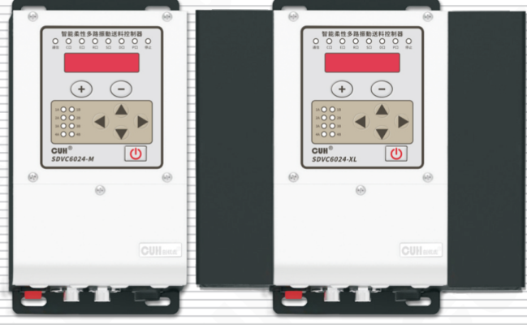

## SDVC60 系列

# 用户手册

### 第 2 页

智能柔性多路振动送料控制器　　　　　　　　　　　　　　　　SDVC60 系列

---

## 版权说明

南京创优科技有限责任公司保留所有权利。

本用户手册上包含的所有信息是属于本公司的知识，受著作权法及所有法律的保护。本公司根据著作权法及其他法律享有并保留所有著作权和其他法律赋予的权利，未经本公司书面同意不得以任何形式对本用户手册的部分或全部进行抄袭、翻译、转译、仿制或其他利用。

## 免责声明

本用户手册的所有内容仅说明本公司生产的相关产品的使用方法，并且是根据现有技术和提供给您使用时的状态进行描述的，在您使用本产品时必须自行承担相关风险。除法律强制规定外，本公司不因本用户手册对产品负有任何明示或暗示的责任，包括但不限于人身伤害、财产损失、机会丧失。

您明确了解上述风险并同意，除法律强制规定外，本公司无须为您的任何直接、间接的损害或损失负责（包括但不限于人员、财物、数据等有形损失和名誉、机会等无形损失）。

本公司保留对本用户手册中所适用的产品进行修改而不预先及事后通知的权利。

---

2022-04　　　　　　　　　　　　　　　　　　　　　　　　　SDVC60SMSCN_1.01

### 第 3 页

智能柔性多路振动送料控制器　　　　　　　　　　　　　　　　　SDVC60 系列

---

# 序　言

感谢您使用南京创优科技有限责任公司（在本手册中以下简称本公司）出品的 SDVC60 系列智能柔性多路振动送料控制器（在本手册中以下简称本产品、本控制器或控制器）。本系列控制器是采用高品质元件并融合了最新的电子技术，采用高性能的数字信号处理器经过精心的设计而成。

本手册介绍了本产品的基本操作方法、功能技术说明和典型应用示例。为用户提供安装调试、参数设置、异常诊断、故障排除及日常维护控制器的相关信息。为了确保正确安装和使用本控制器，请在装机之前仔细阅读本用户手册，并请妥善保存。

以下符号提醒您注意有关防止人身伤害和产品损坏的事项，请务必阅读。

| 符号 | 含义 |
|---|---|
| ⚠️ 危险 | 表示若不遵守该事项，将导致人员伤亡。 |
| ⚠️ 警告 | 表示若不遵守该事项，可能导致人员伤亡。 |
| ⚠️ 小心 | 表示若不遵守该事项，可能导致人员遭受中度或轻微伤害。 |
| 注意 | 表示若不遵守该事项，将导致本产品损坏及财产损失。 |
| ！要点 | 表示在使用过程中必须要遵守的注意事项和使用限制等。 |

## 本说明书适合以下型号控制器：

◆ 智能柔性多路振动送料控制器　SDVC6014-M（1组4路输出，最大总电流1*3A）

◆ 智能柔性多路振动送料控制器　SDVC6024-M（2组4路输出，最大总电流2*3A）

◆ 智能柔性多路振动送料控制器　SDVC6014-XL（1组4路输出，最大总电流1*6A）

◆ 智能柔性多路振动送料控制器　SDVC6024-XL（2组4路输出，最大总电流2*6A）

---

2022-04　　　　　　　　　　　　　　　　　SDVC60SMSCN_1.01

### 第 4 页

智能柔性多路振动送料控制器　　　　　　　　　　　　　　　　　SDVC60 系列

# 安全与预防措施

1、**危险** 本产品仅用于驱动基于电磁铁的振动送料设备，请勿将本产品用于保护人体或人体部位等目的。

2、**危险** 本产品不得作为防爆产品使用，请勿在危险场所和/或潜在爆炸气体环境中使用。

3、**警告** 本产品是采用交流市电供电的设备，请勿施加交流电压超过 260Vac。施加过大的输入电压如380Vac，则可能导致产品爆炸或者着火，造成严重的安全事故。

4、**警告** 本产品是通过电源线进行接地的，请确保为控制器供电的配电设施具备良好的接地，否则可能导致控制器外壳带电，造成触电事故。

5、**警告** 请勿输入交流电源到本控制器的输出端，这会损坏控制器。

6、**警告** 请勿在带电的情况下插拔接线或触摸接线仓内各接线端子触点，以防发生触电事故。

7、**注意** 请避免采用通过继电器等设备切断供电的方式来控制本产品的输出，这会严重降低本控制器的寿命。

8、**注意** 本产品设计使用于阴凉干燥环境，请勿将本产品置于室外、可能会浸水、阳光暴晒场所工作，也不要在超过本产品电气特性要求的温度和湿度范围之外工作。

9、**要点** 请务必将本产品固定在可靠接地的坚固平台上, 并远离振动设备。

10、**要点** 任何情况下请勿将本产品在超越设计极限状态下工作。

11、**要点** 请严格按照本手册的说明操作，对于违反这些操作说明所造成的任何人身伤害或财产损失，本公司不承担任何民事和刑事责任。

12、**要点** 任何情况下请不要打开本控制器机壳，以防遭到电击。机壳内部没有可以调节和用户维修部分，请不要试图维修本机，出现故障请致电本公司。

---

2022-04　　　　　　　　　　　　　　　　　　　　　　　SDVC60SMSCN_1.01

### 第 5 页

智能柔性多路振动送料控制器　　　　　　　　　　　　　　　　SDVC60 系列

---

# 工作与储存环境

## 一、使用前的检查

每台控制器在出厂前，均经过严格的品质检验，并经过强化的防撞包装处理。客户在拆箱后，请即刻进行下列检查：

1、检查控制器是否在运输过程中受到损伤。

2、检查控制器型号是否与订货登记资料完全相同。

## 二、工作环境

为使本控制器具有更好的使用效果和更长的使用寿命，请将控制器安装在符合下列条件的环境中：

●良好的通风散热环境

●远离水滴、蒸气、灰尘，（特别是油性灰尘）

●无腐蚀、易燃性的气体、液体

●无漂浮性的尘埃及金属微粒

●安装表面坚固无振动

●远离电磁噪声干扰

●使用环境温度为0℃到40℃

●仅适用于海拔2000m以下地区安全使用

---

2022-04　　　　　　　　　　　　　　　　　　　　　　　　SDVC60SMSCN_1.01

### 第 6 页

智能柔性多路振动送料控制器　　　　　　　　　　　　　　　　SDVC60 系列

---

---

2022-04　　　　　　　　　　　　　　　　　　　　　　　　　SDVC60SMSCN_1.01

### 第 7 页

智能柔性多路振动送料控制器　　　　　　　　　　　　　　　　SDVC60 系列

---

# 目　录

**第一章 使用前须知** -----------------------------------------------------------------------------1

　　1.1　检查包装内容 -----------------------------------------------------------------------------1

　　1.2　指示灯、按键及外部部件说明 ---------------------------------------------------------2

　　1.3　接线端口说明 -----------------------------------------------------------------------------3

　　1.4　控制器铭牌说明 --------------------------------------------------------------------------3

**第二章 产品介绍** -----------------------------------------------------------------------------------4

　　2.1　产品简介 -----------------------------------------------------------------------------------4

**第三章 安装及使用指南** ------------------------------------------------------------------------5

　　3.1　控制器使用条件 --------------------------------------------------------------------------5

　　3.2　按键基本操作 -----------------------------------------------------------------------------5

　　3.3　安装使用 -----------------------------------------------------------------------------------6

**第四章 程式段参数功能说明** ----------------------------------------------------------------9

　　4.1　程式段参数设置 -------------------------------------------------------------------------10

**第五章 公共参数功能说明** ------------------------------------------------------------------15

　　5.1　传感器设置 -------------------------------------------------------------------------------15

　　5.2　控制输出设置 ----------------------------------------------------------------------------17

**第六章 高级参数功能说明** ------------------------------------------------------------------25

　　6.1　RS485通信设置 -------------------------------------------------------------------------25

　　6.2　边沿触发次数 ----------------------------------------------------------------------------26

　　6.3　恢复出厂设置 ----------------------------------------------------------------------------27

**第七章 控制器搭配振动盘简易操作说明** --------------------------------------------28

　　7.1　通过控制器搭配振动盘实现设计动作 ----------------------------------------------28

---

2022-04　　　　　　　　　　　　　　　　　　　　　　　　　SDVC60SMSCN_1.01

### 第 8 页

智能柔性多路振动送料控制器　　　　　　　　　　　　　　　　　　　　　　　　　SDVC60 系列

---

**第八章 技术规格** ------------------------------------------------------------------ 32

　　8.1　外形尺寸 ------------------------------------------------------------------- 32

　　8.2　技术规格表 ----------------------------------------------------------------- 35

　　8.3　参考标准 ------------------------------------------------------------------- 36

**第九章 附录** ---------------------------------------------------------------------- 37

　　9.1　参数列表 ------------------------------------------------------------------- 37

　　9.2　输入输出电路图 ------------------------------------------------------------- 39

　　9.3　故障诊断 ------------------------------------------------------------------- 40

**第十章 产品质保信息** -------------------------------------------------------------- 41

　　10.1　质保期 -------------------------------------------------------------------- 41

　　10.2　保修范围 ------------------------------------------------------------------ 41

　　10.3　产品适用性 ---------------------------------------------------------------- 41

---

2022-04　　　　　　　　　　　　　　　　　　　　　　　　　　　　SDVC60SMSCN_1.01

### 第 9 页

智能柔性多路振动送料控制器　　　　　　　　　　　　　　　　SDVC60 系列

# 第一章 使用前须知

本章节介绍产品包装内容、控制器外观说明和控制器铭牌信息。

## 1.1 检查包装内容

使用本产品之前，请检查控制器及附件的完整性。如果发现产品有缺陷或已损坏、附件缺失等问题，请与本公司联系。

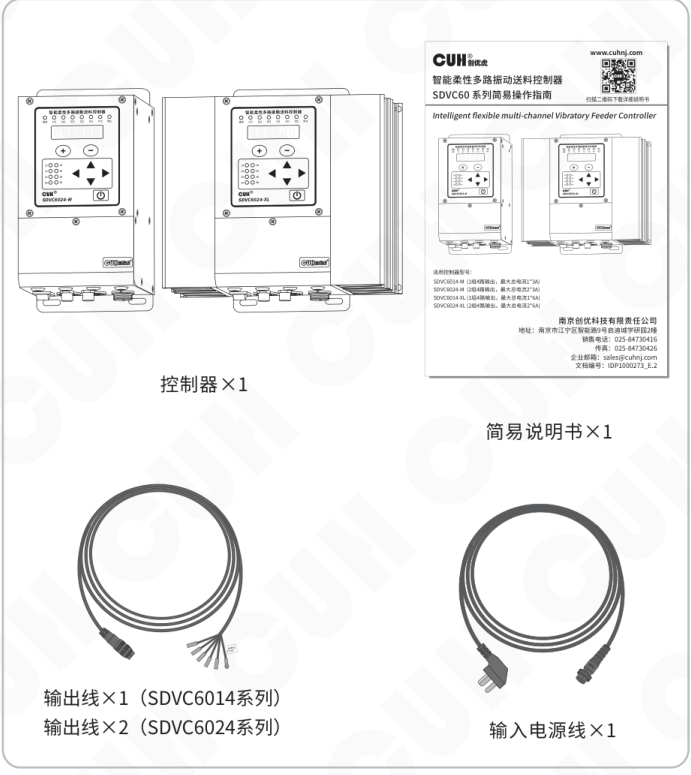

包装内容：

- 控制器×1
- 简易说明书×1
- 输出线×1（SDVC6014系列）
- 输出线×2（SDVC6024系列）
- 输入电源线×1

---

2022-04　　　　　　　　　　　　- 1 -　　　　　　　　　　　　SDVC60SMSCN_1.01

### 第 10 页

智能柔性多路振动送料控制器　　　　　　　　　　　　　　SDVC60 系列

---

## 1.2 指示灯、按键及外部部件说明

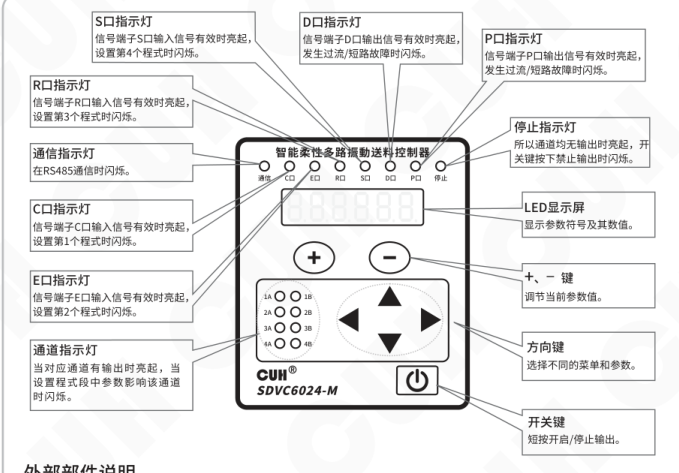

| 名称 | 说明 |
|---|---|
| S口指示灯 | 信号端子S口输入信号有效时亮起，设置第4个程式时闪烁。 |
| D口指示灯 | 信号端子D口输出信号有效时亮起，发生过流/短路故障时闪烁。 |
| P口指示灯 | 信号端子P口输出信号有效时亮起，发生过流/短路故障时闪烁。 |
| 停止指示灯 | 所有通道均无输出时亮起，开关键按下禁止输出时闪烁。 |
| LED显示屏 | 显示参数符号及其数值。 |
| +、- 键 | 调节当前参数值。 |
| 方向键 | 选择不同的菜单和参数。 |
| 开关键 | 短按开启/停止输出。 |
| R口指示灯 | 信号端子R口输入信号有效时亮起，设置第3个程式时闪烁。 |
| 通信指示灯 | 在RS485通信时闪烁。 |
| C口指示灯 | 信号端子C口输入信号有效时亮起，设置第1个程式时闪烁。 |
| E口指示灯 | 信号端子E口输入信号有效时亮起，设置第2个程式时闪烁。 |
| 通道指示灯 | 当对应通道有输出时亮起，当设置程式段中参数影响该通道时闪烁。 |

### 外部部件说明

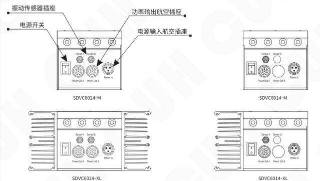

外部部件标注：

- 振动传感器插座
- 电源开关
- 功率输出航空插座
- 电源输入航空插座

图中型号：

- SDVC6024-M
- SDVC6014-M
- SDVC6024-XL
- SDVC6014-XL

---

2022-04　　　　　　　　　　- 2 -　　　　　　　　　　SDVC60SMSCN_1.01

### 第 11 页

智能柔性多路振动送料控制器　　　　　　　　　　　　　　　　　SDVC60 系列

## 1.3 接线端口说明

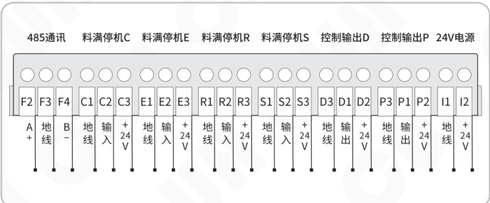

| 功能区域 | 端子1 | 定义1 | 端子2 | 定义2 | 端子3 | 定义3 |
|---|---|---|---|---|---|---|
| 485通讯 | F2 | A+ | F3 | 地线 | F4 | B- |
| 料满停机C | C1 | 地线 | C2 | 输入 | C3 | +24V |
| 料满停机E | E1 | 地线 | E2 | 输入 | E3 | +24V |
| 料满停机R | R1 | 地线 | R2 | 输入 | R3 | +24V |
| 料满停机S | S1 | 地线 | S2 | 输入 | S3 | +24V |
| 控制输出D | D3 | 地线 | D1 | 输出 | D2 | +24V |
| 控制输出P | P3 | 地线 | P1 | 输出 | P2 | +24V |
| 24V电源 | I1 | 地线 | I2 | +24V |  |  |

## 1.4 控制器铭牌说明

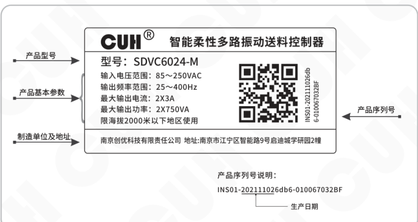

| 标注项 | 图中内容 |
|---|---|
| 产品型号 | 型号：SDVC6024-M |
| 产品基本参数 | 输入电压范围：85～250VAC 输出频率范围：25～400Hz 最大输出电流：2X3A 最大输出功率：2X750VA 限海拔2000米以下地区使用 |
| 制造单位及地址 | 南京创优科技有限责任公司　地址:南京市江宁区智能路9号启迪城学研园2幢 |
| 产品序列号 | INS01-202111026db6-010067032BF |

产品序列号说明：

`INS01-202111026db6-010067032BF`

其中图中括号标注部分为：生产日期。

---

2022-04　　　　　　　　　　　　　　　- 3 -　　　　　　　　　　　　　　　SDVC60SMSCN_1.01

### 第 12 页

智能柔性多路振动送料控制器　　　　　　　　　　　　　　　　　SDVC60 系列

# 第二章 产品介绍

本章节主要内容包括本产品的简单介绍和主要特色功能。

## 2.1 产品简介

SDVC60系列智能柔性多路振动送料控制器是一款专为柔性送料系统设计的产品，通过采用最新的电子技术和精心的设计，提供独特的性能。其特色功能包括：

- 提供一组或两组功率输出，每组可以驱动四路电磁铁控制一个柔性送料振动盘。

- 具备两组功率输出的型号可以连接最多8个电磁铁控制一个柔性振动盘。

- 每组的四路输出支持同时同频输出，且相位差为0。

- 两组输出之间可以同频锁相输出，且两组之间的相位差可在程式段中设置为-180°~180°。

- 控制器输出设计四个程式，每个程式包括9个程式段。每个程式段可以独立设置使能、输出频率、通道电压、缓启动时间、保持时间、缓关闭时间、波形指数、相位差。

- 程式选择与运行支持外部开关传感器信号控制，且传感器类型可以设置或自动识别。

- 程式运行可以内部自动触发也支持外部S口信号触发，触发次数可以通过参数设置。

- 两路控制输出支持NPN、PNP、推挽三种工作模式，支持选择多种信号源。

- RS485接口支持Modbus ASCII和RTU两种协议，可联网控制所有参数。

---

2022-04　　　　　　　　　　　　　　- 4 -　　　　　　　　　　　　　　SDVC60SMSCN_1.01

### 第 13 页

智能柔性多路振动送料控制器　　　　　　　　　　　　　　　SDVC60 系列

# 第三章　安装及使用指南

本章节介绍本产品使用所必须具备的条件以及如何正确进行安装与连接。

## 3.1 控制器使用条件

本产品是使用交流220V供电的设备，且通过电源线三爪插头进行保护接地连接，请提供符合标准的220V，50Hz/60Hz市电供电配电设施并确保保护地线已正确连接。

⚠️ **警告**　切不可将控制器连接到380V交流电，这将造成控制器不可恢复的严重损坏，有可能导致爆炸、火灾等安全事故。

⚠️ **警告**　确保供电侧可靠接地，控制器的金属外壳是与保护接地线直接连接的，接地不良会导致控制器外壳带电，引发触电事故。

**注意**　控制器长时间工作会产生热量致使外壳温度升高，请将控制器安装在通风良好的环境中，并将其固定良好，远离振动源。

**注意**　本产品是用来驱动电磁铁的控制器，切不可连接音圈电机或压电振动盘。

## 3.2 按键基本操作

【短按】定义为按下按键的时间大于0.1秒小于2秒。

【长按】定义为按下按键的时间大于2秒。

同时长按 ◀ 和 ▶ 进入程式段参数设置界面。

同时短按 ◀ 和 ▶ 切换不同的程式，短按 ◀ 或 ▶ 切换不同程式段。

同时长按 ◀ 和 ▲ 进入公共参数设置界面。

同时长按 ▶ 和 ▲ 进入高级参数设置界面。

短按 ▲ 或 ▼ 选择参数，短按 ⊕ 或 ⊖ 调整参数值。

待机界面上短按 ▲ 或 ▼ 切换显示参数。

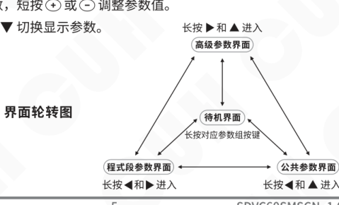

2022-04　　　　　　　　　　　　- 5 -　　　　　　　　　　　　SDVC60SMSCN_1.01

### 第 14 页

智能柔性多路振动送料控制器　　　　　　　　　　　　　　　　　　　　　　　　　SDVC60 系列

---

### 3.3 安装使用

**第一步：**

打开控制器的外包装，检查控制器外观及侧标型号，判断是否为所需的型号。

**第二步：**

取出取出输出线，结合下图中的负载接线图正确连接负载。将输出线的接线端子连接到振动盘的电磁线圈上。并确认黄绿双色的地线与振动盘金属外壳可靠连接。

B组接线方式与A组相同。

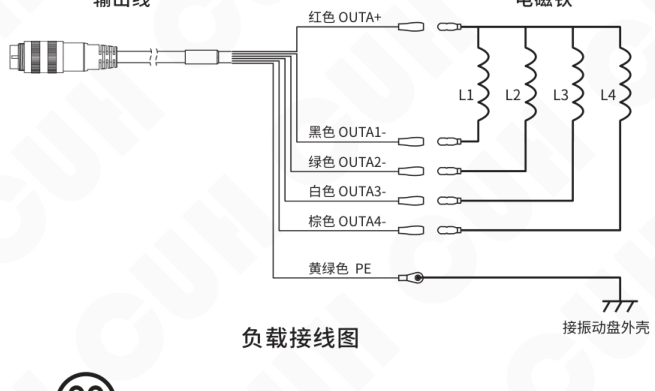

**注意**

1、一定要确认电磁铁线圈接在输出引脚上，外壳需要可靠接地。否则将会导致机壳带电，可能发生严重安全事故。

2、电源输出禁止连接压电类负载，否则可能导致**电击安全事故！**

---

2022-04　　　　　　　　　　　　　　　- 6 -　　　　　　　　　　　　　　　SDVC60SMSCN_1.01

### 第 15 页

智能柔性多路振动送料控制器　　　　　　　　　　　　　　SDVC60 系列

---

**第三步：**

将输入电源线航空插头插入控制器电源输入插座，并锁紧螺母。

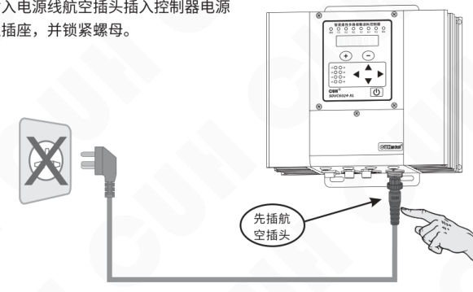

**第四步：**

确认开关处于关闭位置后，将电源线三爪插头插在供电电源插座上。

---

2022-04　　　　　　　　　　　　- 7 -　　　　　　　　　　　　SDVC60SMSCN_1.01

### 第 16 页

智能柔性多路振动送料控制器　　　　　　　　　　　　　　　　　SDVC60 系列

---

**第五步：**

打开控制器电源开关，此时应该显示当前程式段（默认 CP-空-空）。振动盘此时无振动，待程式段设置完毕后振动盘开始工作。

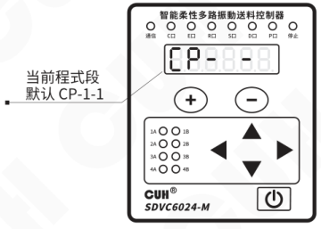

**备注：** 具体程式段参数设置详见本说明书其他章节。

🙂

- 控制器设置完成后，可返回待机参数界面，通过短按 ▲ 或 ▼ 监控不同的待机参数值。待机参数包括：当前程式段、A组温度显示AC、b组温度显示bC和母线电压PU。
- 此界面下的参数值不可调节。

---

2022-04　　　　　　　　　　　　　　　　　- 8 -　　　　　　　　　　　　　　　　　SDVC60SMSCN_1.01

### 第 17 页

智能柔性多路振动送料控制器　　　　　　　　　　　　　　　　　SDVC60 系列

# 第四章 程式段参数功能说明

本章节介绍本控制器在程式段参数界面下的使用方法。

**程式：** 表示控制器循环输出的一组动作，最多可以包含9个程式段（9个子动作）。

**程式段：** 表示在程式下面所有的子程式即子动作。本控制器包含的程式段参数有：输出频率、通道电压、缓启动时间、保持时间、缓关闭时间、波形指数和B组参考A组相位差（SDVC6024系列）。

| 程式 |  |  |
|---|---|---|
| **程式段 1E** | ~ | **程式段 9E** |
| 1E 程式段使能 |  | 9E 程式段使能 |
| 1F 电磁铁频率 |  | 9F 电磁铁频率 |
| 1U 电磁铁1A电压 |  | 9U 电磁铁1A电压 |
| 1U 电磁铁2A电压 |  | 9U 电磁铁2A电压 |
| 1U 电磁铁3A电压 |  | 9U 电磁铁3A电压 |
| 1U 电磁铁4A电压 |  | 9U 电磁铁4A电压 |
| 1U 电磁铁1B电压（SDVC6024系列） |  | 9U 电磁铁1B电压（SDVC6024系列） |
| 1U 电磁铁2B电压（SDVC6024系列） |  | 9U 电磁铁2B电压（SDVC6024系列） |
| 1U 电磁铁3B电压（SDVC6024系列） |  | 9U 电磁铁3B电压（SDVC6024系列） |
| 1U 电磁铁4B电压（SDVC6024系列） |  | 9U 电磁铁4B电压（SDVC6024系列） |
| 1t 缓启动时间 |  | 9t 缓启动时间 |
| 1h 保持时间 |  | 9h 保持时间 |
| 1反t 缓关闭时间 |  | 9反t 缓关闭时间 |
| 1r 电磁铁A组波形指数 |  | 9r 电磁铁A组波形指数 |
| 1r 电磁铁B组波形指数（SDVC6024系列） |  | 9r 电磁铁B组波形指数（SDVC6024系列） |
| 1μ 电磁铁B组参考A组相位差 （SDVC6024系列） |  | 9μ 电磁铁B组参考A组相位差 （SDVC6024系列） |

2022-04　　　　　　　　　　　　　　　　- 9 -　　　　　　　　　　　　　　　　SDVC60SMSCN_1.01

### 第 18 页

智能柔性多路振动送料控制器 SDVC60 系列

## 4.1 程式段参数设置

» 同时长按 ◀ 和 ▶，进入程式段参数调整界面。

» 控制器面板上 C口（程式1）指示灯闪烁，表示此时调整程式1内参数。

» 同时短按 ◀ 和 ▶，切换不同的程式：程式1（C口）、程式2（E口）、程式3（R口）、程式4（S口），同时对应的指示灯闪烁。

» 短按 ▲ 或 ▼，调整当前程式中的参数。

» 通过 ⊕ 或 ⊖ 可以调整程式参数值。

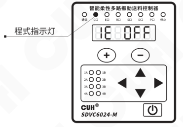

● **程式段使能1E：** 用于设置每个程式段使能开启或关闭。

» 同时长按 ◀ 和 ▶，进入程式段参数调整界面。

» 短按 ◀ 或 ▶，进入程式段使能界面，可切换1E~9E共9个程式段。

» 通过 ⊕ 或 ⊖ 调整每个程式段使能，On表示使能，即工作，Off表示禁止，即不工作。

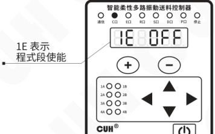

2022-04 SDVC60SMSCN_1.01

### 第 19 页

智能柔性多路振动送料控制器　　　　　　　　　　　　　　　　　SDVC60 系列

---

- **输出频率1F：** 设置所有电磁铁的频率。

  - » 同时长按 ◀ 和 ▶，进入程式段参数调整界面。
  - » 短按 ▲ 或 ▼ 进入输出频率设置界面，此时绿色指示灯全部闪烁。
  - » 通过 ⊕ 或 ⊖ 调整参数值。

  图示：

  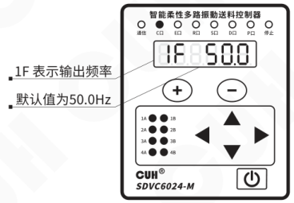

  - 1F 表示输出频率
  - 默认值为50.0Hz
  - 频率范围是25.0～400.0Hz，调整精度0.1Hz。

- **通道电压1U：** 设置某一程式内每个通道输出电压值。

  - » 同时长按 ◀ 和 ▶，进入程式段参数调整界面。
  - » 短按 ▲ 或 ▼ 进入通道电压设置界面。
  - » 通过 ⊕ 或 ⊖ 调整参数值。
  - » 短按 ▲ 或 ▼ 切换本程式段中其他通道电压设置，此时对应通道指示灯闪烁。

  图示：

  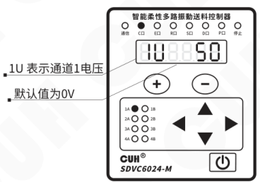

  - 1U 表示通道1电压
  - 默认值为0V
  - 通道电压范围是0~250V，调整精度1V。

---

2022-04　　　　　　　　　　　　　-11-　　　　　　　　　　　　　SDVC60SMSCN_1.01

### 第 20 页

智能柔性多路振动送料控制器　　　　　　　　　　　　　　　　　SDVC60 系列

---

● **缓启动时间1t/缓关闭时间1t：** 设置该程式段内所有通道输出电磁铁的缓启动时间或缓关闭时间。本控制器切换工作状态或关闭时，输出电压可以平缓到达设定值，以防止设备遭到冲击。

- 同时长按 ◀ 和 ▶，进入程式段参数调整界面。
- 短按 ▲ 或 ▼ 进入缓启动/缓关闭时间设置界面，此时绿色指示灯全部闪烁。
- 通过 ＋ 或 － 调整参数值。

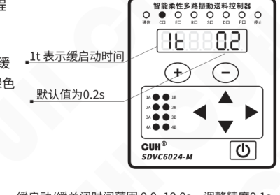

缓启动/缓关闭时间范围 0.0~10.0s，调整精度0.1s。

● **保持时间1h：** 设置该程式段保持工作状态的时间。

- 同时长按 ◀ 和 ▶，进入程式段参数调整界面。
- 短按 ▲ 或 ▼ 进入保持时间设置界面，此时绿色指示灯全部闪烁。
- 通过 ＋ 或 － 调整参数值。

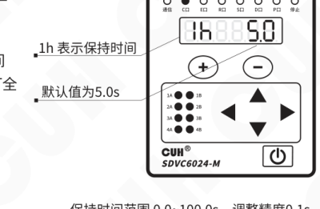

保持时间范围 0.0~100.0s，调整精度0.1s。

---

2022-04　　　　　　　　　　　　　　　　　-12-　　　　　　　　　　　　　　　　　SDVC60SMSCN_1.01

### 第 21 页

智能柔性多路振动送料控制器　　　　　　　　　　　　　　　　　　　　　　　　　SDVC60 系列

● **波形指数1r：** 设置程式段内输出电流的波形指数。本控制器可以在最高效率-最大功率和最小噪音的性能间进行连续的平衡，以满足客户更高的需求。

> » 同时长按 ◀ 和 ▶，进入程式段参数调整界面。
>
> » 短按 ▲ 或 ▼ 进入波形指数设置界面。
>
> » 通过 ⊕ 或 ⊖ 调整参数值。
>
> » 短按 ▲ 或 ▼ 切换通道A和通道B，此时对应通道指示灯闪烁。
>
> `1r` 表示通道A时间  
> 默认值为100  
> 波形指数调整范围 0~100，调整精度1。
>
> 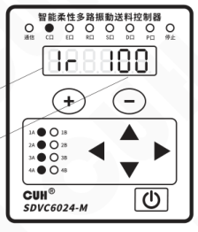

🙂

- 波形指数取值0时具有最高效率，弹簧受到的应力最小。
- 取值为100时可以取得最大额定输出功率和最小噪音，但弹簧将会受到较大的应力。

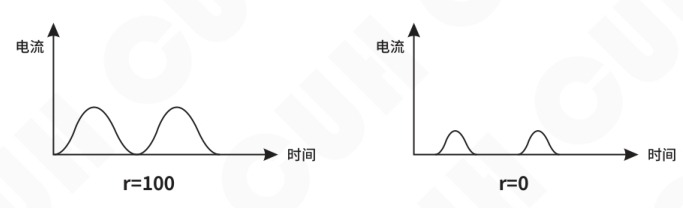

**波形指数示意图**

2022-04　　　　　　　　　　　　　　　　　-13-　　　　　　　　　　　　　　　　　SDVC60SMSCN_1.01

### 第 22 页

智能柔性多路振动送料控制器　　　　　　　　　　　　　　　　　SDVC60 系列

● **B组参考A组相位差1μ：** 设置程式段内两组输出，通道B与通道A之间的相位差。

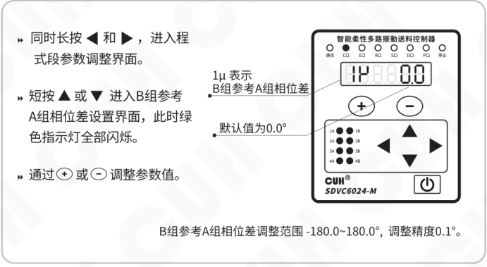

- 同时长按 ◀ 和 ▶，进入程式段参数调整界面。
- 短按 ▲ 或 ▼ 进入B组参考A组相位差设置界面，此时绿色指示灯全部闪烁。
- 通过 ⊕ 或 ⊖ 调整参数值。

图示说明：

- **1μ 表示：** B组参考A组相位差
- **默认值为：** 0.0°
- **B组参考A组相位差调整范围：** -180.0~180.0°，调整精度0.1°。

2022-04　　　　　　　　　　　　　　　　　-14-　　　　　　　　　　　　　　　　　SDVC60SMSCN_1.01

### 第 23 页

# 第五章 公共参数功能说明

本章节介绍本产品在公共参数界面下的使用方法，主要包含传感器、控制输出和触发方式等的使用介绍。

## 5.1 传感器设置

- **输入传感器类型：** 料满停机端口支持 NPN、PNP、Ut1、Ut0 模式。其中：

**Ut1模式为单次扫描**，即传感器信号无效前一直通过变换高低电平检测端口是否有效，发现有效信号后确定端口传感器类型且不再扫描。

**Ut0模式为连续扫描**，不管传感器类型如何始终通过变换高低电平检测端口是否接入有效信号。

### 开关传感器连接方式

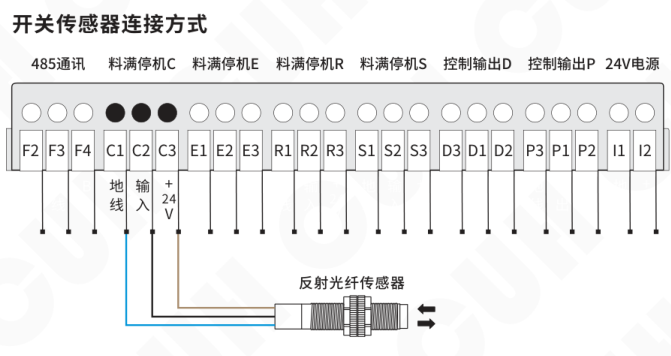

图中示例：反射光纤传感器接入料满停机 C 端口（C1/C2/C3），C1 为地线，C2 为输入，C3 为 +24V。

### 输入传感器类型设置操作

- 同时长按 `▶` 和 `▲`，进入高级参数调整界面。
- 短按 `▲` 或 `▼`，切换到输入传感器类型设置界面。
- 通过 `＋` 或 `－` 切换输入传感器类型。
- `ΓA` 表示输入传感器类型。
- 默认类型为 `ut1`。

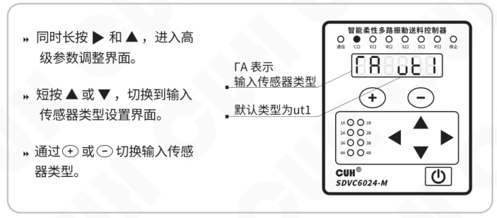

### 第 24 页

智能柔性多路振动送料控制器　　　　　　　　　　　　　　　SDVC60 系列

---

- **输入端口C/E/R/S开延时、关延时：** 当控制器接收输入端口C/E/R/S信号后，设置信号的开延时、关延时时间值。

  - 同时长按 ◀ 和 ▲，进入公共参数调整界面。
  - 短按 ▲ 或 ▼，切换到输入端口C/E/R/S开延时设置界面 `JC/JE/Jr/JS` 或输入端口C/E/R/S关延时设置界面 `LC/LE/Lr/LS`。
  - 通过 `+` 或 `−` 调整参数值。

  **图示说明：**

  - `JC` 表示输入端口C开延时
  - 默认值为 `0.1s`

  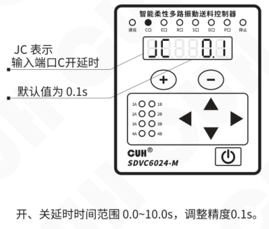

  开、关延时时间范围 `0.0~10.0s`，调整精度 `0.1s`。

---

2022-04　　　　　　　　　　　　　　-16-　　　　　　　　　　　　　　SDVC60SMSCN_1.01

### 第 25 页

智能柔性多路振动送料控制器　　　　　　　　　　　　　　　　　　　　　　　　　SDVC60 系列

## 5.2 控制输出设置

● **控制输出D/P逻辑信号源：** 设置控制输出端口选择的逻辑信号源。

- 同时长按 ◀ 和 ▲，进入公共参数调整界面。
- 短按 ▲ 或 ▼，切换到控制输出D/P逻辑信号源设置界面。
- 通过 ⊕ 或 ⊖ 切换逻辑信号源输入信号值，信号源表如下：

图示说明：

- d 表示控制输出D逻辑信号源
- 默认端口为 t1

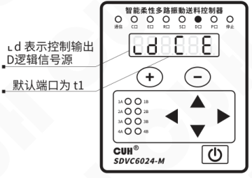

| 信号源 | 含义 |
|---|---|
| 0 | 低电平 |
| 1 | 高电平 |
| C | 取料满停机C口状态 |
| E | 取料满停机E口状态 |
| r | 取料满停机R口状态 |
| S | 取料满停机S口状态 |
| -C | 取料满停机C口相反状态 |
| -E | 取料满停机E口相反状态 |
| -r | 取料满停机R口相反状态 |
| -S | 取料满停机S口相反状态 |
| A1 | 取输出A1状态 |
| A2 | 取输出A2状态 |
| A3 | 取输出A3状态 |
| A4 | 取输出A4状态 |
| b1 | 取输出b1状态（SDVC6024机型） |
| b2 | 取输出b2状态（SDVC6024机型） |
| b3 | 取输出b3状态（SDVC6024机型） |
| b4 | 取输出b4状态（SDVC6024机型） |
| Od | D口常开状态 |
| OP | P口常开状态 |

2022-04　　　　　　　　　　　　　　　　　-17-　　　　　　　　　　　　　　　　　SDVC60SMSCN_1.01

### 第 26 页

智能柔性多路振动送料控制器　　　　　　　　　　　　　　　　　SDVC60 系列

---

- **控制输出D/P逻辑关系：** 设置控制输出端口逻辑信号源之间的逻辑关系。

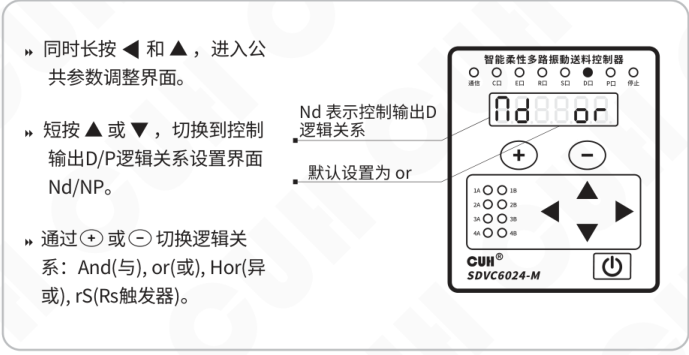

  - 同时长按 ◀ 和 ▲，进入公共参数调整界面。
  - 短按 ▲ 或 ▼，切换到控制输出D/P逻辑关系设置界面 **Nd/NP**。
  - 通过 ＋ 或 － 切换逻辑关系：**And(与)、or(或)、Hor(异或)、rS(RS触发器)**。
  - **Nd** 表示控制输出D逻辑关系。
  - 默认设置为 **or**。

- **控制输出D/P逻辑方向：** 设置控制输出端口逻辑信号的方向。可设置为同相或反相（取反状态）。

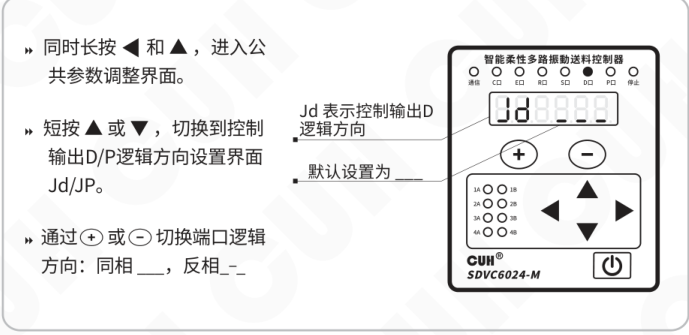

  - 同时长按 ◀ 和 ▲，进入公共参数调整界面。
  - 短按 ▲ 或 ▼，切换到控制输出D/P逻辑方向设置界面 **Jd/JP**。
  - 通过 ＋ 或 － 切换端口逻辑方向：同相 **___**，反相 **_-_**。
  - **Jd** 表示控制输出D逻辑方向。
  - 默认设置为 **___**。

---

2022-04　　　　　　　　　　　　　　　　　-18-　　　　　　　　　　　　　　　　　SDVC60SMSCN_1.01

### 第 27 页

- **控制输出D/P开延时、关延时**：设置控制输出端口的开延时、关延时时间值。设置方法可参考传感器输入端口的开、关延时设置。

操作步骤：

- 同时长按 ◀ 和 ▲，进入公共参数调整界面。
- 短按 ▲ 或 ▼，切换到控制输出D/P开延时设置界面 `↓d/↓P`，或控制输出D/P关延时设置界面 `↑d/↑P`。
- 通过 `+` 或 `−` 调整参数值。

显示说明：

- `d` 表示控制输出D开延时，默认值为 0.1s。
- `P` 表示控制输出P关延时，默认值为 0.1s。

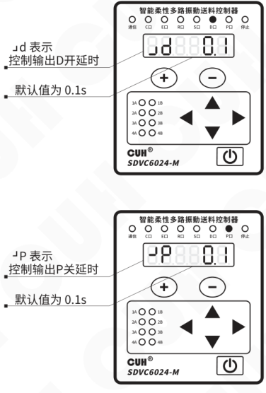

开、关延时时间范围 0.0~10.0s，调整精度0.1s。

### 第 28 页

智能柔性多路振动送料控制器　　　　　　　　　　　　　　SDVC60 系列

---

- **控制输出D/P关延时模式：** 设置控制输出端口的关延时模式：延时模式、保持模式。

**延时模式：** 指驱动控制输出的信号由有效变为无效后，控制输出经过一段关延时时间后变为关闭状态。

**保持模式：** 指驱动控制输出的信号变为有效后，控制输出在关延时时间内保持打开，超过关延时时间后变为关闭的状态。

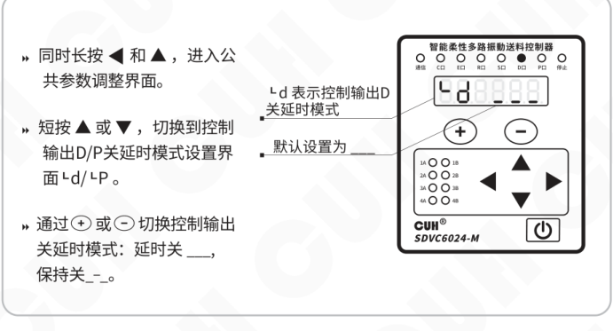

图中说明：

- 同时长按 ◀ 和 ▲，进入公共参数调整界面。
- 短按 ▲ 或 ▼，切换到控制输出D/P关延时模式设置界面 `d/P`。
- 通过 `+` 或 `−` 切换控制输出关延时模式：延时关 `___`，保持关 `_-_`。
- `d` 表示控制输出D关延时模式。
- 默认设置为 `___`。

---

2022-04　　　　　　　　　　　　-20-　　　　　　　　　　　　SDVC60SMSCN_1.01

### 第 29 页

● **控制输出D/P传感器类型**：设置控制输出端口传感器类型：NPN、PNP和推挽 PSPU（默认设置）。其中：

NPN输出有效为低电平，输出无效为高阻态；

PNP输出有效为高电平，输出无效为高阻态；

推挽输出有效为高电平，无效为低电平。

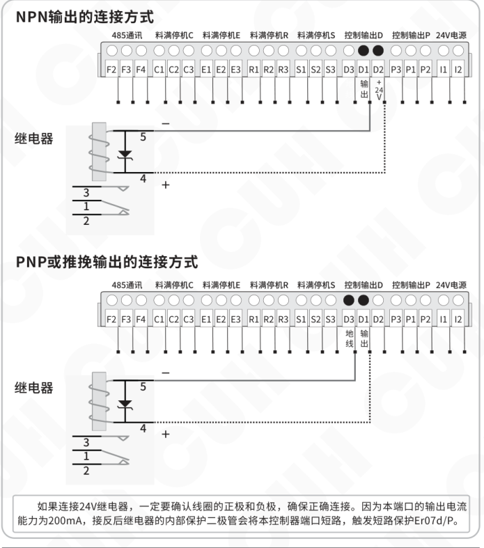

> 如果连接24V继电器，一定要确认线圈的正极和负极，确保正确连接。因为本端口的输出电流能力为200mA，接反后继电器的内部保护二极管会将本控制器端口短路，触发短路保护Er07d/P。

### 第 30 页

智能柔性多路振动送料控制器　　　　　　　　　　　　　　　　　　　　SDVC60 系列

### 控制输出逻辑图：

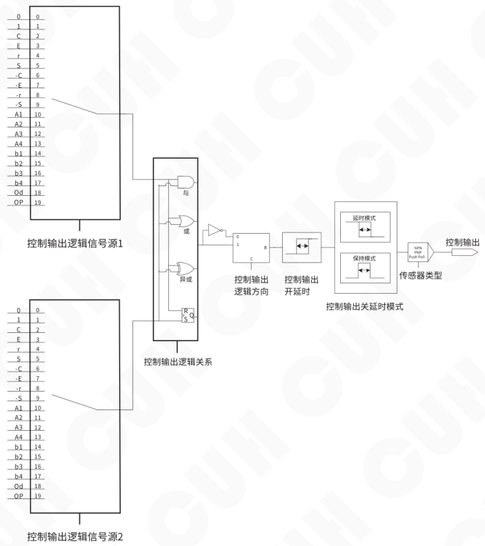

2022-04　　　　　　　　　　　　　　　　　-22-　　　　　　　　　　　　　　　　　SDVC60SMSCN_1.01

### 第 31 页

智能柔性多路振动送料控制器　　　　　　　　　　　　　　　　　SDVC60 系列

---

● **程式源：** 设置控制器在程式间快速切换。

- 同时长按 ◀ 和 ▲，进入公共参数调整界面。
- 短按 ▲ 或 ▼，切换到程式源设置界面 PA。
- 通过 ＋ 或 － 选择信号源，列表如下：

- **PA** 表示程式源
- 默认程式源为 **C E**

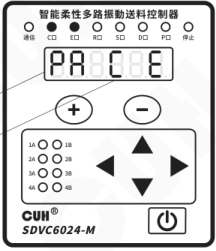

| 信号源 | 含义 |
|---|---|
| 00 | 程式1（C） |
| 01 | 程式2（E） |
| 10 | 程式3（R） |
| 11 | 程式4（S） |
| 0、1、C、E、R、S任选两个 | 客户自定义 |

---

2022-04　　　　　　　　　　　　　　　　　-23-　　　　　　　　　　　　　　　　　SDVC60SMSCN_1.01

### 第 32 页

智能柔性多路振动送料控制器　　　　　　　　　　　　　　　　　　　　　　　　　SDVC60 系列

---

● **触发方式**：设置控制器程式运行触发方式。包括：

**内部电平触发 In__**：程式自动循环运行。

**内部边沿触发 In_-**：程式运行边沿触发次数后停止，程式变化时触发。

**外部 S 口电平触发 ot__**：当 S 口有信号时程式循环运行，S 口无信号时程式不运行。

**外部 S 口边沿触发 ot_-**：当 S 口由无信号变为有信号时程式运行边沿触发次数后停止，再次触发需将 S 口回到无信号再变为有信号方可完成一次触发。

> » 同时长按 ◀ 和 ▲，进入公共参数调整界面。
>
> » 短按 ▲ 或 ▼，切换到触发方式设置界面 `IA`。
>
> » 通过 `＋` 或 `－` 切换触发方式：  
> `In__`、`In_-`、`ot__`、`ot_-`。

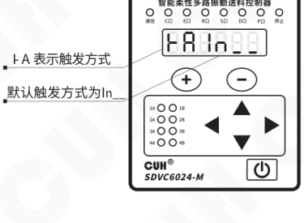

---

2022-04　　　　　　　　　　　　　　　　　　　-24-　　　　　　　　　　　　　　　　　　　SDVC60SMSCN_1.01

### 第 33 页

智能柔性多路振动送料控制器　　　　　　　　　　　　　　　　　　　　　　　　　SDVC60 系列

# 第六章 高级参数功能说明

本章节介绍本产品在高级参数界面下的使用方法。

## 6.1 RS485通信设置

本控制器支持RS485通信，用户连接RS485通信端子后，可以通过上位机对本控制器进行控制和参数的调整。

具体RS485通讯协议设置可参考《SDVC60寄存器地址表》

- **通讯协议：** 本控制器可选通讯协议Modbus RTU或Modbus ASCⅡ。

  - 同时长按 ▶ 和 ▲，进入高级参数调整界面。
  - 短按 ▲ 或 ▼，切换到通讯协议设置界面。
  - 通过 ⊕ 或 ⊖ 切换通讯协议。

  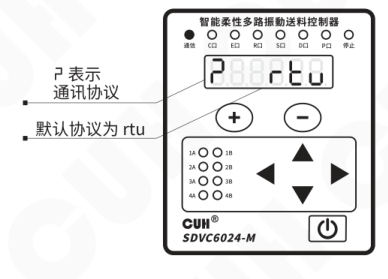

- **波特率：** RS485通信波特率有：0.3, 1.2, 2.4, 9.6, 19.2, 57.6, 115.2 (kbit/s)。

  - 同时长按 ▶ 和 ▲，进入高级参数调整界面。
  - 短按 ▲ 或 ▼，切换到波特率设置界面。
  - 通过 ⊕ 或 ⊖ 调整波特率。

  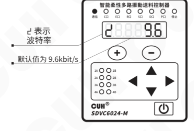

---

2022-04　　　　　　　　　　　　　　　　　-25-　　　　　　　　　　　　　　　　SDVC60SMSCN_1.01

### 第 34 页

智能柔性多路振动送料控制器　　　　　　　　　　　　　　　SDVC60 系列

● **通讯地址**：RS485通信时本机的ID号，以区别同一网络中的其它节点，范围1~31。在通信前请确保同一网络中的控制器通信地址应各不相同。

- 同时长按 ▶ 和 ▲，进入高级参数调整界面。
- 短按 ▲ 或 ▼，切换到通讯地址设置界面「J」。
- 通过 ＋ 或 － 切换地址值。
- 「J」表示通讯地址；默认地址为 1。

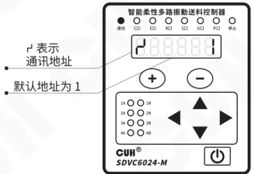

## 6.2 边沿触发次数

● **边沿触发次数**：当控制器公共参数内“触发方式”设置为内部边沿触发或外部S口边沿触发时，本参数用于设置控制器接受到边沿触发信号后程式运行次数。

- 同时长按 ▶ 和 ▲，进入高级参数调整界面。
- 短按 ▲ 或 ▼，切换到边沿触发次数设置界面「C」。
- 通过 ＋ 或 － 切换参数值。
- 「C」表示边沿触发次数；默认值为 1。

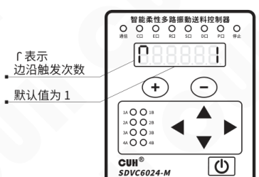

边沿触发次数调整范围 1~255，调整精度1。

---

2022-04　　　　　　　　　　　　-26-　　　　　　　　　　　　SDVC60SMSCN_1.01

### 第 35 页

智能柔性多路振动送料控制器　　　　　　　　　　　　　　　　　　　　　　SDVC60 系列

## 6.3 恢复出厂设置

本功能可以使用户快速将控制器设置为出厂默认设置状态。

由于本控制器功能强大，有数量众多的控制参数可以由用户设定，对于初学者，可能在多次的设定修改后不能恢复控制器的正常工作状态。使用该功能可以快速将调乱的参数状态恢复为出厂默认设置。

» 同时长按 ▶ 和 ▲，进入高级参数调整界面。

» 短按 ▲ 或 ▼，切换到恢复出厂设置界面，此时数码管和 LED 灯全部闪烁。

» 长按 ⊕，直到控制器显示“------”，表示控制器已经重设完毕。

恢复出厂设置参数设定状态：

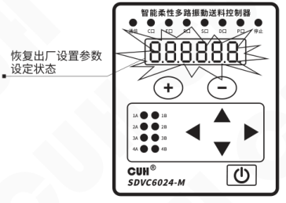

恢复出厂设置参数设定完成：

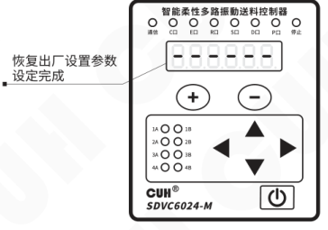

---

2022-04　　　　　　　　　　　　　　　-27-　　　　　　　　　　　　　　　SDVC60SMSCN_1.01

### 第 36 页

智能柔性多路振动送料控制器　　　　　　　　　　　　　　　　　　　　　　　　　SDVC60 系列

## 第七章 控制器搭配振动盘简易操作说明

本章节介绍如何设置控制器相关参数搭配振动盘实现既定动作目标。

### 7.1 通过控制器搭配振动盘实现设计动作

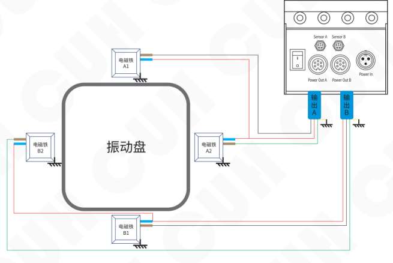

**振动盘俯视示意图**

假设目前计划在一个程式内实现：

① 物料向左聚拢→② 物料左右向中间聚拢→③ 物料向右聚拢→④ 物料向中间聚拢→⑤ 物料重新振散，共五个程式段（动作）

**SDVC6024系列操作如下：**

- 按说明书连接控制器和振动盘，两组输出A1、A2和B1、B2，其中A1、B1对接，A2、B2对接，连接电源通电后开机。
- 进入程式段参数设置界面，具体程式设置如下：

2022-04　　　　　　　　　　　　　　　-28-　　　　　　　　　　　　　　　SDVC60SMSCN_1.01

### 第 37 页

智能柔性多路振动送料控制器　　　　　　　　　　　　　　　　　　　　　　　　　SDVC60 系列

---

● **① 物料向左聚拢。** 此时应仅启用电磁铁A2，进入程式段参数设置程式段1E On，调整通道电压值1U，保持时间1h为0.1s，调整此时输出频率1F直到找到最适频率后，物料向左聚拢，再调整此程式段1E保持时间值1h后退出。

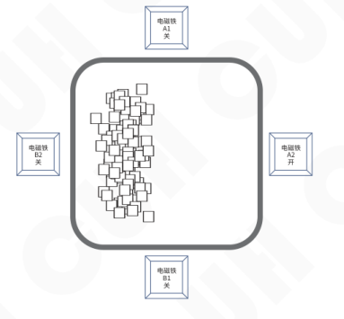

● **② 物料左右向中间聚拢。** 此时应仅启用电磁铁A2和B2，进入程式段参数设置程式段2E On，并调整通道电压值2U，B组参考A组相位差180°，保持时间2h为0.1s，调整此时输出频率2F直到找到最适频率后，物料左右向中间聚拢，再调整此程式段2E保持时间值2h后退出。

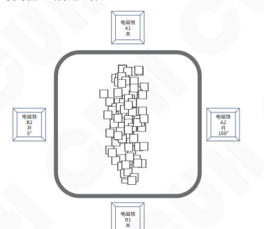

---

2022-04　　　　　　　　　　　　　　-29-　　　　　　　　　　　　　　SDVC60SMSCN_1.01

### 第 38 页

智能柔性多路振动送料控制器　　　　　　　　　　　　　　　　　　　　SDVC60 系列

---

● **③ 物料向右聚拢。** 此时应仅启用电磁铁B2，进入程式段参数设置程式段3E On，调整通道电压值3U，保持时间3h为0.1s，调整此时输出频率3F直到找到最适频率后，物料向右聚拢，再调整此程式段3E保持时间值3h后退出。

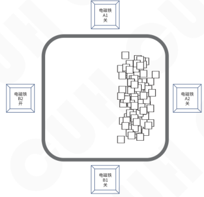

● **④ 物料向中间聚拢。** 此时应仅启用全部四个电磁铁，进入程式段参数设置程式段4E On，并调整通道电压值4U，B组参考A组相位差180°，保持时间4h为0.1s，调整此时输出频率4F直到找到最适频率后，物料向中间聚拢，再调整此程式段4E保持时间值4h后退出。

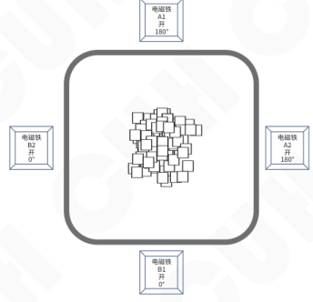

---

2022-04　　　　　　　　　　　　　　-30-　　　　　　　　　　　　　　SDVC60SMSCN_1.01

### 第 39 页

智能柔性多路振动送料控制器　　　　　　　　　　　　　　　　　　　　　　　　　SDVC60 系列

---

- ⑤ **物料重新振散。** 此时应启用全部四个电磁铁，进入程式段参数设置程式段5E On，并调整通道电压值5U，B组参考A组无相位差，保持时间5h为0.1s，调整此时输出频率5F直到找到最适频率后，物料重新振散，再调整此程式段5E 保持时间值5h后退出。
- 程式设置完毕可以运行。

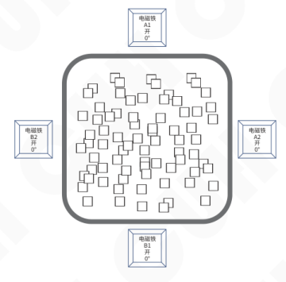

---

2022-04　　　　　　　　　　　　　　　　　-31-　　　　　　　　　　　　　　　　　SDVC60SMSCN_1.01

### 第 40 页

智能柔性多路振动送料控制器　　　　　　　　　　　　　　　　SDVC60 系列

---

## 第八章 技术规格

### 8.1 外形尺寸

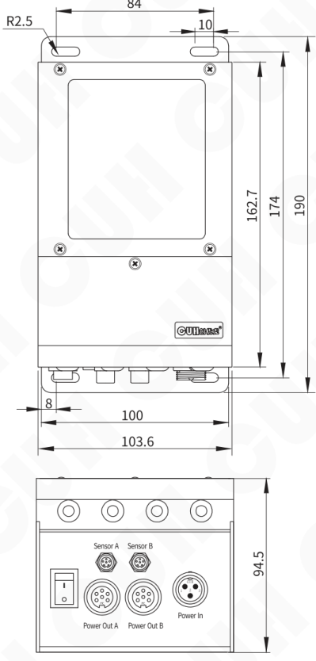

**SDVC6014-M/SDVC6024-M （单位：毫米mm）**

---

2022-04　　　　　　　　　　　　　-32-　　　　　　　　　　　　　SDVC60SMSCN_1.01

### 第 41 页

智能柔性多路振动送料控制器　　　　　　　　　　　　　　　　　SDVC60 系列

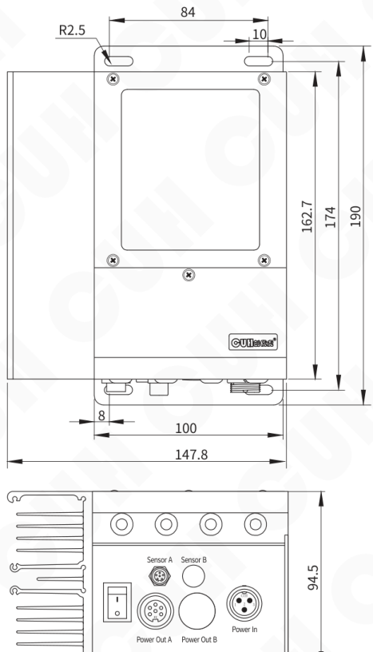

**SDVC6014-XL　（单位：毫米mm）**

### 第 42 页

智能柔性多路振动送料控制器  
SDVC60 系列

#### SDVC6024-XL 外形尺寸

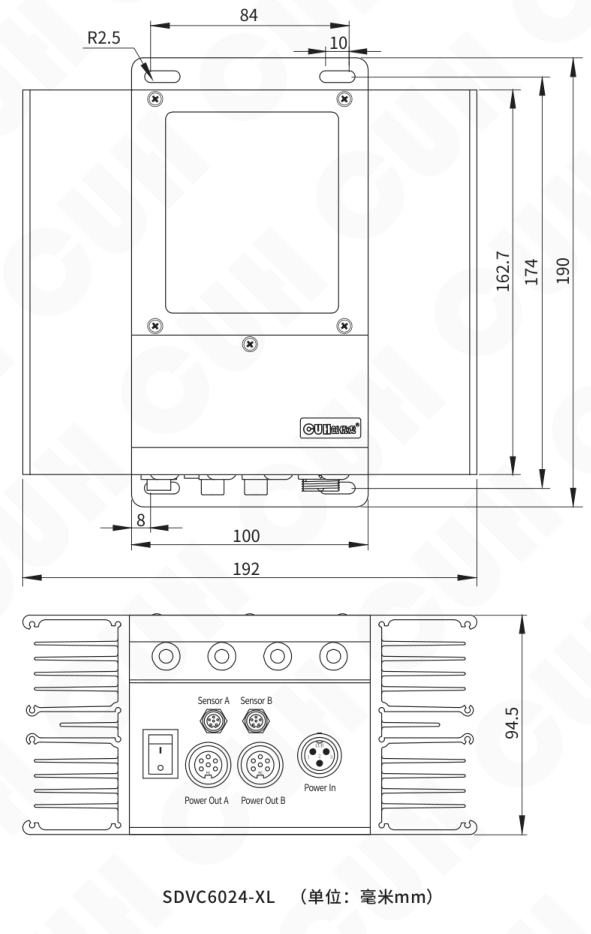

SDVC6024-XL （单位：毫米mm）

### 第 43 页

智能柔性多路振动送料控制器　　　　　　　　　　　　　　　　SDVC60 系列

## 8.2 技术规格表

| 项目 | 最小值 | 典型值 | 最大值 | 单位 | 备注 |
|---|---:|---:|---:|---|---|
| 交流输入电压 | 85 | 220 | 250 | 伏特（V） | 50/60 Hz 交流有效值 |
| 输出电压范围 | 0 | —— | 250 | 伏特（V） |  |
| 输出电流范围 | 0 | —— | 3.0 | 安培（A） | SDVC6014/24-M每组 |
| 输出电流范围 | 0 | —— | 6.0 | 安培（A） | SDVC6014/24-XL每组 |
| 输出功率 | 0 | —— | 750 | 伏安（VA） | SDVC6014/24-M每组 |
| 输出功率 | 0 | —— | 1500 | 伏安（VA） | SDVC6014/24-XL每组 |
| 输出频率范围 | 25 | 50 | 400 | 赫兹（Hz） |  |
| 频率调整精度 |  | 0.1 |  | 赫兹（Hz） |  |
| 输出电流波形 |  | 正弦 |  |  |  |
| 控制输出电流 | 0 | —— | 200 | 毫安（mA） |  |
| 控制输出电压 | 22 | 24 | 26 | 伏特（V） |  |
| 空载功耗 |  | 5 |  | 瓦特（W） |  |
| 负载类型 |  | 电磁铁 |  |  |  |
| 显示方式 |  | 6 |  | 位 | LED数码管 |
| 防护等级 |  | IP20 |  |  |  |
| 工作环境温度 | 0 | 25 | 40 | 摄氏度（℃） |  |
| 工作环境湿度 | 10 | 60 | 85 | 相对湿度（%） | 不结露 |
| 存储环境温度 | -20 | 25 | 85 | 摄氏度（℃） |  |

2022-04　　　　　　　　　　　　　　-35-　　　　　　　　　　　　　　SDVC60SMSCN_1.01

### 第 44 页

智能柔性多路振动送料控制器　　　　　　　　　　　　　　　　　　　　SDVC60 系列

## 8.3 参考标准

**极限参数：超过此指标将会造成严重损坏，必须严格遵守！**

| 项目 | GB 标准 | IEC 标准 | 等级 | 标准要求 | 备注说明 |
|---|---|---|---|---|---|
| 静电放电 | GB/T 17626.2-2006 | IEC 61000-4-2:2001 | 4 | ±8 kV | 接触放电 |
|  |  |  | 4 | ±15 kV | 空气放电 |
| 电快速瞬变 脉冲群 | GB/T 17626.4-2008 | IEC 61000-4-4:2004 | 4 | ±4 kV |  |
| 直流电源纹 波抗扰度 | GB/T 17626.17-2005 | IEC 61000-4-17:2002 | 4 | 15% | 评价 A |

2022-04　　　　　　　　　　　　　　　　　-36-　　　　　　　　　　　　　SDVC60SMSCN_1.01

### 第 45 页

智能柔性多路振动送料控制器　　　　　　　　　　　　　　　　　　　　　　　　　SDVC60 系列

# 第九章 附录

## 9.1 参数列表

| 参数类别 | 含义 | 参数符号 | 数码管符号图片 | 取值范围 | 默认设置 |
|---|---|---|---|---|---|
| 待机参数 （不可调节） | 当前程式段 | 【CP杠1杠1】 |  | —— | —— |
|  | A组温度显示 | 【AC】 |  | -20.0~85.0 摄氏度（℃） | —— |
|  | b组温度显示 | 【BC】 |  | -20.0~85.0 摄氏度（℃） | —— |
|  | 母线电压 | 【PU】 |  | 0~400 伏特（V） | —— |
| 程式段参数 | 程式段使能 | 【1E】 |  | On（使能）、OFF（禁止） | OFF |
|  | 输出频率 | 【1F】 |  | 25.0~400.0 赫兹（Hz） | 50.0 |
|  | 通道电压×8 (6024) ×4 (6014) 注① | 【1U】 |  | 0~250 伏特（V） | 50 |
|  | 缓启动时间 | 【1T】 |  | 0.0~10.0 秒（s） | 0.2 |
|  | 保持时间 | 【1小H】 |  | 0.0~100.0 秒（s） | 5.0 |
|  | 缓关闭时间 | 【1反T】 |  | 0.0~10.0 秒（s） | 0.2 |
|  | 波形指数×2 (6024) ×1 (6014) | 【1R】 |  | 0~100 | 100 |
|  | B组参考A组相位差 | 【1小U】 |  | -180.0~180.0 度（°） | 0.0 |
| 公共参数 | 输入传感器类型 | 【tA】 |  | ut0（连续扫描），ut1（单次扫描），nPn，PnP | ut1 |
|  | 输入端口C开延时 | 【反LC】 |  | 0.0~10.0 秒（s） | 0.1 |
|  | 输入端口E开延时 | 【反LE】 |  | 0.0~10.0 秒（s） | 0.1 |
|  | 输入端口R开延时 | 【反LR】 |  | 0.0~10.0 秒（s） | 0.1 |
|  | 输入端口S开延时 | 【反LS】 |  | 0.0~10.0 秒（s） | 0.1 |
|  | 输入端口C关延时 | 【LC】 |  | 0.0~10.0 秒（s） | 0.1 |
|  | 输入端口E关延时 | 【LE】 |  | 0.0~10.0 秒（s） | 0.1 |
|  | 输入端口R关延时 | 【LR】 |  | 0.0~10.0 秒（s） | 0.1 |
|  | 输入端口S关延时 | 【LS】 |  | 0.0~10.0 秒（s） | 0.1 |
|  | 控制输出D逻辑信号源 | 【小LD】 |  | 0, 1, C, E, r, S, -C, -E, -r, -S, A1, A2, A3, A4, b1, b2, b3, b4, Od, OP | C, E |
|  | 控制输出P逻辑信号源 | 【小LP】 |  | 0, 1, C, E, r, S, -C, -E, -r, -S, A1, A2, A3, A4, b1, b2, b3, b4, Od, OP | r, S |

2022-04　　　　　　　　　　　　　　　　　-37-　　　　　　　　　　　　　　　　　SDVC60SMSCN_1.01

### 第 46 页

智能柔性多路振动送料控制器　　　　　　　　　　　　　　　　　　　　　　　　　SDVC60 系列

| 参数类别 | 参数 | 标志 | 数码管符号图片 | 设置范围 | 出厂值 |
|---|---|---|---|---|---|
| 公共参数 | 控制输出D逻辑关系 | [大ND] | 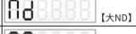 | And, or, Hor, rS | or |
| 公共参数 | 控制输出P逻辑关系 | [大NP] |  | And, or, Hor, rS | or |
| 公共参数 | 控制输出D逻辑方向 | [JD] |  | 同相---，反相-.- | --- |
| 公共参数 | 控制输出P逻辑方向 | [JP] |  | 同相---，反相-.- | --- |
| 公共参数 | 控制输出D开延时 | [反小LD] | 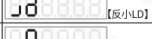 | 0.0~10.0 秒（s） | 0.1 |
| 公共参数 | 控制输出P开延时 | [反小LP] | 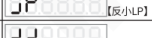 | 0.0~10.0 秒（s） | 0.1 |
| 公共参数 | 控制输出D关延时 | [反上LD] | 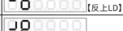 | 0.0~10.0 秒（s） | 0.1 |
| 公共参数 | 控制输出P关延时 | [反上LP] |  | 0.0~10.0 秒（s） | 0.1 |
| 公共参数 | 控制输出D关延时模式 | [上LD] |  | 延时关---，保持关-.- | --- |
| 公共参数 | 控制输出P关延时模式 | [上LP] |  | 延时关---，保持关-.- | --- |
| 公共参数 | 控制输出D传感器类型 | [满D] |  | nPn, PnP, PSPU | PSPU |
| 公共参数 | 控制输出P传感器类型 | [满P] |  | nPn, PnP, PSPU | PSPU |
| 公共参数 | 程式源 | [PA] |  | 0, 1, C, E, r, S | C, E |
| 公共参数 | 触发方式 | [横TA] |  | `In__` 内部电平触发 `In_-` 内部边沿触发 `ot__` 外部S口电平触发 `ot_-` 外部S口边沿触发 | `In__` |
| 高级功能参数 | 运行模式 | [CA] |  | 开环---，闭环(暂未实现)-.- | --- |
| 高级功能参数 | 通讯协议 | [上拐] |  | rtu, ASC | rtu |
| 高级功能参数 | 波特率 | [下拐] |  | 0.3, 1.2, 2.4, 9.6, 19.2, 57.6, 115.2 （Kbit/s） | 9.6 |
| 高级功能参数 | 通讯地址 | [万] |  | 1~31 | 1 |
| 高级功能参数 | 边沿触发次数 | [倒J] |  | 1~255 | 1 |
| 高级功能参数 | 恢复出厂设置 | [全8] |  | —— | —— |

备注：① 通过通道指示灯闪烁指示当前设置的通道电压。

2022-04　　　　　　　　　　　　　　　　-38-　　　　　　　　　　　　　　　　SDVC60SMSCN_1.01

### 第 47 页

智能柔性多路振动送料控制器　　　　　　　　　　　　　　　　　SDVC60 系列

---

## 9.2 输入输出电路图

**485通讯F端口**

| 端子 | 功能 |
|---|---|
| F2 | A+ |
| F3 | 地线 |
| F4 | B- |

**料满停机C/E/R/S端口**（以料满停机C为例）

| 端子 | 功能 |
|---|---|
| C3 | +24V |
| C2 | 输入 |
| C1 | 地线 |

**控制输出D/P端口**（以控制输出D为例）

| 端子 | 功能 |
|---|---|
| D2 | +24V |
| D1 | 输出 |
| D3 | 地线 |

---

2022-04　　　　　　　　　　　　　　　　　-39-　　　　　　　　　　　　　　　　　SDVC60SMSCN_1.01

### 第 48 页

智能柔性多路振动送料控制器　　　　　　　　　　　　　　　SDVC60 系列

## 9.3 故障诊断

| 故障代码 | 数码管符号图片 | 含义 | 排除方法 |
|---|---|---|---|
| Err01A |  | A组短路保护 | 确保负载未被短路 |
| Err01b |  | B组短路保护 | 确保负载未被短路 |
| Err02A |  | A组过流保护 | 适当降低输出电压 |
| Err02b |  | B组过流保护 | 适当降低输出电压 |
| Err03A |  | A组过热/过冷保护 | 提供通风散热良好的环境 确保不在-20℃以下启动 |
| Err03b |  | B组过热/过冷保护 | 提供通风散热良好的环境 确保不在-20℃以下启动 |
| Err04 |  | 输入过压/欠压保护 | 确保电源电压不超过85~250Vac |
| Err05 |  | 内部通讯异常 | 联系我司技术支持 |
| Err06 |  | 温度传感器异常 | 联系我司技术支持 |
| Err07d |  | D口过流/短路保护 | 确保24V负载电流不超过200mA |
| Err07P |  | P口过流/短路保护 | 确保24V负载电流不超过200mA |
| Err09A |  | 振动传感器A故障 | 联系我司技术支持 |
| Err09b |  | 振动传感器B故障 | 联系我司技术支持 |

2022-04　　　　　　　　　　　　　　　-40-　　　　　　　　　　　　　　　SDVC60SMSCN_1.01

### 第 49 页

智能柔性多路振动送料控制器　　　　　　　　　　　　　　　　　　　　　　　　　SDVC60 系列

---

# 第十章 产品质保信息

## 10.1 质保期

本公司为本产品提供的质保期为一年，从产品发送到购买方指定地点之日算起。

## 10.2 保修范围

（一）如果在上述质保期内出现本公司造成的故障，我们将免费维修产品。但是以下情况不属于保修范围：

- a、未按照简易说明书、用户手册或购买方与本公司专门达成的技术要求中规定的条件、环境下的不正确操作，或不正确使用造成的故障。
- b、故障不是因产品缺陷，而是购买方设备或软件设计造成的。
- c、非本公司人员进行的修改或修理而造成的故障。
- d、按照简易操作指南或用户手册正确维修或更换易损部件等规定可以完全避免的故障。
- e、产品从本公司发货后，因无法预料的科学技术水平变化等因素而造成的故障。
- f、由于火灾、地震、洪水等自然灾害，或异常电压等外部因素造成的故障，本公司不负责保修。

（二）保修范围仅限于（一）中规定的情况，本公司对该设备造成的购买方间接损失（如设备损坏、机会丧失、利润损失等）或其他损失，不承担任何责任。

## 10.3 产品适用性

本公司的该控制器是针对柔性振动送料行业的通用产品而设计生产的。因此，本公司的该控制器不得用于下列应用且不适合其使用。

（一）对生命和财产有严重影响的设施，如核发电厂、机场、铁路、轮船、机动装置及医疗设备。

（二）公共事业，包括电力、气体、供水等。

（三）相似条件或环境的户外使用。

---

2022-04　　　　　　　　　　　　　　　　　-41-　　　　　　　　　　　　　　　　　SDVC60SMSCN_1.01

### 第 50 页

*（本页 `page_markdown` 为空。）*

### 第 51 页

*（本页 `page_markdown` 为空。）*

### 第 52 页

|  |  |
|---|---|
|  | 南京创优科技有限责任公司 网址:www.cuhnj.com 电话:025-84730416 传真:025-84730426 邮箱:sales@cuhnj.com 地址:南京市江宁区智能路9号 启迪城学研园2幢 |
<!-- /auto:ai-body-draft v1 -->

<!-- auto:data-params-summary v1 -->
## 附录 · 参数表（结构化侧车·机器生成）

> 说明：本节由 `data/<doc_key>/params/params.yaml` 自动渲染（展示前若干行），用于校对与二次开发。定稿以层 C 数据为准。

| 参数 | 标志/符号 | 范围 | 默认 | 单位 | 备注 |
| --- | --- | --- | --- | --- | --- |
|    **危险** |    **危险** |  |  |  |  |
|    **警告** |    **警告** |  |  |  |  |
|    **小心** |    **小心** |  |  |  |  |
|    **注意** |    **注意** |  |  |  |  |
|      **程式** |  |  |  |  |  |
|      **程式段 1E** |  |  |  |  |  |
|      1E 程式段使能 |  |  |  |  |  |
|        1F 电磁铁频率 |  |  |  |  |  |
|        1U 电磁铁1A电压 |  |  |  |  |  |
|        1U 电磁铁2A电压 |  |  |  |  |  |
|        1U 电磁铁3A电压 |  |  |  |  |  |
|        1U 电磁铁4A电压 |  |  |  |  |  |
|      1U 电磁铁1B电压 (SDVC6024系列) |  |  |  |  |  |
|      1U 电磁铁2B电压 (SDVC6024系列) |  |  |  |  |  |
|      1U 电磁铁3B电压 (SDVC6024系列) |  |  |  |  |  |
|      1U 电磁铁4B电压 (SDVC6024系列) |  |  |  |  |  |
|      1t缓启动时间 |  |  |  |  |  |
|    1h 保持时间 |  |  |  |  |  |
|    1反t缓关闭时间 |  |  |  |  |  |
|    1r 电磁铁A组波形指数 |  |  |  |  |  |
|    1r 电磁铁B组波形指数(SDVC6024系列) |  |  |  |  |  |
|      信号源 |  |  |  |  |  |
|      0 |  |  |  |  |  |
|      1 |  |  |  |  |  |
|      C |  |  |  |  |  |
|      E |  |  |  |  |  |
|      r |  |  |  |  |  |
|      S |  |  |  |  |  |
|      -C |  |  |  |  |  |
|    -E |  |  |  |  |  |

*（仅展示前 30 条，共 171 条；完整数据见下方链接。）*

- 完整 YAML：`data/cuh.sdvc.manual.v1.01/params/params.yaml`
- 表格索引：`data/cuh.sdvc.manual.v1.01/index.yaml`
<!-- /auto:data-params-summary v1 -->
