## 目录

> 下列条目来自 PDF 内置书签/大纲；链接指向本批转换生成的整页渲染图（`assets/pages/`），便于与原版 PDF 对照校对。

- [7: 目录](assets/pages/page-0007.png)（第 7 页）
- [8: 目录2](assets/pages/page-0008.png)（第 8 页）
- [第一章 使用前须知](assets/pages/page-0009.png)（第 9 页）
  - [1.1 检查包装内容](assets/pages/page-0009.png)（第 9 页）
  - [1.2 指示灯、按键、外部部件及接线端口说明](assets/pages/page-0010.png)（第 10 页）
  - [1.3 负载端口及传感器端口说明](assets/pages/page-0011.png)（第 11 页）
  - [1.4 控制器铭牌说明](assets/pages/page-0011.png)（第 11 页）
- [第二章 产品介绍](assets/pages/page-0012.png)（第 12 页）
  - [2.1 产品简介](assets/pages/page-0012.png)（第 12 页）
- [第三章 安装及使用指南](assets/pages/page-0013.png)（第 13 页）
  - [3.1 控制器使用条件](assets/pages/page-0013.png)（第 13 页）
  - [3.2 按键基本操作](assets/pages/page-0013.png)（第 13 页）
  - [3.3 安装使用](assets/pages/page-0014.png)（第 14 页）
- [第四章 程式和程式段参数功能说明](assets/pages/page-0017.png)（第 17 页）
  - [4.1 程式参数设置](assets/pages/page-0018.png)（第 18 页）
  - [4.2 程式段参数设置](assets/pages/page-0020.png)（第 20 页）
- [第五章 公共参数功能说明](assets/pages/page-0024.png)（第 24 页）
  - [5.1 光源点亮设置](assets/pages/page-0024.png)（第 24 页）
  - [5.2 闪光触发设置](assets/pages/page-0026.png)（第 26 页）
- [第六章 高级参数功能说明](assets/pages/page-0031.png)（第 31 页）
  - [6.1 程式外部控制功能](assets/pages/page-0031.png)（第 31 页）
  - [6.2 移频信号频差](assets/pages/page-0033.png)（第 33 页）
  - [6.3 电机最大电压和过流保护限制](assets/pages/page-0033.png)（第 33 页）
  - [6.4 RS485通信协议设置](assets/pages/page-0034.png)（第 34 页）
  - [6.5 软件版本查询](assets/pages/page-0035.png)（第 35 页）
  - [6.6 恢复出厂设置](assets/pages/page-0036.png)（第 36 页）
- [第七章 控制器搭配振动盘简易操作说明](assets/pages/page-0037.png)（第 37 页）
  - [7.1 通过控制器搭配振动盘实现设计动作](assets/pages/page-0037.png)（第 37 页）
- [第八章 技术规格](assets/pages/page-0041.png)（第 41 页）
  - [8.1 外形尺寸](assets/pages/page-0041.png)（第 41 页）
  - [8.2 技术规格表](assets/pages/page-0042.png)（第 42 页）
  - [8.3 参考标准](assets/pages/page-0043.png)（第 43 页）
- [第九章 附录](assets/pages/page-0044.png)（第 44 页）
  - [9.1 参数列表](assets/pages/page-0044.png)（第 44 页）
  - [9.2 输入输出电路图](assets/pages/page-0047.png)（第 47 页）
  - [9.3 故障诊断](assets/pages/page-0048.png)（第 48 页）
- [第十章 产品质保信息](assets/pages/page-0049.png)（第 49 页）
  - [10.1 质保期](assets/pages/page-0049.png)（第 49 页）
  - [10.2 保修范围](assets/pages/page-0049.png)（第 49 页）
  - [10.3 产品适用性](assets/pages/page-0049.png)（第 49 页）
## 术语与命名

- 侧车：`glossary/terms.yaml`（机读）、`glossary/zh-CN.md`（人读）；候选表，定稿后并入公司级 `glossary/`。

## 适用范围

- 本文档由 PDF 自动转换生成，正文与插图需人工核对。

## 变更记录

- 2026-06-05 17:12:23：由转换工具从源 PDF 生成首版。

## 正文


<!-- auto:ai-body-draft v1 -->
> 以下为**整页视觉转写**的正文草稿（多模态模型直接输出 Markdown，含 GFM 表； 若配置 `[[vcrop:页:序]]` 占位符，裁剪步骤会插入 `assets/images/` 下 PNG）。**请务必人工校对。**

### 第 1 页

<div align="center">

# CUH®

## 智能低压柔性振动送料控制器

**Intelligent low voltage flexible Vibratory<br>Feeder Controller**

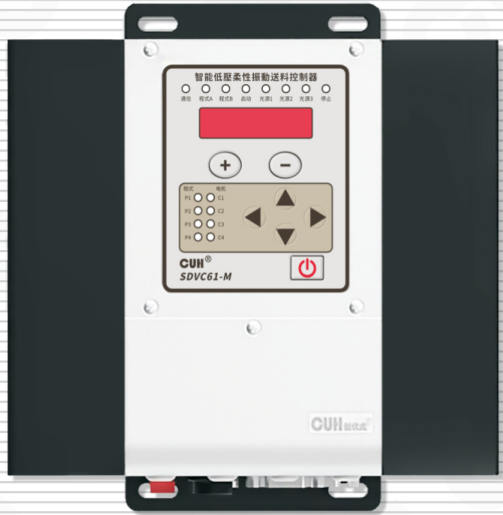

## SDVC61-M

# 用户手册

</div>


### 第 2 页

智能低压柔性振动送料控制器　　　　　　　　　　　　　　　　　SDVC61-M

---

## 版权说明

南京创优科技有限责任公司保留所有权利。

本用户手册上包含的所有信息是属于本公司的知识，受著作权法及所有法律的保护。本公司根据著作权法及其他法律享有并保留所有著作权和其他法律赋予的权利，未经本公司书面同意不得以任何形式对本用户手册的部分或全部进行抄袭、翻译、转译、仿制或其他利用。

## 免责声明

本用户手册的所有内容仅说明本公司生产的相关产品的使用方法，并且是根据现有技术和提供给您使用时的状态进行描述的，在您使用本产品时必须自行承担相关风险。除法律强制规定外，本公司不因本用户手册对产品负有任何明示或暗示的责任，包括但不限于人身伤害、财产损失、机会丧失。

您明确了解上述风险并同意，除法律强制规定外，本公司无须为您的任何直接、间接的损害或损失负责（包括但不限于人员、财物、数据等有形损失和名誉、机会等无形损失）。

本公司保留对本用户手册中所适用的产品进行修改而不预先及事后通知的权利。

---

2022-04　　　　　　　　　　　　　　　　　　　　　　　　　SDVC61SMSCN_1.02


### 第 3 页

智能低压柔性振动送料控制器　　　　　　　　　　　　　　　　　　　　　　　　　SDVC61-M

---

## 序　言

感谢您使用南京创优科技有限责任公司（在本手册中以下简称本公司）出品的SDVC61-M智能低压柔性振动送料控制器（在本手册中以下简称本产品、本控制器或控制器）。本系列控制器是采用高品质元件并融合了最新的电子技术，采用高性能的数字信号处理器经过精心的设计而成。

本手册介绍了本产品的基本操作方法、功能技术说明和典型应用示例。为用户提供安装调试、参数设置、异常诊断、故障排除及日常维护控制器的相关信息。为了确保正确安装和使用本控制器，请在装机之前仔细阅读本用户手册，并请妥善保存。

以下符号提醒您注意有关防止人身伤害和产品损坏的事项，请务必阅读。

| 符号 | 说明 |
|---|---|
| 危险 | 表示若不遵守该事项，将导致人员伤亡。 |
| 警告 | 表示若不遵守该事项，可能导致人员伤亡。 |
| 小心 | 表示若不遵守该事项，可能导致人员遭受中度或轻微伤害。 |
| 注意 | 表示若不遵守该事项，将导致本产品损坏及财产损失。 |
| 要点 | 表示在使用过程中必须要遵守的注意事项和使用限制等。 |

**本说明书适合以下型号控制器：**

◆ 智能低压柔性振动送料控制器  
　SDVC61-M（4路音圈电机输出24V/3A，3路LED驱动输出60V/2A）

---

2022-04　　　　　　　　　　　　　　　　　　　　　　　　　　　SDVC61SMSCN_1.02


### 第 4 页

智能低压柔性振动送料控制器　　　　　　　　　　　　　　　SDVC61-M

---

# 安全与预防措施

1. **【危险】** 本产品仅用于驱动基于音圈电机的振动送料设备，请勿将本产品用于保护人体或人体部位等目的。

2. **【危险】** 本产品不得作为防爆产品使用，请勿在危险场所和/或潜在爆炸气体环境中使用本产品。

3. **【警告】** 本产品是采用交流市电供电的设备，请勿施加交流电压超过260Vac。施加过大的输入电压如380Vac，则可能导致产品爆炸或者着火，造成严重的安全事故。

4. **【警告】** 本产品是通过电源线进行接地的，请确保为控制器供电的配电设施具备良好的接地，否则可能导致控制器外壳带电，造成触电事故。

5. **【警告】** 请勿输入交流电源到本控制器的输出端，这会损坏控制器。

6. **【警告】** 请勿在带电的情况下插拔接线或触摸接线仓内各接线端子触点，以防发生触电事故。

7. **【注意】** 请避免采用通过继电器等设备切断供电的方式来控制本产品的输出，这会严重降低本控制器的寿命。

8. **【注意】** 本产品设计使用于阴凉干燥环境，请勿将本产品置于室外、可能会浸水、阳光暴晒场所工作，也不要在超过本产品电气特性要求的温度和湿度范围之外工作。

9. **【要点】** 请务必将本产品固定在可靠接地的坚固平台上，并远离振动设备。

10. **【要点】** 任何情况下请勿将本产品在超越设计极限状态下工作。

11. **【要点】** 请严格按照本手册的说明操作，对于违反这些操作说明所造成的任何人身伤害或财产损失，本公司不承担任何民事和刑事责任。

12. **【要点】** 任何情况下请不要打开本控制器机壳，以防遭到电击。机壳内部没有可以调节和用户维修部分，请不要试图维修本机，出现故障请致电本公司。

---

2022-04　　　　　　　　　　　　　　　　　　　　　　　　　SDVC61SMSCN_1.02


### 第 5 页

智能低压柔性振动送料控制器　　　　　　　　　　　　　　　　　　　　　SDVC61-M

---

# 工作与储存环境

## 一、使用前的检查

每台控制器在出厂前，均经过严格的品质检验，并经过强化的防撞包装处理。客户在拆箱后，请即刻进行下列检查：

1、检查控制器是否在运输过程中受到损伤。

2、检查控制器型号是否与订货登记资料完全相同。

## 二、工作环境

为使本控制器具有更好的使用效果和更长的使用寿命，请将控制器安装在符合下列条件的环境中：

- 良好的通风散热环境
- 远离水滴、蒸气、灰尘，（特别是油性灰尘）
- 无腐蚀、易燃性的气体、液体
- 无漂浮性的尘埃及金属微粒
- 安装表面坚固无振动
- 远离电磁噪声干扰
- 使用环境温度为0℃到40℃
- 仅适用于海拔2000m以下地区安全使用

---

2022-04　　　　　　　　　　　　　　　　　　　　　　　　　SDVC61SMSCN_1.02


### 第 6 页

智能低压柔性振动送料控制器　　　　　　　　　　　　　　　　　　　　　　　　　SDVC61-M

---


---

2022-04　　　　　　　　　　　　　　　　　　　　　　　　　SDVC61SMSCN_1.02


### 第 7 页

智能低压柔性振动送料控制器　　　　　　　　　　　　　　　　　　　　　　　　　SDVC61-M

# 目　录

**第一章 使用前须知** ----------------------------------------------------------------------------- 1

1.1　检查包装内容 ----------------------------------------------------------------------------- 1

1.2　指示灯、按键、外部部件及接线端口说明 ------------------------------------------ 2

1.3　负载端口及传感器端口说明 ------------------------------------------------------------ 3

1.4　控制器铭牌说明 -------------------------------------------------------------------------- 3

**第二章 产品介绍** ------------------------------------------------------------------------------- 4

2.1　产品简介 ----------------------------------------------------------------------------------- 4

**第三章 安装及使用指南** --------------------------------------------------------------------- 5

3.1　控制器使用条件 -------------------------------------------------------------------------- 5

3.2　按键基本操作 ----------------------------------------------------------------------------- 5

3.3　安装使用 ----------------------------------------------------------------------------------- 6

**第四章 程式和程式段参数功能说明** ----------------------------------------------------- 9

4.1　程式参数设置 ---------------------------------------------------------------------------- 10

4.2　程式段参数设置 ------------------------------------------------------------------------- 12

**第五章 公共参数功能说明** ------------------------------------------------------------------ 16

5.1　光源点亮设置 ---------------------------------------------------------------------------- 16

5.2　闪光触发设置 ---------------------------------------------------------------------------- 18

**第六章 高级参数功能说明** ------------------------------------------------------------------ 23

6.1　程式外部控制功能 ---------------------------------------------------------------------- 23

6.2　移频信号频差 ---------------------------------------------------------------------------- 25

6.3　电机最大电压和过流保护限制 ------------------------------------------------------- 25

6.4　RS485通信协议设置 ------------------------------------------------------------------- 26

6.5　软件版本查询 ---------------------------------------------------------------------------- 27

6.6　恢复出厂设置 ---------------------------------------------------------------------------- 28

2022-04　　　　　　　　　　　　　　　　　　　　　　　　　　　　　SDVC61SMSCN_1.02


### 第 8 页

智能低压柔性振动送料控制器　　　　　　　　　　　　　　　　　　　　　　　　　SDVC61-M

---

**第七章 控制器搭配振动盘简易操作说明** --------------------------------------------29

&nbsp;&nbsp;&nbsp;&nbsp;7.1&nbsp;&nbsp;通过控制器搭配振动盘实现设计动作 ----------------------------------------------29

**第八章 技术规格** ---------------------------------------------------------------------------------33

&nbsp;&nbsp;&nbsp;&nbsp;8.1&nbsp;&nbsp;外形尺寸 ----------------------------------------------------------------------------------33

&nbsp;&nbsp;&nbsp;&nbsp;8.2&nbsp;&nbsp;技术规格表 -------------------------------------------------------------------------------34

&nbsp;&nbsp;&nbsp;&nbsp;8.3&nbsp;&nbsp;参考标准 ---------------------------------------------------------------------------------35

**第九章 附录** ----------------------------------------------------------------------------------------36

&nbsp;&nbsp;&nbsp;&nbsp;9.1&nbsp;&nbsp;参数列表 ----------------------------------------------------------------------------------36

&nbsp;&nbsp;&nbsp;&nbsp;9.2&nbsp;&nbsp;输入输出电路图 -------------------------------------------------------------------------39

&nbsp;&nbsp;&nbsp;&nbsp;9.3&nbsp;&nbsp;故障诊断 ----------------------------------------------------------------------------------40

**第十章 产品质保信息** -------------------------------------------------------------------------41

&nbsp;&nbsp;&nbsp;&nbsp;10.1&nbsp;&nbsp;质保期 -----------------------------------------------------------------------------------41

&nbsp;&nbsp;&nbsp;&nbsp;10.2&nbsp;&nbsp;保修范围 --------------------------------------------------------------------------------41

&nbsp;&nbsp;&nbsp;&nbsp;10.3&nbsp;&nbsp;产品适用性 -----------------------------------------------------------------------------41

---

2022-04　　　　　　　　　　　　　　　　　　　　　　　　　　　　　　SDVC61SMSCN_1.02


### 第 9 页

# 第一章 使用前须知

本章节介绍产品包装内容、控制器外观说明和控制器铭牌信息。

## 1.1 检查包装内容

使用本产品之前，请检查控制器及附件的完整性。如果发现产品有缺陷或已损坏、附件缺失等问题，请与本公司联系。

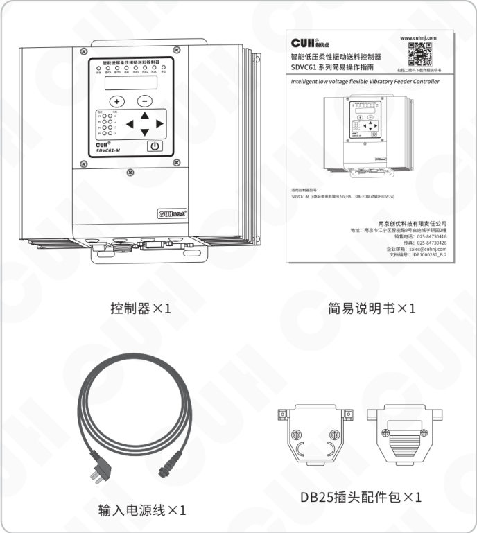

- 控制器×1
- 简易说明书×1
- 输入电源线×1
- DB25插头配件包×1


### 第 10 页

> 智能低压柔性振动送料控制器　　　　　　　　　　　　　　　　　　　　　SDVC61-M

## 1.2 指示灯、按键、外部部件及接线端口说明

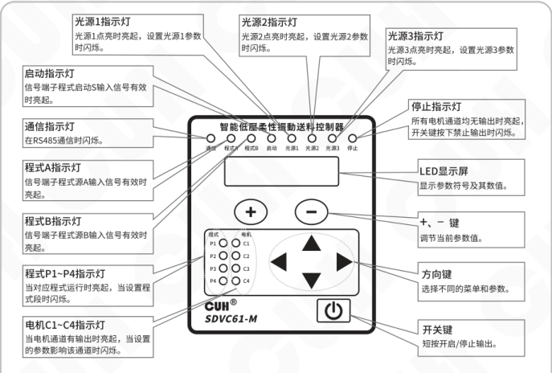

### 指示灯、按键说明

| 名称 | 说明 |
|---|---|
| 启动指示灯 | 信号端子程式启动S输入信号有效时亮起。 |
| 通信指示灯 | 在RS485通信时闪烁。 |
| 程式A指示灯 | 信号端子程式源A输入信号有效时亮起。 |
| 程式B指示灯 | 信号端子程式源B输入信号有效时亮起。 |
| 程式P1~P4指示灯 | 当对应程式运行时亮起，当设置程式段时闪烁。 |
| 电机C1~C4指示灯 | 当电机通道有输出时亮起，当设置的参数影响该通道时闪烁。 |
| 光源1指示灯 | 光源1点亮时亮起，设置光源1参数时闪烁。 |
| 光源2指示灯 | 光源2点亮时亮起，设置光源2参数时闪烁。 |
| 光源3指示灯 | 光源3点亮时亮起，设置光源3参数时闪烁。 |
| 停止指示灯 | 所有电机通道均无输出时亮起，开关键按下禁止输出时闪烁。 |
| LED显示屏 | 显示参数符号及其数值。 |
| +、－键 | 调节当前参数值。 |
| 方向键 | 选择不同的菜单和参数。 |
| 开关键 | 短按开启/停止输出。 |

前面板标识：通信、程式A、程式B、启动、光源1、光源2、光源3、停止；程式 P1~P4；电机 C1~C4；CUH® SDVC61-M。

### 外部部件说明

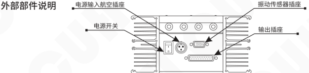

| 外部部件 | 位置/说明 |
|---|---|
| 电源输入航空插座 | 机身背面上方接口 |
| 振动传感器插座 | 机身背面上方接口 |
| 电源开关 | 机身背面左侧 |
| 输出插座 | 机身背面右侧 |

### 接线端口说明

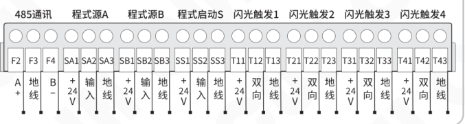

| 功能分组 | 端子 | 定义 |
|---|---|---|
| 485通讯 | F2 | A+ |
| 485通讯 | F3 | 地线 |
| 485通讯 | F4 | B- |
| 程式源A | SA1 | +24V |
| 程式源A | SA2 | 输入 |
| 程式源A | SA3 | 地线 |
| 程式源B | SB1 | +24V |
| 程式源B | SB2 | 输入 |
| 程式源B | SB3 | 地线 |
| 程式启动S | SS1 | +24V |
| 程式启动S | SS2 | 输入 |
| 程式启动S | SS3 | 地线 |
| 闪光触发1 | T11 | +24V |
| 闪光触发1 | T12 | 双向 |
| 闪光触发1 | T13 | 地线 |
| 闪光触发2 | T21 | +24V |
| 闪光触发2 | T22 | 双向 |
| 闪光触发2 | T23 | 地线 |
| 闪光触发3 | T31 | +24V |
| 闪光触发3 | T32 | 双向 |
| 闪光触发3 | T33 | 地线 |
| 闪光触发4 | T41 | +24V |
| 闪光触发4 | T42 | 双向 |
| 闪光触发4 | T43 | 地线 |

---

2022-04　　　　　　　　　　　　　　　　　- 2 -　　　　　　　　　　　　　　　　　SDVC61SMSCN_1.02


### 第 11 页

## 1.3 负载端口及传感器端口说明

### 输出插座引脚图

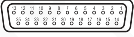

| 13 | 12 | 11 | 10 | 9 | 8 | 7 | 6 | 5 | 4 | 3 | 2 | 1 |
|---|---|---|---|---|---|---|---|---|---|---|---|---|
| 温度3+ | 温度2+ | 温度1+ | 光源3+ | 光源2+ | 光源1+ | 空 | PE | 空 | 电机4+ | 电机3+ | 电机2+ | 电机1+ |

| 25 | 24 | 23 | 22 | 21 | 20 | 19 | 18 | 17 | 16 | 15 | 14 |
|---|---|---|---|---|---|---|---|---|---|---|---|
| 温度3- | 温度2- | 温度1- | 光源3- | 光源2- | 光源1- | 空 | 空 | 电机4- | 电机3- | 电机2- | 电机1- |

### 传感器插座引脚图

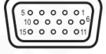

| 5 | 4 | 3 | 2 | 1 |
|---|---|---|---|---|
| 3.3V | 4号传感器Z轴 | 3号传感器Z轴 | 2号传感器Z轴 | 1号传感器Z轴 |

| 10 | 9 | 8 | 7 | 6 |
|---|---|---|---|---|
| GND | 4号传感器Y轴 | 3号传感器Y轴 | 2号传感器Y轴 | 1号传感器Y轴 |

| 15 | 14 | 13 | 12 | 11 |
|---|---|---|---|---|
| PE | 4号传感器X轴 | 3号传感器X轴 | 2号传感器X轴 | 1号传感器X轴 |

## 1.4 控制器铭牌说明

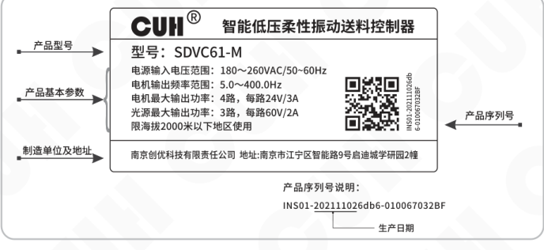

铭牌内容：

- **产品型号**：SDVC61-M
- **产品基本参数**：
  - 电源输入电压范围：180～260VAC/50～60Hz
  - 电机输出频率范围：5.0～400.0Hz
  - 电机最大输出功率：4路，每路24V/3A
  - 光源最大输出功率：3路，每路60V/2A
  - 限海拔2000米以下地区使用
- **制造单位及地址**：南京创优科技有限责任公司　地址:南京市江宁区智能路9号启迪城学研园2幢
- **产品序列号**：INS01-202111026db6-010067032BF
- **产品序列号说明**：INS01-202111026db6-010067032BF
- **生产日期**：20211102


### 第 12 页

智能低压柔性振动送料控制器　　　　　　　　　　　　　　　　　　　　　　　　　SDVC61-M

---

# 第二章 产品介绍

本章节主要内容包括本产品的简单介绍和主要特色功能。

## 2.1 产品简介

SDVC61系列智能低压柔性振动送料控制器是一款专为音圈电机柔性送料系统设计的产品，通过采用最新的电子技术和精心的设计，提供独特的性能。其特色功能包括：

- 四个音圈电机驱动输出，最大功率24V/3A，可以独立控制相位差。
- 三个光源驱动输出，最大功率60V/2A。
- 每组光源配备NTC温度传感器接口，可实现光源的过热保护。
- 控制器设计四个程式，每个程式包括9个程式段。每个程式段可以控制使能、输出频率、通道电压或振幅、相位差、光源电流、保持时间。
- 程式选择与运行触发支持外部开关传感器信号控制，且传感器类型可以设置或自动识别。
- 闪光触发端口为双向端口，可以设置为输入用来触发光源点亮，也可以设置为输出驱动外部负载。输出支持NPN、PNP、推挽三种工作模式，支持选择多种信号源。
- 闪光触发端口可以输出同步信号或移频信号，用来触发光源形成移频闪光。该功能通过拍频将物料的运动状态减慢，使得用户可以看出物料运动的细节。
- 加速度传感器接口可以连接4个3轴加速度传感器，为每个音圈电机提供振幅自动稳定（开发中）。
- RS485接口支持Modbus ASCII和RTU两种协议，可联网控制所有参数。

---

2022-04　　　　　　　　　　　　　　　　　- 4 -　　　　　　　　　　　　　　　　　SDVC61SMSCN_1.02


### 第 13 页

智能低压柔性振动送料控制器  
SDVC61-M

# 第三章 安装及使用指南

本章节介绍本产品使用所必须具备的条件以及如何正确进行安装与连接。

## 3.1 控制器使用条件

本产品是使用交流220V供电的设备，且通过电源线三爪插头进行保护接地连接，请提供符合标准的220V，50Hz/60Hz市电供电配电设施并确保保护地线已正确连接。

**警告** 切不可将控制器连接到380V交流电，这将造成控制器不可恢复的严重损坏，有可能导致爆炸、火灾等安全事故。

**警告** 确保供电侧可靠接地，控制器的金属外壳是与保护接地线直接连接的，接地不良会导致控制器外壳带电，引发触电事故。

**注意** 控制器长时间工作会产生热量致使外壳温度升高，请将控制器安装在通风良好的环境中，并将其固定良好，远离振动源。

**注意** 本产品是用来驱动音圈电机的控制器，切不可连接压电振动盘。

## 3.2 按键基本操作

【短按】定义为按下按键的时间大于0.1秒小于2秒。

【长按】定义为按下按键的时间大于2秒。

同时长按 ◀ 和 ▶ 进入程式段参数设置界面。

同时短按 ◀ 和 ▶ 切换不同的程式，短按 ◀ 或 ▶ 切换不同程式段。

同时长按 ◀ 和 ▲ 进入公共参数设置界面。

同时长按 ▶ 和 ▲ 进入高级参数设置界面。

短按 ▲ 或 ▼ 选择参数，短按 ⊕ 或 ⊖ 调整参数值。

待机界面上短按 ▲ 或 ▼ 切换显示参数。

**界面轮转图**

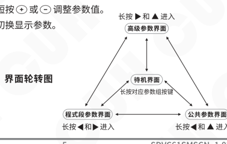

2022-04  
SDVC61SMSCN_1.02


### 第 14 页

智能低压柔性振动送料控制器　　　　　　　　　　　　　　　　　SDVC61-M

## 3.3 安装使用

**第一步：**

打开控制器的外包装，检查控制器外观及侧标型号，判断是否为所需的型号。

**第二步：**

取出DB25插头配件包，自行组装输出插头后，根据柔性振动盘音圈电机的分布和照明灯板的需求，结合本手册中的负载接线图正确连接负载。

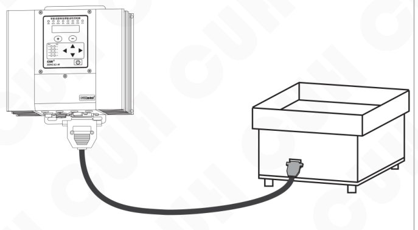

2022-04　　　　　　　　　　　　- 6 -　　　　　　　　　　　　SDVC61SMSCN_1.02


### 第 15 页

智能低压柔性振动送料控制器　　　　　　　　　　　　　　　　　　　　　　　　　SDVC61-M

---

### 第三步：

将输入电源线航空插头插入控制器电源输入插座，并锁紧螺母。

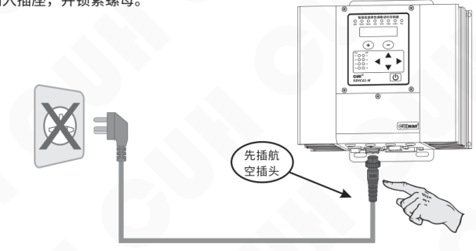

### 第四步：

确认开关处于关闭位置后，将电源线三爪插头插在供电电源插座上。


---

2022-04　　　　　　　　　　　　- 7 -　　　　　　　　　　　　SDVC61SMSCN_1.02


### 第 16 页

智能低压柔性振动送料控制器　　　　　　　　　　　　　　　　　　　　　　　SDVC61-M

---

### 第五步：

打开控制器电源开关，此时应该显示当前程式段（默认 CP - 空 - 空）。振动盘此时无振动，待程式和程式段设置完毕后振动盘开始工作。

当前程式段：默认 CP-空-空

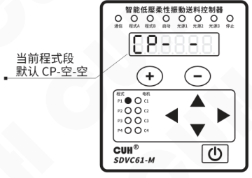

> ☺
>
> - 根据柔性振动盘的工作模态要求设置当前程式的程式段参数。
> - 设置完成后，可返回待机参数界面，通过短按 ▲ 或 ▼ 监控不同的待机参数值。

---

2022-04　　　　　　　　　　　　　　　　　- 8 -　　　　　　　　　　　　　　　　　SDVC61SMSCN_1.02


### 第 17 页

智能低压柔性振动送料控制器　　　　　　　　　　　　　　　　　　　　　　　　　SDVC61-M

---

# 第四章 程式和程式段参数功能说明

本章节介绍本控制器在程式和程式段参数界面下的使用方法。

**程式：** 表示控制器循环输出的一组动作，最多可以包含9个程式段（9个子动作）。

**程式段：** 表示在程式下面所有的子程式即子动作。本控制器包含电机程式段和光源程式段。其中：

电机程式段用于设置电机频率、电压、相位等；  
光源程式段用于设置光源电流等。  
每个程式段电机和光源程式仅可二选一进行设置，每个程式段可以独立设置该程式段缓启动或保持时间。

### 程式 P1

|  | 程式段 1E |  |  | 程式段 9E |  |
|---|---|---|---|---|---|
|  | 1E____ | 1E_._._._. | ～ | 9E____ | 9E_._._._. |
| Ptc<br>Pcc<br>Ptg | 1F电机频率<br>1U电机1电压<br>1U电机2电压<br>1U电机3电压<br>1U电机4电压<br>1μ电机1相位<br>1μ电机2相位<br>1μ电机3相位<br>1μ电机4相位 | 1C光源1电流<br>1C光源2电流<br>1C光源3电流 | ～ | 9F电机频率<br>9U电机1电压<br>9U电机2电压<br>9U电机3电压<br>9U电机4电压<br>9μ电机1相位<br>9μ电机2相位<br>9μ电机3相位<br>9μ电机4相位 | 9C光源1电流<br>9C光源2电流<br>9C光源3电流 |
|  | 1h该程式段缓启动或保持时间 |  |  | 9h该程式段缓启动或保持时间 |  |

---

2022-04　　　　　　　　　　　　　　　- 9 -　　　　　　　　　　　　　　　SDVC61SMSCN_1.02


### 第 18 页

## 4.1 程式参数设置

» 同时长按 ◀ 和 ▶，进入程式参数调整界面。

» 控制器面板上 P1 指示灯闪烁，表示此时调整程式 P1 内参数。

» 同时短按 ◀ 和 ▶，切换不同的程式（P1, P2, P3, P4）同时对应的指示灯闪烁。

» 短按 ▲ 或 ▼，调整当前程式中的参数。

» 通过 ⊕ 或 ⊖ 可以调整程式参数值。

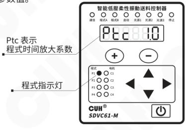

**程式参数介绍：**

● **程式时间放大系数 Ptc：** 将整个程式的运行时间放大或缩小设置的系数。  
设置范围 0.1~10，调整精度为 0.1。

● **程式幅度放大系数 Pcc：** 将本程式中电机电压全部放大或缩小设置的系数。  
本参数仅对电机有效；设置范围 0.1~10，调整精度为 0.1。

● **程式触发方式 Ptg：** 程式的运行既可以内部自动运行，也可以受外部信号控制运行。运行的次数也可以指定。  
调整范围 Ptg In0~Ptg In9；Ptg Ot0~Ptg Ot9。  
备注：In0~In9 为内部自动触发，Ot0~Ot9 为外部程式启动触发；  
0 值表示持续运行，1~9 值表示运行循环次数。


### 第 19 页

智能低压柔性振动送料控制器  
SDVC61-M

## 外部触发示例：

### 接近开关外部触发示例

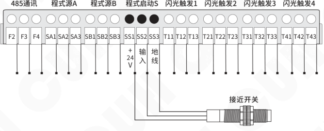

图中端口分组依次为：485通讯、程式源A、程式源B、程式启动S、闪光触发1、闪光触发2、闪光触发3、闪光触发4。接近开关接入程式启动S相关端子（+24V、输入、地线）。

### PLC 外部触发示例

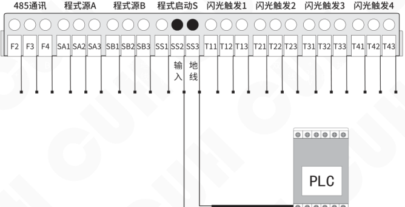

图中端口分组依次为：485通讯、程式源A、程式源B、程式启动S、闪光触发1、闪光触发2、闪光触发3、闪光触发4。PLC 接入程式启动S相关端子（输入、地线）。

2022-04  
SDVC61SMSCN_1.02


### 第 20 页

智能低压柔性振动送料控制器　　　　　　　　　　　　　　　　　　　　　　　　　SDVC61-M

## 4.2 程式段参数设置

**程式段使能：** 表示具体针对某一程式内的具体每个程式段进行设置。

- 同时长按 ◀ 和 ▶，进入程式参数调整界面。
- 短按 ◀ 或 ▶，进入程式段使能界面，可切换 1E~9E 共 9 个程式段。
- 通过 ＋ 或 － 调整每个程式段内电机使能或光源使能（二选一）。

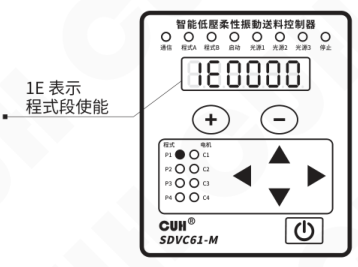

备注：

**1E0000~1E1111为电机开关设置。**

“1”表示开，“0”表示关，四路电机总共16个状态组合。

```text
1 E _ _ _ _
    │ │ │ │
    │ │ │ └─ 电机1
    │ │ └─── 电机2
    │ └───── 电机3
    └─────── 电机4
```

**1E0.0.0.0.~1E0.1.1.1.为光源开关设置。**

“1.”表示开，“0.”表示关，三路光源总共8个状态组合。

```text
1 E 0 . _ . _ . _ .
        │   │   │
        │   │   └─ 光源1
        │   └───── 光源2
        └───────── 光源3
```

---

2022-04　　　　　　　　　　　　　-12-　　　　　　　　　　　　　SDVC61SMSCN_1.02


### 第 21 页

智能低压柔性振动送料控制器  
SDVC61-M

程式段参数介绍：

● **电机使能-电机频率1F：** 设置在某一程式内所有电机的频率值。

» 同时长按 ◀ 和 ▶，进入程式参数调整界面。

» 短按 ▲ 或 ▼ 进入电机频率设置界面，可切换1F~9F对应每个程式段内对应频率值。

» 通过 ＋ 或 － 调整参数值。此时对应的程式和电机指示灯闪烁。

- 1F 表示电机频率
- 默认值为50.0Hz

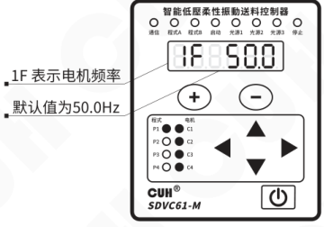

频率范围是5.0～400.0Hz，调整精度0.1Hz。

● **电机使能-电机电压1U：** 设置某一程式内所有电机各自的电压值。

A闭环振幅（1A~4A），此功能开发中。

» 同时长按 ◀ 和 ▶，进入程式参数调整界面。

» 短按 ▲ 或 ▼ 进入电机电压设置界面。

» 通过 ＋ 或 － 调整参数值。

» 短按 ▲ 或 ▼ 切换电机C1~C4。此时对应的程式和电机指示灯闪烁。

- 1U 表示电机1电压
- 默认值为0.0V

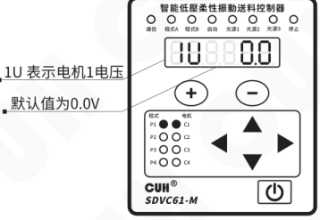

电压范围是0.0V~24.0V，调整精度0.1V。

备注：电机电压的可设置最大值受高级参数“电机最大电压限制hU”的控制。

---

2022-04　　　　　　　　　　　　　-13-　　　　　　　　　　　　　SDVC61SMSCN_1.02


### 第 22 页

智能低压柔性振动送料控制器　　　　　　　　　　　　　　　　　　　　　　　　　SDVC61-M

---

- **电机使能-电机相位1μ**：设置在某一程式内所有电机的相位值。

  - 同时长按 **◀** 和 **▶**，进入程式参数调整界面。
  - 短按 **▲** 或 **▼** 进入电机相位设置界面。
  - 通过 **＋** 或 **－** 调整参数值。
  - 短按 **▲** 或 **▼** 切换电机 C1~C4。此时对应的程式和电机指示灯闪烁。
  - **1μ** 表示电机1相位。
  - 默认值为 **0°**。
  - 相位范围 **-180°~180°**，调整精度 **1°**。

  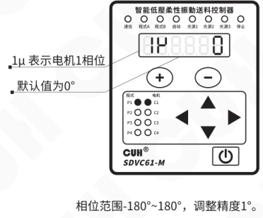

- **光源使能-光源电流1C**：本控制可以独立驱动三路光源，并可以单独设置每路输出电流值大小。

  - 同时长按 **◀** 和 **▶**，进入程式参数调整界面。
  - 短按 **◀** 或 **▶**，进入程式段使能参数，调整控制器为光源使能。
  - 短按 **▼** 进入光源电流设置界面。
  - 通过 **＋** 或 **－** 调整参数值。
  - 短按 **▲** 或 **▼** 切换光源1~光源3。此时对应的程式和光源指示灯闪烁。
  - **1C** 表示光源1电流。
  - 默认值为 **0.00A**。
  - 光源电流调整范围 **0.00~2.00A**，调整精度 **0.01A**。

  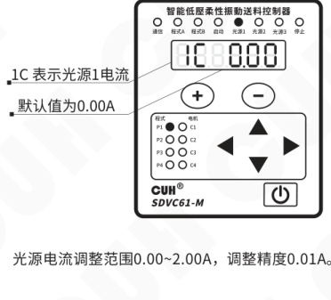

---

2022-04　　　　　　　　　　　　　　　　　-14-　　　　　　　　　　　　　　　　　SDVC61SMSCN_1.02


### 第 23 页

智能低压柔性振动送料控制器　　　　　　　　　　　　　　　　　　　　SDVC61-M

● **保持时间：** 设置该程式段的缓启动时间或保持工作状态的时间值。

- 同时长按 **◀** 和 **▶**，进入程式参数调整界面。
- 短按 **▲** 或 **▼** 进入保持时间设置界面。
- 通过 **＋** 或 **－** 调整参数值。

**缓启动时间设置示意：**

- `1h` 表示缓启动时间。
- 参数值为负值时表示缓启动时间。
- 缓启动时间范围：-9.9s~-0.1s，调整精度：-0.1s。

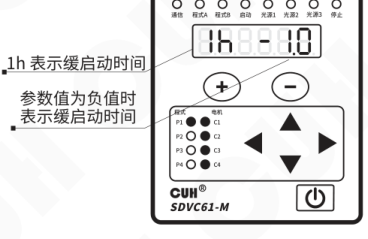

**保持时间设置示意：**

- `1h` 表示保持时间。
- 默认值为 5.0s。
- 保持时间范围：0.0s~99.9s，调整精度：0.1s。

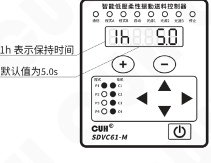

2022-04　　　　　　　　　　　　　　　　　-15-　　　　　　　　　　　　　SDVC61SMSCN_1.02


### 第 24 页

# 第五章 公共参数功能说明

本章节介绍本产品在公共参数界面下的使用方法，主要包含光源及闪光触发功能使用介绍。

## 5.1 光源点亮设置

- **光源1/2/3点亮模式：** 单独设置每路光源的点亮模式，包括：On, Ato, ELU, 1~999ms。

**On：** 常亮；

**Ato：** 程式段控制点亮（默认设置）；

**ELU：** 外部电平触发，当闪光触发端口接收到外部电平有效时，光源点亮；外部电平无效后，光源熄灭；

**1~999ms：** 外部触发闪光时间，当设置闪光触发信号从无效变为有效后，光源点亮的保持时间。

---

- 同时长按 ◀ 和 ▲，进入公共参数调整界面。

- 短按 ▲ 或 ▼，切换到光源1/2/3点亮模式设置界面 1b/2b/3b。

- 通过 ＋ 或 － 调整参数值。

操作示意图：

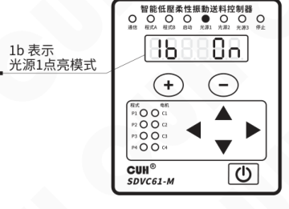


### 第 25 页

智能低压柔性振动送料控制器　　　　　　　　　　　　　　　　　　　　　　　　　SDVC61-M

---

● **光源1/2/3独立输出电流：**区别于程式段参数光源电流1C，当设置光源点亮模式为独立工作时（非Ato状态），可以指定一个外部端口控制，即：闪光触发。此时，设置收到闪光触发后或设置常亮时，具体每路光源的输出电流值。

- 同时长按 ◀ 和 ▲，进入公共参数调整界面。
- 短按 ▲ 或 ▼，切换到光源1/2/3独立输出电流设置界面 1bc/2bc/3bc。
- 通过 ＋ 或 － 调整参数值。

1bc 表示光源1独立输出电流。  
默认值为 0.50A。

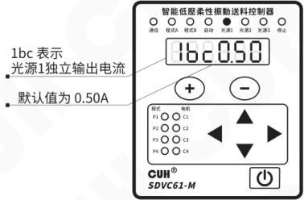

独立输出电流范围 0.00A~2.00A，调整精度0.01A。

---

2022-04　　　　　　　　　　　　　　　　　-17-　　　　　　　　　　　　　　　SDVC61SMSCN_1.02


### 第 26 页

## 5.2 闪光触发设置

- **光源1/2/3外部触发源：** 光源接收到外部闪光触发信号后再输出电流。

操作步骤：

- 同时长按 ◀ 和 ▲，进入公共参数调整界面。
- 短按 ▲ 或 ▼，切换到光源 1/2/3 外部触发源设置界面 `1tg/2tg/3tg`。
- 通过 `+` 或 `-` 调整触发源选择信号 `t1, t2, t3, t4`。

显示说明：

- `1tg` 表示光源 1 外部触发源。
- 默认端口为 `t1`。

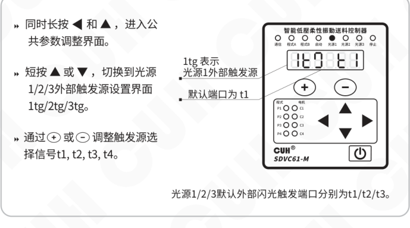

光源 1/2/3 默认外部闪光触发端口分别为 `t1/t2/t3`。


### 第 27 页

智能低压柔性振动送料控制器　　　　　　　　　　　　　　　　　SDVC61-M

● **闪光触发1~4输出信号源1/2：** 当闪光触发端口设置为输出时，可以选择信号源用于指示控制器的参数和状态。

- 同时长按 ◀ 和 ▲，进入公共参数调整界面。
- 短按 ▲ 或 ▼，切换到闪光触发1~4输出信号源1/2设置界面 E1t/E.1t/ E2t/E.2t/ E3t/E.3t/ E4t/E.4t。
- 通过 ＋ 或 － 选择信号源，信号源列表如下：

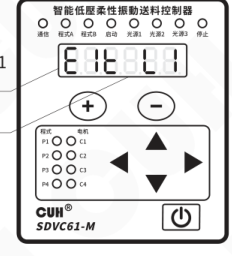

E1t 表示闪光触发1输出信号源1  
默认信号源为 L1

E1t/E.1t/ E2t/E.2t/ E3t/E.3t/ E4t/E.4t  
默认值分别为：L1/0/L2/0/L3/0/Err/0。

| 信号源 | 含义 | 信号源 | 含义 |
|---|---|---|---|
| -P4 | 取程式P4相反状态 | A | 取程式源A状态 |
| -P3 | 取程式P3相反状态 | b | 取程式源B状态 |
| -P2 | 取程式P2相反状态 | S | 取程式启动S状态 |
| -P1 | 取程式P1相反状态 | t1 | 取闪光触发1状态 |
| -L3 | 取光源3相反状态 | t2 | 取闪光触发2状态 |
| -L2 | 取光源2相反状态 | t3 | 取闪光触发3状态 |
| -L1 | 取光源1相反状态 | t4 | 取闪光触发4状态 |
| -t4 | 取闪光触发4相反状态 | L1 | 取光源1状态 |
| -t3 | 取闪光触发3相反状态 | L2 | 取光源2状态 |
| -t2 | 取闪光触发2相反状态 | L3 | 取光源3状态 |
| -t1 | 取闪光触发1相反状态 | P1 | 取程式P1状态 |
| -S | 取程式启动S相反状态 | P2 | 取程式P2状态 |
| -b | 取程式源B相反状态 | P3 | 取程式P3状态 |
| -A | 取程式源A相反状态 | P4 | 取程式P4状态 |
| 0 | 低电平 | Err | 信号错误 |
| 1 | 高电平 |  |  |

2022-04　　　　　　　　　　　　　　　　　-19-　　　　　　　　　　　　　　　　　SDVC61SMSCN_1.02


### 第 28 页

智能低压柔性振动送料控制器　　　　　　　　　　　　　　　　　　　　　　　　　SDVC61-M

- **闪光触发1~4输出信号关系：** 设置闪光触发1~4输出信号的逻辑关系。

  - 同时长按 `◀` 和 `▲`，进入公共参数调整界面。
  - 短按 `▲` 或 `▼`，切换到闪光触发1~4输出信号关系设置界面 `N1t/N2t/N3t/N4t`。
  - 通过 `＋` 或 `－` 切换逻辑关系：`And`（与），`or`（或），`Hor`（异或），`rS`（Rs触发器）。

  `N1t` 表示闪光触发1输出信号关系；默认设置为 `or`。

  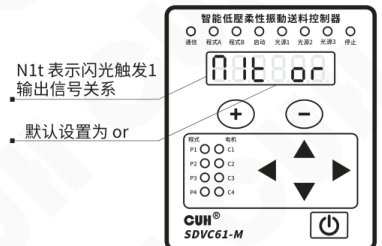

- **闪光触发1~4输出开延时、关延时：** 单独设置每个闪光触发通道的开延时、关延时。

  - 同时长按 `◀` 和 `▲`，进入公共参数调整界面。
  - 短按 `▲` 或 `▼`，切换到闪光触发1~4输出开延时设置界面 `」1t/」2t/」3t/」4t` 或闪光触发1~4输出关延时设置界面 `L1t/L2t/L3t/L4t`。
  - 通过 `＋` 或 `－` 调整参数值。

  `」1t` 表示闪光触发1开延时；默认值为 `0.0s`。

  闪光触发输出开/关延时范围 `0.0s~99.9s`，调整精度 `0.1s`。

  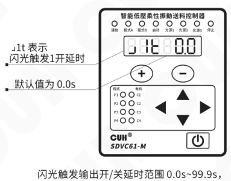

---

2022-04　　　　　　　　　　　　　　　　　-20-　　　　　　　　　　　　　　　　　SDVC61SMSCN_1.02


### 第 29 页

● **闪光触发端口方向：** 因为闪光触发端口是一个双向端口，既可以输入做触发闪光，也可以输出驱动外部负载，所以根据工作需求设置其工作方向。

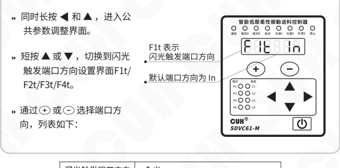

- 同时长按 **◀** 和 **▲**，进入公共参数调整界面。
- 短按 **▲** 或 **▼**，切换到闪光触发端口方向设置界面 **F1t/F2t/F3t/F4t**。
- **F1t** 表示闪光触发端口方向，默认端口方向为 **In**。
- 通过 **＋** 或 **－** 选择端口方向，列表如下：

| 闪光触发端口方向 | 含义 |
|---|---|
| In | 端口设置为输入 |
| Otn | 端口设置为NPN输出 |
| Otp | 端口设置为PNP输出 |
| Opp | 端口设置为推挽输出 |
| O.t.n | 端口设置为NPN取反输出 |
| O.t.p | 端口设置为PNP取反输出 |
| O.p.p | 端口设置为推挽取反输出 |
| syc | 端口设置为输出同步信号 |
| fsc | 端口设置为输出移频信号 |

备注：

x.x.x.：表示取反。

syc：输出同步信号，是指与电机振动频率和相位同步的信号。

fsc：输出移频信号，是指与同步信号有一个设置频差的信号。

输出同步信号和移频信号时，均为推挽输出。


### 第 30 页

智能低压柔性振动送料控制器　　　　　　　　　　　　　　　　　　　　　　　　　SDVC61-M

闪光触发1~4输出逻辑图：

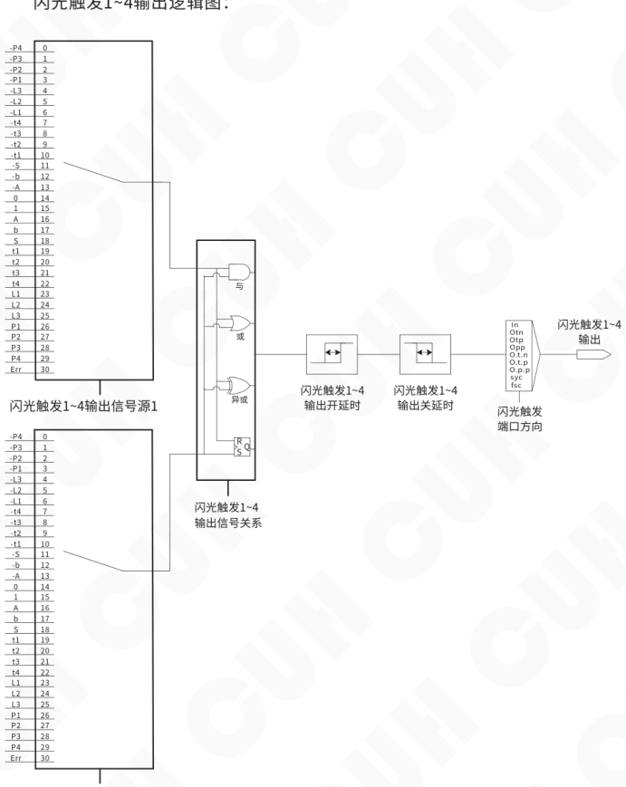

图中闪光触发1~4输出信号源1、输出信号源2的取值对应关系相同：

| 信号源项 | 数值 |
|---|---:|
| -P4 | 0 |
| -P3 | 1 |
| -P2 | 2 |
| -P1 | 3 |
| -L3 | 4 |
| -L2 | 5 |
| -L1 | 6 |
| -t4 | 7 |
| -t3 | 8 |
| -t2 | 9 |
| -t1 | 10 |
| -S | 11 |
| -b | 12 |
| -A | 13 |
| 0 | 14 |
| 1 | 15 |
| A | 16 |
| b | 17 |
| S | 18 |
| t1 | 19 |
| t2 | 20 |
| t3 | 21 |
| t4 | 22 |
| L1 | 23 |
| L2 | 24 |
| L3 | 25 |
| P1 | 26 |
| P2 | 27 |
| P3 | 28 |
| P4 | 29 |
| Err | 30 |

图中逻辑关系：闪光触发1~4输出信号源1、闪光触发1~4输出信号源2经“闪光触发1~4输出信号关系”（与、或、异或）后，依次经过“闪光触发1~4输出开延时”“闪光触发1~4输出关延时”“闪光触发端口方向”，形成“闪光触发1~4输出”。

闪光触发端口方向图中列示项：`In`、`Otn`、`O.t.n`、`Otp`、`O.t.p`、`Opp`、`O.p.p`、`syc`、`fsc`。

2022-04　　　　　　　　　　　　　　　　-22-　　　　　　　　　　　　　　　　SDVC61SMSCN_1.02


### 第 31 页

智能低压柔性振动送料控制器　　　　　　　　　　　　　　　　　　　　SDVC61-M

# 第六章 高级参数功能说明

本章节介绍本产品在高级参数界面下的使用方法。

## 6.1 程式外部控制功能

● **开关传感器类型：** 程式源A，程式源B，程式启动S端口可以支持NPN、PNP、Ut1、Ut0模式。其中：

**Ut1模式为单次扫描，** 即传感器信号无效前一直通过变换高低电平检测端口是否有效，发现有效信号后确定端口传感器类型且不再扫描。

**Ut0模式为连续扫描，** 不管传感器类型如何始终通过变换高低电平检测端口是否接入有效信号。

- » 同时长按 ▶ 和 ▲，进入高级参数调整界面。
- » 短按 ▲ 或 ▼，切换到开关传感器类型设置界面ΓA。
- » 通过 ⊕ 或 ⊖ 切换开关传感器类型。

ΓA 表示开关传感器类型，默认值为 Ut1。

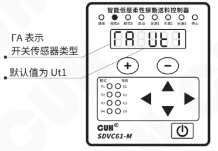

● **程式源A、b、S开延时、关延时：** 用于控制器在接收信号后，开启或关闭时间延迟设置。

- » 同时长按 ▶ 和 ▲，进入高级参数调整界面。
- » 短按 ▲ 或 ▼，切换到程式源A、b、S开延时设置界面JA/Jb/Jq或程式源A、b、S关延时设置界面LA/Lb/Lq。
- » 通过 ⊕ 或 ⊖ 调整参数值。

JA 表示程式源A开延时，默认值为 0.1。

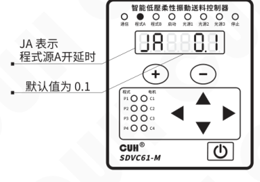

程式源A、b、S开/关延时范围 0.0s~99.9s，调整精度0.1s。

---

2022-04　　　　　　　　　　　　　　-23-　　　　　　　　　　　　　　SDVC61SMSCN_1.02


### 第 32 页

智能低压柔性振动送料控制器　　　　　　　　　　　　　　　　　　　　　　　　　SDVC61-M

---

● **程式源选择：** 由于本控制器可以接收程式源A、程式源B两路输入信号，调整该程式源选择关系可以设置两路程式源信号输入逻辑关系。

**程式源接线示例：**

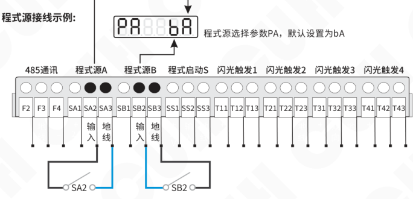

**程式源选择列表：**

| 程式源选择 | 端口信号 | 程式选择 | 备注 |
|---|---|---|---|
| 00 | —— | 程式P1 | 控制器只受面板控制，不受程式源A、B信号控制 |
| 01 | —— | 程式P2 |  |
| 10 | —— | 程式P3 |  |
| 11 | —— | 程式P4 |  |
| 0A | SA2: 无效（仅考虑程式源A口信号） | 程式P1 | 控制器受程式源A、B信号控制 |
| 0A | SA2: 有效（仅考虑程式源A口信号） | 程式P2 |  |
| 1A | SA2: 无效（仅考虑程式源A口信号） | 程式P3 |  |
| 1A | SA2: 有效（仅考虑程式源A口信号） | 程式P4 |  |
| 0b | SB2: 无效（仅考虑程式源B口信号） | 程式P1 |  |
| 0b | SB2: 有效（仅考虑程式源B口信号） | 程式P2 |  |
| 1b | SB2: 无效（仅考虑程式源B口信号） | 程式P3 |  |
| 1b | SB2: 有效（仅考虑程式源B口信号） | 程式P4 |  |
| bA | SB2: 无效　　SA2: 无效 | 程式P1 |  |
| bA | SB2: 无效　　SA2: 有效 | 程式P2 |  |
| bA | SB2: 有效　　SA2: 无效 | 程式P3 |  |
| bA | SB2: 有效　　SA2: 有效 | 程式P4 |  |

---

2022-04　　　　　　　　　　　　　　　　　-24-　　　　　　　　　　　　　　　　　SDVC61SMSCN_1.02


### 第 33 页

智能低压柔性振动送料控制器　　　　　　　　　　　　　　　　　SDVC61-M

---

## 6.2 移频信号频差

● **移频信号频差：** 控制器可以输出一个与音圈电机输出频率偏移固定频率的移频信号。这个移频信号可以用来触发闪光，形成拍频闪光，从而在视觉上减慢物料运动的速度，有助于用户了解物料运动的详细过程。

- 同时长按 ▶ 和 ▲，进入高级参数调整界面。
- 短按 ▲ 或 ▼，切换到移频信号频差设置界面 FS。
- 通过 ＋ 或 － 调整参数值。

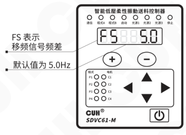

- FS 表示移频信号频差
- 默认值为 5.0Hz

移频信号频差范围 -20.0Hz~20.0Hz，调整精度0.1Hz。

## 6.3 电机最大电压和过流保护限制

● **电机最大电压限制&电机过流保护电流：** 本控制器设置最大输出电压限制和过流保护电流值，用于避免控制器输出功率过大导致电机损坏。

- 同时长按 ▶ 和 ▲，进入高级参数调整界面。
- 短按 ▲ 或 ▼，切换到电机最大电压限制设置界面 hU 或电机过流保护电流 hA。
- 通过 ＋ 或 － 调整参数值。

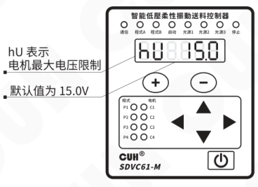

- hU 表示电机最大电压限制
- 默认值为 15.0V

电机最大电压限制范围 0.0V~24.0V，调整精度0.1V。  
电机过流保护电流范围 0.0A~3.0A，调整精度0.1A，默认值1.0A。

---

2022-04　　　　　　　　　-25-　　　　　　　　　SDVC61SMSCN_1.02


### 第 34 页

智能低压柔性振动送料控制器　　　　　　　　　　　　　　　　　　　　　　　　　SDVC61-M

---

## 6.4 RS485通信协议设置

本控制器支持RS485通信，用户连接RS485通信端子后，可以通过上位机对本控制器进行控制和参数的调整。

具体RS485通信协议设置可参考《SDVC61-M系列RS485寄存器地址表》

- **通信协议：** 本控制器可选通信协议Modbus RTU或Modbus ASCⅡ。

  - 同时长按 ▶ 和 ▲，进入高级参数调整界面。
  - 短按 ▲ 或 ▼，切换到通信协议设置界面 **P**。
  - 通过 ⊕ 或 ⊖ 切换通讯协议。

  **P** 表示通信协议；默认协议为 **rtu**。

  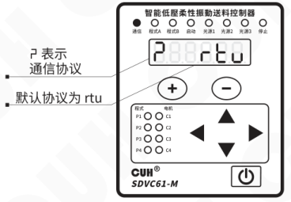

- **波特率：** RS485通信波特率有：0.3, 1.2, 2.4, 9.6, 19.2, 57.6, 115.2 (kbit/s)。

  - 同时长按 ▶ 和 ▲，进入高级参数调整界面。
  - 短按 ▲ 或 ▼，切换到波特率设置界面 **C**。
  - 通过 ⊕ 或 ⊖ 调整波特率。

  **C** 表示波特率；默认值为 **9.6kbit/s**。

  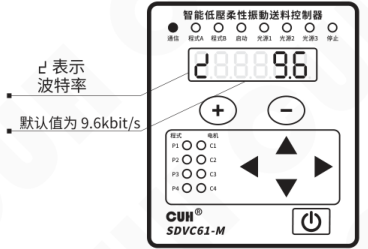

---

2022-04　　　　　　　　　　　　　　　　　-26-　　　　　　　　　　　　　　　　　SDVC61SMSCN_1.02


### 第 35 页

- **通信地址：** RS485通信时本机的ID号，以区别同一网络中的其它节点，范围 1~31。在通信前请确保同一网络中的控制器通信地址应各不相同。

  - 同时长按 **▶** 和 **▲**，进入高级参数调整界面。
  - 短按 **▲** 或 **▼**，切换到通信地址设置界面 **P**。
  - 通过 **+** 或 **−** 切换地址值。

  显示说明：**P** 表示通信地址；默认地址为 **1**。

  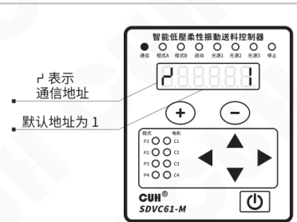

## 6.5 软件版本查询

- 同时长按 **▶** 和 **▲**，进入高级参数调整界面。
- 短按 **▲** 或 **▼**，切换到功率板软件版本显示界面 **Urg** 或控制板软件版本显示界面 **UrC**。
- 此界面仅用于查询软件版本，无法对版本进行任何变更。

显示说明：

- **Urg** 表示功率板软件版本；显示当前版本。
- **UrC** 表示控制板软件版本；显示当前版本。

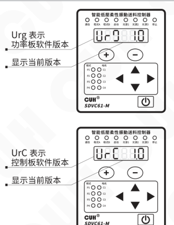


### 第 36 页

智能低压柔性振动送料控制器　　　　　　　　　　　　　　　　　　　SDVC61-M

## 6.6 恢复出厂设置

本功能可以使用户快速将控制器设置为出厂默认设置状态。

由于本控制器功能强大，有数量众多的控制参数可以由用户设定，对于初学者，可能在多次的设定修改后不能恢复控制器的正常工作状态。使用该功能可以快速将调乱的参数状态恢复为出厂默认设置。

- 同时长按 ▶ 和 ▲，进入高级参数调整界面。
- 短按 ▲ 或 ▼，切换到恢复出厂设置界面，此时数码管和 LED 灯全部闪烁。
- 长按 ⊕，直到控制器显示“------”，表示控制器已经重设完毕。

**恢复出厂设置参数设定状态**

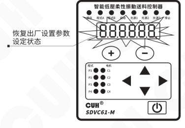

**恢复出厂设置参数设定完成**

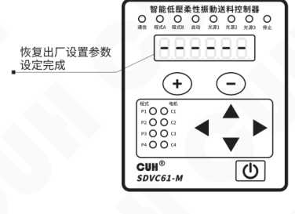

2022-04　　　　　　　　　　　　　　　　　-28-　　　　　　　　　　　　　　　　　SDVC61SMSCN_1.02


### 第 37 页

智能低压柔性振动送料控制器  
SDVC61-M

# 第七章 控制器搭配振动盘简易操作说明

本章节介绍如何设置控制器相关参数搭配振动盘实现既定动作目标。

## 7.1 通过控制器搭配振动盘实现设计动作

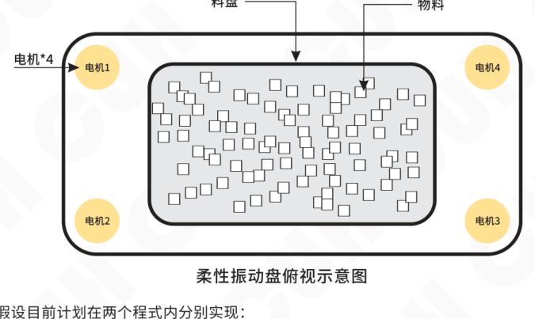

假设目前计划在两个程式内分别实现：

**例1：①物料向左侧聚拢→②物料向右侧聚拢→③点亮底部板，共三个程式段（动作）**

**例2：①物料左右向中间聚拢→②物料上下向中间聚拢→③物料重新振散→④点亮底部灯板，共四个程式段（动作）。**

那么应做如下操作：

### 例1 程式设置

● 按说明书连接控制器和振动盘并通电。

● 确认振动盘电机1~电机4对应位置关系。

● ① **物料向左侧聚拢。** 此时应仅启用电机3、电机4，进入程式段参数设置电机运行为1E 1100、调整电机电压值1U、保持时间1h为0.1s，调整此时电机频率1F，直到找到最适合的频率后，物料按照计划向左侧聚拢，再调整此程式段1E保持时间值1h后退出。

---

2022-04　　　　　　　　　　　　　　　　　-29-　　　　　　　　　　　　　　　SDVC61SMSCN_1.02


### 第 38 页

智能低压柔性振动送料控制器　　　　　　　　　　　　　　　　　　　　　　　　　SDVC61-M

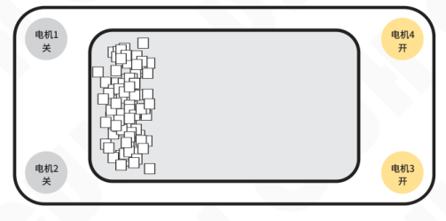

- ② **物料向右侧聚拢。** 此时应仅启用电机1、电机2，进入程式段参数设置电机运行为2E 0011、调整电机电压值2U、保持时间2h为0.1s，调整此时电机频率2F，直到找到最适合的频率后，物料按照计划向右侧聚拢，再调整此程式段2E保持时间值2h后退出。

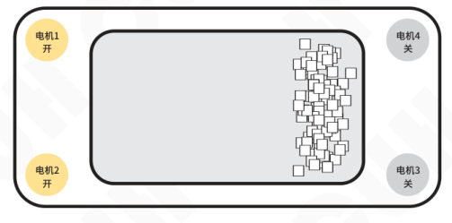

- ③ **点亮底部灯板。** 此时仅使用光源输出不启用电机，进入程式段参数设置光源开关运行为3E 0.0.0.1.、调整光源1电流值，设定此程式段3E保持时间3h后退出。
- 程式设置完毕可以运行。

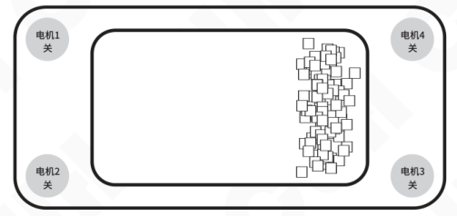


### 第 39 页

智能低压柔性振动送料控制器　　　　　　　　　　　　　　　　　　　　　　SDVC61-M

---

### 例2 程式设置

- 按说明书连接控制器和振动盘并通电。
- 确认振动盘电机1~电机4对应位置关系。

- **① 物料左右向中间聚拢。** 此时应启用全部电机1~4，且把电机1、2看做一组，电机3、4看作另一组。进入程式段参数设置电机运行为1E 1111、调整四组电机电压值、电机1、2相位为0°、电机3、4相位为180°、保持时间1h为0.1s，调整此时电机频率1F直到找到最适频率后物料按照计划向中间聚拢，再调整此程式段1E 保持时间值1h后退出。

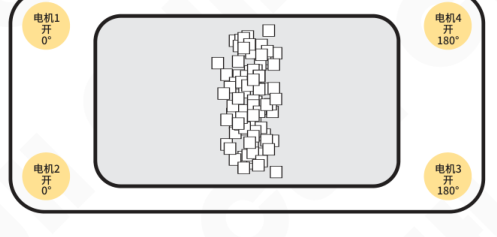

- **② 物料上下向中间聚拢。** 此时应启用全部电机1~4，且把电机1、4看做一组，电机2、3看作另一组。进入程式段参数设置电机运行为2E 1111、调整四组电机电压值、电机1、4相位为0°、电机2、3相位为180°、保持时间2h为0.1s，调整此时电机频率2F直到找到最适频率后物料按照计划向中间聚拢，再调整此程式段2E 保持时间值2h后退出。

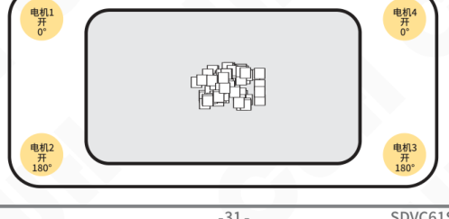

---

2022-04　　　　　　　　　　　　　　　　　-31-　　　　　　　　　　　　　　　　　SDVC61SMSCN_1.02


### 第 40 页

智能低压柔性振动送料控制器　　　　　　　　　　　　　　　　　　　　　　　　　SDVC61-M

- ③ **物料重新振散。** 此时应启用全部电机1~4，进入程式段参数设置电机运行为3E 1111、调整电机电压值3U、四电机保持相同相位3μ为0°、保持时间3h为0.1s，调整此时电机频率3F直到找到最适频率后，物料振散，再调整此程式段3E保持时间值3h后退出。

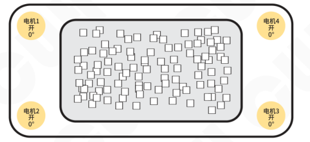

- ④ **点亮底部灯板。** 此时仅使用光源输出不启用电机，进入程式段参数设置光源开关运行为4E 0.0.0.1.、调整光源1电流值，设定此程式段4E保持时间4h后退出。
- 程式设置完毕可以运行。

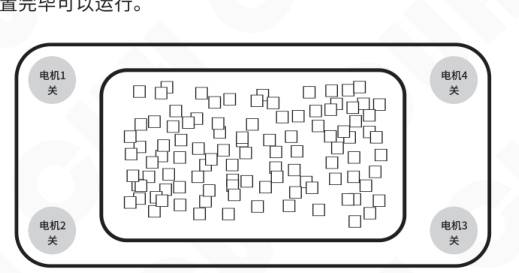

2022-04　　　　　　　　　　　　　　　-32-　　　　　　　　　　　　　　　SDVC61SMSCN_1.02


### 第 41 页

# 第八章 技术规格

## 8.1 外形尺寸

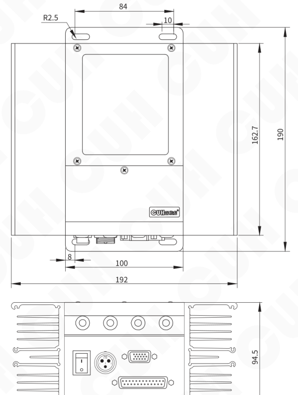

单位：毫米mm


### 第 42 页

## 8.2 技术规格表

| 项目 | 最小值 | 典型值 | 最大值 | 单位 | 备注 |
|---|---:|---:|---:|---|---|
| 交流输入电压 | 180 | 220 | 260 | 伏特（V） | 50/60 Hz 交流有效值 |
| 电机输出电压 | 0 | —— | 24 | 伏特（Vac） |  |
| 电机输出电流 | 0 | —— | 3 | 安培（A） | 交流有效值 |
| 电机输出频率 | 5.0 | 50.0 | 400.0 | 赫兹（Hz） |  |
| 频率调整精度 |  | 0.1 |  | 赫兹（Hz） |  |
| 电机输出波形 |  | 正弦 |  |  |  |
| 光源输出电压 | 12 | —— | 60 | 伏特（V） | 直流 |
| 光源输出电流 | 0 | —— | 2 | 安培（A） | 直流 |
| 光源NTC温度传感器阻值 |  | 100000 |  | 欧姆（Ω） | B值4000K |
| 控制输出电压 | 22 | 24 | 26 | 伏特（V） |  |
| 空载功耗 |  | 7 |  | 瓦特（W） |  |
| 负载类型 |  | 音圈电机和LED灯板 |  |  |  |
| 显示方式 |  | 6 |  | 位 | LED数码管 |
| 工作环境温度 | 0 | 25 | 40 | 摄氏度（℃） |  |
| 工作环境湿度 | 10 | 60 | 85 | 相对湿度（%） | 不结露 |
| 存储环境温度 | -20 | 25 | 85 | 摄氏度（℃） |  |


### 第 43 页

智能低压柔性振动送料控制器　　　　　　　　　　　　　　　　SDVC61-M

## 8.3 参考标准

| 极限参数：超过此指标将会造成严重损坏，必须严格遵守！ |  |  |  |  |  |
|---|---|---|---|---|---|
| 项目 | GB 标准 | IEC 标准 | 等级 | 标准要求 | 备注说明 |
| 静电放电 | GB/T 17626.2-2006 | IEC 61000-4-2:2001 | 4 | ±8 kV | 接触放电 |
|  |  |  | 4 | ±15 kV | 空气放电 |
| 电快速瞬变<br>脉冲群 | GB/T 17626.4-2008 | IEC 61000-4-4:2004 | 4 | ±4 kV |  |
| 直流电源纹<br>波抗扰度 | GB/T 17626.17-2005 | IEC 61000-4-17:2002 | 4 | 15% | 评价 A |

2022-04　　　　　　　　　　　　　　-35-　　　　　　　　　　　　　　SDVC61SMSCN_1.02


### 第 44 页

智能低压柔性振动送料控制器　　　　　　　　　　　　　　　SDVC61-M

# 第九章　附录

## 9.1 参数列表

| 类别 | 含义 | 参数符号 | 取值范围 | 默认设置 |
|---|---|---|---|---|
| 待机参数<br>（不可调节） | 当前程式段 | CP-1-1（[CP-1-1]） | —— | —— |
| 待机参数<br>（不可调节） | 母线电压 | Pu（[PU]） | 12~48 伏特（V） | —— |
| 待机参数<br>（不可调节） | 24V辅助电压 | AU（[AU]） | 20~28 伏特（V） | —— |
| 待机参数<br>（不可调节） | 左/右散热器温度 | Lt（[LT]）<br>rt（[RT]） | -20~85 摄氏度（℃） | —— |
| 待机参数<br>（不可调节） | 电机1/2/3/4电流 | C1C（[C1C]）<br>C2C（[C2C]）<br>C3C（[C3C]）<br>C4C（[C4C]） | 0.00~3.00 安培（A） | —— |
| 待机参数<br>（不可调节） | 传感器1/2/3/4振幅 | A1A（[A1A]）<br>A2A（[A2A]）<br>A3A（[A3A]）<br>A4A（[A4A]） | 0.0~16.0（g） | —— |
| 待机参数<br>（不可调节） | 光源1/2/3输出电压 | L1U（[L1U]）<br>L2U（[L2U]）<br>L3U（[L3U]） | 0.0~60.0 伏特（V） | —— |
| 待机参数<br>（不可调节） | 光源1/2/3输出电流 | L1C（[L1C]）<br>L2C（[L2C]）<br>L3C（[L3C]） | 0.00~2.00 安培（A） | —— |
| 待机参数<br>（不可调节） | 光源1/2/3温度 | L1t（[L1T]）<br>L2t（[L2T]）<br>L3t（[L3T]） | -20~85 摄氏度（℃）<br>-21表示温度传感器未连接 | —— |
| 程式参数 | 程式时间放大系数 | PtC（[PTC]） | 0.1~10 不超过保持时间的最大值 | 1 |
| 程式参数 | 程式幅度放大系数 | PCC（[PCC]） | 0.1~10 仅对电机有效 | 1 |
| 程式参数 | 程式触发方式 | PtG（[PTG]） | In0~9 内部自动触发<br>Ot0~9 外部程式启动S触发<br>0为持续运行，1~9为循环次数 | In0 |

2022-04　　　　　　　　　　　　　　　　SDVC61SMSCN_1.02


### 第 45 页

智能低压柔性振动送料控制器　　　　　　　　　　　　　　　　　SDVC61-M

| 参数类别 | 参数名称 | 数码管符号图片 | 标志 | 参数范围/说明 | 出厂值 |
|---|---|---|---|---|---|
| 程式段参数 | 程式段使能 |  | [1E] | 0000~1111 电机开关<br>0.0.0.~1.1.1. 光源开关 | 0000 |
| 程式段参数 | 电机频率 |  | [1F] | 5.0~400.0 赫兹（Hz） | 50.0 |
| 程式段参数 | 电机电压*4<br>（U开环电压，A闭环振幅） |  | [1U]<br>[1A] | 0.0~24.0 伏特（V）<br>0.0~16.0（g） | 0.0<br>0.0 |
| 程式段参数 | 电机相位*4 |  | [1μ] | -180.0~180.0 度（°） | 0 |
| 程式段参数 | 光源电流*3 |  | [1C] | 0.00~2.00 安培（A） | 0.00 |
| 程式段参数 | 保持时间 |  | [1小H] | 缓启动：-9.9 ~ -0.1 秒（s）<br>保持：0.0~99.9秒（s） | 5.0 |
| 公共参数 | 光源1/2/3点亮模式 |  | [1B]<br>[2B]<br>[3B] | On 常亮<br>Ato 程式段控制点亮<br>ELU 外部电平触发<br>1~999 毫秒 外部触发闪光时间 | Ato |
| 公共参数 | 光源1/2/3独立输出电流<br>（区别于程式段中的电流） |  | [1BC]<br>[2BC]<br>[3BC] | 0.00~2.00 安培（A） | 0.50 |
| 公共参数 | 光源1/2/3外部触发源 |  | [1TG]<br>[2TG]<br>[3TG] | t1, t2, t3, t4<br>外部闪光触发端口 | t1<br>t2<br>t3 |
| 公共参数 | 闪光触发1~4输出<br>信号源1/2 |  | [E1T]<br>[E点1T]<br>[E2T]<br>[E点2T]<br>[E3T]<br>[E点3T]<br>[E4T]<br>[E点4T] | -P4、-P3、-P2、-P1、-L3、<br>-L2、-L1、-t4、-t3、-t2、<br>-t1、-S、-b、-A、0、1、A、<br>b、S、t1、t2、t3、t4、<br>L1、L2、L3、P1、P2、P3、<br>P4、Err<br>t表示外部触发输入，<br>L表示LED亮灭状态，<br>P表示运行程式，<br>Err表示错误信号 | L1<br>0<br>L2<br>0<br>L3<br>0<br>Err<br>0 |
| 公共参数 | 闪光触发1~4输出<br>信号关系 |  | [大N1T]<br>[大N2T]<br>[大N3T]<br>[大N4T] | And 与，or 或<br>Hor 异或，rS Rs触发器 | or |

2022-04　　　　　　　　　　　　　　　　　SDVC61SMSCN_1.02


### 第 46 页

智能低压柔性振动送料控制器　　　　　　　　　　　　　　　　　　　　　　　　　SDVC61-M

### 9.1 参数列表（续）

| 参数类别 | 参数名称 | 标志（文字） | 数码管符号图片 | 设定范围 | 出厂值 |
|---|---|---|---|---|---|
| 公共参数 | 闪光触发1~4输出开延时 | J1t<br>J2t<br>J3t<br>J4t |  | 0.0~99.9 秒（s） | 0.0 |
| 公共参数 | 闪光触发1~4输出关延时 | L1t<br>L2t<br>L3t<br>L4t |  | 0.0~99.9 秒（s） | 0.0 |
| 公共参数 | 闪光触发端口方向 | F1t<br>F2t<br>F3t<br>F4t |  | In, Otn, Otp, Opp, O.t.n., O.t.p., O.p.p., syc, fsc<br>（x.x.x.表示取反、syc表示输出同步信号、fsc表示移频信号） | In |
| 公共参数 | 开关传感器类型 | tA |  | Ut0（连续扫描）, Ut1（单次扫描）, nPn, PnP | Ut1 |
| 高级参数 | 程式源A, b, S开延时 | JA<br>Jb<br>JS |  | 0.0~99.9 秒（s） | 0.1 |
| 高级参数 | 程式源A, b, S关延时 | LA<br>Lb<br>LS |  | 0.0~99.9 秒（s） | 0.1 |
| 高级参数 | 程式源选择 | PA |  | 00, 01, 10, 11, 0A, 1A, 0b, 1b, bA | bA |
| 高级参数 | 振动盘运行模式 | Cn |  | OPE 开环，CLo 闭环 | OPE |
| 高级参数 | 移频信号频差 | FS |  | -20.0~20.0 赫兹（Hz） | 5.0 |
| 高级参数 | 电机最大电压限制 | hU |  | 0.0~24.0 伏特（V） | 15.0 |
| 高级参数 | 电机过流保护电流 | hA |  | 0.0~3.0 安培（A） | 1.0 |
| 高级参数 | 通信协议 | P |  | rtu, ASC | rtu |
| 高级参数 | 波特率 | b |  | 0.3, 1.2, 2.4, 9.6, 19.2, 57.6, 115.2<br>（Kbit/s） | 9.6 |
| 高级参数 | 通信地址 | A |  | 1~31 | 1 |
| 高级参数 | 功率板软件版本 | UrG |  | —— | —— |
| 高级参数 | 控制板软件版本 | UrC |  | —— | —— |
| 高级参数 | 恢复出厂设置 | 888888 |  | —— | —— |

2022-04　　　　　　　　　　　　　　　　　　-38-　　　　　　　　　　　　　　　　　　SDVC61SMSCN_1.02


### 第 47 页

智能低压柔性振动送料控制器　　　　　　　　　　　　　　　　　　　　　　　　　SDVC61-M

## 9.2 输入输出电路图

### 485通讯F端口


### 程式源A/B/S端口（以程式源A为例）


### 闪光触发1~4端口（以闪光触发1为例）


---

2022-04　　　　　　　　　　　　　　　-39-　　　　　　　　　　　　　　　SDVC61SMSCN_1.02


### 第 48 页

## 9.3 故障诊断

| 故障代码 | 含义 | 排除方法 |
|---|---|---|
| Err011/012/013/014 | 音圈电机C1~C4短路 | 确保负载未被短路 |
| Err021/022/023/024 | 音圈电机C1~C4过流 | 适当降低输出电压 |
| Err031/032 | 左/右散热器过热 | 提供通风散热良好的环境 |
| Err041/042 | 功率/辅助电源故障 | 确保输入电压在180~260Vac |
| Err05 | 内部通讯异常 | 联系我司技术支持 |
| Err06 | 内部温度传感器异常 | 联系我司技术支持 |
| Err071/072/073 | 光源输出1~3短路 | 确保正确连接光源负载 |
| Err081/082/083 | 光源输出1~3开路 | 确保正确连接光源负载 |
| Err091/092/093/094 | 触发输出1~4短路 | 确保负载未被短路或超过200mA电流 |
| Err101/102/103/104 | 振动传感器1~4缺轴 | 正确连接振动传感器 |
| Err201/202/203 | 光源1~3过热 | 为光源提供良好散热 |


### 第 49 页

智能低压柔性振动送料控制器　　　　　　　　　　　　　　　　SDVC61-M

---

# 第十章 产品质保信息

## 10.1 质保期

本公司为本产品提供的质保期为一年，从产品发送到购买方指定地点之日算起。

## 10.2 保修范围

（一）如果在上述质保期内出现本公司造成的故障，我们将免费维修产品。但是以下情况不属于保修范围：

 a、未按照简易说明书、用户手册或购买方与本公司专门达成的技术要求中规定的条件、环境下的不正确操作，或不正确使用造成的故障。

 b、故障不是因产品缺陷，而是购买方设备或软件设计造成的。

 c、非本公司人员进行的修改或修理而造成的故障。

 d、按照简易操作指南或用户手册正确维修或更换易损部件等规定可以完全避免的故障。

 e、产品从本公司发货后，因无法预料的科学技术水平变化等因素而造成的故障。

 f、由于火灾、地震、洪水等自然灾害，或异常电压等外部因素造成的故障，本公司不负责保修。

（二）保修范围仅限于（一）中规定的情况，本公司对该设备造成的购买方间接损失（如设备损坏、机会丧失、利润损失等）或其他损失，不承担任何责任。

## 10.3 产品适用性

本公司的该控制器是针对柔性振动送料行业的通用产品而设计生产的。因此，本公司的该控制器不得用于下列应用且不适合其使用。

（一）对生命和财产有严重影响的设施，如核发电厂、机场、铁路、轮船、机动装置及医疗设备。

（二）公共事业，包括电力、气体、供水等。

（三）相似条件或环境的户外使用。

---

2022-04　　　　　　　　　　　　　　　　-41-　　　　　　　　　　　　　　　　SDVC61SMSCN_1.02


### 第 50 页

智能低压柔性振动送料控制器　　　　　　　　　　　　　　　　　　　　　　　　　SDVC61-M

---


---

2022-04　　　　　　　　　　　　　　　　　　　　　　　　　　　　　SDVC61SMSCN_1.02


### 第 51 页

*（本页 `page_markdown` 为空。）*


### 第 52 页

|  |  |
|---|---|
|  | 南京创优科技有限责任公司<br>网址:www.cuhnj.com<br>电话:025-84730416<br>传真:025-84730426<br>邮箱:sales@cuhnj.com<br>地址:南京市江宁区智能路9号<br>启迪城学研园2幢 |
<!-- /auto:ai-body-draft v1 -->

<!-- auto:data-params-summary v1 -->
## 附录 · 参数表（结构化侧车·机器生成）

> 说明：本节由 `data/<doc_key>/params/params.yaml` 自动渲染（展示前若干行），用于校对与二次开发。定稿以层 C 数据为准。

| 参数 | 标志/符号 | 范围 | 默认 | 单位 | 备注 |
| --- | --- | --- | --- | --- | --- |
| <br> <br>**警告** | <br> <br>**警告** |  |  |  |  |
| <br> <br>**小心** | <br> <br>**小心** |  |  |  |  |
| <br> <br>**注意** | <br> <br>**注意** |  |  |  |  |
| <br>温度3+ |  |  |  |  |  |
| <br> <br>5 |  |  |  |  |  |
| <br> <br>3.3V |  |  |  |  |  |
| <br> <br>Ptc<br>Pcc<br>Ptg |  |  |  |  |  |
| <br> <br>Ptc<br>Pcc<br>Ptg |  |  |  |  |  |
| <br> <br>Ptc<br>Pcc<br>Ptg |  |  |  |  |  |
| <br> <br>Ptc<br>Pcc<br>Ptg |  |  |  |  |  |
| <br> <br>-P4 |  |  |  |  |  |
| <br> <br>-P3 |  |  |  |  |  |
| <br> <br>-P2 |  |  |  |  |  |
| <br> <br>-P1 |  |  |  |  |  |
| <br> <br>-L3 |  |  |  |  |  |
| <br> <br>-L2 |  |  |  |  |  |
| <br> <br>-L1 |  |  |  |  |  |
| <br> <br>-t4 |  |  |  |  |  |
| <br> <br>-t3 |  |  |  |  |  |
| <br> <br>-t2 |  |  |  |  |  |
| <br> <br>-t1 |  |  |  |  |  |
| <br> <br>-S |  |  |  |  |  |
| <br> <br>-b |  |  |  |  |  |
| <br>-A |  |  |  |  |  |
| <br>0 |  |  |  |  |  |
| <br>1 |  |  |  |  |  |
| <br> <br> <br>In |  |  | <br> <br> <br>端口设置为输入 |  |  |
| <br> <br> <br>Otn |  |  | <br> <br> <br>端口设置为NPN输出 |  |  |
| <br> <br> <br>Otp |  |  | <br> <br> <br>端口设置为PNP输出 |  |  |
| <br> <br> <br>Opp |  |  | <br> <br> <br>端口设置为推挽输出 |  |  |

*（仅展示前 30 条，共 165 条；完整数据见下方链接。）*

- 完整 YAML：`data/cuh.sdvc.manual.v1.01/params/params.yaml`
- 表格索引：`data/cuh.sdvc.manual.v1.01/index.yaml`
<!-- /auto:data-params-summary v1 -->
