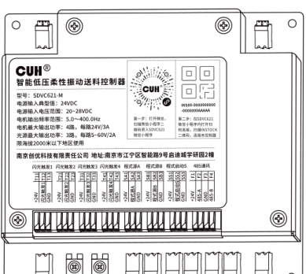
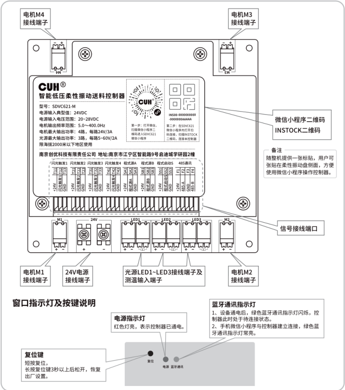
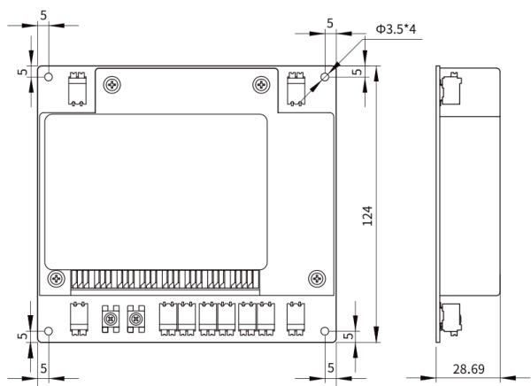
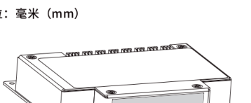

## 目录

> 下列条目来自 PDF 内置书签/大纲；链接指向本批转换生成的整页渲染图（`assets/pages/`），便于与原版 PDF 对照校对。

- [页 1](assets/pages/page-0001.png)（第 1 页）
- [页 2](assets/pages/page-0002.png)（第 2 页）
- [页 3](assets/pages/page-0003.png)（第 3 页）
- [页 4](assets/pages/page-0004.png)（第 4 页）
## 术语与命名

- 侧车：`glossary/terms.yaml`（机读）、`glossary/zh-CN.md`（人读）；候选表，定稿后并入公司级 `glossary/`。

## 适用范围

- 本文档由 PDF 自动转换生成，正文与插图需人工核对。

## 变更记录

- 2026-06-05 12:24:37：由转换工具从源 PDF 生成首版。

## 正文

<!-- auto:ai-body-draft v1 -->
> 以下为**整页视觉转写**的正文草稿（多模态模型直接输出 Markdown，含 GFM 表； 若配置 `[[vcrop:页:序]]` 占位符，裁剪步骤会插入 `assets/images/` 下 PNG）。**请务必人工校对。**

### 第 1 页

**CUH® 创优虎**

www.cuhnj.com

扫描二维码下载详细说明书

# 智能低压柔性振动送料控制器

# SDVC621 简易操作指南

---

*Intelligent Low Voltage Flexible Vibratory Feeder Controller*

适用控制器型号：  
SDVC621-M  
（4路音圈电机输出，每路峰值24V/3A，3路LED驱动输出，每路电压5~60V/峰值电流2A）

**南京创优科技有限责任公司**

地址：南京市江宁区智能路9号启迪城学研园2幢  
销售电话：025-84730416  
传真：025-84730426  
企业邮箱：sales@cuhnj.com  
文档编号：IDP1000368_A.2

### 第 2 页

*SDVC621智能低压柔性振动送料控制器*

## 指示灯，按键及接线端口说明

### 接线端口位置说明

| 图中标注 | 说明 |
|---|---|
| 电机M1接线端子 | 电机 M1 接线端口 |
| 电机M2接线端子 | 电机 M2 接线端口 |
| 电机M3接线端子 | 电机 M3 接线端口 |
| 电机M4接线端子 | 电机 M4 接线端口 |
| 24V电源接线端子 | 24V 电源接线端口 |
| 光源LED1~LED3接线端子及测温输入端子 | 光源 LED1~LED3 接线端子及测温输入端子 |
| 信号接线端口 | 控制器信号接线端口 |
| 微信小程序二维码 / INSTOCK二维码 | 用于进入 SDVC621 微信小程序及扫码连接本控制器 |

### 控制器标贴信息

| 项目 | 内容 |
|---|---|
| 名称 | 智能低压柔性振动送料控制器 |
| 型号 | SDVC621-M |
| 电源输入典型值 | 24VDC |
| 电源输入电压范围 | 20~28VDC |
| 电机输出频率范围 | 5.0~400.0Hz |
| 电机最大输出功率 | 4路，每路24V/3A |
| 光源最大输出功率 | 3路，每路5~60V/2A |
| 使用限制 | 限海拔2000米以下地区使用 |
| 厂商 | 南京创优科技有限责任公司 |
| 地址 | 南京市江宁区智能路9号启迪城学研园2幢 |

### 信号接线端口可见标识

| 类别 | 图中可见文字 |
|---|---|
| 功能分组 | 闪光触发1、闪光触发2、闪光触发3、闪光触发4、程式源A、程式源B、程式启动S、485通讯 |
| 端子代号 | T13、T43、SA3、SB3、SS3、F3、F4、T33、T23、T12、T42、SA2、SB2、SS2、F2、T32、T22、T11、T41、SA1、SB1、SS1、F1、T31、T21 |
| 电源/地/通讯 | +24V、GND、485-A、485-B |

### 二维码使用说明

| 步骤 | 说明 |
|---|---|
| 第一步 | 打开微信，扫描微信小程序二维码进入 SDVC621 微信小程序。 |
| 第二步 | 在微信小程序内打开扫码连接，扫描 INSTOCK 二维码，连接本控制器。 |

二维码标识示例：

- `INS00-0000000000`
- `-0000000AAAAA`

备注：随整机提供一张标贴，用户可张贴在柔性振动盘侧面，方便使用微信小程序操作控制器。

### 窗口指示灯及按键说明

窗口处可见标识：`复位`、`电源`、`蓝牙通讯`。

| 项目 | 说明 |
|---|---|
| 复位键 | 短按复位，长按复位键3秒以上后松开，恢复出厂设置。 |
| 电源指示灯 | 红色灯亮，表示控制器已通电。 |
| 蓝牙通讯指示灯 | 1、设备通电后，绿色蓝牙通讯指示灯闪烁，控制器此时处于待连接状态。 2、手机微信小程序与控制器建立连接，绿色蓝牙通讯指示灯常亮。 |

### 第 3 页

<u><em>SDVC621智能低压柔性振动送料控制器</em></u>

## 技术规格

| 项目 | 最小值 | 典型值 | 最大值 | 单位 | 备注 |
|---|---:|---:|---:|---|---|
| 直流输入电压 | 20 | 24 | 28 | 伏特（Vdc） |  |
| 电机输出电压 | 0 | —— | 24 | 伏特（Vac） | 交流有效值 |
| 电机输出电流 | 0 | —— | 3 | 安培（A） | 交流有效值 |
| 电机输出频率 | 5.0 | 50.0 | 400.0 | 赫兹（Hz） |  |
| 频率调整精度 |  | 0.1 |  | 赫兹（Hz） |  |
| 电机输出波形 |  | 正弦 |  |  |  |
| 光源输出电压 | 5 | —— | 60 | 伏特（V） | 直流 |
| 光源输出电流 | 0 | —— | 2 | 安培（A） | 直流 |
| 光源NTC温度传感器阻值 |  | 100000 |  | 欧姆（Ω） | B值4000K |
| 控制输出电压 | 22 | 24 | 26 | 伏特（V） |  |
| 空载功耗 |  | 不超过3W |  | 瓦特（W） |  |
| 负载类型 |  | 音圈电机和LED灯板 |  |  |  |
| 电机接线端子使用线径 | 24 | —— | 16 | AWG |  |
| 信号接线端子使用线径 | 26 | —— | 18 | AWG |  |
| 工作环境温度 | 0 | 25 | 40 | 摄氏度（℃） |  |
| 工作环境湿度 | 10 | 60 | 85 | 相对湿度（%） | 不结露 |
| 存储环境温度 | -20 | 25 | 85 | 摄氏度（℃） |  |

## 功能特点

- 支持手机蓝牙连接控制器，并实现通过手机微信小程序在手机端完成所有设备操作。
- 四个音圈电机驱动输出，最大功率24V/3A，可以独立控制相位差。
- 三个光源驱动输出，每路电压5~60V/峰值电流2A。
- 每组光源配备NTC温度传感器接口，可实现光源的过热保护。
- 控制器设计四个程式，每个程式包括9个程式段。每个程式段可以控制使能、输出频率、通道电压或振幅、相位差、光源电流、保持时间。
- 程式选择与运行触发支持外部开关传感器信号控制，且传感器类型可以设置或自动识别。
- 闪光触发端口为双向端口，可以设置为输入用来触发光源点亮，也可以设置为输出驱动外部负载。输出支持NPN、PNP、推挽三种工作模式，支持选择多种信号源。
- 闪光触发端口可以输出同步信号或移频信号，用来触发光源形成移频闪光。该功能通过拍频将物料的运动状态减慢，使得用户可以看出物料运动的细节。
- RS485接口支持Modbus ASCII和RTU两种协议，可联网控制所有参数。

### 第 4 页

<u><em>SDVC621智能低压柔性振动送料控制器</em></u>

## 安装尺寸

**单位：毫米（mm）**

| 公差区间 | 公差值 |
|---|---|
| 0~3 | ±0.05 |
| 3~10 | ±0.1 |
| 10~30 | ±0.15 |
| 30~80 | ±0.2 |
| 80~180 | ±0.3 |

**要求：** 请将本产品安装在导热良好的平台上并打硅脂填缝。

**发布时间：** 2023.08

**该说明书的最终解释权归本公司所有**
<!-- /auto:ai-body-draft v1 -->

<!-- auto:data-params-summary v1 -->
## 附录 · 参数表（结构化侧车·机器生成）

> 说明：本节由 `data/<doc_key>/params/params.yaml` 自动渲染（展示前若干行），用于校对与二次开发。定稿以层 C 数据为准。

| 参数 | 标志/符号 | 范围 | 默认 | 单位 | 备注 |
| --- | --- | --- | --- | --- | --- |
| 项目 |  |  |  |  |  |
| 直流输入电压 |  |  |  |  |  |
| 电机输出电压 |  |  |  |  |  |
| 电机输出电流 |  |  |  |  |  |
| 电机输出频率 |  |  |  |  |  |
| 频率调整精度 |  |  |  |  |  |
| 电机输出波形 |  |  |  |  |  |
| 光源输出电压 |  |  |  |  |  |
| 光源输出电流 |  |  |  |  |  |
| 光源NTC温度传感器阻值 |  |  |  |  |  |
| 控制输出电压 |  |  |  |  |  |
| 空载功耗 |  |  |  |  |  |
| 负载类型 |  |  |  |  |  |
| 电机接线端子使用线径 |  |  |  |  |  |
| 信号接线端子使用线径 |  |  |  |  |  |
| 工作环境温度 |  |  |  |  |  |
| 工作环境湿度 |  |  |  |  |  |
| 0~3 |  |  |  |  |  |
| 3~10 |  |  |  |  |  |
| 10~30 |  |  |  |  |  |
| 30~80 |  |  |  |  |  |
| 80~180 |  |  |  |  |  |

- 完整 YAML：`data/cuh.sdvc.manual.v0.0/params/params.yaml`
- 表格索引：`data/cuh.sdvc.manual.v0.0/index.yaml`
<!-- /auto:data-params-summary v1 -->
