## 目录

> 下列条目来自 PDF 内置书签/大纲；链接指向本批转换生成的整页渲染图（`assets/pages/`），便于与原版 PDF 对照校对。

- [1: 封面](assets/pages/page-0001.png)（第 1 页）
- [2: 封2](assets/pages/page-0002.png)（第 2 页）
- [3: 序言](assets/pages/page-0003.png)（第 3 页）
- [4: 安全与预防措施](assets/pages/page-0004.png)（第 4 页）
- [5: 目录](assets/pages/page-0005.png)（第 5 页）
- [6: 目录2](assets/pages/page-0006.png)（第 6 页）
- [7: 1](assets/pages/page-0007.png)（第 7 页）
- [8: 2](assets/pages/page-0008.png)（第 8 页）
- [9: 3](assets/pages/page-0009.png)（第 9 页）
- [10: 4](assets/pages/page-0010.png)（第 10 页）
- [11: 5](assets/pages/page-0011.png)（第 11 页）
- [12: 6](assets/pages/page-0012.png)（第 12 页）
- [13: 7](assets/pages/page-0013.png)（第 13 页）
- [14: 8](assets/pages/page-0014.png)（第 14 页）
- [15: 9](assets/pages/page-0015.png)（第 15 页）
- [16: 10](assets/pages/page-0016.png)（第 16 页）
- [17: 11](assets/pages/page-0017.png)（第 17 页）
- [18: 12](assets/pages/page-0018.png)（第 18 页）
- [19: 13](assets/pages/page-0019.png)（第 19 页）
- [20: 14](assets/pages/page-0020.png)（第 20 页）
- [21: 15](assets/pages/page-0021.png)（第 21 页）
- [22: 16](assets/pages/page-0022.png)（第 22 页）
- [23: 17](assets/pages/page-0023.png)（第 23 页）
- [24: 18](assets/pages/page-0024.png)（第 24 页）
- [25: 19](assets/pages/page-0025.png)（第 25 页）
- [26: 20](assets/pages/page-0026.png)（第 26 页）
- [27: 21](assets/pages/page-0027.png)（第 27 页）
- [28: 22](assets/pages/page-0028.png)（第 28 页）
- [29: 23](assets/pages/page-0029.png)（第 29 页）
- [30: 24](assets/pages/page-0030.png)（第 30 页）
- [31: 25](assets/pages/page-0031.png)（第 31 页）
- [32: 26](assets/pages/page-0032.png)（第 32 页）
- [33: 27](assets/pages/page-0033.png)（第 33 页）
- [34: 28](assets/pages/page-0034.png)（第 34 页）
- [35: 29](assets/pages/page-0035.png)（第 35 页）
- [36: 30](assets/pages/page-0036.png)（第 36 页）
- [37: 空白页](assets/pages/page-0037.png)（第 37 页）
- [38: 空白页](assets/pages/page-0038.png)（第 38 页）
- [39: 封3](assets/pages/page-0039.png)（第 39 页）
- [40: 封底](assets/pages/page-0040.png)（第 40 页）
## 术语与命名

- 侧车：`glossary/terms.yaml`（机读）、`glossary/zh-CN.md`（人读）；候选表，定稿后并入公司级 `glossary/`。

## 适用范围

- 本文档由 PDF 自动转换生成，正文与插图需人工核对。

## 变更记录

- 2026-06-05 23:26:12：由转换工具从源 PDF 生成首版。

## 正文

<!-- auto:ai-body-draft v1 -->
> 以下为**整页视觉转写**的正文草稿（多模态模型直接输出 Markdown，含 GFM 表； 若配置 `[[vcrop:页:序]]` 占位符，裁剪步骤会插入 `assets/images/` 下 PNG）。**请务必人工校对。**

### 第 1 页

# 智能光纤分选控制器

*Intelligent Optical Fiber Sorting Controller*

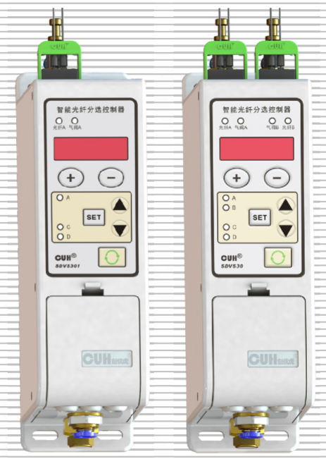

## SDVS30系列

# 用户手册

### 第 2 页

## 智能数字振动送料控制器相关产品

| 品名规格 | 特 | 点 |
|---|---|---|
| **SDVC34** 智能数字自动调频振动送料控制器系列 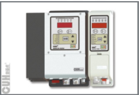 | · 频率调节 · 智能跟踪 · 料满停机 · 控制输出 · 最大输出限定 · 恢复出厂设置 · 过流保护功能 · 加速功能 | · 电压调节 · 计数功能 · 线控调速 · Rs485通信 · 波形指数设置 · 过热保护功能 · 短路保护功能 |
| **SDVC31** 数字调频振动送料控制器系列 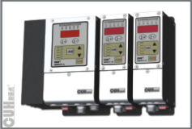 | · 自动稳压 · 缓启动时间设置 · 智能光电传感 · 控制输出 · 最大输出限定 · 恢复出厂设置 · 过流保护功能 | · 缓启动 · 加速功能 · 线控调速 · 键盘锁定 · 波形指数设置 · 过热保护功能 · 短路保护功能 |

## 压电数字调频振动送料控制器

| 品名规格 | 特 | 点 |
|---|---|---|
| **SDVC40** 压电数字调频振动送料控制器系列 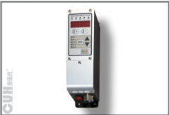 | · 自动稳压 · 缓启动时间设置 · 线控调速 · 键盘锁定 · 波形指数设置 · 过热保护功能 · 短路保护功能 | · 缓启动 · 智能光电传感 · 控制输出 · 最大输出限定 · 恢复出厂设置 · 过流保护功能 |

### 第 3 页

**智能光纤分选控制器**　　　　　　　　　　　　　　　　　　　　　　　　　**SDVS30系列**

---

# 序　言

感谢您使用南京创优科技有限责任公司（在本手册中以下简称本公司）出品的SDVS30系列智能光纤分选控制器（在本手册中以下简称本产品、本控制器或控制器）。

本手册介绍了本产品的基本操作方法、功能技术说明和典型应用示例，为用户提供安装调试、参数设置、异常诊断、故障排除及日常维护控制器的相关信息。为了确保正确安装和使用本控制器，请在装机之前仔细阅读本用户手册，并请妥善保存。

以下符号提醒您注意有关防止人身伤害和产品损坏的事项，请务必阅读。

| 符号 | 说明 |
|---|---|
| ⚠️ 危险 | 表示若不遵守该事项，将导致人员伤亡。 |
| ⚠️ 警告 | 表示若不遵守该事项，可能导致人员伤亡 |
| ⚠️ 小心 | 表示若不遵守该事项，可能导致人员遭受中度或轻微伤害。 |
| 注意 | 表示若不遵守该事项，将导致本产品损坏及财产损失。 |
| 要点 | 表示在使用过程中必须要遵守的注意事项和使用限制等。 |

本说明书适合以下型号控制器：

- 智能光纤分选控制器-SDVS30 （双路光纤）
- 智能光纤分选控制器-SDVS301 （单路光纤）

---

2019-01　　　　　　　　　　　　　　　　　　　　　　　　　SDVS30SMSCN_2.01

### 第 4 页

智能光纤分选控制器　　　　　　　　　　　　　　　　　　　　　　　　　SDVS30系列

# 安全与预防措施

1、⚠ **危险** 本产品仅供物料分选之用，请勿将本产品用于保护人体或人体部位等目的。

2、⚠ **危险** 本产品不得作为防爆产品使用，请勿在危险场所和/或潜在爆炸气体环境中使用本产品。

3、⚠ **警告** 本产品是采用直流供电的设备，请勿施加交流电压。如果施加交流电压则可能导致产品爆炸或者火。

4、⚠ **警告** 请勿在带电的情况下拔插接线或试图触摸接线仓内各接线点，以防发生触电意外事故。

5、⚠ **小心** 请务必根据控制器所接负载选择合理功率的电源，推荐24V/1A规格且符合IEC标准的Class Ⅱ类电源。

6、**注意** 请勿将所有连接线与交流电源线或振动盘电磁铁线圈引出线使用同一配线，否则可能因噪声导致内部电路发生故障或受损。

7、**注意** 本产品设计使用于阴凉干燥环境，请勿将本产品置于室外、可能会浸水、阳光暴晒场所工作，也不要在超过本产品电气特性要求的温度和湿度范围之外工作。

8、**注意** 请确认使用的气源气压未超出本产品技术规格表中规定的最高工作气压，且压缩空气净化等级满足3.1节中规定的要求，否则可能损坏产品或造成使用寿命的极大下降。

9、**要点** 请务必将本产品固定在可靠接地的坚固平台上。

10、**要点** 任何情况下请勿将本产品在超越设计极限状态下工作。

11、**要点** 请严格按照本手册和《智能光纤分选控制器SDVS30系列简易操作指南》的说明操作，对于违反这些操作说明所造成的任何设备损失或人身伤害，本公司不承担任何民事和刑事责任。

12、本手册的最终解释权归本公司所有。

---

2019-01　　　　　　　　　　　　　　　　　　　　　　　　　SDVS30SMSCN_2.01

### 第 5 页

智能光纤分选控制器　　　　　　　　　　　　　　　　　　　　　　　　　SDVS30系列

---

# 目　　录

 i.　介绍

 ii.　安全与预防措施

第一章　使用前须知 ---------------------------------------------------- 1

　　1.1　检查包装内容 ----------------------------------------------- 1

　　1.2　控制器部件说明 --------------------------------------------- 3

　　1.3　选购部件代码 ----------------------------------------------- 4

第二章　产品介绍 ------------------------------------------------------ 6

　　2.1　产品简介 --------------------------------------------------- 6

　　2.2　主要功能特点 ----------------------------------------------- 6

　　2.3　产品适用范围 ----------------------------------------------- 7

第三章　安装与连接 ---------------------------------------------------- 8

　　3.1　控制器使用条件 --------------------------------------------- 8

　　3.2　控制器安装固定 --------------------------------------------- 8

　　3.3　输入输出气管安装 ------------------------------------------- 9

　　3.4　输出流量调节 ----------------------------------------------- 9

　　3.5　光纤传感器安装 -------------------------------------------- 10

　　3.6　电源连接 -------------------------------------------------- 11

第四章　基本使用方法 ------------------------------------------------- 12

　　4.1　基本操作 -------------------------------------------------- 12

　　4.2　使用方法 -------------------------------------------------- 13

　　4.3　恢复出厂设置 ---------------------------------------------- 14

第五章　高级功能说明 ------------------------------------------------- 15

　　5.1　参数列表 -------------------------------------------------- 15

　　5.2　输入输出逻辑图 -------------------------------------------- 17

　　5.3　输出模式说明 ---------------------------------------------- 18

　　5.4　外接光纤传感器和电磁阀 ------------------------------------ 19

　　5.5　选配光纤支架安装 ------------------------------------------ 21

第六章　典型应用案例 ------------------------------------------------- 23

　　6.1　纯色物料分选案例 ------------------------------------------ 23

　　6.2　混色物料分选案例 ------------------------------------------ 24

　　6.3　两路光纤协同案例 ------------------------------------------ 25

第七章　技术规格 ----------------------------------------------------- 26

　　7.1　技术规格表 ------------------------------------------------ 26

　　7.2　输入输出电路图 -------------------------------------------- 27

---

2019-01　　　　　　　　　　　　　　　　　　　　　　　　　SDVS30SMSCN_2.01

### 第 6 页

| 智能光纤分选控制器 | SDVS30系列 |
|---|---:|

第八章　附录 ------------------------------------------------------------ 28  
　8.1　外形尺寸 -------------------------------------------------------- 28  
　8.2　故障诊断 -------------------------------------------------------- 29  
　8.3　参考标准 -------------------------------------------------------- 29  
第九章　产品保证信息 ---------------------------------------------------- 30  
　9.1　保质期 ---------------------------------------------------------- 30  
　9.2　保修范围 -------------------------------------------------------- 30  
　9.3　产品适用性 ------------------------------------------------------ 30

| 2019-01 | SDVS30SMSCN_2.01 |
|---|---:|

### 第 7 页

**智能光纤分选控制器**　　　　　　　　　　　　　　　　　　　　　　　　　**SDVS30系列**

# 第一章　使用前须知

本章节介绍产品包装内容、控制器各零部件的名称、选配部件代码。

## 1.1 检查包装内容

使用本产品之前，请检查以下设备和附件完整。如果发现产品有缺陷或已损坏，请与我司联系。

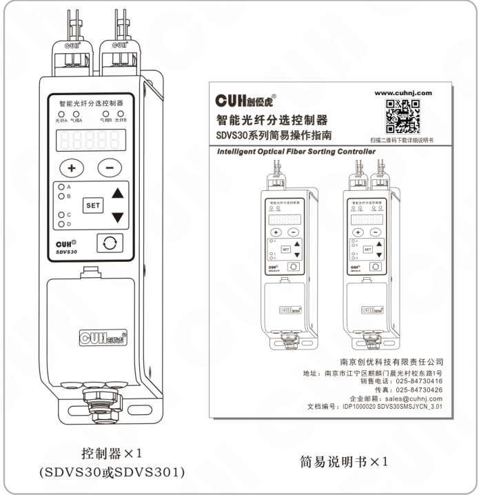

- 控制器 × 1（SDVS30或SDVS301）
- 简易说明书 × 1

---

2019-01　　　　　　　　　　　　　　　　- 1 -　　　　　　　　　　　　　　　　SDVS30SMSCN_2.01

### 第 8 页

**智能光纤分选控制器**　　　　　　　　　　　　　　　　　　　　　　　　　**SDVS30系列**

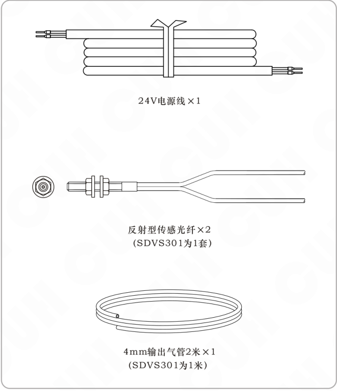

- 24V电源线×1
- 反射型传感光纤×2  
  （SDVS301为1套）
- 4mm输出气管2米×1  
  （SDVS301为1米）

---

2019-01　　　　　　　　　　　　　　　　　- 2 -　　　　　　　　　　　　　　　　　SDVS30SMSCN_2.01

### 第 9 页

智能光纤分选控制器  
SDVS30系列

## 1.2 控制器部件说明

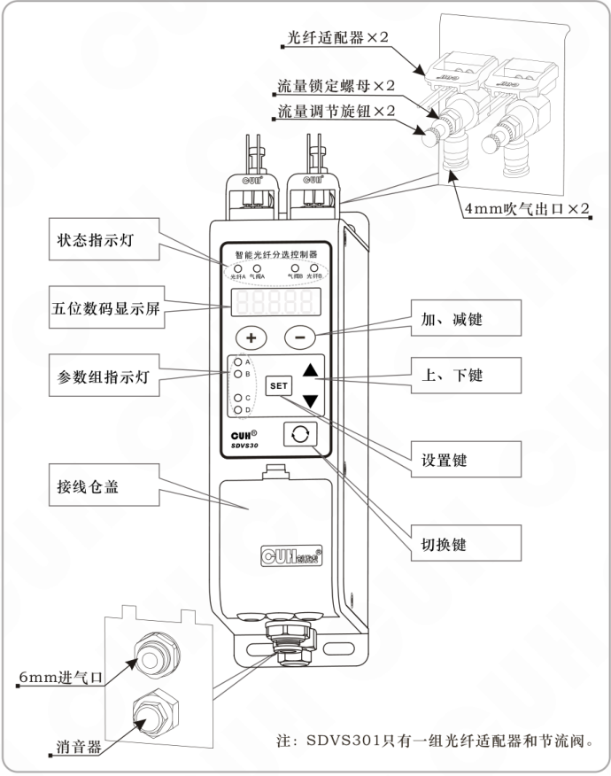

图中标注：

- 光纤适配器×2
- 流量锁定螺母×2
- 流量调节旋钮×2
- 4mm吹气出口×2
- 状态指示灯
- 五位数码显示屏
- 参数组指示灯
- 接线仓盖
- 加、减键
- 上、下键
- 设置键
- 切换键
- 6mm进气口
- 消音器

注：SDVS301只有一组光纤适配器和节流阀。

2019-01　　　　　- 3 -　　　　　SDVS30SMSCN_2.01

### 第 10 页

**智能光纤分选控制器**　　　　　　　　　　　　　　　　　　　　　　　　　**SDVS30系列**

---

## 1.3 选购部件代码

| 选购部件代码 | 图示 | 图中标注 |
|---|---|---|
| 光纤安装支架F-1T | 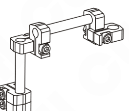 | — |
| 光纤切断器F-1C | 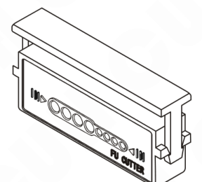 | — |
| 反射型光纤传感器用透镜F-1M | 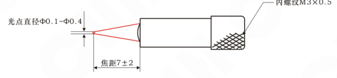 | 光点直径Ф0.1~Ф0.4；焦距7±2；内螺纹M3×0.5 |
| 反射型光纤传感器用透镜F-2M | 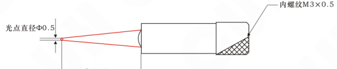 | 光点直径Ф0.5；焦距15±2；内螺纹M3×0.5 |

---

2019-01　　　　　　　　　　　　　- 4 -　　　　　　　　　　　　　SDVS30SMSCN_2.01

### 第 11 页

**智能光纤分选控制器**　　　　　　　　　　　　　　　　　　　　　　　　　**SDVS30系列**

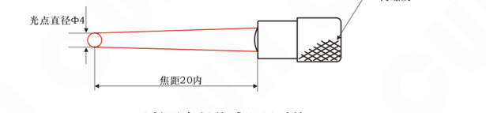

### 反射型光纤传感器用透镜F-3M

- 光点直径Φ4
- 焦距20内
- 内螺纹M3×0.5

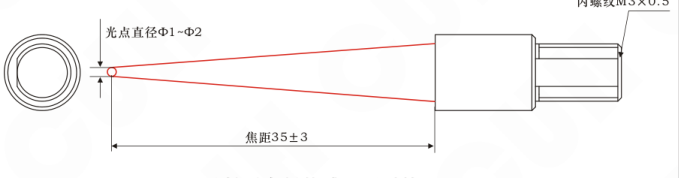

### 反射型光纤传感器用透镜F-4M

- 光点直径Φ1~Φ2
- 焦距35±3
- 内螺纹M3×0.5

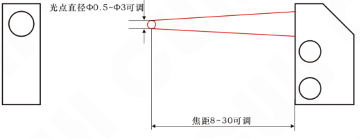

### 反射型光纤传感器用透镜F-5M

- 光点直径Φ0.5~Φ3可调
- 焦距8~30可调

如需要对射型光纤传感器、区域型光纤传感器、耐高温或其他特殊用途的光纤传感器，请联系我们。

2019-01　　　　　　　　　　　　　　　　　- 5 -　　　　　　　　　　　　　　　　　SDVS30SMSCN_2.01

### 第 12 页

智能光纤分选控制器　　　　　　　　　　　　　　　　　　　　　　　　　SDVS30系列

# 第二章　产品介绍

本章节主要内容包括本产品的简单介绍、主要特色功能和适用范围。

## 2.1 产品简介

SDVS30系列智能光纤分选控制器是本公司针对自动化物料分选市场开发的一款通用型产品。本产品将分立的光纤放大器、电磁阀及流量调节器、输入输出传感器接口集成在控制器中，且均设计了两套（SDVS301为单套）。本产品基于各种类型的光纤传感器获取的物料亮度特征差异信息，通过控制内部电磁阀在喷嘴处形成气流，剔除异常状态物料以实现物料分选的目的。

本产品可以满足大多数两级分选系统（SDVS301为单级分选）的要求，相比市场上现有的光纤放大器和电磁阀分体式解决方案具有极佳的性价比优势。该控制器可以与我司开发的SDVC系列振动送料控制器协同工作，包括供电、信号输入、控制输出连接，为客户提供自动送料与分选的整体解决方案。

## 2.2 主要功能特点

- 双路独立完整的光纤放大器、气阀分选系统，提高分选可靠性（SDVS301为单路）；
- 光纤放大器具有很强的日光和白炽灯光抑制能力；
- 对料功能可自动设置分选双阈值，排除物料间隙的影响；
- 可设置报警功能，在剔除操作失败后可输出报警信号；
- 两路气嘴输出口可独立调节出气流量（SDVS301为单路）；
- 双通道自适应开关传感器支持NPN和PNP两种类型；
- 双通道对称推挽控制输出可驱动24V/400mA负载；
- 具有完善的保护功能，包括欠压、过压、反接、过流、短路等；
- 参数组切换设计，可实现参数快速设置；
- 输入输出之间的交叉选择矩阵和逻辑组合可灵活设置控制器的功能；
- 输出模式选择，可定义输出与输入之间的时序关系；
- 独立的参数组恢复出厂设置功能，避免所有参数重设；
- 内部电磁阀计数功能，可以对电磁阀的寿命进行有效评估；
- 双路抗干扰允许两路光纤在相互靠近的情况下协同工作（SDVS301为单路，无此功能）；
- 具有学习物料特征分布的能力，可显著提高分选可靠性。

2019-01　　　　　　　　　　　　　　　　　- 6 -　　　　　　　　　　　　SDVS30SMSCN_2.01

### 第 13 页

智能光纤分选控制器　　　　　　　　　　　　　　　　　　　　　　　　　SDVS30系列

---

## 2.3 产品适用范围

　　本产品是根据物料反射或透射光强度区分物料的状态特征进行分选的，无法处理状态间无显著灰度差异的物料。在选择物料特征时需要根据物料的几何外形、透明度、表面亮度或颜色差异来确定合适的光斑尺寸和检测位置，通过这些信息判断本产品是否适用于待分选的物料。

　　本产品不适用于质量检测，如贴片电容裂纹缺陷剔除、大米色选、水果精选等应用。

---

2019-01　　　　　　　　　　　　　　　　　- 7 -　　　　　　　　　　　　　　SDVS30SMSCN_2.01

### 第 14 页

# 第三章　安装与连接

本章节介绍本产品使用所必须具备的条件以及如何正确进行安装与连接。

## 3.1 控制器使用条件

本产品是使用直流24V供电的设备，为确保操作者的人身安全请务必使用符合IEC标准的CLASS Ⅱ类电源，以在电网与直流输出线之间满足加强绝缘的要求。

本产品的内部功率消耗包括电路静态功率1.2W、2个1.6W电磁阀（SDVS301为1个1.6W电磁阀），总功率约4.4W（SDVS301总功率约2.8W）。本公司出品的振动送料控制器SDVC31系列或SDVC34系列均可以提供24V/4.8W的电源输出，所以可以直接为本产品供电。如果需要外接电磁阀，电源选择请参考5.4节。

本产品工作时需要输入压缩空气，且对压缩空气的气压和净化等级具有较严格的要求。本产品的内部电磁阀最高工作气压为7Bar，所有任何情况下气源气压不可超过该值，建议用独立调压阀调节至5Bar使用。压缩空气净化等级按照《GB/T13277.1-2008压缩空气质量标准》中规定的固体颗粒等级2、湿度等级3、含油等级2或相比前述要求更优。

对于工作环境温湿度的要求请参考技术规格表。

## 3.2 控制器安装固定

请将本产品固定在可靠接地的坚固金属平台上，推荐用M4螺栓以0.6N*m扭矩在4角位置固定，如下图所示。

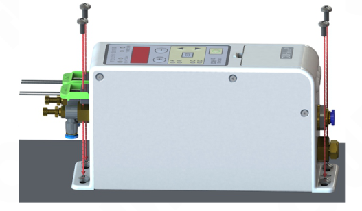

### 第 15 页

**智能光纤分选控制器**　　　　　　　　　　　　　　　　　　　　　　　　　**SDVS30系列**

## 3.3 输入输出气管安装

输入气管接头配置为Φ6的快插端子，匹配外径6mm、内径4mm的PU气管，插入深度约17mm。

输出气管接头配置为Φ4的快插端子，匹配外径4mm、内径2.5mm的PU气管，插入深度约15mm。该快插端子可以旋转至任意角度以方便插管。

**注意**　插管时注意应握紧快插端子本体，防止损坏节流阀，如下图所示。

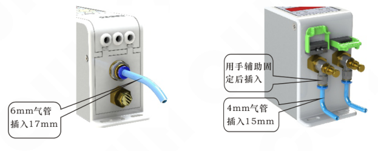

## 3.4 输出流量调节

本产品为每个电磁阀输出配置了单独的流量调节阀，可以控制气流流量进而调节吹气力量，可以防止物料因力量过大被吹出料盘。

每个节流阀具有调节手柄和锁定螺母两部分，调节流量分3步：

第1步：逆时针旋松流量锁定螺母；

第2步：旋转流量调节旋钮，顺时针为减小流向、逆时针为增大流量；

第3步：顺时针旋紧流量锁定螺母，如下图所示。

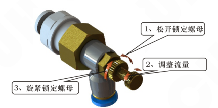

2019-01　　　　　　　　　　　　- 9 -　　　　　　　　　　　　SDVS30SMSCN_2.01

### 第 16 页

智能光纤分选控制器　　　　　　　　　　　　　　　　　　　　　　SDVS30系列

---

## 3.5 光纤传感器安装

本产品的光纤适配器是按照兼容大部分光纤传感器原则设计的，所以可以支持多种类型的光纤传感器，产品标准配置两套（SDVS301为1套）反射式光纤传感器方便用户使用。安装步骤如下：

1、首先将光纤传感器附带的转接头连接至光纤尾部至齐平；  
2、向上拨起光纤适配器锁定杆；  
3、将已经连接转接头的光纤按单芯对准T孔，多芯对准R孔插入15mm；  
4、向下转动锁定杆直至水平状态并检查光纤是否锁紧。  
如下图所示。

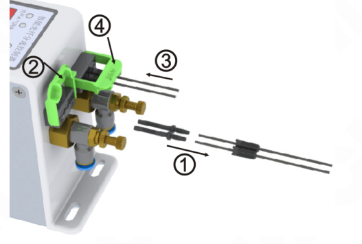

本产品的光纤适配器可接受2.1mm至2.3mm之间直径的光纤或转接头，客户如果需要可以使用其他尺寸兼容的反射、对射光纤传感器。

> **要点**　光纤纤芯越粗，耦合进入光纤的光功率越大，对于检测亮度值较小的物料越有帮助。

---

2019-01　　　　　　　　　　　　　- 10 -　　　　　　　　　　　　　SDVS30SMSCN_2.01

### 第 17 页

智能光纤分选控制器　　　　　　　　　　　　　　　　　　　　　　　SDVS30系列

---

## 3.6 电源连接

本产品可由独立的电源适配器供电或由SDVC系列振动送料控制器供电。

**注意**　如果使用SDVC系列振动送料控制器提供的电源，请确认其输出功率是否满足本产品实际应用负载要求。

本产品标准配置一根电源连接线，可以通过该电源线从具备24V输出的SDVC系列振动送料控制器连接取电。实现方法是：将电源线一端红色端子插入I2，黑色端子插入I1；另一端红色端子插入SDVC系列振动送料控制器+24V端子，黑色端子插入地线端子。

下图给出了使用SDVC34-M控制器为本产品供电的情形，在SDVC34-M控制器接线仓内选择空闲的+24V端子连接红色电源线、空闲的接地端子连接黑色电源线即可完成对本控制器的供电。

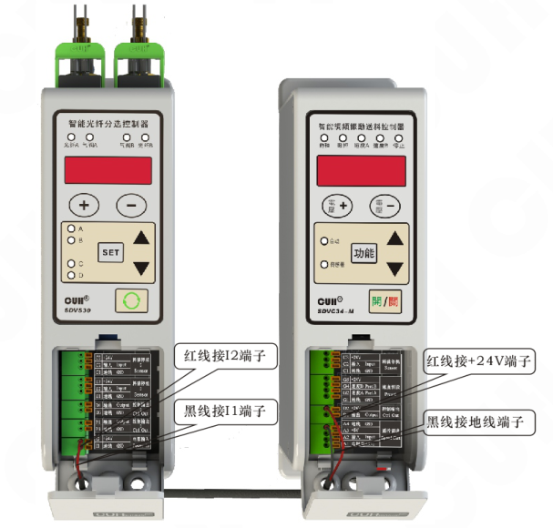

---

2019-01　　　　　　　　　　　　　　　　　　　- 11 -　　　　　　　　　　　　　　　SDVS30SMSCN_2.01

### 第 18 页

智能光纤分选控制器　　　　　　　　　　　　　　　　　　　　　　　SDVS30系列

# 第四章　基本使用方法

本章节介绍本产品的面板功能、按键操作和基本使用方法。

## 4.1 基本操作

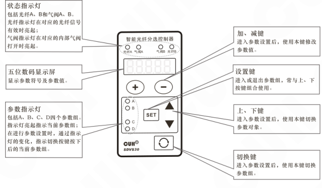

### 面板功能说明

| 项目 | 说明 |
|---|---|
| 状态指示灯 | 包括光纤A、B和气阀A、B。 光纤指示灯在对应的光纤信号有效时亮起； 气阀指示灯在对应的内部气阀打开时亮起。 |
| 五位数码显示屏 | 显示参数符号及参数值。 |
| 参数指示灯 | 包括A、B、C、D四个参数组。 指示灯亮起指示当前参数组； 在进行参数设置时，通过指示灯的变化，指示切换按键按下后的当前参数组。 |
| 加、减键 | 进入参数设置后，使用本键修改参数值。 |
| 设置键 | 进入或退出参数组，常与上、下按键组合使用。 |
| 上、下键 | 进入参数设置后，使用本键切换参数对象。 |
| 切换键 | 进入参数设置后，使用本键切换参数组。 |

### 按键操作

【短按】定义为按下按键的时间大于0.1秒小于2秒  
【长按】定义为按下按键的时间大于2秒

有三个设置参数的入口：

- 长按 <kbd>SET</kbd> 和 <kbd>▲</kbd> 进入或退出A或B组参数设置，短按 <kbd>切换</kbd> 切换A或B组参数。
- 长按 <kbd>SET</kbd> 和 <kbd>▼</kbd> 进入或退出C或D组参数设置，短按 <kbd>切换</kbd> 切换C或D组参数。
- 长按 <kbd>SET</kbd> 和 <kbd>切换</kbd> 进入或退出电磁阀计数，使用 <kbd>▼</kbd> 和 <kbd>▲</kbd> 切换亿、万、次参数，短按 <kbd>切换</kbd> 切换A或B路电磁阀。

进入参数设置后，使用 <kbd>▼</kbd> 和 <kbd>▲</kbd> 切换参数对象，使用 <kbd>＋</kbd> 和 <kbd>－</kbd> 修改参数值。

注：SDVS301无B路光纤、无B参数组、无B路电磁阀。

2019-01　　　　　　　　　　　　　　　　　　　　　　　　　SDVS30SMSCN_2.01

### 第 19 页

智能光纤分选控制器　　　　　　　　　　　　　　　　　　　　　　　　　SDVS30系列

---

## 4.2 使用方法

拿到待分选的物料后按如下5步进行操作：

**第1步：寻找物料亮度特征**  
根据物料的几何特征及表面光学特征（反射率、透明度）选择差异最大的通过亮度和剔除亮度。

**第2步：连接光纤传感器**  
将光纤传感器检测头固定在合适的位置，并根据物料情况决定是否需要透镜。然后将光纤与本产品连接，参考3.5节。连接后对光纤检测头的位置进行微调。

**第3步：对料操作**  
长按 `SET` 和 `▲` 进入设置界面下的实时灰度显示状态 ；  
通过 `□` 切换A或B组参数（可选）；

- 将需要通过的物料状态对准光纤焦点，按下 `⊕`，显示 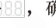，确认**通过亮度**；
- 将需要剔除的物料状态对准光纤焦点，按下 `⊖`，显示 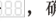，确认**剔除亮度**；
- 将物料移开，同时按下 `⊕` 和 `⊖`，显示 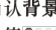，确认**背景亮度**。

离开本参数状态后控制器将自动计算高、低分选双阈值 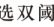 和 。

> **要点** 注意：对料时，电磁阀动作将暂停。完成对料后可以通过长按 `SET` 和 `▲` 或等待2分钟回到待机界面，电磁阀动作恢复正常。  
> **要点** 应该调整光纤传感器的安装位置和角度，使物料的**剔除亮度**与**通过亮度**、**背景亮度**有较明显的差异，否则可能出现漏剔除或过于灵敏剔除正常物料的情况。

**第4步：检查吹气逻辑**  
手动将物料的通过状态和剔除状态放置在光纤检测区域，检查控制器对于剔除状态的物料是否打开电磁阀，而通过状态的物料电磁阀关闭。如果逻辑有误，请重新对料。

**第5步：调整输出气流**  
根据物料的尺寸和重量，通过节流阀控制气流流量使吹气气流能充分将物料吹落同时又不使物料飞出料盘，调节方法见3.4节。电磁阀的开启时间受输出模式包括延时模式和保持模式的影响，两种模式的时序图请参考5.3节。

顺利完成上述5步操作后应该可以顺利进行物料分选。

---

2019-01　　　　　　　　　　　　　　　　　-13-　　　　　　　　　　　　SDVS30SMSCN_2.01

### 第 20 页

智能光纤分选控制器　　　　　　　　　　　　　　　　　　　　　　　　　SDVS30系列

---

## 4.3 恢复出厂设置

A、B、C、D四组参数均包含自身的恢复出厂设置功能，即需要对每个参数组单独进行恢复出厂设置操作，无法一次实现将所有的参数组恢复出厂设置。具体实现方法为：

1、根据需要恢复出厂设置的参数组，进入参数设置界面；  
2、通过 ▼ 切换至恢复出厂参数：闪烁的 `88888`（数码管和LED灯全部闪烁）；  
3、按下 ⊕，显示 `□□□□□` 后，松开 ⊕，控制器回到待机界面，即完成该组参数恢复出厂设置操作。

注：SDVS301无B参数组。

---

2019-01　　　　　　　　　　　　　　　　-14-　　　　　　　　　　　　　　　　SDVS30SMSCN_2.01

### 第 21 页

智能光纤分选控制器　　　　　　　　　　　　　　　　　　　　　　　　　SDVS30系列

# 第五章　高级功能说明

本章节介绍本产品的全部参数信息、输入输出逻辑图、外接光纤传感器和电磁阀及光纤支架的安装指导。

## 5.1 参数列表

| 参数符号 | 数码管符号图片 | 含义及解释 | 取值范围 | 默认设置 |
|---|---|---|---|---|
| 读【A】 |  | 待机界面下光纤实时灰度值： 用于显示实时灰度值。 | 0~1023 | ——（仅AB组） |
| 读【A点】 | 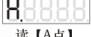 | 设置界面下光纤实时灰度值： 用于对料操作。 | 0~1023 | ——（仅AB组） |
| 读【P点】 | 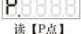 | 剔除区间的高阈值： 与【P】配合构成灰度 判断区间。 | 0~1023 | 479（仅AB组） |
| 读【P】 | 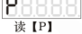 | 剔除区间的低阈值： 与【P点】配合构成灰度 判断区间。 | 0~1023 | 179（仅AB组） |
| 读【小T】 | 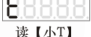 | 判别时间： 对物料特征进行判别的时 间，应与送料速度匹配　* | 0.01~0.1秒 | 0.01（仅AB组） |
| 读【小恩】 | 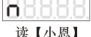 | 抗干扰能力： 0为自动（推荐），从1至8 抗干扰能力依次增强　* | 0~8 | 0（仅AB组） |
| 读【涛A】 | 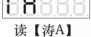 | 开关传感器类型选择： 根据外接传感器PNP和NPN 类型选择或设置为自动。 |  自动  NPN  PNP | 自动（仅CD组） |
| 读【大勾】 | 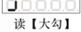 | 输入信号上升沿延时： 用于对输入信号上升沿 进行消抖或延时。 | 0.00~10.00秒 | 0.05（仅CD组） |
| 读【大L】 | 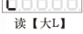 | 输入信号下降沿延时： 用于对输入信号下降沿 进行消抖或延时。 | 0.00~10.00秒 | 0.05（仅CD组） |
| 读【E点】 | 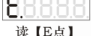 | 第1信号源选择： 选择双输入逻辑的第1个 信号源。 | 0、1、A、b、C、E、 -A、-b、-C、-E、 OA、Ob、Od、OP、 -OA、-Ob、-Od、-OP | 0 （-X表示对X取反） |
| 读【E】 |  | 第2信号源选择： 选择双输入逻辑的第2个 信号源。 | 0、1、A、b、C、E、 -A、-b、-C、-E、 OA、Ob、Od、OP、 -OA、-Ob、-Od、-OP | A组为A B组为b C组为C D组为E |

---

2019-01　　　　　　　　　　　　　　-15-　　　　　　　　　　　　　　SDVS30SMSCN_2.01

### 第 22 页

**智能光纤分选控制器**　　　　　　　　　　　　　　　　　　　　　　　　　**SDVS30系列**

| 参数符号 | 数码管符号图片 | 含义及解释 | 取值范围 | 默认设置 |
|---|---|---|---|---|
| 读【大恩】 |  | 信号源逻辑关系选择： 选择两个信号源的逻辑关系。 | 与 或 异或 rs触发器 | 或 |
| 读【小勾】 |  | 输出信号上升沿延时： 设定输出信号的上升沿延时， 详见5.3节。 | 0.00~10.00秒 | 0 |
| 读【小L】 |  | 输出信号下降沿延时： 设定输出信号的下降沿延时， 详见5.3节。 | 0.00~10.00秒 | 0（AB组） 0.1（CD组） |
| 读【F】 |  | 输出信号模式选择： 选择输出信号的模式， 详见5.3节。 | 保持模式 延时模式 | 延时模式 |
| 读【小反C】 |  | 输出逻辑方向选择： 将输出信号进行取反或 输出常开或输出常关。 | 同相 取反 输出常开 输出常关 | 同相 |
| 读【全8】 |  | 恢复出厂设置 | —— | —— |
| 读【亿】 |  | 电磁阀动作亿次： 内部电磁阀动作次数以亿 为单位。 | 0～9999亿次 | 0 |
| 读【万】 |  | 电磁阀动作万次： 内部电磁阀动作次数以万 为单位。 | 0～9999万次 | 0 |
| 读【次】 |  | 电磁阀动作次： 内部电磁阀动作次数以次 为单位（仅保存100次以上 的计数）。 | 0～9999次 | 0 |

注：SDVS301无B参数组。

如需调整带 * 参数，请咨询专业工程师。

2019-01　　　　　　　　　　　　　　-16-　　　　　　　　　　　　　　SDVS30SMSCN_2.01

### 第 23 页

智能光纤分选控制器　　　　　　　　　　　　　　　　　　　　　　　　　SDVS30系列

## 5.2 输入输出逻辑图

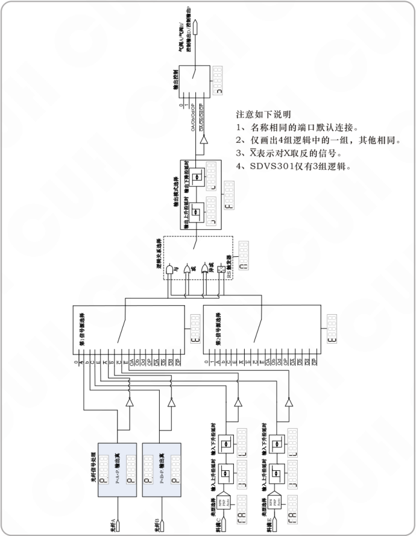

注意如下说明

1. 名称相同的端口默认连接。
2. 仅画出4组逻辑中的一组，其他相同。
3. X表示对X取反的信号。
4. SDVS301仅有3组逻辑。

2019-01　　　　　　　　　　　　　　　　　- 17 -　　　　　　　　　　　　　　　　　SDVS30SMSCN_2.01

### 第 24 页

**智能光纤分选控制器**　　　　　　　　　　　　　　　　　　　　　　　　　**SDVS30系列**

## 5.3 输出模式说明

本控制器包含四个输出端口，分别是：气阀A、气阀B、控制输出D、控制输出P（SDVS301无气阀B输出）。其中：控制输出D端口在参数组C中设置；控制输出P端口在参数组D中设置。

每个输出可以单独设置输出模式，包含：保持模式、延时模式。每个模式的解释如下：

a) 保持模式：使输出的信号保持设定的时间。即当驱动输出的信号由无效变为有效后，输出保持开启状态并持续设定的时间，超过此时间后输出信号自动关闭。在此模式下参数“输出信号上升沿延时”用于设定开延时，参数“输出信号下降沿延时”用于设定输出信号保持时间。

b) 延时模式：是指驱动输出的信号由有效变为无效后，输出延时一段时间后才关闭。输出信号的持续时间由驱动输出的信号（即逻辑关系选择器后输出的信号）持续时间和输出关延时时间决定。此模式下参数“输出信号上升沿延时”用于设定开延时，参数“输出信号下降沿延时”用于设定关延时。

将两种模式的差别以时序图的形式表达如下，其中输入信号是逻辑关系选择器后输出的信号。

图中：

- T1：输出信号上升沿延时
- T2：输出信号下降沿延时

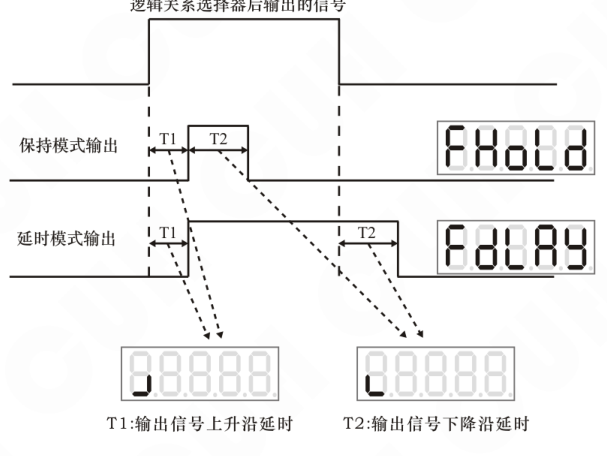

2019-01　　　　　　　　　　　　　　　　　-18-　　　　　　　　　　　　　　　　　SDVS30SMSCN_2.01

### 第 25 页

## 5.4 外接光纤传感器和电磁阀

本控制器内部除了集成两路光纤传感器和两路电磁阀外，还设计了两个数字输入端口C和E及两个控制输出端口D和P。其中C、E端口支持PNP和NPN类型选择和自动识别，每个可以支持最大1.2W的传感器；D、P两个控制输出端口每个可以支持最大9.6W的阻性或感性负载，如电磁阀、继电器。

> **要点** 用户应该根据外接传感器及外接电磁阀的功率和数量，选择输出功率不小于总消耗功率的电源。例如外接2个0.8W的光纤传感器和2个4W的电磁阀，则电源输出功率应不小于2x0.8W+2x4W+4.4W=14W。因此，这种情况下SDVC系列振动送料控制器的电源功率将不能满足该应用的要求，用户应额外配备单独的供电电源。

下图是外接光纤传感器和外接电磁阀的示例，分别连接在C端口和D端口。如果再连接一套在E端口和P端口，则本产品结合自身的2路光纤传感器和电磁阀可以构成4路光纤检测与电磁阀分选系统。

### 第 26 页

**智能光纤分选控制器**　　　　　　　　　　　　　　　　　　　　　　　　　**SDVS30系列**

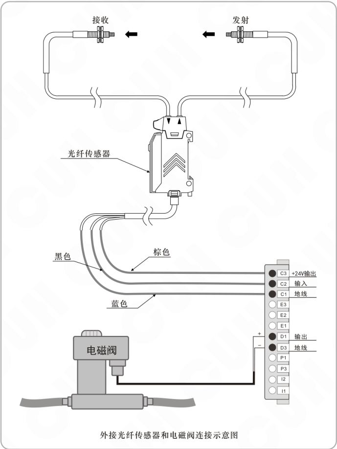

外接光纤传感器和电磁阀连接示意图

图中端子标注：

- C3：+24V输出
- C2：输入
- C1：地线
- D1：输出
- D3：地线

2019-01　　　　　　　　　　　　　　　　　-20-　　　　　　　　　　　　　　　　　SDVS30SMSCN_2.01

### 第 27 页

智能光纤分选控制器　　　　　　　　　　　　　　　　　　　　　　　　SDVS30系列

---

## 5.5 选配光纤支架安装

为方便用户安装光纤传感器，可选购专用支架用于固定光纤传感头。该支架由轻质铝合金关节和碳纤杆构成，可多自由度调整，具有安装方便、重量轻、固定牢固等优点。光纤支架安装方法如下：

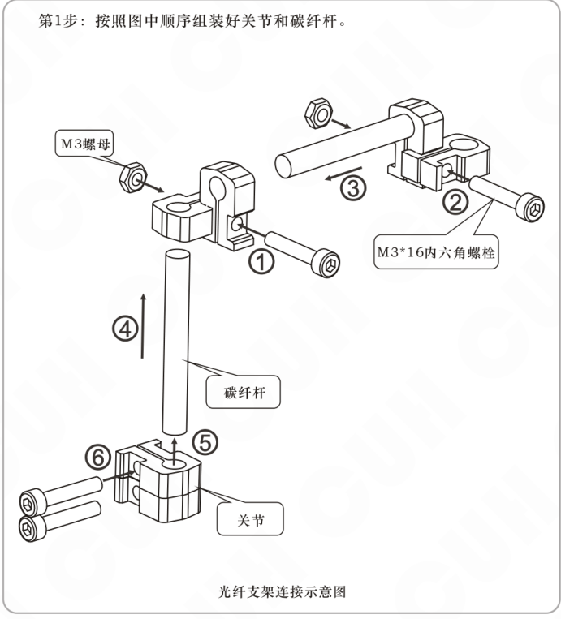

---

2019-01　　　　　　　　　　　　　　　　　- 21 -　　　　　　　　　　　　　　　SDVS30SMSCN_2.01

### 第 28 页

智能光纤分选控制器　　　　　　　　　　　　　　　　　　　　　　　　　SDVS30系列

---

第2步：将传感光纤头用螺母固定到支架上并将组装好的支架安装到振动盘外壁上。  
安装完成后还可以根据物料的位置对每个关节进行调整，以获得更好的检测效果。

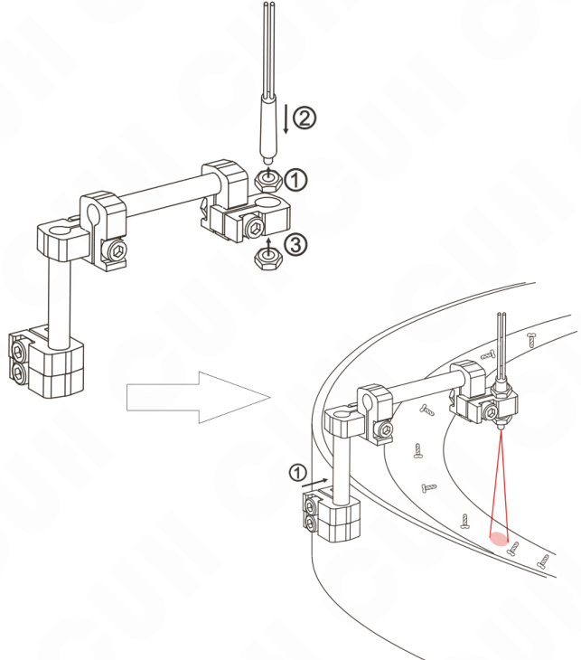

光纤及支架固定示意图

---

2019-01　　　　　　　　　　　　　　　　　-22-　　　　　　　　　　　　　SDVS30SMSCN_2.01

### 第 29 页

智能光纤分选控制器　　　　　　　　　　　　　　　　　　　　　　　　　SDVS30系列

---

## 第六章　典型应用案例

本章节介绍本产品的典型应用案例，包括对不同纯色物料的分选、对具有灰度特征分布物料的分选及两路光纤协同对复杂外形的物料进行分选的示例。

### 6.1 纯色物料分选案例

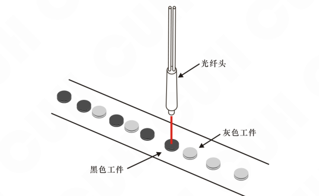

纯色物料分选示意图

对于此类纯色物料，可以任选一种进行剔除，只需按照第4章基本使用方法中描述的步骤进行操作便可以实现物料的分选。

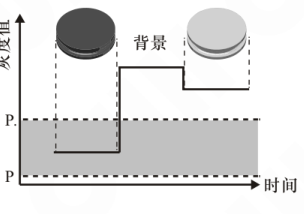

剔除黑色物料对料结果

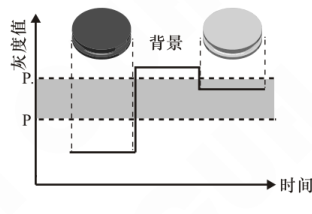

剔除灰色物料对料结果

---

2019-01　　　　　　　　　　　　　-23-　　　　　　　　　　　　　SDVS30SMSCN_2.01

### 第 30 页

**智能光纤分选控制器**　　　　　　　　　　　　　　　　　　　　　　　　　**SDVS30系列**

---

## 6.2 混色物料分选案例

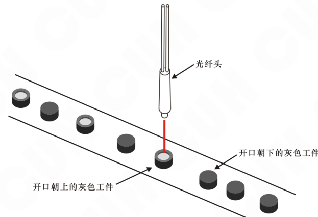

*混色物料分选示意图*

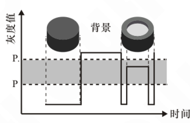

*混色物料灰度分布图*

根据本控制器分选的工作原理，只能剔除具有独特灰度特征的工件状态。

本案例中开口朝下状态的灰度值与开口朝上状态工件的周边部分灰度值相同，因此必须选择开口朝上工件的中间部分灰度值作为特征进行剔除。

---

2019-01　　　　　　　　　　　　　　　　　-24-　　　　　　　　　　　　　　　　　SDVS30SMSCN_2.01

### 第 31 页

智能光纤分选控制器　　　　　　　　　　　　　　　　　　　　　　　　　SDVS30系列

## 6.3 两路光纤协同案例

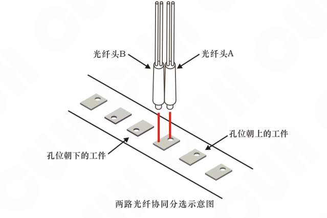

两路光纤协同分选示意图

上图是使用两个光纤传感器协同确定工件状态包含两个步骤如下：

1、分别对两路光纤进行对料。对料时将工件的孔作为保留的特征，工件的实体部分作为剔除的特征。  
2、设置两路信号的逻辑运算。剔除孔位朝上的工件，逻辑关系如下图所示。

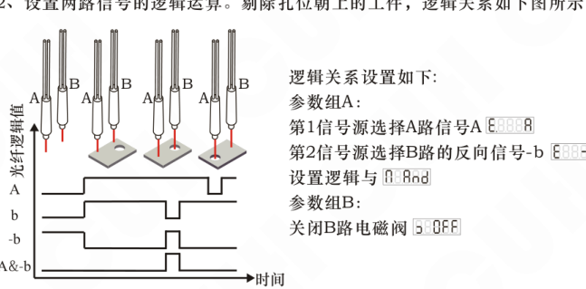

两路光纤协同逻辑图

逻辑关系设置如下:

参数组A:  
第1信号源选择A路信号A  
第2信号源选择B路的反向信号-b  
设置逻辑与  

参数组B:  
关闭B路电磁阀

2019-01　　　　　　　　　　　　　　　　-25-　　　　　　　　　　　　　　　　SDVS30SMSCN_2.01

### 第 32 页

智能光纤分选控制器　　　　　　　　　　　　　　　　　　　　　　　　　SDVS30系列

# 第七章　技术规格

## 7.1 技术规格表

| 项目 | 最小值 | 典型值 | 最大值 | 单位 | 备注 |
|---|---:|---:|---:|---|---|
| 直流输入电压 | 22 | 24 | 26 | 伏特（V） | 注1 |
| 控制输出电流 | —— | —— | 400 | 毫安（mA） | 注2 |
| NPN剩余电压 | —— | —— | 1.0 | 伏特（V） | 400mA |
| PNP剩余电压 | —— | —— | 1.5 | 伏特（V） | 400mA |
| 响应时间 | 20 | 100 | —— | 毫秒（ms） | 气压5bar |
| 电磁阀控制精度 | 10 | —— | —— | 毫秒（ms） |  |
| 流量调节范围 | 0 | —— | 20 | 升/分（L/min） |  |
| 数字光电增益 | —— | 7.8×105 | —— | 无量纲 | 注3 |
| 光电分辨率 | —— | 1024:1 | —— | 无量纲 |  |
| 静态功耗 | —— | —— | 1.2 | 瓦（W） | 注4 |
| 适用光纤直径 | 2.1 | 2.2 | 2.3 | 毫米（mm） |  |
| 输入气压范围 | —— | 5 | 7 | 巴（Bar） | 注5 |
| 输入气管外径 | —— | 6 | —— | 毫米（mm） |  |
| 输出气管外径 | —— | 4 | —— | 毫米（mm） |  |
| 抗日光干扰 | —— | —— | 50000 | 勒克斯（Lux） |  |
| 抗白炽灯干扰 | —— | —— | 30000 | 勒克斯（Lux） | 注6 |
| 工作环境温度 | 0 | 25 | 45 | 摄氏度（℃） |  |
| 工作环境湿度 | 10 | 60 | 85 | 相对湿度（%） | 不结露 |
| 储藏环境温度 | -40 | 25 | 85 | 摄氏度（℃） |  |

⚠️ **小心** 注1：超过30V控制器屏幕熄灭进入保护状态，最大不可超过36V。

⚠️ **小心** 注2：不可连接容性负载。

**要点** 注3：数字光电增益定义为发射光平均功率和接收灵敏度的乘积，使用纤芯直径0.5mm 的光纤测量得到。

**要点** 注4：静态功耗为内部电磁阀不动作时的功耗。

**注意** 注5：控制器不通电时最大气压不可超过10Bar。

**要点** 注6：不可在强光LED照明灯下工作。

---

2019-01　　　　　　　　　　　　　　　-26-　　　　　　　　　　　　　　　SDVS30SMSCN_2.01

### 第 33 页

智能光纤分选控制器　　　　　　　　　　　　　　　　　　　　　　　　　SDVS30系列

---

## 7.2 输入输出电路图

传感器输入输出电路图见下图所示。其中C端口与E端口相同，仅画出C端口；D端口与P端口相同，仅画出D端口。

C、E端口支持各种类型的开关传感器，如接近开关、光电开关、光纤放大器、激光传感器、超声传感器、压力传感器、触碰传感器、PLC数字输出等。

D、P端口支持各种类型的负载，如电磁阀、继电器、警报器、直流风扇、PLC数字输入等。

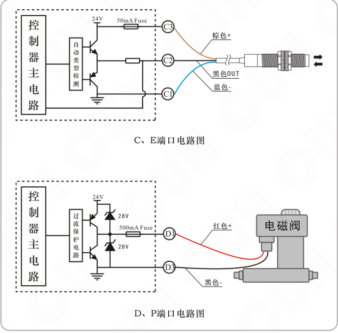

---

2019-01　　　　　　　　　　　　　　　　　-27-　　　　　　　　　　　SDVS30SMSCN_2.01

### 第 34 页

智能光纤分选控制器　　　　　　　　　　　　　　　　　　　　　　　　　SDVS30系列

# 第八章　附录

## 8.1 外形尺寸

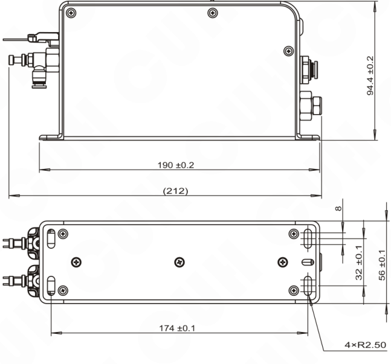

外形尺寸图（单位：毫米mm）

### 第 35 页

智能光纤分选控制器　　　　　　　　　　　　　　　　　　　　　　　　　SDVS30系列

## 8.2 故障诊断

| 故障代码 | 数码管符号图片 | 含义 | 排除方法 |
|---|---|---|---|
| E0001 |  | 输入电压过高 | 确保输入电压在22V至26V之间 |
| E0002 |  | 输入电压过低 |  |
| E0003 |  | D端口高电平输出过流 | 确保负载电流不大于400mA |
| E0004 |  | P端口高电平输出过流 |  |
| E0005 |  | D端口低电平输出过流 |  |
| E0006 |  | P端口低电平输出过流 |  |
| E0007 |  | D端口高电平输出短路 | 确保负载未被短路 |
| E0008 |  | D端口低电平输出短路 |  |
| E0009 |  | P端口高电平输出短路 |  |
| E0010 |  | P端口低电平输出短路 |  |
| E0020 |  | 气阀A输入信号逻辑错误 | 确保rs触发器输入不同时有效 注：SDVS301无气阀B |
| E0021 |  | 气阀B输入信号逻辑错误 |  |
| E0022 |  | D端口输入信号逻辑错误 |  |
| E0023 |  | P端口输入信号逻辑错误 |  |

## 8.3 参考标准

**极限参数：超过此指标将会造成严重损坏，必须严格遵守！**

| 项目 | GB 标准 | IEC 标准 | 等级 | 标准要求 | 备注说明 |
|---|---|---|---|---|---|
| 静电放电 | GB/T 17626.2-2006 | IEC 61000-4-2:2001 | 4 | ±8 kV | 接触放电 |
|  |  |  | 4 | ±15 kV | 空气放电 |
| 电快速瞬变 脉冲群 | GB/T 17626.4-2008 | IEC 61000-4-4:2004 | 4 | ±4 kV |  |
| 直流电源纹 波抗扰度 | GB/T17626.17-2005 | IEC 61000-4-17:2002 | 4 | 15% | 评价 A |

2019-01　　　　　　　　　　　　　　　　　-29-　　　　　　　　　　　　　SDVS30SMSCN_2.01

### 第 36 页

智能光纤分选控制器　　　　　　　　　　　　　　　　　　　　SDVS30系列

---

## 第九章　产品保证信息

### 9.1 保质期

本公司为本产品提供的保质期为一年，从产品发送到购买方指定地点之日算起。

### 9.2 保修范围

（一）如果在上述保质期内出现本公司造成的故障，我们将免费维修产品。但是以下情况不属于保修范围。

　　a、未按照简易说明书、用户手册或购买方与本公司专门达成的技术要求中规定的条件、环境下的不正确操作，或不正确使用造成的故障。

　　b、故障不是因产品缺陷，而是购买方设备或软件设计造成的。

　　c、非本公司人员进行的修改或修理而造成的故障。

　　d、按照简易操作指南或用户手册正确维修或更换易损部件等规定可以完全避免的故障。

　　e、产品从本公司发货后，因无法预料的科学技术水平变化等因素而造成的故障。

　　f、由于火灾、地震、洪水等自然灾害，或异常电压等外部因素造成的故障，本公司不负责保修。

（二）保修范围仅限于（一）中规定的情况，本公司对该设备造成的购买方间接损失（如设备损坏、机会丧失、利润损失等）或其他损失，不承担任何责任。

### 9.3 产品适用性

本公司的该控制器是针对物料分选行业的通用产品而设计生产的。因此，本公司的该控制器不得用于下列应用且不适合其使用。

（一）对生命和财产有严重影响的设施，如核发电厂、机场、铁路、轮船、机动装置及医疗设备。

（二）公共事业，包括电力、气体、供水等。

（三）相似条件或环境的户外使用。

---

2019-01　　　　　　　　　　　　　　　　　-30-　　　　　　　　　　　　SDVS30SMSCN_2.01

### 第 37 页

**智能光纤分选控制器**　　　　　　　　　　　　　　　　　　　　　　　　　**SDVS30系列**

---

---

2019-01　　　　　　　　　　　　　　　　　　　　　　　　　　　　　　　SDVS30SMSCN_2.01

### 第 38 页

智能光纤分选控制器　　　　　　　　　　　　　　　　SDVS30系列

---

---
2019-01　　　　　　　　　　　　　　　　　　　　SDVS30SMSCN_2.01

### 第 39 页

## 数字调压振动送料控制器

| 品名规格 | 特点 |  |
|---|---|---|
| SDVC10、11 数字稳压振动送料控制器系列 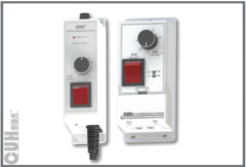 | 输入电压范围：150V～260V | 输出电压范围：35V～250V |
|  | 输出电流：0～4A | 输出功率：880VA |
|  | 电源频率范围：40～70Hz |  |
|  | · 自动稳压 · 最大输出比例调节 · 短路保护功能 | · 缓启动 · 线性调节规律 · 过热保护功能 |
| SDVC20、22 智能数字稳压振动送料控制器系列 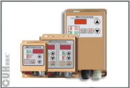 | 输入电压范围：85V～440V | 输出电压范围：35V～380V |
|  | 输出电流：0～10A | 输出功率：3800VA |
|  | 电源频率范围：40～70Hz |  |
|  | · 自动稳压 · 缓启动时间设置 · 双控制信号输入 · 料满停机 · 线控调速 · 过热保护功能 | · 缓启动 · 信号控制开关 · 输出电压预置功能 · 智能光电传感 控制输出 · 过流保护功能 |

### 第 40 页

南京创优科技有限责任公司

地址：南京市江宁区麒麟门晨光村校东路1号  
销售电话：025-84730416  
传真：025-84730426  
企业邮箱：sales@cuhnj.com  
网址：www.cuhnj.com
<!-- /auto:ai-body-draft v1 -->

<!-- auto:data-params-summary v1 -->
## 附录 · 参数表（结构化侧车·机器生成）

> 说明：本节由 `data/<doc_key>/params/params.yaml` 自动渲染（展示前若干行），用于校对与二次开发。定稿以层 C 数据为准。

| 参数 | 标志/符号 | 范围 | 默认 | 单位 | 备注 |
| --- | --- | --- | --- | --- | --- |
|      品名规格 |  |  |  |  |  |
| H CU   C   SDVC34 智能数字自动调频振动送料控制器系列 |  |  |  |  |  |
|   |  |  |  |  |  |
|    危险 |  |  |  |  |  |
|   |  |  |  |  |  |
|   |  |  |  |  |  |
|    警告 |  |  |  |  |  |
|   |  |  |  |  |  |
|   |  |  |  |  |  |
|    小心 |  |  |  |  |  |
|   |  |  |  |  |  |
|   |  |  |  |  |  |
|    注意 |  |  |  |  |  |
|   |  |  |  |  |  |
|     |  |  |  |  |  |
|    要点 ！ |  |  |  |  |  |
|   |  |  |  |  |  |
|      读【A】 |  |  |  |  |  |
|        读【A点】 |  |  |  |  |  |
|        读【P点】 |  |  |  |  |  |
|      读【P】 |  |  |  |  |  |
|      读【小T】 |  |  |  |  |  |
|      读【小恩】 |  |  |  |  |  |
|      读【涛A】 |  |  |  |  |  |
|    读【大勾】 |  |  |  |  |  |
|    读【大L】 |  |  |  |  |  |
|    读【E点】 |  |  |  |  |  |
|  读【E】 |  |  |  |  |  |
|      读【大恩】 |  |  |  |  |  |
|      读【大恩】 |  |  |  |  |  |

*（仅展示前 30 条，共 80 条；完整数据见下方链接。）*

- 完整 YAML：`data/cuh.sdvc.manual.v1.01/params/params.yaml`
- 表格索引：`data/cuh.sdvc.manual.v1.01/index.yaml`
<!-- /auto:data-params-summary v1 -->
