## 目录

> 下列条目来自 PDF 内置书签/大纲；链接指向本批转换生成的整页渲染图（`assets/pages/`），便于与原版 PDF 对照校对。

- [1: 封面](assets/pages/page-0001.png)（第 1 页）
- [2: 封二](assets/pages/page-0002.png)（第 2 页）
- [3: 目录](assets/pages/page-0003.png)（第 3 页）
- [4: 目录2](assets/pages/page-0004.png)（第 4 页）
- [5: SDVC10-S](assets/pages/page-0005.png)（第 5 页）
- [6: SDVC11-S](assets/pages/page-0006.png)（第 6 页）
- [7: SDVC11-M](assets/pages/page-0007.png)（第 7 页）
- [8: SDVC14-S](assets/pages/page-0008.png)（第 8 页）
- [9: SDVC20-S](assets/pages/page-0009.png)（第 9 页）
- [10: SDVC20-L](assets/pages/page-0010.png)（第 10 页）
- [11: SDVC20-XL](assets/pages/page-0011.png)（第 11 页）
- [12: SDVC201-L](assets/pages/page-0012.png)（第 12 页）
- [13: SDVC20-U](assets/pages/page-0013.png)（第 13 页）
- [14: SDVC21-S](assets/pages/page-0014.png)（第 14 页）
- [15: SDVC21LP](assets/pages/page-0015.png)（第 15 页）
- [16: SDVC21XLP](assets/pages/page-0016.png)（第 16 页）
- [17: SDVC212](assets/pages/page-0017.png)（第 17 页）
- [18: SDVC222](assets/pages/page-0018.png)（第 18 页）
- [19: SDVC232](assets/pages/page-0019.png)（第 19 页）
- [20: SDVC22-S](assets/pages/page-0020.png)（第 20 页）
- [21: SDVC301](assets/pages/page-0021.png)（第 21 页）
- [22: SDVC302](assets/pages/page-0022.png)（第 22 页）
- [23: SDVC31SM](assets/pages/page-0023.png)（第 23 页）
- [24: SDVC311-S/M](assets/pages/page-0024.png)（第 24 页）
- [25: SDVC31L/XL](assets/pages/page-0025.png)（第 25 页）
- [26: SDVC311-XL](assets/pages/page-0026.png)（第 26 页）
- [27: SDVC31XLP](assets/pages/page-0027.png)（第 27 页）
- [28: SDVC31U](assets/pages/page-0028.png)（第 28 页）
- [29: SDVC31UP](assets/pages/page-0029.png)（第 29 页）
- [30: SDVC33-M](assets/pages/page-0030.png)（第 30 页）
- [31: SDVC333SG](assets/pages/page-0031.png)（第 31 页）
- [32: SDVC34M系列](assets/pages/page-0032.png)（第 32 页）
- [33: SDVC34XL系列](assets/pages/page-0033.png)（第 33 页）
- [34: SDVC34UR/XU](assets/pages/page-0034.png)（第 34 页）
- [35: SDVC341-M](assets/pages/page-0035.png)（第 35 页）
- [36: SDVC35M](assets/pages/page-0036.png)（第 36 页）
- [37: SDVC40-S](assets/pages/page-0037.png)（第 37 页）
- [38: SDVC40-XS](assets/pages/page-0038.png)（第 38 页）
- [39: SDVC402](assets/pages/page-0039.png)（第 39 页）
- [40: SDVC41-M](assets/pages/page-0040.png)（第 40 页）
- [41: SDVC42-S](assets/pages/page-0041.png)（第 41 页）
- [42: SDVC42-SD](assets/pages/page-0042.png)（第 42 页）
- [43: SDVC50](assets/pages/page-0043.png)（第 43 页）
- [44: SDVC60系列](assets/pages/page-0044.png)（第 44 页）
- [45: SDVC61-M](assets/pages/page-0045.png)（第 45 页）
- [46: SDVC621-M](assets/pages/page-0046.png)（第 46 页）
- [47: SDVS30系列](assets/pages/page-0047.png)（第 47 页）
- [48: SDVS31](assets/pages/page-0048.png)（第 48 页）
- [49: SDUC20U](assets/pages/page-0049.png)（第 49 页）
- [50: SDMC10](assets/pages/page-0050.png)（第 50 页）
- [51: SDMC20](assets/pages/page-0051.png)（第 51 页）
- [52: SDMC201](assets/pages/page-0052.png)（第 52 页）
- [53: SDMC30](assets/pages/page-0053.png)（第 53 页）
- [54: 产品功能矩阵表](assets/pages/page-0054.png)（第 54 页）
- [55: 矩阵表2](assets/pages/page-0055.png)（第 55 页）
- [56: 产品引领](assets/pages/page-0056.png)（第 56 页）
- [57: 市场引领](assets/pages/page-0057.png)（第 57 页）
- [封底](assets/pages/page-0060.png)（第 60 页）
## 术语与命名

- 侧车：`glossary/terms.yaml`（机读）、`glossary/zh-CN.md`（人读）；候选表，定稿后并入公司级 `glossary/`。

## 适用范围

- 本文档由 PDF 自动转换生成，正文与插图需人工核对。

## 变更记录

- 2026-06-04 01:42:46：由转换工具从源 PDF 生成首版。

## 正文

<!-- auto:ai-body-draft v1 -->
> 以下为**整页视觉转写**的正文草稿（多模态模型直接输出 Markdown，含 GFM 表； 若配置 `[[vcrop:页:序]]` 占位符，裁剪步骤会插入 `assets/images/` 下 PNG）。**请务必人工校对。**

### 第 1 页

**CUH®**

# 振动送料控制器全球引领者

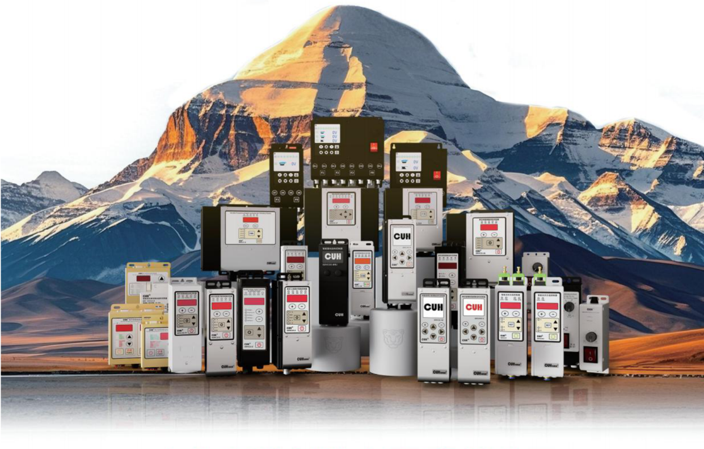

## 南京创优科技有限责任公司

### 第 2 页

# 企业介绍

南京创优科技有限责任公司，自2003年创始之初就致力于智能振动送料控制系统的自主研发、生产和销售。

作为中国振动送料控制领域的头部企业和行业标准制定者，产品线涵盖全系列电磁、压电、音圈电机振动送料控制器，传送带、离心盘、提升机等控制器。

---

# 技术引领

创优科技累计投入过亿研发资金，坚持创新驱动，自主研发自动稳速技术、无振动传感器稳速技术、全面保护技术等，助力中国新质生产力发展。

---

- 自动稳速技术
- 无振动传感器稳速技术
- 自适应控制技术
- 自传感技术
- 振动控制技术
- 矢量振动驱动技术
- 智能分选技术
- 全面保护技术

---

## 企业荣誉

- 国家级高新技术企业
- 国家级科技中小型企业
- 国家级专精特新“小巨人”企业
- 中国机械工业联合会智能制造分会会员单位
- 江苏省智能振动控制工程技术研究中心
- 江苏省研究生工作站
- 江苏省民营科技企业
- 江苏省仪表学会会员单位
- 江苏省机械行业协会理事单位
- 深圳市智能化学会副会长单位
- 南京市创新型中小企业

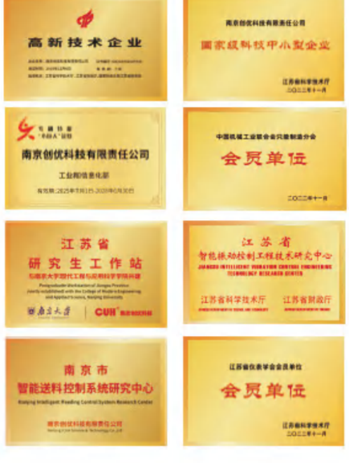

### 第 3 页

南京创优科技有限责任公司　www.cuhnj.com　　　　　　　　　　　　　　　　　　　CUH®

# 目　录

## 调压系列

| 型号 | 名称 | 页码 |
|---|---|---:|
| SDVC10系列 | 调压振动送料控制器 | 1 |
| SDVC11-S | 数字调压振动送料控制器 | 2 |
| SDVC11-M | 数字调压振动送料控制器 | 3 |
| SDVC14-S | 数字调压振动送料控制模块 | 4 |
| SDVC20-S | 数字调压振动送料控制器 | 5 |
| SDVC20-L | 数字调压振动送料控制器 | 6 |
| SDVC20-XL | 数字调压振动送料控制器 | 7 |
| SDVC201-L | 数字调压振动送料控制器 | 8 |
| SDVC20-U | 数字调压振动送料控制器 | 9 |
| SDVC21-S | 数字调压振动送料控制器 | 10 |
| SDVC21-LP | 数字调压振动送料控制器 | 11 |
| SDVC21-XLP | 数字调压振动送料控制器 | 12 |
| SDVC212 | 单路数字调压振动送料控制器 | 13 |
| SDVC222 | 双路数字调压振动送料控制器 | 14 |
| SDVC232 | 三路数字调压振动送料控制器 | 15 |
| SDVC22 | 系列双路数字调压振动送料控制器 | 16 |

## 调频系列

| 型号 | 名称 | 页码 |
|---|---|---:|
| SDVC301-S/M | 数字调频振动送料控制器 | 17 |
| SDVC302-S/M | 数字调频振动送料控制器 | 18 |
| SDVC31-S/M | 数字调频振动送料控制器 | 19 |
| SDVC311-S/M | 数字调频振动送料控制器 | 20 |
| SDVC31-L/XL | 数字调频振动送料控制器 | 21 |
| SDVC311-XL | 数字调频振动送料控制器 | 22 |
| SDVC31-XLP | 数字调频振动送料控制器 | 23 |
| SDVC31-U | 数字调频振动送料控制器 | 24 |
| SDVC31-UP | 数字调频振动送料控制器 | 25 |
| SDVC33-M | 双路数字调频振动送料控制器 | 26 |
| SDVC333-SG | 三路数字调频振动送料控制器 | 27 |
| SDVC34-M系列 | 智能调频振动送料控制器 | 28 |
| SDVC34-XL系列 | 智能调频振动送料控制器 | 29 |
| SDVC34-UR/XU | 智能调频振动送料控制器 | 30 |
| SDVC341-M | 自动调频振动送料控制器 | 31 |
| SDVC35系列 | 智能调频振动送料控制器 | 32 |

### 第 4 页

南京创优科技有限责任公司  www.cuhnj.com

CUH®

## 压电系列

| 型号 | 名称 | 页码 |
|---|---|---:|
| SDVC40-S | 数字调频压电振动送料控制器 | 33 |
| SDVC40-XS 系列 | 多路数字调频压电振动送料控制器 | 34 |
| SDVC402-S | 数字调频压电振动送料控制器 | 35 |
| SDVC41-M | 智能调频压电振动送料控制器 | 36 |
| SDVC42-S | 自动高频压电振动送料控制器 | 37 |
| SDVC42-SD | 自动高频压电振动送料控制器 | 38 |

## 低压调频系列

| 型号 | 名称 | 页码 |
|---|---|---:|
| SDVC50 | 低压数字调频振动送料控制器 | 39 |

## 柔性送料系列

| 型号 | 名称 | 页码 |
|---|---|---:|
| SDVC60 系列 | 智能柔性多路振动送料控制器 | 40 |
| SDVC61-M | 智能低压柔性振动送料控制器 | 41 |
| SDVC621-M | 智能低压柔性振动送料控制器 | 42 |

## 光纤分选系列

| 型号 | 名称 | 页码 |
|---|---|---:|
| SDVS30 系列 | 智能光纤分选控制器 | 43 |
| SDVS31 | 智能双光纤线扫分选控制器 | 44 |

## 超声波焊接系列

| 型号 | 名称 | 页码 |
|---|---|---:|
| SDUC20-U 系列 | 智能数字超声波焊接控制器 | 45 |

## 电机控制系列

| 型号 | 名称 | 页码 |
|---|---|---:|
| SDMC10-S | 数字低压直流有刷电机控制器 | 46 |
| SDMC20-S | 数字单相异步电机控制器 | 47 |
| SDMC201-S | 数字单相异步电机控制器 | 48 |
| SDMC30-S | 数字三相异步电机控制器 | 49 |

| 项目 | 页码 |
|---|---:|
| CUH产品功能矩阵表 | 50 |

### 第 5 页

**南京创优科技有限责任公司**  www.cuhnj.com

# SDVC10系列 调压振动送料控制器

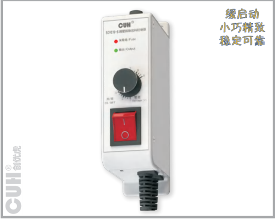

## 型号

SDVC10-XS: 2.5A调压控制器  
SDVC10-S: 4A调压控制器

## 功能

**缓启动：** 在启动时，输出电压会从零开始逐渐增大到预设电压，以消除对振动盘的冲击。

**熔断式短路保护：** 输出端发生短路时，控制器的保险丝会熔断以保护控制器及振动设备。

## 尺寸和重量

尺寸：长154mm×宽42mm×高86.4mm  
重量：370g（不含附件）

## 技术规格

| 项目 | 最小值 | 典型值 | 最大值 | 单位 | 说明 |
|---|---:|---:|---:|---|---|
| 输入电压 | 150 | 220 | 250 | 伏特（V） | 交流有效值 |
| 输出电压调整范围 | 90 | — | Vin-30 | 伏特（V） | 半波 |
| 输出电压调整范围 | 70 | — | Vin-10 | 伏特（V） | 全波 |
| 额定输出电流 | 0 | — | 2.5 | 安培（A） | SDVC10-XS |
| 额定输出电流 | 0 | — | 4 | 安培（A） | SDVC10-S |
| 输出功率 | 0 | — | 550 | 伏安（VA） | SDVC10-XS |
| 输出功率 | 0 | — | 880 | 伏安（VA） | SDVC10-S |
| 输出频率 | 45 | 50/60 | 65 | 赫兹（Hz） | 半波 |
| 输出频率 | 90 | 100/120 | 130 | 赫兹（Hz） | 全波 |
| 输出波形 | — | 正弦相切 | — | — | — |
| 缓启动时间 | — | 0.2 | — | 秒（s） | — |
| 短路保护动作电流 | — | 6.3 | — | 安培（A） | 保险丝容量 |
| 保险丝容量 | — | 6.3 | — | 安培（A） | — |
| 工作环境温度 | 0 | 25 | 40 | 摄氏度（℃） | — |
| 工作环境湿度 | 10 | 60 | 85 | 相对湿度（%） | 不结露 |
| 存储环境温度 | -20 | 25 | 65 | 摄氏度（℃） | — |

---

**振动送料控制器专家** Vibratory Feeder Controller Expert

地址：南京市江宁区智能路9号启迪城学研园2幢  
销售电话：400-985-8889  
传真：025-84730426  
企业邮箱：sales@cuhnj.com

### 第 6 页

南京创优科技有限责任公司  www.cuhnj.com

# SDVC11-S 数字调压振动送料控制器

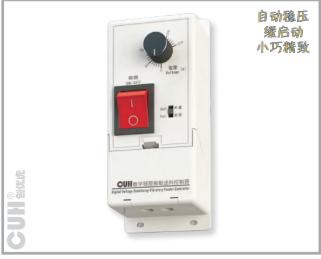

## 技术规格

| 项目 | 范围-最小值 | 范围-典型值 | 范围-最大值 | 单位 | 说明 |
|---|---:|---:|---:|---|---|
| 输入电压 | 150 | 220 | 250 | 伏特（V） | 交流有效值 |
| 输出电压调整范围 | 35 | —— | Vin-10 | 伏特（V） | 半波 |
| 输出电压调整范围 | 45 | —— | Vin-5 | 伏特（V） | 全波 |
| 稳压精度 | —— | —— | 30 | 伏特（V） | Vset = 150V △Vin+ = 70V |
| 稳压响应时间 | 0 | 0.01 | 0.02 | 秒（s） |  |
| 输出电流调整范围 | 0.1 | —— | 4 | 安培（A） |  |
| 输出功率 | 22 | —— | 880 | 伏安（VA） |  |
| 输出频率 | 45 | 50/60 | 65 | 赫兹（Hz） | 半波 |
| 输出频率 | 90 | 100/120 | 130 | 赫兹（Hz） | 全波 |
| 输出波形 | —— | 正弦相切 | —— |  |  |
| 缓启动时间 | 0.5 | 0.65 | 0.7 | 秒（s） |  |
| 过热保护温度 | 58 | 60 | 66 | 摄氏度（℃） |  |
| 短路保护动作电流 | —— | 6.3 | —— | 安培（A） | 保险丝容量 |
| 保险丝容量 | —— | 6.3 | —— | 安培（A） |  |
| 工作环境温度 | 0 | 25 | 40 | 摄氏度（℃） |  |
| 工作环境湿度 | 10 | 60 | 85 | 相对湿度（%） | 不结露 |
| 存储环境温度 | -20 | 25 | 65 | 摄氏度（℃） |  |

## 型号

SDVC11-S：4A调压控制器

## 功能

**自动稳压：** 内置数字稳压电路，可以减小由于电源电压波动造成的送料速度变化。

**缓启动：** 在启动时，输出电压会从零开始逐渐增大到预设电压，以消除对振动盘的冲击。

**线性调节规律：** 输出电压和旋钮旋转角度成线性关系，随着调节旋钮角度的增大，输出电压以线性规律增大。具有良好的操作性。

**过热保护：** 当控制器工作温度过高时将停止输出，以自我保护。

**过流保护：** 当控制器工作电流超过额定电流时将停止输出，以保护控制器及振动设备。

**熔断式短路保护：** 输出端发生短路时，控制器的保险丝会熔断以保护控制器及振动设备。

## 尺寸和重量

尺寸：长140mm×宽58mm×高60mm  
重量：200g（不含附件）

## 选购附件

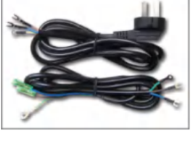

- 电源线（线长1.5米）
- 输出线（线长1.5米）

---

振动送料控制器专家 Vibratory Feeder Controller Expert

地址：南京市江宁区智能路9号启迪城学研园2幢  
销售电话：400-985-8889  
传真：025-84730426  
企业邮箱：sales@cuhnj.com

### 第 7 页

**南京创优科技有限责任公司**  www.cuhnj.com

# SDVC11-M 数字调压振动送料控制器

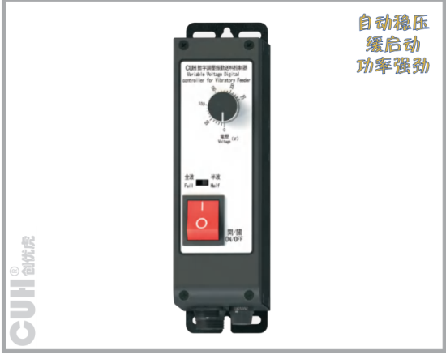

## 技术规格

| 项目 | 范围-最小值 | 范围-典型值 | 范围-最大值 | 单位 | 说明 |
|---|---:|---:|---:|---|---|
| 输入电压 | 150 | 220 | 250 | 伏特（V） | 交流有效值 |
| 输出电压调整范围 | 35 | —— | Vin-10 | 伏特（V） | 半波 |
| 输出电压调整范围 | 45 | —— | Vin-5 | 伏特（V） | 全波 |
| 稳压精度 | —— | —— | 30 | 伏特（V） | Vset = 150V △Vin+ = 70V |
| 稳压响应时间 | 0 | 0.01 | 0.02 | 秒（s） |  |
| 输出电流调整范围 | 0.1 | —— | 5 | 安培（A） |  |
| 输出功率 | 22 | —— | 1100 | 伏安（VA） |  |
| 输出频率 | 45 | 50/60 | 65 | 赫兹（Hz） | 半波 |
| 输出频率 | 90 | 100/120 | 130 | 赫兹（Hz） | 全波 |
| 输出波形 | —— | 正弦相切 | —— |  |  |
| 缓启动时间 | 0.5 | 0.65 | 0.7 | 秒（s） |  |
| 过热保护温度 | 58 | 60 | 66 | 摄氏度（℃） |  |
| 短路保护动作电流 | —— | 6.3 | —— | 安培（A） | 保险丝容量 |
| 保险丝容量 | —— | 6.3 | —— | 安培（A） |  |
| 工作环境温度 | 0 | 25 | 40 | 摄氏度（℃） |  |
| 工作环境湿度 | 10 | 60 | 85 | 相对湿度（%） | 不结露 |
| 存储环境温度 | -20 | 25 | 65 | 摄氏度（℃） |  |

## 型号

SDVC11-M：5A调压控制器

## 功能

**自动稳压：** 内置数字稳压电路，可以减小由于电源电压波动造成的送料速度变化。

**缓启动：** 在启动时，输出电压会从零开始逐渐增大到预设电压，以消除对振动盘的冲击。

**线性调节规律：** 输出电压和旋钮旋转角度成线性关系，随着调节旋钮角度的增大，输出电压以线性规律增大。具有良好的操作性。

**过热保护：** 当控制器工作温度过高时将停止输出，以自我保护。

**过流保护：** 当控制器工作电流超过额定电流时将停止输出，以保护控制器及振动设备。

**熔断式短路保护：** 输出端发生短路时，控制器的保险丝会熔断以保护控制器及振动设备。

## 尺寸和重量

尺寸：长190mm×宽53.6mm×高109.3mm  
重量：430g（不含附件）

## 随机附件

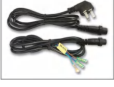

- 电源线（线长1.5米）
- 输出线（线长1.5米）

---

**振动送料控制器专家** Vibratory Feeder Controller Expert

地址：南京市江宁区智能路9号启迪城学研园2幢  
销售电话：400-985-8889  
传真：025-84730426  
企业邮箱：sales@cuhnj.com

### 第 8 页

南京创优科技有限责任公司  www.cuhnj.com  CUH®

# SDVC14-S 数字调压振动送料控制模块

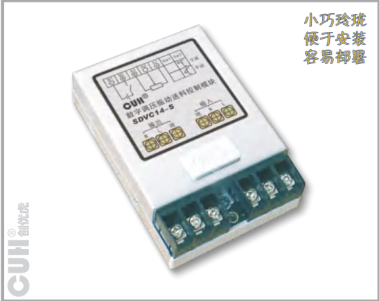

小巧玲珑  
便于安装  
容易部署

## 型号

SDVC14-S: 4A调压模块

## 功能

**自动稳压：** 内置数字稳压电路，可以减小由于电源电压波动造成的送料速度变化。

**缓启动：** 在启动时，输出电压会从零开始逐渐增大到预设电压，以消除对振动盘的冲击。

**线性调节规律：** 输出电压和旋钮旋转角度成线性关系，随着调节旋钮角度的增大，输出电压以线性规律增大。具有良好的操作性。

**过热保护：** 当控制模块工作温度过高时将停止输出，以自我保护。

**过流保护：** 当控制模块工作电流超过额定电流时将停止输出，以保护控制模块及振动设备。

**熔断式短路保护：** 输出端发生短路时，控制模块的保险丝会熔断以保护控制模块及振动设备。

## 技术规格

| 项目 | 范围 最小值 | 范围 典型值 | 范围 最大值 | 单位 | 说明 |
|---|---:|---:|---:|---|---|
| 输入电压 | 150 | 220 | 250 | 伏特（V） | 交流有效值 |
| 输出电压调整范围 | 35 | —— | Vin-10 | 伏特（V） | 半波 |
|  | 45 | —— | Vin-5 | 伏特（V） | 全波 |
| 稳压精度 | —— | —— | 30 | 伏特（V） | Vset = 150V △Vin+ = 70V |
| 稳压响应时间 | 0 | 0.01 | 0.02 | 秒（s） |  |
| 输出电流调整范围 | 0.1 | —— | 4 | 安培（A） |  |
| 输出功率 | 22 | —— | 880 | 伏安（VA） |  |
| 输出频率 | 45 | 50/60 | 65 | 赫兹（Hz） | 半波 |
|  | 90 | 100/120 | 130 | 赫兹（Hz） | 全波 |
| 输出波形 | —— | 正弦相切 | —— |  |  |
| 缓启动时间 | 0.5 | 0.65 | 0.7 | 秒（s） |  |
| 过热保护温度 | 58 | 60 | 66 | 摄氏度（℃） |  |
| 短路保护动作电流 | —— | 6.3 | —— | 安培（A） | 保险丝容量 |
| 远程开关控制电压 | 5 | —— | 24 | 伏特（V） |  |
| 保险丝容量 | —— | 6.3 | —— | 安培（A） |  |
| 工作环境温度 | 0 | 25 | 40 | 摄氏度（℃） |  |
| 工作环境湿度 | 10 | 60 | 85 | 相对湿度（%） | 不结露 |
| 存储环境温度 | -20 | 25 | 65 | 摄氏度（℃） |  |

## 尺寸和重量

尺寸：长102mm × 宽63mm × 高27mm  
重量：92g

## 随机附件

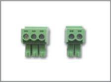

- 2位插拔式端子插头
- 3位插拔式端子插头

---

振动送料控制器专家 Vibratory Feeder Controller Expert

地址：南京市江宁区智能路9号启迪城学研园2幢  
销售电话：400-985-8889  
传真：025-84730426  
企业邮箱：sales@cuhnj.com

### 第 9 页

南京创优科技有限责任公司  www.cuhnj.com  CUH®

# SDVC20-S 数字调压振动送料控制器

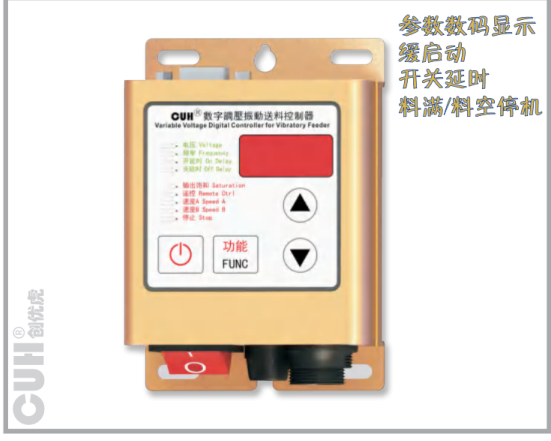

图中标注：参数数码显示、缓启动、开关延时、料满/料空停机。

## 型号

SDVC20-S: 5A料满停机调压控制器

## 功能

**自动稳压：** 内置数字稳压电路，可以减小由于电源电压波动造成的送料速度变化。

**可调缓启动：** 在启动时，输出电压会从零开始逐渐增大到预设电压，以消除对振动盘的冲击。缓启动时间可数字预置。

**速度预置：** 可以通过外部控制信号直接选择多达4种预先设置的输出电压。

**双路开关传感器料满/料空停机：** 支持2路NPN型传感器或PLC远程料满/料空停机控制。

**光电传感器料满/料空停机：** 支持光电对射传感器料满/料空停机控制。

**远程速度控制：** 可以直接使用外置的电位器、PLC、1～5V电压信号或4~20mA电流信号远程控制输出电压。

**直流控制输出：** 控制器可输出直流低压控制信号，以驱动电磁阀等设备与控制器协同工作。

**过热保护：** 当控制器工作温度过高时将停止输出，以自我保护。

**过流保护：** 当控制器工作电流超过额定电流时将停止输出，以保护控制器及振动设备。

**过压保护：** 当输入电压过高时，电源将自动关闭，以自我保护。

**熔断式短路保护：** 输出端发生短路时，控制器的保险丝会熔断以保护控制器及振动设备。

**最大可输出电压设定：** 设定最大可调整电压防止用户误操作输出过大电压损坏振动设备。

## 技术规格

| 项目 | 最小值 | 典型值 | 最大值 | 单位 | 说明 |
|---|---:|---:|---:|---|---|
| 输入电压 | 85 | 220 | 250 | 伏特（V） | 交流有效值 |
| 输出电压调整范围 | 35 | —— | Vin-10 | 伏特（V） | 半波 |
| 输出电压调整范围 | 45 | —— | Vin-5 | 伏特（V） | 全波 |
| 电压调整精度 | —— | 1 | —— | 伏特（V） |  |
| 稳压精度 | —— | —— | 30 | 伏特（V） | Vset = 150V △Vin+ = 70V |
| 稳压响应时间 | 0 | 0.01 | 0.02 | 秒（s） |  |
| 输出电流调整范围 | 0 | —— | 5 | 安培（A） |  |
| 输出功率 | 0 | —— | 1100 | 伏安（VA） |  |
| 输出频率 | 45 | 50/60 | 65 | 赫兹（Hz） | 半波 |
| 输出频率 | 90 | 100/120 | 130 | 赫兹（Hz） | 全波 |
| 输出波形 |  | 正弦相切 |  |  |  |
| 缓启动时间 | 0 | —— | 10.0 | 秒（s） | 出厂默认0.5 |
| 延迟时间范围 | 0 | —— | 9.9 | 秒（s） | 出厂默认0.2 |
| 延迟时间精度 | —— | 0.1 | —— | 秒（s） |  |
| 过热保护温度 | 58 | 60 | 66 | 摄氏度（℃） |  |
| 短路保护动作电流 | —— | 6.3 | —— | 安培（A） | 保险丝容量 |
| 直流控制输出电压 | 11 | 12 | 13 | 伏特（V） |  |
| 直流控制输出电流 | 0 | —— | 200 | 毫安（mA） |  |
| 模拟控制信号 | 1~5/4~20 |  |  | 伏特（V）/毫安（mA） | 远程速度控制电压/电流 |
| 数字控制信号 |  | 12 |  | 伏特（V） | 开关信号控制 |
| 调整方式 |  | 4 |  | 键（Button） |  |
| 保险丝容量 |  | 6.3 |  | 安培（A） |  |
| 空载功耗 | —— | 2 | —— | 瓦特（W） |  |
| 显示方式 |  | 4 |  | 位（Digit） | LED数码管 |
| 工作环境温度 | 0 | 25 | 40 | 摄氏度（℃） |  |
| 工作环境湿度 | 10 | 60 | 85 | 相对湿度（%） | 不结露 |
| 存储环境温度 | -20 | 25 | 65 | 摄氏度（℃） |  |

## 尺寸和重量

尺寸：长111mm×宽76mm×高48.5mm  
重量：285g（不含附件）

## 随机附件

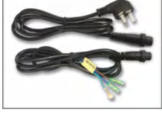

- 电源线（线长1.5米）
- 输出线（线长1.5米）

## 选购附件

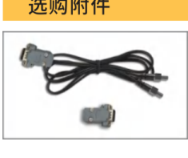

- 智能光电传感器（线长1.5米）
- 信号控制15针D型插头

---

振动送料控制器专家 Vibratory Feeder Controller Expert

地址：南京市江宁区智能路9号启迪城学研园2幢  
销售电话：400-985-8889  
传真：025-84730426  
企业邮箱：sales@cuhnj.com

### 第 10 页

南京创优科技有限责任公司  www.cuhnj.com

CUH®

# SDVC20-L 数字调压振动送料控制器

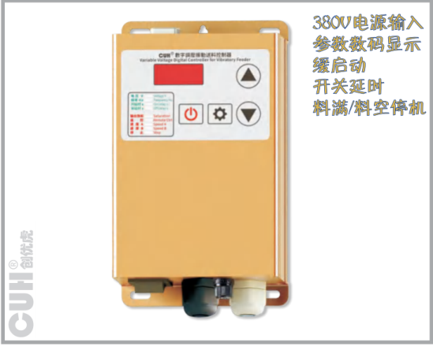

- 380V电源输入
- 参数数码显示
- 缓启动
- 开关延时
- 料满/料空停机

## 型号

SDVC20-L：10A料满停机调压控制器

## 功能

- **自动稳压：** 内置数字稳压电路，可以减小由于电源电压波动造成的送料速度变化。
- **可调缓启动：** 在启动时，输出电压会从零开始逐渐增大到预设电压，以消除对振动盘的冲击。缓启动时间可数字预置。
- **速度预置：** 可以通过外部控制信号直接选择多达4种预先设置的输出电压。
- **双路开关传感器料满/料空停机：** 支持2路NPN型传感器或PLC远程料满/料空停机控制。
- **光电传感器料满/料空停机：** 支持光电对射传感器料满/料空停机控制。
- **远程速度控制：** 可以直接使用外置的电位器、PLC、1~5V电压信号或4~20mA电流信号远程控制输出电压。
- **直流控制输出：** 控制器可输出直流低压控制信号，以驱动电磁阀等设备与控制器协同工作。
- **过热保护：** 当控制器工作温度过高时将停止输出，以自我保护。
- **过流保护：** 当控制器工作电流超过额定电流时将停止输出，以保护控制器及振动设备。
- **熔断式短路保护：** 输出端发生短路时，控制器的保险丝会熔断以保护控制器及振动设备。
- **最大可输出电压设定：** 设定最大可调整电压防止用户误操作输出过大电压损坏振动设备。

## 尺寸和重量

- 尺寸：长180mm×宽106mm×高58mm
- 重量：960g（不含附件）

## 选购附件

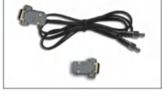

- 智能光电传感器（线长1.5米）
- 信号控制15针D型插头

## 技术规格

| 项目 | 最小值 | 典型值 | 最大值 | 单位 | 说明 |
|---|---:|---:|---:|---|---|
| 输入电压 | 85 | 380 | 440 | 伏特（V） | 交流有效值 |
| 输出电压调整范围 | 35 | —— | Vin-10 | 伏特（V） | 半波 |
| 输出电压调整范围 | 45 | —— | Vin-5 | 伏特（V） | 全波 |
| 电压调整精度 | —— | 1 | —— | 伏特（V） |  |
| 稳压精度 | —— | —— | 30 | 伏特（V） | Vset = 150V；△Vin+ = 70V |
| 稳压响应时间 | 0 | 0.01 | 0.02 | 秒（s） |  |
| 输出电流调整范围 | 0 | —— | 10 | 安培（A） |  |
| 输出功率 | 0 | —— | 3800 | 伏安（VA） |  |
| 输出频率 | 45 | 50/60 | 65 | 赫兹（Hz） | 半波 |
| 输出频率 | 90 | 100/120 | 130 | 赫兹（Hz） | 全波 |
| 输出波形 | —— | 正弦相切 | —— |  |  |
| 缓启动时间 | 0 | 1.0 | 10.0 | 秒（s） | 出厂默认0.5 |
| 延迟时间范围 | 0 | —— | 9.9 | 秒（s） | 出厂默认0.2 |
| 延迟时间精度 | —— | 0.1 | —— | 秒（s） |  |
| 过热保护温度 | 58 | 60 | 66 | 摄氏度（℃） |  |
| 短路保护动作电流 | —— | 10 | —— | 安培（A） | 保险丝容量 |
| 直流控制输出电压 | 22 | 24 | 26 | 伏特（V） |  |
| 直流控制输出电流 | 0 | —— | 200 | 毫安（mA） |  |
| 模拟控制信号 | —— | 1~5/4~20 | —— | 伏特（V）/毫安（mA） | 远程速度控制电压/电流 |
| 数字控制信号 | 0 | 24 | —— | 伏特（V） | 开关信号控制 |
| 调整方式 | —— | 4 | —— | 键（Button） |  |
| 保险丝容量 | —— | 10 | —— | 安培（A） |  |
| 空载功耗 | —— | 2 | —— | 瓦特（W） |  |
| 显示方式 | —— | 4 | —— | 位（Digit） | LED数码管 |
| 工作环境温度 | 0 | 25 | 40 | 摄氏度（℃） |  |
| 工作环境湿度 | 10 | 60 | 85 | 相对湿度（%） | 不结露 |
| 存储环境温度 | -20 | 25 | 65 | 摄氏度（℃） |  |

---

振动送料控制器专家 Vibratory Feeder Controller Expert

地址：南京市江宁区智能路9号启迪城学研园2幢  
销售电话：400-985-8889  
传真：025-84730426  
企业邮箱：sales@cuhnj.com

### 第 11 页

南京创优科技有限责任公司  www.cuhnj.com

CUH®

# SDVC20-XL 数字调压振动送料控制器

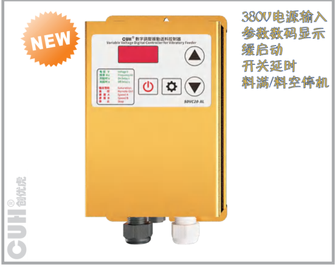

图示标注：NEW；380V电源输入；参数数码显示；缓启动；开关延时；料满/料空停机。

## 型号

SDVC20-XL：15A料满停机调压控制器

## 功能

**自动稳压：** 内置数字稳压电路，可以减小由于电源电压波动造成的送料速度变化。

**可调缓启动：** 在启动时，输出电压会从零开始逐渐增大到预设电压，以消除对振动盘的冲击。缓启动时间可数字预置。

**速度预置：** 可以通过外部控制信号直接选择多达4种预先设置的输出电压。

**双路开关传感器料满/料空停机：** 支持2路NPN型传感器或PLC远程料满/料空停机控制。

**光电传感器料满/料空停机：** 支持光电对射传感器料满/料空停机控制。

**远程速度控制：** 可以直接使用外置的电位器、PLC、1～5V电压信号或4～20mA电流信号远程控制输出电压。

**直流控制输出：** 控制器可输出直流低压控制信号，以驱动电磁阀等设备与控制器协同工作。

**过热保护：** 当控制器工作温度过高时将停止输出，以自我保护。

**过流保护：** 当控制器工作电流超过额定电流时将停止输出，以保护控制器及振动设备。

**熔断式短路保护：** 输出端发生短路时，控制器的保险丝会熔断以保护控制器及振动设备。

**最大可输出电压设定：** 设定最大可调整电压防止用户误操作输出过大电压损坏振动设备。

## 技术规格

| 项目 | 最小值 | 典型值 | 最大值 | 单位 | 说明 |
|---|---:|---:|---:|---|---|
| 输入电压 | 85 | 380 | 440 | 伏特（V） |  |
| 输出电压调整范围 | 35 | — | Vin-10 | 伏特（V） | 半波 |
| 输出电压调整范围 | 45 | — | Vin-5 | 伏特（V） | 全波 |
| 电压调整精度 | — | 1 | — | 伏特（V） |  |
| 稳压精度 | — | — | 30 | 伏特（V） | Vset = 150V；ΔVin+ = 70V |
| 稳压响应时间 | 0 | 0.01 | 0.02 | 秒（s） |  |
| 输出电流调整范围 | 0 | — | 15 | 安培（A） |  |
| 输出功率 | 0 | — | 5700 | 伏安（VA） |  |
| 输出频率 | 90 | 100/120 | 130 | 赫兹（Hz） | 全波 |
| 输出频率 | 45 | 50/60 | 65 | 赫兹（Hz） | 半波 |
| 输出频率 | 30 | 33/40 | 43 | 赫兹（Hz） | 三分之一波 |
| 输出频率 | 22 | 25/30 | 32 | 赫兹（Hz） | 四分之一波 |
| 输出波形 | — | 正弦相切 | — |  |  |
| 缓启动时间 | 0 | 0.5 | 10.0 | 秒（s） | 出厂默认0.5 |
| 延迟时间范围 | 0 | — | 9.9 | 秒（s） | 出厂默认0.2 |
| 延迟时间精度 | — | 0.1 | — | 秒（s） |  |
| 过热保护温度 | 58 | 60 | 66 | 摄氏度（℃） |  |
| 直流控制输出电压 | 22 | 24 | 26 | 伏特（V） |  |
| 直流控制输出电流 | 0 | — | 200 | 毫安（mA） |  |
| 模拟控制信号 | — | 1~5/4~20 | — | 伏特（V）/毫安（mA） | 远程速度控制电压/电流 |
| 数字控制信号 | — | 24 | — | 伏特（V） | 开关信号控制 |
| 调整方式 | — | 4 | — | 键（Button） |  |
| 保险丝容量 | — | 20 | — | 安培（A） |  |
| 空载功耗 | — | 2 | — | 瓦特（W） |  |
| 显示方式 | — | 4 | — | 位（Digit） | LED数码管 |
| 工作环境温度 | 0 | 25 | 40 | 摄氏度（℃） |  |
| 工作环境湿度 | 10 | 60 | 85 | 相对湿度（%） | 不结露 |
| 存储环境温度 | -20 | 25 | 65 | 摄氏度（℃） |  |

## 尺寸和重量

尺寸：长180mm×宽106mm×高58mm  
重量：960g（不含附件）

## 选购附件

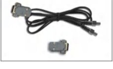

- 智能光电传感器（线长1.5米）
- 信号控制15针D型插头

---

振动送料控制器专家 Vibratory Feeder Controller Expert

地址：南京市江宁区智能路9号启迪城学研园2幢  
销售电话：400-985-8889  
传真：025-84730426  
企业邮箱：sales@cuhnj.com

### 第 12 页

南京创优科技有限责任公司  www.cuhnj.com  CUH®

# SDVC201-L 数字调压振动送料控制器

产品图标注：NEW；参数数码显示、缓启动、开关延时、料满/料空停机。

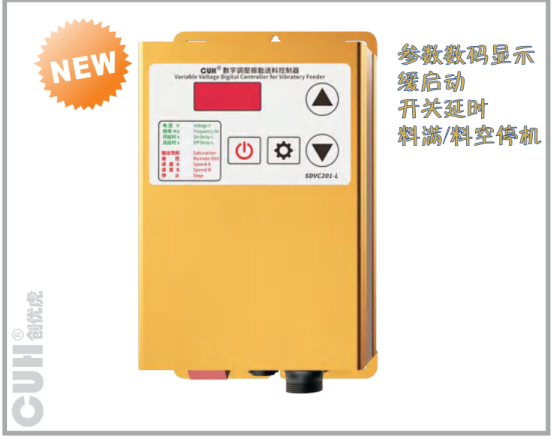

## 技术规格

| 项目 | 最小值 | 典型值 | 最大值 | 单位 | 说明 |
|---|---:|---:|---:|---|---|
| 输入电压 | 85 | 220 | 250 | 伏特（V） |  |
| 输出电压调整范围 | 35 | — | Vin-10 | 伏特（V） | 半波 |
| 输出电压调整范围 | 45 | — | Vin-5 | 伏特（V） | 全波 |
| 电压调整精度 | — | 1 | 30 | 伏特（V） | Vset = 150V；ΔVin+ = 70V |
| 稳压响应时间 | 0 | 0.01 | 0.02 | 秒（s） |  |
| 输出电流调整范围 | 0 | — | 10 | 安培（A） |  |
| 输出功率 | 0 | — | 2200 | 伏安（VA） |  |
| 输出频率 | 90 | 100/120 | 130 | 赫兹（Hz） | 全波 |
| 输出频率 | 45 | 50/60 | 65 | 赫兹（Hz） | 半波 |
| 输出频率 | 30 | 33/40 | 43 | 赫兹（Hz） | 三分之一波 |
| 输出频率 | 22 | 25/30 | 32 | 赫兹（Hz） | 四分之一波 |
| 输出波形 | — | 正弦相切 | — | — |  |
| 缓启动时间 | 0 | — | 10.0 | 秒（s） | 出厂默认0.5 |
| 延迟时间范围 | 0 | — | 9.9 | 秒（s） | 出厂默认0.2 |
| 延迟时间精度 | — | 0.1 | — | 秒（s） |  |
| 过热保护温度 | 58 | 60 | 66 | 摄氏度（℃） |  |
| 直流控制输出电压 | 22 | 24 | 26 | 伏特（V） |  |
| 直流控制输出电流 | 0 | — | 200 | 毫安（mA） |  |
| 模拟控制信号 | — | 1~5/4~20 | — | 伏特（V）/毫安（mA） | 远程速度控制电压/电流 |
| 数字控制信号 | — | 24 | — | 伏特（V） | 开关信号控制 |
| 调整方式 | — | 4 | — | 键（Button） |  |
| 保险丝容量 | — | 15 | — | 安培（A） |  |
| 空载功耗 | — | 2 | — | 瓦特（W） |  |
| 显示方式 | — | 4 | — | 位（Digit） | LED数码管 |
| 工作环境温度 | 0 | 25 | 40 | 摄氏度（℃） |  |
| 工作环境湿度 | 10 | 60 | 85 | 相对湿度（%） | 不结露 |
| 存储环境温度 | -20 | 25 | 65 | 摄氏度（℃） |  |

## 型号

SDVC201-L：10A料满停机调压控制器

## 功能

- **自动稳压**：内置数字稳压电路，可以减小由于电源电压波动造成的送料速度变化。
- **可调缓启动**：在启动时，输出电压会从零开始逐渐增大到预设电压，以消除对振动盘的冲击。缓启动时间可数字预置。
- **速度预置**：可以通过外部控制信号直接选择多达4种预先设置的输出电压。
- **双路开关传感器料满/料空停机**：支持2路NPN型传感器或PLC远程料满/料空停机控制。
- **光电传感器料满/料空停机**：支持光电对射传感器料满/料空停机控制。
- **远程速度控制**：可以直接使用外置的电位器、PLC、1～5V电压信号或4~20mA电流信号远程控制输出电压。
- **直流控制输出**：控制器可输出直流低压控制信号，以驱动电磁阀等设备与控制器协同工作。
- **过热保护**：当控制器工作温度过高时将停止输出，以自我保护。
- **过流保护**：当控制器工作电流超过额定电流时将停止输出，以保护控制器及振动设备。
- **熔断式短路保护**：输出端发生短路时，控制器的保险丝会熔断以保护控制器及振动设备。
- **最大可输出电压设定**：设定最大可调整电压防止用户误操作输出过大电压损坏振动设备。

## 尺寸和重量

尺寸：长180mm×宽106mm×高58mm  
重量：960g（不含附件）

## 随机附件

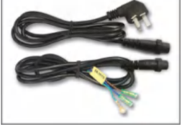

- 电源线（线长1.5米）
- 输出线（线长1.5米）

## 选购附件

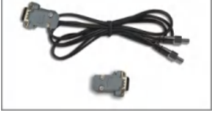

- 智能光电传感器（线长1.5米）
- 信号控制15针D型插头

---

振动送料控制器专家 Vibratory Feeder Controller Expert

地址：南京市江宁区智能路9号启迪城学研园2幢  
销售电话：400-985-8889  
传真：025-84730426  
企业邮箱：sales@cuhnj.com

8

### 第 13 页

南京创优科技有限责任公司  www.cuhnj.com

# SDVC20-U 数字调压振动送料控制器

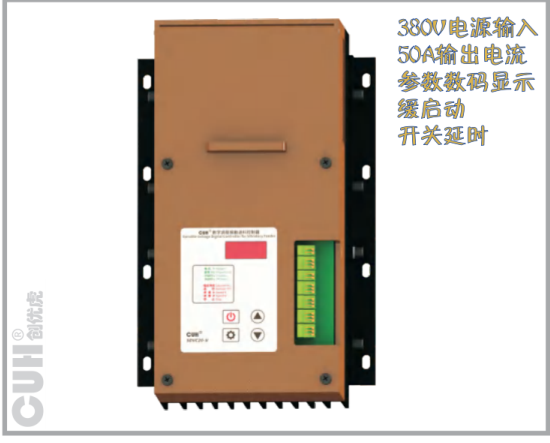

图示标注：

- 380V电源输入
- 50A输出电流
- 参数数码显示
- 缓启动
- 开关延时

## 型号

SDVC20-U：50A料满停机调压控制器

## 功能

- **自动稳压**：内置数字稳压电路，可以减小由于电源电压波动造成的送料速度变化。
- **可调缓启动**：在启动时，输出电压会从零开始逐渐增大到预设电压，以消除对振动盘的冲击。缓启动时间可数字预置。
- **速度预置**：可以通过外部控制信号直接选择多达4种预先设置的输出电压。
- **双路开关传感器料满/料空停机**：支持自适应传感器或PLC远程料满/料空停机控制。
- **远程速度控制**：可以直接使用外置的电位器、PLC、1～5V电压信号或4~20mA电流信号远程控制输出电压。
- **直流控制输出**：控制器可输出直流低压控制信号，以驱动电磁阀等设备与控制器协同工作。
- **过热保护**：当控制器工作温度过高时将停止输出，以自我保护。
- **过流保护**：当控制器工作电流超过额定电流时将停止输出，以保护控制器及振动设备。
- **熔断式短路保护**：输出端发生短路时，控制器的保险丝会熔断以保护控制器及振动设备。
- **最大可输出电压设定**：设定最大可调整电压防止用户误操作输出过大电压损坏振动设备。

## 技术规格

| 项目 | 最小值 | 典型值 | 最大值 | 单位 | 说明 |
|---|---:|---:|---:|---|---|
| 输入电压 | 85 | 380 | 440 | 伏特（V） | 交流有效值 |
| 输出电压调整范围 | 35 | —— | Vin-10 | 伏特（V） |  |
| 电压调整精度 | —— | 1 | —— | 伏特（V） |  |
| 稳压精度 | —— | —— | 30 | 伏特（V） | Vset = 150V；△Vin+ = 70V |
| 稳压响应时间 | 0 | 0.01 | 0.02 | 秒（s） |  |
| 输出电流调整范围 | 0 | —— | 50 | 安培（A） |  |
| 输出功率 | 0 | —— | 19000 | 伏安（VA） |  |
| 输出频率（全波） | 90 | 100/120 | 130 | 赫兹（Hz） | 全波 |
| 输出频率（半波） | 45 | 50/60 | 65 | 赫兹（Hz） | 半波 |
| 输出频率（三分之一波） | 30 | 33/40 | 43 | 赫兹（Hz） | 三分之一波 |
| 输出频率（四分之一波） | 22 | 25/30 | 32 | 赫兹（Hz） | 四分之一波 |
| 输出频率（五分之一波） | 18 | 20/24 | 26 | 赫兹（Hz） | 五分之一波 |
| 输出波形 | —— | 正弦相切 | —— |  |  |
| 缓启动时间 | 0 | —— | 10.0 | 秒（s） | 出厂默认1.0 |
| 延迟时间范围 | 0 | —— | 9.9 | 秒（s） | 出厂默认0.2 |
| 延迟时间精度 | —— | 0.1 | —— | 秒（s） |  |
| 过热保护温度 | 58 | 60 | 66 | 摄氏度（℃） |  |
| 直流控制输出电压 | 22 | 24 | 26 | 伏特（V） |  |
| 直流控制输出电流 | 0 | —— | 200 | 毫安（mA） |  |
| 模拟控制信号 | —— | 1~5/4~20 | —— | 伏特（V）/毫安（mA） | 本地控制电压/远程遥控电流 |
| 数字控制信号 | —— | 24 | —— | 伏特（V） | 开关信号控制 |
| 调整方式 | —— | 4 | —— | 键（Button） |  |
| 保险丝容量 | —— | 50 | —— | 安培（A） |  |
| 空载功耗 | —— | 2 | —— | 瓦特（W） |  |
| 显示方式 | —— | 4 | —— | 位（Digit） | LED数码管 |
| 工作环境温度 | -10 | 25 | 40 | 摄氏度（℃） |  |
| 工作环境湿度 | 10 | 60 | 85 | 相对湿度（%） | 不结露 |
| 存储环境温度 | -20 | 25 | 65 | 摄氏度（℃） |  |

## 尺寸和重量

尺寸：长280mm×宽180mm×高121mm  
重量：2480g（不含附件）

---

振动送料控制器专家 *Vibratory Feeder Controller Expert*

地址：南京市江宁区智能路9号启迪城学研园2幢  
销售电话：400-985-8889  
传真：025-84730426  
企业邮箱：sales@cuhnj.com

### 第 14 页

南京创优科技有限责任公司  www.cuhnj.com

# SDVC21-S 数字调压振动送料控制器

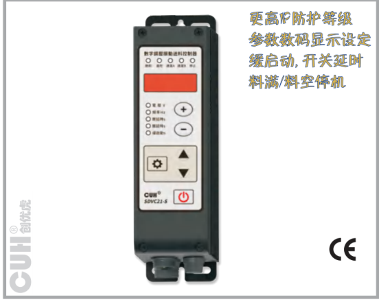

更高IP防护等级  
参数数码显示设定  
缓启动，开关延时  
料满/料空停机

## 技术规格

| 项目 | 最小值 | 典型值 | 最大值 | 单位 | 说明 |
|---|---:|---:|---:|---|---|
| 输入电压 | 85 | 220 | 250 | 伏特（V） | 交流有效值 |
| 输出电压调整范围 | 22 | 100/120 | Vin-10 | 伏特（V） | 半波 |
| 输出电压调整范围 | 35 | —— | Vin-10 | 伏特（V） | 半波 |
| 输出电压调整范围 | 45 | —— | Vin-5 | 伏特（V） | 全波 |
| 电压调整精度 | —— | 1 | —— | 伏特（V） |  |
| 稳压精度 | —— | —— | 30 | 伏特（V） | Vset = 150V；△Vin+ = 70V |
| 稳压响应时间 | 0 | 0.01 | 0.02 | 秒（s） |  |
| 输出电流调整范围 | 0 | —— | 5 | 安培（A） |  |
| 输出功率 | 0 | —— | 1100 | 伏安（VA） |  |
| 输出频率 | 45 | 50/60 | 65 | 赫兹（Hz） | 半波 |
| 输出频率 | 90 | 100/120 | 130 | 赫兹（Hz） | 全波 |
| 输出波形 |  | 正弦相切 |  |  |  |
| 缓启动时间 | 0 | 9.9/10.0 | —— | 秒（s） | 出厂默认1.0 |
| 延迟时间范围 | 0 | 9.9/99.9 | —— | 秒（s） | 出厂默认0.2 |
| 延迟时间精度 | —— | 0.1 | —— | 秒（s） |  |
| 过热保护温度 | 58 | 60 | 66 | 摄氏度（℃） |  |
| 短路保护动作电流 | —— | 6.3 | —— | 安培（A） | 保险丝容量 |
| 直流控制输出电压 | 22 | 24 | 26 | 伏特（V） |  |
| 直流控制输出电流 | 0 | —— | 200 | 毫安（mA） |  |
| 模拟控制信号 |  | 1~5/4~20 |  | 伏特（V）/毫安（mA） | 远程速度控制电压/电流 |
| 数字控制信号 |  | 24 |  | 伏特（V） | 开关信号控制 |
| 调整方式 |  | 6 |  | 键（Button） |  |
| 保险丝容量 |  | 6.3 |  | 安培（A） |  |
| 空载功耗 | —— | 2 | —— | 瓦特（W） |  |
| 显示方式 |  | 5 |  | 位（Digit） | LED数码管 |
| 工作环境温度 | 0 | 25 | 40 | 摄氏度（℃） |  |
| 工作环境湿度 | 10 | 60 | 85 | 相对湿度（%） | 不结露 |
| 存储环境温度 | -20 | 25 | 65 | 摄氏度（℃） |  |

振动送料控制器专家 Vibratory Feeder Controller Expert

地址：南京市江宁区智能路9号启迪城学研园2幢  
销售电话：400-985-8889  
传真：025-84730426  
企业邮箱：sales@cuhnj.com

## 型号

SDVC21-S：5A料满停机调压控制器

## 功能

**自动稳压：** 内置数字稳压电路，可以减小由于电源电压波动造成的送料速度变化。

**可调缓启动：** 在启动时，输出电压会从零开始逐渐增大到预设电压，以消除对振动盘的冲击。缓启动时间可数字预置。

**速度预置：** 可以通过外部控制信号直接选择多达4种预先设置的输出电压。

**双路开关传感器料满/料空停机：** 支持2路自适应传感器或PLC远程料满/料空停机控制。

**光电传感器料满/料空停机：** 支持光电对射传感器料满/料空停机控制。

**传感器自适应：** 控制器可自动适应NPN型和PNP型开关传感器。

**远程速度控制：** 可以直接使用外置的电位器、PLC、1~5V电压信号或4~20mA电流信号远程控制输出电压。

**直流控制输出：** 控制器可输出直流低压控制信号，以驱动电磁阀等设备与控制器协同工作。

**过热保护：** 当控制器工作温度过高时将停止输出，以自我保护。

**过流保护：** 当控制器工作电流超过额定电流时将停止输出，以保护控制器及振动设备。

**过压保护：** 当输入电压过高时，电源将自动关闭，以自我保护。

**熔断式短路保护：** 输出端发生短路时，控制器的保险丝会熔断以保护控制器及振动设备。

**最大可输出电压设定：** 设定最大可调整电压防止用户误操作输出过大电压损坏振动设备。

## 尺寸和重量

尺寸：长190mm×宽53.6mm×高94.5mm  
重量：430g（不含附件）

## 随机附件

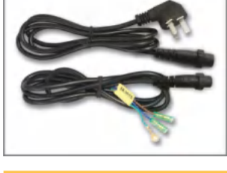

- 电源线（线长1.5米）
- 输出线（线长1.5米）

## 选购附件

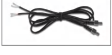

- 智能光电传感器（线长1.5米）

### 第 15 页

南京创优科技有限责任公司  www.cuhnj.com  
CUH®

## SDVC21-LP 数字调压振动送料控制器

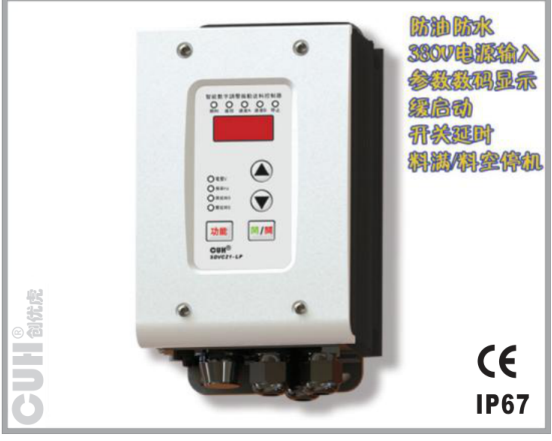

## 技术规格

| 项目 | 最小值 | 典型值 | 最大值 | 单位 | 说明 |
|---|---:|---:|---:|---|---|
| 输入电压 | 85 | 380 | 440 | 伏特（V） | 交流有效值 |
| 输出电压调整范围 | 35 | —— | Vin-10 | 伏特（V） | 半波 |
| 输出电压调整范围 | 45 | —— | Vin-5 | 伏特（V） | 全波 |
| 电压调整精度 | —— | 1 | —— | 伏特（V） |  |
| 稳压精度 | —— | —— | 30 | 伏特（V） | Vset = 150V；△Vin+ = 70V |
| 稳压响应时间 | 0 | 0.01 | 0.02 | 秒（s） |  |
| 输出电流调整范围 | 0 | —— | 10 | 安培（A） |  |
| 输出功率 | 0 | —— | 3800 | 伏安（VA） |  |
| 输出频率 | 90 | 100/120 | 130 | 赫兹（Hz） | 全波 |
| 输出频率 | 45 | 50/60 | 65 | 赫兹（Hz） | 半波 |
| 输出波形 | —— | 正弦相切 | —— |  |  |
| 缓启动时间 | 0 | —— | 10.0 | 秒（s） | 出厂默认0.5 |
| 延迟时间范围 | 0 | —— | 9.9 | 秒（s） | 出厂默认0.2 |
| 延迟时间精度 | —— | 0.1 | —— | 秒（s） |  |
| 过热保护温度 | 58 | 60 | 66 | 摄氏度（℃） |  |
| 直流控制输出电压 | 22 | 24 | 26 | 伏特（V） |  |
| 直流控制输出电流 | 0 | —— | 200 | 毫安（mA） |  |
| 模拟控制信号 | —— | 1~5/4~20 | —— | 伏特（V）/毫安（mA） | 远程速度控制电压/电流 |
| 数字控制信号 | —— | 24 | —— | 伏特（V） | 开关信号控制 |
| 调整方式 | —— | 4 | —— | 键（Button） |  |
| 保险丝容量 | —— | 16 | —— | 安培（A） |  |
| 空载功耗 | —— | 4 | —— | 瓦特（W） |  |
| 显示方式 | —— | 4 | —— | 位（Digit） | LED数码管 |
| 防护等级 | —— | IP67 | —— |  |  |
| 工作环境温度 | 0 | 25 | 40 | 摄氏度（℃） |  |

## 型号

SDVC21-LP：10A调压控制器

## 功能

**防护等级：** IP67，本控制器可以长期工作在恶劣环境中，如：潮湿、油污、灰尘严重的环境等。

**超宽工作电压范围：** 本控制器可以工作在电源电压AC 85-440V。

**自动稳压：** 内置数字稳压电路，可以减小由于电源电压波动造成的送料速度变化。

**可调缓启动：** 在启动时，输出电压会从零开始逐渐增大到预设电压，以消除对振动盘的冲击。缓启动时间可数字预置。

**速度预置：** 可以通过外部控制信号直接选择多达4种预先设置的输出电压。

**双路开关传感器料满/料空停机：** 支持2路NPN型传感器或PLC远程料满/料空停机控制。

**光电传感器料满/料空停机：** 支持光电对射传感器料满/料空停机控制。

**远程速度控制：** 可以直接使用外置的电位器、PLC、1～5V电压信号或4~20mA电流信号远程控制输出电压。

**直流控制输出：** 控制器可输出直流低压控制信号，以驱动电磁阀等设备与控制器协同工作。

**雷击保护：** 本控制器可以承受不超过4KV的雷击冲击。

**过热保护：** 当控制器工作温度过高时将停止输出，以自我保护。

**过流保护：** 当控制器工作电流超过额定电流时将停止输出，以保护控制器及振动设备。

**熔断式短路保护：** 输出端发生短路时，控制器的保险丝会熔断以保护控制器及振动设备。

**最大可输出电压设定：** 设定最大可调整电压防止用户误操作输出过大电压损坏振动设备。

## 尺寸和重量

尺寸：长190mm×宽110mm×高98mm  
重量：4600g（不含附件）

## 选购附件

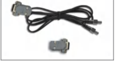

- 智能光电传感器（线长2米）
- 信号控制15针D型插头

---

振动送料控制器专家 Vibratory Feeder Controller Expert

地址：南京市江宁区智能路9号启迪城学研园2幢  
销售电话：400-985-8889  
传真：025-84730426  
企业邮箱：sales@cuhnj.com

### 第 16 页

南京创优科技有限责任公司  www.cuhnj.com

# SDVC21-XLP 数字调压振动送料控制器

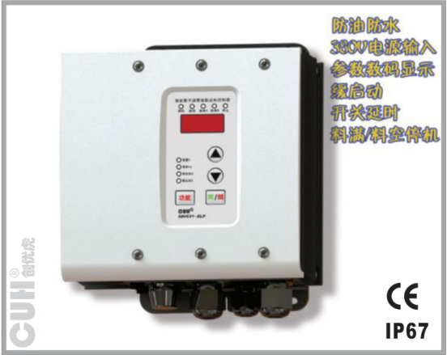

## 技术规格

| 项目 | 最小值 | 典型值 | 最大值 | 单位 | 说明 |
|---|---:|---:|---:|---|---|
| 输入电压 | 85 | 380 | 440 | 伏特（V） | 交流有效值 |
| 输出电压调整范围 | 22 | 35 | 90 | 伏特（V） |  |
| 输出电压调整范围 | 35 | — | Vin-10 | 伏特（V） | 半波 |
| 输出电压调整范围 | 45 | — | Vin-5 | 伏特（V） | 全波 |
| 电压调整精度 | — | 1 | — | 伏特（V） |  |
| 稳压精度 | — | — | 30 | 伏特（V） | Vset = 150V △Vin+ = 70V |
| 稳压响应时间 | 0 | 0.01 | 0.02 | 秒（s） |  |
| 输出电流调整范围 | 0 | — | 25 | 安培（A） |  |
| 输出功率 | 0 | — | 9500 | 伏安（VA） |  |
| 输出频率 | 90 | 100/120 | 130 | 赫兹（Hz） | 全波 |
| 输出频率 | 45 | 50/60 | 65 | 赫兹（Hz） | 半波 |
| 输出频率 | 30 | 33/40 | 43 | 赫兹（Hz） | 三分之一波 |
| 输出频率 | 22 | 25/30 | 32 | 赫兹（Hz） | 四分之一波 |
| 输出波形 | — | 正弦相切 | — |  |  |
| 缓启动时间 | 0 | — | 10.0 | 秒（s） | 出厂默认0.5 |
| 延迟时间范围 | 0 | — | 9.9 | 秒（s） | 出厂默认0.2 |
| 延迟时间精度 | — | 0.1 | — | 秒（s） |  |
| 过热保护温度 | 58 | 60 | 66 | 摄氏度（℃） |  |
| 直流控制输出电压 | 22 | 24 | 26 | 伏特（V） |  |
| 直流控制输出电流 | 0 | — | 200 | 毫安（mA） |  |
| 模拟控制信号 | — | 1~5/4~20 | — | 伏特（V）/毫安（mA） | 远程速度控制电压/电流 |
| 数字控制信号 | — | 24 | — | 伏特（V） | 开关信号控制 |
| 调整方式 | — | 4 | — | 键（Button） |  |
| 保险丝容量 | — | 30 | — | 安培（A） |  |
| 空载功耗 | — | 4 | — | 瓦特（W） |  |
| 显示方式 | — | 4 | — | 位（Digit） | LED数码管 |
| 防护等级 | — | IP67 | — |  |  |
| 工作环境温度 | 0 | 25 | 40 | 摄氏度（℃） |  |

## 型号

SDVC21-XLP：25A调压控制器

## 功能

**防护等级：** IP67，本控制器可以长期工作在恶劣环境中，如：潮湿、油污、灰尘严重的环境等。

**超宽工作电压范围：** 本控制器可以工作在电源电压AC 85-440V。

**自动稳压：** 内置数字稳压电路，可以减小由于电源电压波动造成的送料速度变化。

**可调缓启动：** 在启动时，输出电压会从零开始逐渐增大到预设电压，以消除对振动盘的冲击。缓启动时间可数字预置。

**速度预置：** 可以通过外部控制信号直接选择多达4种预先设置的输出电压。

**双路开关传感器料满/料空停机：** 支持2路NPN型传感器或PLC远程料满/料空停机控制。

**光电传感器料满/料空停机：** 支持光电对射传感器料满/料空停机控制。

**远程速度控制：** 可以直接使用外置的电位器、PLC、1~5V电压信号或4~20mA电流信号远程控制输出电压。

**直流控制输出：** 控制器可输出直流低压控制信号，以驱动电磁阀等设备与控制器协同工作。

**雷击保护：** 本控制器可以承受不超过4KV的雷击冲击。

**过热保护：** 当控制器工作温度过高时将停止输出，以自我保护。

**过流保护：** 当控制器工作电流超过额定电流时将停止输出，以保护控制器及振动设备。

**熔断式短路保护：** 输出端发生短路时，控制器的保险丝会熔断以保护控制器及振动设备。

**最大可输出电压设定：** 设定最大可调整电压防止用户误操作输出过大电压损坏振动设备。

## 尺寸和重量

尺寸：长190mm×宽170mm×高98mm  
重量：5800g（不含附件）

## 选购附件

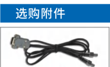

- 智能光电传感器（线长2米）
- 信号控制15针D型插头

---

振动送料控制器专家 Vibratory Feeder Controller Expert

地址：南京市江宁区智能路9号启迪城学研园2幢  
销售电话：400-985-8889  
传真：025-84730426  
企业邮箱：sales@cuhnj.com

### 第 17 页

南京创优科技有限责任公司  www.cuhnj.com

# SDVC212-L 单路数字调压振动送料控制器

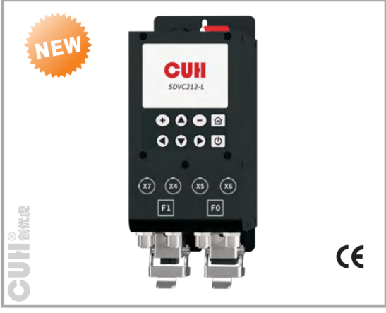

## 技术规格

| 项目 | 最小值 | 典型值 | 最大值 | 单位 | 备注 |
|---|---:|---:|---:|---|---|
| 输入电压 | 85 | 120/230 | 250 | 伏特（V） | 交流有效值 |
| 输出电压调整范围 | 10 | —— | Vin-5 | 伏特（V） |  |
| 电压调整精度 | —— | 1 | —— | 伏特（V） |  |
| 稳压响应时间 | —— | 0.02 | —— | 秒（s） |  |
| F1/F2/F3输出电流调整范围 | 0 | —— | 10 | 安培（A） |  |
| 总输出最大电流 | —— | 10 | —— | 安培（A） |  |
| 总输出功率 | —— | —— | 2500 | 伏安（VA） |  |
| 输出频率 | 90 | 100/120 | 130 | 赫兹（Hz） | 全波 |
| 输出频率 | 45 | 50/60 | 65 | 赫兹（Hz） | 半波 |
| 输出频率 | 30 | 33/40 | 43 | 赫兹（Hz） | 三分之一波 |
| 输出频率 | 22 | 25/30 | 32 | 赫兹（Hz） | 四分之一波 |
| 输出波形 | —— | 正弦相切 | —— |  |  |
| 缓启动时间 | 0 | —— | 60.0 | 秒（s） | 出厂默认0.1 |
| 缓关闭时间 | 0 | —— | 60.0 | 秒（s） | 出厂默认0.1 |
| 过热保护温度 | 58 | 65 | 66 | 摄氏度（℃） |  |
| 保险丝容量 | —— | 15 | —— | 安培（A） |  |
| 保险丝I²T | —— | 182.3 | —— | A²s | 保险丝容量=15A |
| 直流控制输出电压 | 22 | 24 | 26 | 伏特（V） |  |
| 直流输出总电流 | —— | 1.2 | —— | 安培（A） |  |
| X20/X21/X30/X31/X6.1直流输出 | —— | 400 | —— | 毫安（mA） |  |
| 数字控制信号 | —— | 24 | —— | 伏特（V） | 开关信号控制 |
| 模拟控制信号 | —— | 电位器，1-5V，0-10V | —— | 伏特（V） |  |
| 空载功耗 | —— | 3.5 | —— | 瓦特（W） |  |
| 显示方式 | —— | 2.8英寸彩色液晶显示屏320*240 | —— | 点（Dot） | 262K色 |
| 工作环境温度 | 0 | 25 | 40 | 摄氏度（℃） |  |
| 工作环境湿度 | 10 | 60 | 85 | 相对湿度（%） | 不结露 |
| 存储环境温度 | -20 | 25 | 65 | 摄氏度（℃） |  |
| 适用海拔高度 | —— | ＜2000 | —— | 米（m） |  |

## 型号

SDVC212-L：10A 单路数字调压控制器

## 功能

**自动稳压：** 内置数字稳压电路，可以减小由于电源电压波动造成的送料速度变化。

**可调缓启动：** 在启动时，输出电压会从零开始逐渐增大到预设电压，以消除对振动盘的冲击。缓启动时间可数字预置。

**双路开关传感器料满/料空停机：** 支持2路NPN/PNP型传感器或PLC远程料满/料空停机控制。

**传感器自适应：** 控制器可自动适应NPN型和PNP型开关传感器。

**485通讯：** 通过485通讯可以远程控制修改控制器的各项参数。

**远程速度控制：** 可以直接使用外置的电位器、PLC或1~5V/0~10V电压信号远程控制输出电压。

**直流控制输出：** 控制器可输出直流低压控制信号，以驱动电磁阀等设备与控制器协同工作。

**键盘锁定：** 长按开/关键以锁定所有按键，防止用户误操作。

**电流显示：** 可以实时显示当前输出电流。

**过热保护：** 当控制器工作温度过高时将停止输出，以自我保护。

**过流保护：** 当控制器工作电流超过额定电流时将停止输出，以保护控制器及振动设备。

**过压保护：** 当输入电压过高时，电源将自动关闭，以自我保护。

**熔断式短路保护：** 输出端发生短路时，控制器的保险丝会熔断以保护控制器及振动设备。

**最大可输出电压设定：** 设定最大可调整电压防止用户误操作输出过大电压损坏振动设备。

## 尺寸和重量

尺寸：长205mm×宽93mm×高94.5mm  
重量：940g（不含附件）

## 随机附件

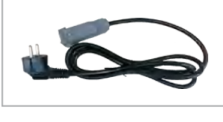

- 电源线（线长1.5米）

---

振动送料控制器专家 Vibratory Feeder Controller Expert

地址：南京市江宁区智能路9号启迪城学研园2幢  
销售电话：400-985-8889  
传真：025-84730426  
企业邮箱：sales@cuhnj.com

### 第 18 页

南京创优科技有限责任公司  www.cuhnj.com

# SDVC222-XL 双路数字调压振动送料控制器

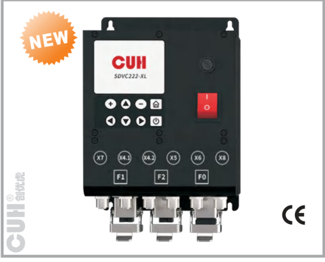

## 技术规格

| 项目 | 范围：最小值 | 范围：典型值 | 范围：最大值 | 单位 | 备注 |
|---|---:|---:|---:|---|---|
| 输入电压 | 85 | 120/230 | 250 | 伏特（V） | 交流有效值 |
| 输出电压调整范围 | 10 | — | Vin-5 | 伏特（V） |  |
| 电压调整精度 | — | 1 | — | 伏特（V） |  |
| 稳压响应时间 | — | 0.02 | — | 秒（s） |  |
| F1/F2/F3输出电流调整范围 | 0 | — | 10 | 安培（A） |  |
| 总输出最大电流 | — | 15 | — | 安培（A） |  |
| 总输出功率 | — | — | 2500 | 伏安（VA） |  |
| 输出频率 | 90 | 100/120 | 130 | 赫兹（Hz） | 全波 |
| 输出频率 | 45 | 50/60 | 65 | 赫兹（Hz） | 半波 |
| 输出频率 | 30 | 33/40 | 43 | 赫兹（Hz） | 三分之一波 |
| 输出频率 | 22 | 25/30 | 32 | 赫兹（Hz） | 四分之一波 |
| 输出波形 | — | 正弦相切 | — | — |  |
| 缓启动时间 | 0 | — | 60.0 | 秒（s） | 出厂默认0.1 |
| 缓关闭时间 | 0 | — | 60.0 | 秒（s） | 出厂默认0.1 |
| 过热保护温度 | 58 | 65 | 66 | 摄氏度（℃） |  |
| 保险丝容量 | — | 20 | — | 安培（A） |  |
| 保险丝I²T | — | 672 | — | A²s | 保险丝容量=20A |
| 直流控制输出电压 | 22 | 24 | 26 | 伏特（V） |  |
| 直流输出总电流 | — | 1.2 | — | 安培（A） |  |
| X20/X21/X30/X31/X6.1直流输出 | — | 400 | — | 毫安（mA） |  |
| 数字控制信号 | — | 24 | — | 伏特（V） | 开关信号控制 |
| 模拟控制信号 | — | 电位器，1-5V，0-10V | — | 伏特（V） |  |
| 空载功耗 | — | 3.5 | — | 瓦特（W） |  |
| 显示方式 | — | 2.8英寸彩色液晶显示屏320\*240 | — | 点（Dot） | 262K色 |
| 工作环境温度 | 0 | 25 | 40 | 摄氏度（℃） |  |
| 工作环境湿度 | 10 | 60 | 85 | 相对湿度（%） | 不结露 |
| 存储环境温度 | -20 | 25 | 65 | 摄氏度（℃） |  |
| 适用海拔高度 | — | ＜2000 | — | 米（m） |  |

## 型号

SDVC222-XL：15A 双路数字调压控制器

## 功能

- **自动稳压：** 内置数字稳压电路，可以减小由于电源电压波动造成的送料速度变化。
- **可调缓启动：** 在启动时，输出电压会从零开始逐渐增大到预设电压，以消除对振动盘的冲击。缓启动时间可数字预置。
- **双路开关传感器料满/料空停机：** 支持2路NPN/PNP型传感器或PLC远程料满/料空停机控制。
- **传感器自适应：** 控制器可自动适应NPN型和PNP型开关传感器。
- **485通讯：** 通过485通讯可以远程控制修改控制器的各项参数。
- **远程速度控制：** 可以直接使用外置的电位器、PLC或1～5V/0~10V电压信号远程控制输出电压。
- **直流控制输出：** 控制器可输出直流低压控制信号，以驱动电磁阀等设备与控制器协同工作。
- **键盘锁定：** 长按开/关键以锁定所有按键，防止用户误操作。
- **电流显示：** 可以实时显示当前输出电流。
- **过热保护：** 当控制器工作温度过高时将停止输出，以自我保护。
- **过流保护：** 当控制器工作电流超过额定电流时将停止输出，以保护控制器及振动设备。
- **过压保护：** 当输入电压过高时，电源将自动关闭，以自我保护。
- **熔断式短路保护：** 输出端发生短路时，控制器的保险丝会熔断以保护控制器及振动设备。
- **最大可输出电压设定：** 设定最大可调整电压防止用户误操作输出过大电压损坏振动设备。

## 尺寸和重量

- 尺寸：长205mm×宽153mm×高94.5mm
- 重量：1300g（不含附件）

## 随机附件

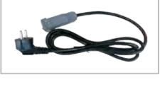

- 电源线（线长2米）

---

振动送料控制器专家 Vibratory Feeder Controller Expert

地址：南京市江宁区智能路9号启迪城学研园2幢  
销售电话：400-985-8889  
传真：025-84730426  
企业邮箱：sales@cuhnj.com

### 第 19 页

南京创优科技有限责任公司　www.cuhnj.com　CUH®

# SDVC232-XL 三路数字调压振动送料控制器

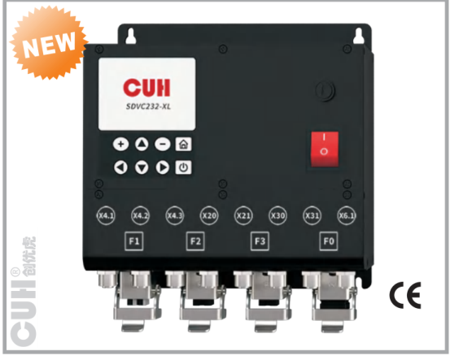

## 技术规格

| 项目 | 范围（最小值） | 范围（典型值） | 范围（最大值） | 单位 | 备注 |
|---|---:|---:|---:|---|---|
| 输入电压 | 85 | 120/230 | 250 | 伏特（V） | 交流有效值 |
| 输出电压调整范围 | 10 | —— | Vin-5 | 伏特（V） |  |
| 电压调整精度 | —— | 1 | —— | 伏特（V） |  |
| 稳压响应时间 | —— | 0.02 | —— | 秒（s） |  |
| F1/F2/F3输出电流调整范围 | 0 | —— | 10 | 安培（A） |  |
| 总输出最大电流 | —— | 15 | —— | 安培（A） |  |
| 总输出功率 | —— | —— | 2500 | 伏安（VA） |  |
| 输出频率 | 90 | 100/120 | 130 | 赫兹（Hz） | 全波 |
| 输出频率 | 45 | 50/60 | 65 | 赫兹（Hz） | 半波 |
| 输出频率 | 30 | 33/40 | 43 | 赫兹（Hz） | 三分之一波 |
| 输出频率 | 22 | 25/30 | 32 | 赫兹（Hz） | 四分之一波 |
| 输出波形 | —— | 正弦相切 | —— |  |  |
| 缓启动时间 | 0 | —— | 60.0 | 秒（s） | 出厂默认0.1 |
| 缓关闭时间 | 0 | —— | 60.0 | 秒（s） | 出厂默认0.1 |
| 过热保护温度 | 58 | 65 | 66 | 摄氏度（℃） |  |
| 保险丝容量 | —— | 20 | —— | 安培（A） |  |
| 保险丝I²T | —— | 672 | —— | A²s | 保险丝容量=20A |
| 直流控制输出电压 | 22 | 24 | 26 | 伏特（V） |  |
| 直流输出总电流 | —— | 1.2 | —— | 安培（A） |  |
| X20/X21/X30/X31/X6.1直流输出 | —— | 400 | —— | 毫安（mA） |  |
| 数字控制信号 | —— | 24 | —— | 伏特（V） | 开关信号控制 |
| 模拟控制信号 | —— | 电位器，1-5V，0-10V | —— | 伏特（V） |  |
| 空载功耗 | —— | 3.5 | —— | 瓦特（W） |  |
| 显示方式 | —— | 2.8英寸彩色液晶显示屏320*240 | —— | 点（Dot） | 262K色 |
| 工作环境温度 | 0 | 25 | 40 | 摄氏度（℃） |  |
| 工作环境湿度 | 10 | 60 | 85 | 相对湿度（%） | 不结露 |
| 存储环境温度 | -20 | 25 | 65 | 摄氏度（℃） |  |
| 适用海拔高度 |  | ＜2000 |  | 米（m） |  |

## 型号

SDVC232-XL：15A 三路数字调压控制器

## 功能

- **自动稳压**：内置数字稳压电路，可以减小由于电源电压波动造成的送料速度变化。
- **可调缓启动**：在启动时，输出电压会从零开始逐渐增大到预设电压，以消除对振动盘的冲击。缓启动时间可数字预置。
- **双路开关传感器料满/料空停机**：支持2路NPN/PNP型传感器或PLC远程料满/料空停机控制。
- **传感器自适应**：控制器可自动适应NPN型和PNP型开关传感器。
- **485通讯**：通过485通讯可以远程控制修改控制器的各项参数。
- **远程速度控制**：可以直接使用外置的电位器、PLC或1～5V/0~10V电压信号远程控制输出电压。
- **直流控制输出**：控制器可输出直流低压控制信号，以驱动电磁阀等设备与控制器协同工作。
- **键盘锁定**：长按开/关键以锁定所有按键，防止用户误操作。
- **电流显示**：可以实时显示当前输出电流。
- **过热保护**：当控制器工作温度过高时将停止输出，以自我保护。
- **过流保护**：当控制器工作电流超过额定电流时将停止输出，以保护控制器及振动设备。
- **过压保护**：当输入电压过高时，电源将自动关闭，以自我保护。
- **熔断式短路保护**：输出端发生短路时，控制器的保险丝会熔断以保护控制器及振动设备。
- **最大可输出电压设定**：设定最大可调整电压防止用户误操作输出过大电压损坏振动设备。

## 尺寸和重量

尺寸：长205mm×宽203.6mm×高94.5mm  
重量：1580g（不含附件）

## 随机附件

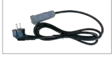

- 电源线（线长2米）

---

振动送料控制器专家 Vibratory Feeder Controller Expert

地址：南京市江宁区智能路9号启迪城学研园2幢  
销售电话：400-985-8889  
传真：025-84730426  
企业邮箱：sales@cuhnj.com

### 第 20 页

南京创优科技有限责任公司  www.cuhnj.com

CUH®

# SDVC22 系列双路数字调压振动送料控制器

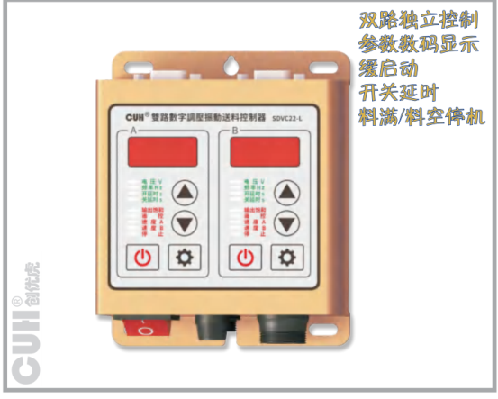

产品外观图中标注功能：

- 双路独立控制
- 参数数码显示
- 缓启动
- 开关延时
- 料满/料空停机

## 型号

- **SDVC22-S**：5A双路料满停机调压控制器
- **SDVC22-L**：10A双路料满停机调压控制器

## 功能

**自动稳压：** 内置数字稳压电路，可以减小由于电源电压波动造成的送料速度变化。

**可调缓启动：** 在启动时，输出电压会从零开始逐渐增大到预设电压，以消除对振动盘的冲击。缓启动时间可数字预置。

**速度预置：** 可以通过外部控制信号直接选择多达4种预先设置的输出电压。

**双路开关传感器料满/料空停机：** 支持2路NPN型传感器或PLC远程料满/料空停机控制。

**光电传感器料满/料空停机：** 支持光电对射传感器料满/料空停机控制。

**远程速度控制：** 可以直接使用外置的电位器、PLC、1～5V电压信号或4~20mA电流信号远程控制输出电压。

**直流控制输出：** 控制器可输出直流低压控制信号，以驱动电磁阀等设备与控制器协同工作。

**过热保护：** 当控制器工作温度过高时将停止输出，以自我保护。

**过流保护：** 当控制器工作电流超过额定电流时将停止输出，以保护控制器及振动设备。

**熔断式短路保护：** 输出端发生短路时，控制器的保险丝会熔断以保护控制器及振动设备。

**最大可输出电压设定：** 设定最大可调整电压防止用户误操作输出过大电压损坏振动设备。

## 技术规格

| 项目 | 最小值 | 典型值 | 最大值 | 单位 | 说明 |
|---|---:|---:|---:|---|---|
| 输入电压 | 85 | 220 | 250 | 伏特（V） | 交流有效值 |
| 输出电压调整范围 | 35 | —— | Vin-10 | 伏特（V） | 半波 |
| 输出电压调整范围 | 45 | —— | Vin-5 | 伏特（V） | 全波 |
| 电压调整精度 | —— | 1 | —— | 伏特（V） |  |
| 稳压精度 | 33 | —— | 61 | 伏特（V） | Vset = 150V；△Vin+ = 70V |
| 稳压响应时间 | 0 | 0.01 | 0.02 | 秒（s） |  |
| 输出电流调整范围 | 0 | —— | 5 | 安培（A） | SDVC22-S两路总和 |
| 输出电流调整范围 | 0 | —— | 10 | 安培（A） | SDVC22-L两路总和 |
| 输出功率 | 0 | —— | 1100 | 伏安（VA） | SDVC22-S两路总和 |
| 输出功率 | 0 | —— | 2200 | 伏安（VA） | SDVC22-L两路总和 |
| 输出频率 | 45 | 50/60 | 65 | 赫兹（Hz） | 半波 |
| 输出频率 | 90 | 100/120 | 130 | 赫兹（Hz） | 全波 |
| 输出波形 | —— | 正弦相切 | —— | —— |  |
| 缓启动时间 | 0 | —— | 10.0 | 秒（s） | 出厂默认1.0 |
| 延迟时间范围 | 0 | —— | 9.9 | 秒（s） | 出厂默认0.2 |
| 延迟时间精度 | —— | 0.1 | —— | 秒（s） |  |
| 过热保护温度 | 58 | 60 | 66 | 摄氏度（℃） |  |
| 直流控制输出电压 | 22 | 24 | 26 | 伏特（V） |  |
| 直流控制输出电流 | 0 | —— | 400 | 毫安（mA） |  |
| 模拟控制信号 | —— | 1~5/4~20 | —— | 伏特（V）/毫安（mA） | 远程速度控制电压/电流 |
| 数字控制信号 | —— | 24 | —— | 伏特（V） | 开关信号控制 |
| 显示方式 | —— | 4+4 | —— | 位（Digit） | LED数码管 |
| 调整方式 | —— | 8 | —— | 键（Button） |  |
| 保险丝容量 | —— | 6.3 | —— | 安培（A） | SDVC22-S |
| 保险丝容量 | —— | 16 | —— | 安培（A） | SDVC22-L |
| 空载功耗 | —— | 3 | —— | 瓦特（W） |  |
| 工作环境温度 | 0 | 25 | 40 | 摄氏度（℃） |  |
| 工作环境湿度 | 10 | 60 | 85 | 相对湿度（%） | 不结露 |
| 存储环境温度 | -20 | 25 | 65 | 摄氏度（℃） |  |

## 尺寸和重量

- 尺寸：长130mm×宽106mm×高57.5mm
- 重量：500g（不含附件）

## 随机附件

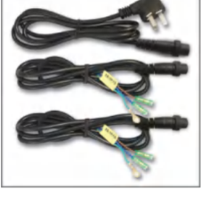

- 电源线（线长1.5米）
- 输出线（线长1.5米）*2

## 选购附件

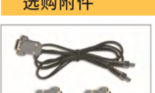

- 智能光电传感器（线长1.5米）
- 信号控制15针D型插头*2

---

振动送料控制器专家 *Vibratory Feeder Controller Expert*

地址：南京市江宁区智能路9号启迪城学研园2幢  
销售电话：400-985-8889  
传真：025-84730426  
企业邮箱：sales@cuhnj.com

### 第 21 页

南京创优科技有限责任公司　www.cuhnj.com　CUH®

## SDVC301-S、SDVC301-M

### 数字调频振动送料控制器

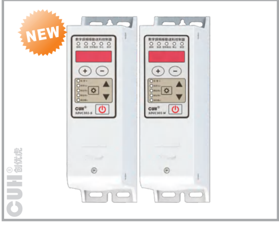

## 型号

- SDVC301-S：1.5A调频控制器
- SDVC301-M：3.0A调频控制器

## 功能

**频率调整：** 控制器的输出频率可以调整，方便用户找到振动体的最佳工作频率，以获得更平稳、安静、节能的送料效果。

**高精度自动稳压：** 内置数字稳压电路，可以自动消除由于电源电压波动造成的送料速度变化。

**可调缓启动：** 在启动时，输出电压会从零开始逐渐增大到预设电压，以消除对振动盘的冲击。缓启动时间可数字预置。

**开关传感器料满/料空停机：** 支持NPN型传感器或PLC远程料满/料空停机控制。

**直流控制输出：** 控制器可输出直流低压控制信号，以驱动电磁阀等设备与控制器协同工作。

**键盘锁定：** 长按开/关键以锁定所有按键，防止用户误操作。

**电流显示：** 可以实时显示当前输出电流。

**最大可输出电压设定：** 设定最大可调整电压防止用户误操作输出过大电压损坏振动设备。

**过热保护：** 当控制器工作温度过高时将停止输出，以自我保护。

**过流保护：** 当控制器工作电流超过额定电流时将停止输出，以保护控制器及振动设备。

**可恢复短路保护：** 输出端发生短路时，控制器会停止输出，保险丝不会被熔断，以保护控制器及振动设备。输出端不再短路后，控制器通电即可再次正常工作。

## 技术规格

| 项目 | 最小值 | 典型值 | 最大值 | 单位 | 备注 |
|---|---:|---:|---:|---|---|
| 输入电压 | 85 | 220 | 250 | 伏特（V） | 交流有效值 |
| 输出电压调整范围 | 0 | —— | 260 | 伏特（V） | 小于输入电压的150% |
| 电压调整精度 | —— | 1 | —— | 伏特（V） |  |
| 稳压精度 | 0 | —— | 10 | % | ΔVout/ΔVin |
| 输出电流调整范围 | 0 | —— | 1.5 | 安培（A） | SDVC301-S |
| 输出电流调整范围 | 0 | —— | 3.0 | 安培（A） | SDVC301-M |
| 输出功率 | 0 | —— | 330 | 伏安（VA） | SDVC301-S |
| 输出功率 | 0 | —— | 660 | 伏安（VA） | SDVC301-M |
| 输出频率 | 40.0 | —— | 400.0 | 赫兹（Hz） |  |
| 频率调整精度 | —— | 0.1 | —— | 赫兹（Hz） |  |
| 输出波形 | —— | 正弦 | —— |  |  |
| 缓启动时间 | 0 | —— | 10 | 秒（s） | 出厂默认0.5 |
| 延迟时间范围 | 0 | —— | 20.0/99.9 | 秒（s） | 出厂默认0.2/0.0 |
| 延迟时间精度 | —— | 0.1 | —— | 秒（s） |  |
| 过热保护温度 | 58 | 60 | 66 | 摄氏度（℃） |  |
| 直流控制输出电流 | 0 | —— | 200 | 毫安（mA） |  |
| 直流控制输出电压 | 22 | 24 | 26 | 伏特（V） |  |
| 数字控制信号 | —— | 24 | —— | 伏特（V） | 开关信号控制 |
| 调整方式 | —— | 6 | —— | 键（Button） |  |
| 空载功耗 | —— | 3 | —— | 瓦特（W） |  |
| 显示方式 | —— | 5 | —— | 位（Digit） | LED数码管 |
| 工作环境温度 | 0 | 25 | 40 | 摄氏度（℃） |  |
| 工作环境湿度 | 10 | 60 | 85 | 相对湿度（%） | 不结露 |
| 存储环境温度 | -20 | 25 | 65 | 摄氏度（℃） |  |

## 尺寸和重量

尺寸：长190mm × 宽56mm × 高94mm

重量：

- SDVC301-S：390g（不含附件）
- SDVC301-M：410g（不含附件）

## 选购附件

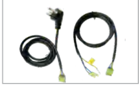

- 电源线（线长1.5米）
- 输出线（线长1.5米）

---

振动送料控制器专家 *Vibratory Feeder Controller Expert*

地址：南京市江宁区智能路9号启迪城学研园2幢  
销售电话：400-985-8889  
传真：025-84730426  
企业邮箱：sales@cuhnj.com

### 第 22 页

**南京创优科技有限责任公司**　www.cuhnj.com

## SDVC302-S、SDVC302-M  
数字调频振动送料控制器

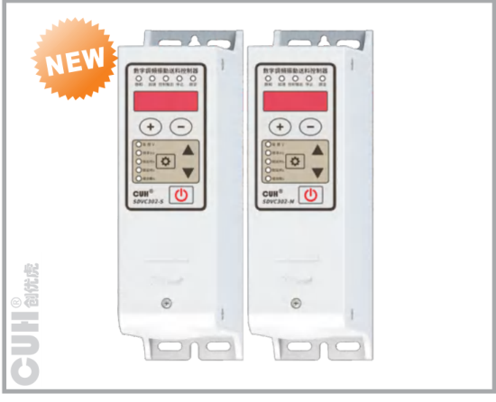

### 技术规格

| 项目 | 最小值 | 典型值 | 最大值 | 单位 | 备注 |
|---|---:|---:|---:|---|---|
| 输入电压 | 85 | 220 | 250 | 伏特（V） | 交流有效值 |
| 输出电压调整范围 | 0 | —— | 260 | 伏特（V） | 小于输入电压的150% |
| 电压调整精度 | —— | 1 | —— | 伏特（V） |  |
| 稳压精度 | 0 | —— | 10 | % | ΔVout/ΔVin |
| 输出电流调整范围 | 0 | —— | 1.5 | 安培（A） | SDVC302-S |
| 输出电流调整范围 | 0 | —— | 3.0 | 安培（A） | SDVC302-M |
| 输出功率 | 0 | —— | 330 | 伏安（VA） | SDVC302-S |
| 输出功率 | 0 | —— | 660 | 伏安（VA） | SDVC302-M |
| 输出频率 | 40.0 | —— | 400.0 | 赫兹（Hz） |  |
| 频率调整精度 | —— | 0.1 | —— | 赫兹（Hz） |  |
| 输出波形 | —— | 正弦 | —— |  |  |
| 缓启动时间 | 0 | —— | 10 | 秒（s） | 出厂默认0.5 |
| 延迟时间范围 | 0 | —— | 20.0/99.9 | 秒（s） | 出厂默认0.2/0.0 |
| 延迟时间精度 | —— | 0.1 | —— | 秒（s） |  |
| 过热保护温度 | 58 | 60 | 66 | 摄氏度（℃） |  |
| 直流控制输出电流 | 0 | —— | 200 | 毫安（mA） |  |
| 直流控制输出电压 | 22 | 24 | 26 | 伏特（V） |  |
| 数字控制信号 | —— | 24 | —— | 伏特（V） | 开关信号控制 |
| 模拟控制信号 | —— | 电位器或0～3.3V电压 | —— | 伏特（V） |  |
| 调整方式 | —— | 6 | —— | 键（Button） |  |
| 空载功耗 | —— | 3 | —— | 瓦特（W） |  |
| 显示方式 | —— | 5 | —— | 位（Digit） | LED数码管 |
| 工作环境温度 | 0 | 25 | 40 | 摄氏度（℃） |  |
| 工作环境湿度 | 10 | 60 | 85 | 相对湿度（%） | 不结露 |
| 存储环境温度 | -20 | 25 | 65 | 摄氏度（℃） |  |

### 型号

- SDVC302-S：1.5A调频控制器
- SDVC302-M：3.0A调频控制器

### 功能

- **频率调整**：控制器的输出频率可以调整，方便用户找到振动体的最佳工作频率，以获得更平稳、安静、节能的送料效果。
- **高精度自动稳压**：内置数字稳压电路，可以自动消除由于电源电压波动造成的送料速度变化。
- **可调缓启动**：在启动时，输出电压会从零开始逐渐增大到预设电压，以消除对振动盘的冲击。缓启动时间可数字预置。
- **开关传感器料满/料空停机**：支持NPN/PNP型传感器或PLC远程料满/料空停机控制。
- **光电传感器料满/料空停机**：支持光电对射传感器料满/料空停机控制。
- **远程速度控制**：可以直接使用外置的电位器、PLC或0～3.3V电压信号远程控制输出电压。
- **直流控制输出**：控制器可输出直流低压控制信号，以驱动电磁阀等设备与控制器协同工作。
- **键盘锁定**：长按开/关键以锁定所有按键，防止用户误操作。
- **电流显示**：可以实时显示当前输出电流。
- **最大可输出电压设定**：设定最大可调整电压防止用户误操作输出过大电压损坏振动设备。
- **过热保护**：当控制器工作温度过高时将停止输出，以自我保护。
- **过流保护**：当控制器工作电流超过额定电流时将停止输出，以保护控制器及振动设备。
- **可恢复短路保护**：输出端发生短路时，控制器会停止输出，保险丝不会被熔断，以保护控制器及振动设备。输出端不再短路后，控制器通电即可再次正常工作。

### 尺寸和重量

- 尺寸：长190mm × 宽56mm × 高94mm
- 重量：SDVC302-S：390g（不含附件）
- 重量：SDVC302-M：410g（不含附件）

### 选购附件

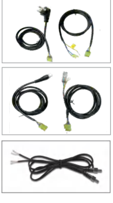

- 电源线（线长1.5米）
- 输出线（线长1.5米）
- 双头输出线（线长1.5米）
- 快接输出线（线长1.5米）
- 智能光电传感器（线长1.5米）

---

振动送料控制器专家 Vibratory Feeder Controller Expert

地址：南京市江宁区智能路9号启迪城学研园2幢  
销售电话：400-985-8889  
传真：025-84730426  
企业邮箱：sales@cuhnj.com

### 第 23 页

南京创优科技有限责任公司  www.cuhnj.com

# SDVC31-S、SDVC31-M  
## 数字调频振动送料控制器

**调频、调压控制**  
**送料平稳**  
**参数数码显示**  
**缓启动**  
**开关延时**  
**料满/料空停机**

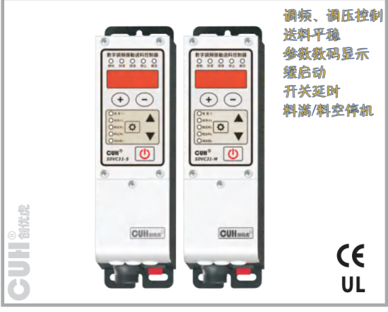

## 型号

- SDVC31-S：1.5A调频控制器
- SDVC31-M：3.0A调频控制器

## 功能

- **频率调整：** 控制器的输出频率可以调整，方便用户找到振动体的最佳工作频率，以获得更平稳、安静、节能的送料效果。
- **高精度自动稳压：** 内置数字稳压电路，可以自动消除由于电源电压波动造成的送料速度变化。
- **可调缓启动：** 在启动时，输出电压会从零开始逐渐增大到预设电压，以消除对振动盘的冲击。缓启动时间可数字预置。
- **开关传感器料满/料空停机：** 支持自适应传感器或PLC远程料满/料空停机控制。
- **光电传感器料满/料空停机：** 支持光电对射传感器料满/料空停机控制。
- **远程速度控制：** 可以直接使用外置的电位器、PLC、1～5V电压信号或4～20mA电流信号远程控制输出电压。
- **直流控制输出：** 控制器可输出直流低压控制信号，以驱动电磁阀等设备与控制器协同工作。
- **键盘锁定：** 长按开/关键以锁定所有按键，防止用户误操作。
- **最大可输出电压设定：** 设定最大可调整电压防止用户误操作输出过大电压损坏振动设备。
- **过热保护：** 当控制器工作温度过高时将停止输出，以自我保护。
- **过流保护：** 当控制器工作电流超过额定电流时将停止输出，以保护控制器及振动设备。
- **可恢复短路保护：** 输出端发生短路时，控制器会停止输出，保险丝不会被熔断，以保护控制器及振动设备。输出端不再短路后，控制器通电即可再次正常工作。

## 技术规格

| 项目 | 最小值 | 典型值 | 最大值 | 单位 | 说明 |
|---|---:|---:|---:|---|---|
| 输入电压 | 85 | 220 | 250 | 伏特（V） | 交流有效值 |
| 输出电压调整范围 | 0 | —— | 260 | 伏特（V） | 小于输入电压的150% |
| 电压调整精度 | —— | 1 | —— | 伏特（V） |  |
| 稳压精度 | 0 | —— | 10 | % | ΔVout/ΔVin |
| 输出电流调整范围 | 0 | —— | 1.5 | 安培（A） | SDVC31-S |
| 输出电流调整范围 | 0 | —— | 3.0 | 安培（A） | SDVC31-M |
| 输出功率 | 0 | —— | 330 | 伏安（VA） | SDVC31-S |
| 输出功率 | 0 | —— | 660 | 伏安（VA） | SDVC31-M |
| 输出频率 | 40.0 | —— | 400.0 | 赫兹（Hz） |  |
| 频率调整精度 | —— | 0.1 | —— | 赫兹（Hz） |  |
| 输出波形 | —— | 正弦 | —— |  |  |
| 缓启动时间 | 0 | —— | 10 | 秒（s） | 出厂默认0.5 |
| 延迟时间范围 | 0 | —— | 20 | 秒（s） | 出厂默认0.2 |
| 延迟时间精度 | —— | 0.1 | —— | 秒（s） |  |
| 过热保护温度 | 58 | 60 | 66 | 摄氏度（℃） |  |
| 直流控制输出电流 | 0 | —— | 200 | 毫安（mA） |  |
| 直流控制输出电压 | 22 | 24 | 26 | 伏特（V） |  |
| 模拟控制信号 | —— | 1～5/4～20 | —— | 伏特（V）/毫安（mA） | 远程速度控制电压/电流 |
| 数字控制信号 | —— | 24 | —— | 伏特（V） | 开关信号控制 |
| 调整方式 | —— | 6 | —— | 键（Button） |  |
| 空载功耗 | —— | 3 | —— | 瓦特（W） |  |
| 显示方式 | —— | 5 | —— | 位（Digit） | LED数码管 |
| 工作环境温度 | 0 | 25 | 40 | 摄氏度（℃） |  |
| 工作环境湿度 | 10 | 60 | 85 | 相对湿度（%） | 不结露 |
| 存储环境温度 | -20 | 25 | 65 | 摄氏度（℃） |  |

## 尺寸和重量

- 尺寸：长190mm×宽53.6mm×高94.5mm
- 重量：
  - SDVC31-S：560g（不含附件）
  - SDVC31-M：610g（不含附件）

## 随机附件

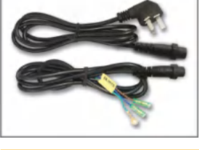

- 电源线（线长1.5米）
- 输出线（线长1.5米）

## 选购附件

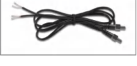

- 智能光电传感器（线长1.5米）

---

**振动送料控制器专家** Vibratory Feeder Controller Expert

地址：南京市江宁区智能路9号启迪城学研园2幢  
销售电话：400-985-8889  
传真：025-84730426  
企业邮箱：sales@cuhnj.com

### 第 24 页

南京创优科技有限责任公司  www.cuhnj.com

CUH®

## SDVC311-S、SDVC311-M

### 数字调频振动送料控制器

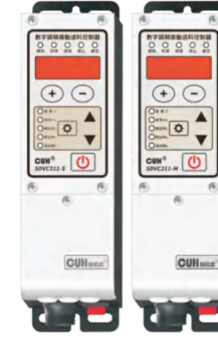

- 调频、调压控制
- 送料平稳
- 参数数码显示
- 缓启动
- 缓关闭
- 开关延时
- 料满/料空停机
- NPN/PNP自适应
- 新老界面切换
- 电流显示

## 技术规格

| 项目 | 最小值 | 典型值 | 最大值 | 单位 | 说明 |
|---|---:|---:|---:|---|---|
| 输入电压 | 85 | 220 | 250 | 伏特（V） | 交流有效值 |
| 输出电压调整范围 | 0 | —— | 260 | 伏特（V） | 小于输入电压的150% |
| 电压调整精度 | —— | 1 | —— | 伏特（V） |  |
| 稳压精度 | 0 | —— | 10 | % | ΔVout/ΔVin |
| 输出电流调整范围 | 0 | —— | 1.5 | 安培（A） | SDVC311-S |
| 输出电流调整范围 | 0 | —— | 3.0 | 安培（A） | SDVC311-M |
| 输出功率 | 0 | —— | 330 | 伏安（VA） | SDVC311-S |
| 输出功率 | 0 | —— | 660 | 伏安（VA） | SDVC311-M |
| 输出频率 | 40.0/5.0 | —— | 400.0 | 赫兹（Hz） |  |
| 频率调整精度 | —— | 0.1 | —— | 赫兹（Hz） |  |
| 输出波形 | —— | 正弦 | —— |  |  |
| 缓启动时间 | 0 | —— | 10 | 秒（s） | 出厂默认0.5 |
| 延迟时间范围 | 0 | —— | 20.0/99.9 | 秒（s） | 出厂默认0.2 |
| 延迟时间精度 | —— | 0.1 | —— | 秒（s） |  |
| 过热保护温度 | 58 | 60 | 66 | 摄氏度（℃） |  |
| 直流控制输出电流 | 0 | —— | 400 | 毫安（mA） |  |
| 直流控制输出电压 | 22 | 24 | 26 | 伏特（V） |  |
| 模拟控制信号 | 1~5/4~20 | —— | —— | 伏特（V）/毫安（mA） | 远程速度控制电压/电流 |
| 数字控制信号 | —— | 24 | —— | 伏特（V） | 开关信号控制 |
| 调整方式 | —— | 6 | —— | 键（Button） |  |
| 空载功耗 | —— | 3 | —— | 瓦特（W） |  |
| 显示方式 | —— | 5 | —— | 位（Digit） | LED数码管 |
| 工作环境温度 | 0 | 25 | 40 | 摄氏度（℃） |  |
| 工作环境湿度 | 10 | 60 | 85 | 相对湿度（%） | 不结露 |
| 存储环境温度 | -20 | 25 | 65 | 摄氏度（℃） |  |

备注：表中“xxx/xxx”指：传统参数显示值/现代参数显示值。

## 型号

- SDVC311-S：1.5A调频控制器
- SDVC311-M：3.0A调频控制器

## 功能

**频率调整：** 控制器的输出频率可以调整，方便用户找到振动体的最佳工作频率，以获得更平稳、安静、节能的送料效果。

**高精度自动稳压：** 内置数字稳压电路，可以自动消除由于电源电压波动造成的送料速度变化。

**可调缓启动/缓关闭：** 在启动或关闭时，输出电压会逐渐变化以消除对振动盘的冲击，缓启动和缓关闭时间可数字预置。

**开关传感器料满/料空停机：** 支持自适应传感器或PLC远程料满/料空停机控制。

**光电传感器料满/料空停机：** 支持光电对射传感器料满/料空停机控制。

**远程速度控制：** 可以直接使用外置的电位器、PLC、1~5V电压信号或4~20mA电流信号远程控制输出电压。

**直流控制输出：** 控制器可输出直流低压控制信号，以驱动电磁阀等设备与控制器协同工作。

**键盘锁定：** 长按开/关键以锁定所有按键，防止用户误操作。

**参数密码锁：** 可以为*标参数设定锁定密码，防止未授权的更改。

**最大可输出电压设定：** 设定最大可调整电压防止用户误操作输出过大电压损坏振动设备。

**过热保护：** 当控制器工作温度过高时将停止输出，以自我保护。

**过流保护：** 当控制器工作电流超过额定电流时将停止输出，以保护控制器及振动设备。

**过压/欠压保护：** 当输入电压过高/过低时，电源将自动关闭，以自我保护。

**可恢复短路保护：** 输出端发生短路时，控制器会停止输出，保险丝不会被熔断，以保护控制器及振动设备。输出端不再短路后，控制器通电即可再次正常工作。

## 尺寸和重量

- 尺寸：长190mm × 宽53.6mm × 高94.5mm
- 重量：
  - SDVC311-S：560g（不含附件）
  - SDVC311-M：610g（不含附件）

## 随机附件

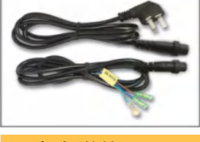

- 电源线（线长1.5米）
- 输出线（线长1.5米）

## 选购附件

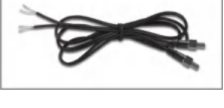

- 智能光电传感器（线长1.5米）

---

振动送料控制器专家 Vibratory Feeder Controller Expert

地址：南京市江宁区智能路9号启迪城学研园2幢  
销售电话：400-985-8889  
传真：025-84730426  
企业邮箱：sales@cuhnj.com

### 第 25 页

南京创优科技有限责任公司  www.cuhnj.com

# SDVC31-L、SDVC31-XL

## 数字调频振动送料控制器

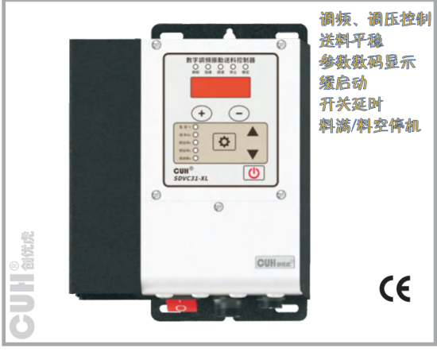

产品特性标识：

- 调频、调压控制
- 送料平稳
- 参数数码显示
- 缓启动
- 开关延时
- 料满/料空停机

## 技术规格

| 项目 | 最小值 | 典型值 | 最大值 | 单位 | 说明 |
|---|---:|---:|---:|---|---|
| 输入电压 | 85 | 220 | 250 | 伏特（V） | 交流有效值 |
| 输出电压调整范围 | 0 | —— | 260 | 伏特（V） | 小于输入电压的150% |
| 电压调整精度 | —— | 1 | —— | 伏特（V） |  |
| 稳压精度 | 0 | —— | 10 | % | ΔVout/ΔVin |
| 输出电流调整范围 | 0 | —— | 4.5 | 安培（A） | SDVC31-L |
| 输出电流调整范围 | 0 | —— | 6 | 安培（A） | SDVC31-XL |
| 输出功率 | 0 | —— | 990 | 伏安（VA） | SDVC31-L |
| 输出功率 | 0 | —— | 1320 | 伏安（VA） | SDVC31-XL |
| 输出频率 | 40 | —— | 400 | 赫兹（Hz） |  |
| 频率调整精度 | —— | 0.1 | —— | 赫兹（Hz） |  |
| 输出波形 | —— | 正弦 | —— |  |  |
| 缓启动时间 | 0 | —— | 10 | 秒（s） | 出厂默认0.5 |
| 延迟时间范围 | 0 | —— | 20 | 秒（s） | 出厂默认0.2 |
| 延迟时间精度 | —— | 0.1 | —— | 秒（s） |  |
| 过热保护温度 | 60 | 65 | 65 | 摄氏度（℃） |  |
| 直流控制输出电流 | 0 | —— | 200 | 毫安（mA） |  |
| 直流控制输出电压 | 22 | 24 | 26 | 伏特（V） |  |
| 模拟控制信号 | —— | 1~5/4~20 | —— | 伏特（V）/毫安（mA） | 远程速度控制电压/电流 |
| 数字控制信号 | —— | 24 | —— | 伏特（V） | 开关信号控制 |
| 调整方式 | —— | 6 | —— | 键（Button） |  |
| 空载功耗 | —— | 3 | —— | 瓦特（W） |  |
| 显示方式 | —— | 5 | —— | 位（Digit） | LED数码管 |
| 工作环境温度 | 0 | 25 | 40 | 摄氏度（℃） |  |
| 工作环境湿度 | 10 | 60 | 85 | 相对湿度（%） | 不结露 |
| 存储环境温度 | -20 | 25 | 65 | 摄氏度（℃） |  |

## 型号

| 型号 | 说明 |
|---|---|
| SDVC31-L | 4.5A调频控制器 |
| SDVC31-XL | 6.0A调频控制器 |

## 功能

**频率调整：** 控制器的输出频率可以调整，方便用户找到振动体的最佳工作频率，以获得更平稳、安静、节能的送料效果。

**高精度自动稳压：** 内置数字稳压电路，可以自动消除由于电源电压波动造成的送料速度变化。

**可调缓启动：** 在启动时，输出电压会从零开始逐渐增大到预设电压，以消除对振动盘的冲击。缓启动时间可数字预置。

**开关传感器料满/料空停机：** 支持NPN或PNP型传感器或PLC远程料满/料空停机控制。

**光电传感器料满/料空停机：** 支持光电对射传感器料满/料空停机控制。

**远程速度控制：** 可以直接使用外置的电位器、PLC、1~5V电压信号或4~20mA电流信号远程控制输出电压。

**直流控制输出：** 控制器可输出直流低压控制信号，以驱动电磁阀等设备与控制器协同工作。

**键盘锁定：** 长按开/关键以锁定所有按键，防止用户误操作。

**最大可输出电压设定：** 设定最大可调整电压防止用户误操作输出过大电压损坏振动设备。

**过热保护：** 当控制器工作温度过高时将停止输出，以自我保护。

**过流保护：** 当控制器工作电流超过额定电流时将停止输出，以保护控制器及振动设备。

**可恢复短路保护：** 输出端发生短路时，控制器会停止输出，保险丝不会被熔断，以保护控制器及振动设备。输出端不再短路后，控制器通电即可再次正常工作。

## 尺寸和重量

尺寸：长190mm×宽147.8mm×高94.5mm

重量：

- SDVC31-L：1675g（不含附件）
- SDVC31-XL：1720g（不含附件）

## 随机附件

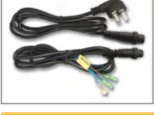

- 电源线（线长1.5米）
- 输出线（线长1.5米）

## 选购附件

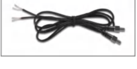

- 智能光电传感器（线长1.5米）

---

振动送料控制器专家 Vibratory Feeder Controller Expert

地址：南京市江宁区智能路9号启迪城学研园2幢  
销售电话：400-985-8889  
传真：025-84730426  
企业邮箱：sales@cuhnj.com

### 第 26 页

**南京创优科技有限责任公司**  www.cuhnj.com  
**CUH®**

## SDVC311-XL 数字调频振动送料控制器

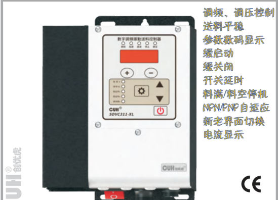

产品图标注功能：调频、调压控制；送料平稳；参数数码显示；缓启动；缓关闭；开关延时；料满/料空停机；NPN/PNP自适应；新老界面切换；电流显示。

### 型号

SDVC311-XL：6.0A调频控制器

### 功能

- **频率调整：** 控制器的输出频率可以调整，方便用户找到振动体的最佳工作频率，以获得更平稳、安静、节能的送料效果。
- **高精度自动稳压：** 内置数字稳压电路，可以自动消除由于电源电压波动造成的送料速度变化。
- **可调缓启动/缓关闭：** 在启动或关闭时，输出电压会逐渐变化以消除对振动盘的冲击，缓启动和缓关闭时间可数字预置。
- **开关传感器料满/料空停机：** 支持自适应传感器或PLC远程料满/料空停机控制。
- **光电传感器料满/料空停机：** 支持光电对射传感器料满/料空停机控制。
- **远程速度控制：** 可以直接使用外置的电位器、PLC、1～5V电压信号或4~20mA电流信号远程控制输出电压。
- **直流控制输出：** 控制器可输出直流低压控制信号，以驱动电磁阀等设备与控制器协同工作。
- **键盘锁定：** 长按开/关键以锁定所有按键，防止用户误操作。
- **参数密码锁：** 可以为\*标参数设定锁定密码，防止未授权的更改。
- **最大可输出电压设定：** 设定最大可调整电压防止用户误操作输出过大电压损坏振动设备。
- **过热保护：** 当控制器工作温度过高时将停止输出，以自我保护。
- **过流保护：** 当控制器工作电流超过额定电流时将停止输出，以保护控制器及振动设备。
- **过压/欠压保护：** 当输入电压过高/过低时，电源将自动关闭，以自我保护。
- **可恢复短路保护：** 输出端发生短路时，控制器会停止输出，保险丝不会被熔断，以保护控制器及振动设备。输出端不再短路后，控制器通电即可再次正常工作。

### 尺寸和重量

尺寸：长190mm×宽147.8mm×高94.5mm  
重量：1720g（不含附件）

### 技术规格

| 项目 | 范围-最小值 | 范围-典型值 | 范围-最大值 | 单位 | 说明 |
|---|---:|---:|---:|---|---|
| 输入电压 | 85 | 220 | 250 | 伏特（V） | 交流有效值 |
| 输出电压调整范围 | 0 | —— | 260 | 伏特（V） | 小于输入电压的150% |
| 电压调整精度 | —— | 1 | —— | 伏特（V） |  |
| 稳压精度 | 0 | —— | 10 | % | ΔVout/ΔVin |
| 输出电流调整范围 | 0 | —— | 6 | 安培（A） |  |
| 输出功率 | 0 | —— | 1320 | 伏安（VA） |  |
| 输出频率 | 40.0/5.0 | —— | 400.0 | 赫兹（Hz） |  |
| 频率调整精度 | —— | 0.1 | —— | 赫兹（Hz） |  |
| 输出波形 | —— | 正弦 | —— |  |  |
| 缓启动时间 | 0 | —— | 10 | 秒（s） | 出厂默认0.5 |
| 延迟时间范围 | 0 | —— | 20.0/99.9 | 秒（s） | 出厂默认0.2 |
| 延迟时间精度 | —— | 0.1 | —— | 秒（s） |  |
| 过热保护温度 | 60 | 65 | 65 | 摄氏度（℃） |  |
| 直流控制输出电流 | 0 | —— | 200 | 毫安（mA） |  |
| 直流控制输出电压 | 22 | 24 | 26 | 伏特（V） |  |
| 模拟控制信号 | —— | 1~5/4~20 | —— | 伏特（V）/毫安（mA） | 远程速度控制电压/电流 |
| 数字控制信号 | —— | 24 | —— | 伏特（V） | 开关信号控制 |
| 调整方式 | —— | 6 | —— | 键（Button） |  |
| 空载功耗 | —— | 3 | —— | 瓦特（W） |  |
| 显示方式 | —— | 5 | —— | 位（Digit） | LED数码管 |
| 工作环境温度 | 0 | 25 | 40 | 摄氏度（℃） |  |
| 工作环境湿度 | 10 | 60 | 85 | 相对湿度（%） | 不结露 |
| 存储环境温度 | -20 | 25 | 65 | 摄氏度（℃） |  |

备注：表中“xxx/xxx”指：传统参数显示值/现代参数显示值。

### 随机附件

- 电源线（线长1.5米）
- 输出线（线长1.5米）

### 选购附件

- 智能光电传感器（线长1.5米）

---

**振动送料控制器专家** Vibratory Feeder Controller Expert

地址：南京市江宁区智能路9号启迪城学研园2幢  
销售电话：400-985-8889  
传真：025-84730426  
企业邮箱：sales@cuhnj.com

### 第 27 页

南京创优科技有限责任公司  www.cuhnj.com

CUH®

# SDVC31-XLP 数字调频振动送料控制器

## 产品外观

产品图标注：防油防水；调频调压控制；送料平稳；参数数码显示；缓启动；开关延时；料满/料空停机；CE；IP67。

## 技术规格

| 项目 | 最小值 | 典型值 | 最大值 | 单位 | 说明 |
|---|---:|---:|---:|---|---|
| 输入电压 | 85 | 220 | 250 | 伏特（V） | 交流有效值 |
| 输出电压调整范围 | 0 | —— | 260 | 伏特（V） | 小于输入电压的150% |
| 电压调整精度 | —— | 1 | —— | 伏特（V） |  |
| 稳压精度 | 0 | —— | 10 | % | ΔVout/ΔVin |
| 输出电流调整范围 | 0 | —— | 6 | 安培（A） |  |
| 输出功率 | 0 | —— | 1320 | 伏安（VA） |  |
| 输出频率 | 40 | —— | 400 | 赫兹（Hz） |  |
| 频率调整精度 | —— | 0.1 | —— | 赫兹（Hz） |  |
| 输出波形 | 正弦 | —— | —— | —— |  |
| 缓启动时间 | 0 | —— | 10 | 秒（s） | 出厂默认0.5 |
| 延迟时间范围 | 0 | —— | 20 | 秒（s） | 出厂默认0.2 |
| 延迟时间精度 | —— | 0.1 | —— | 秒（s） |  |
| 过热保护温度 | 60 | 65 | 65 | 摄氏度（℃） |  |
| 直流控制输出电流 | 0 | —— | 200 | 毫安（mA） |  |
| 直流控制输出电压 | 22 | 24 | 26 | 伏特（V） |  |
| 模拟控制信号 | 1~5/4~20 | —— | —— | 伏特（V）/毫安（mA） | 远程速度控制电压/电流 |
| 数字控制信号 | —— | 24 | —— | 伏特（V） | 开关信号控制 |
| 调整方式 | —— | 6 | —— | 键（Button） |  |
| 空载功耗 | —— | 4 | —— | 瓦特（W） |  |
| 显示方式 | —— | 5 | —— | 位（Digit） | LED数码管 |
| 防护等级 | IP67 | —— | —— | —— |  |
| 工作环境温度 | 0 | 25 | 40 | 摄氏度（℃） |  |

## 型号

SDVC31-XLP：6A调频控制器

## 功能

- **防护等级**：IP67，本控制器可以长期工作在恶劣环境中，如：潮湿、油污、灰尘严重的环境等。
- **频率调整**：控制器的输出频率可以调整，方便用户找到振动体的最佳工作频率，以获得更平稳、安静、节能的送料效果。
- **高精度自动稳压**：内置数字稳压电路，可以自动消除由于电源电压波动造成的送料速度变化。
- **可调缓启动**：在启动时，输出电压会从零开始逐渐增大到预设电压，以消除对振动盘的冲击。缓启动时间可数字预置。
- **开关传感器料满/料空停机**：支持NPN型传感器或PLC远程料满/料空停机控制。
- **光电传感器料满/料空停机**：支持光电对射传感器料满/料空停机控制。
- **远程速度控制**：可以直接使用外置的电位器、PLC、1～5V电压信号或4~20mA电流信号远程控制输出电压。
- **直流控制输出**：控制器可输出直流低压控制信号，以驱动电磁阀等设备与控制器协同工作。
- **键盘锁定**：长按开/关键以锁定所有按键，防止用户误操作。
- **最大可输出电压设定**：设定最大可调整电压防止用户误操作输出过大电压损坏振动设备。
- **雷击保护**：本控制器可以承受不超过2KV的雷击冲击。
- **过压保护**：当输入电压过高时，电源将自动关闭，以自我保护。
- **过热保护**：当控制器工作温度过高时将停止输出，以自我保护。
- **过流保护**：当控制器工作电流超过额定电流时将停止输出，以保护控制器及振动设备。
- **可恢复短路保护**：输出端发生短路时，控制器会停止输出，保险丝不会被熔断，以保护控制器及振动设备。输出端不再短路后，控制器通电即可再次正常工作。

## 尺寸和重量

- 尺寸：长190mm×宽170mm×高98mm
- 重量：5800g（不含附件）

## 随机附件

- 电源线（线长2米）
- 输出线（线长2米）

## 选购附件

- 智能光电传感器（线长2米）

---

**振动送料控制器专家** Vibratory Feeder Controller Expert

地址：南京市江宁区智能路9号启迪城学研园2幢  
销售电话：400-985-8889  
传真：025-84730426  
企业邮箱：sales@cuhnj.com

### 第 28 页

南京创优科技有限责任公司  www.cuhnj.com  
CUH®

# SDVC31-U 数字调频振动送料控制器

## 型号

SDVC31-U：10A调频控制器

## 功能

- **频率调整：** 控制器的输出频率可以调整，方便用户找到振动体的最佳工作频率，以获得更平稳、安静、节能的送料效果。
- **高精度自动稳压：** 内置数字稳压电路，可以自动消除由于电源电压波动造成的送料速度变化。
- **可调缓启动：** 在启动时，输出电压会从零开始逐渐增大到预设电压，以消除对振动盘的冲击。缓启动时间可数字预置。
- **开关传感器料满/料空停机：** 支持NPN或PNP型传感器或PLC远程料满/料空停机控制。
- **光电传感器料满/料空停机：** 支持光电对射传感器料满/料空停机控制。
- **远程速度控制：** 可以直接使用外置的电位器、PLC、1～5V电压信号或4~20mA电流信号远程控制输出电压。
- **直流控制输出：** 控制器可输出直流低压控制信号，以驱动电磁阀等设备与控制器协同工作。
- **键盘锁定：** 长按开/关键以锁定所有按键，防止用户误操作。
- **最大可输出电压设定：** 设定最大可调整电压防止用户误操作输出过大电压损坏振动设备。
- **过压保护：** 当输入电压过高时，电源将自动关闭，以自我保护。
- **过热保护：** 当控制器工作温度过高时将停止输出，以自我保护。
- **过流保护：** 当控制器工作电流超过额定电流时将停止输出，以保护控制器及振动设备。
- **可恢复短路保护：** 输出端发生短路时，控制器会停止输出，保险丝不会被熔断，以保护控制器及振动设备。输出端不再短路后，控制器通电即可再次正常工作。

## 尺寸和重量

- 尺寸：长190mm×宽242mm×高94.5mm
- 重量：2670g（不含附件）

## 随机附件

| 图片 | 说明 |
|---|---|
|  | ● 电源线（线长1.5米） |

## 选购附件

| 图片 | 说明 |
|---|---|
|  | ● 智能光电传感器（线长1.5米） |

## 技术规格

| 项目 | 最小值 | 典型值 | 最大值 | 单位 | 说明 |
|---|---:|---:|---:|---|---|
| 输入电压 | 85 | 220 | 250 | 伏特（V） | 交流有效值 |
| 输出电压调整范围 | 0 | — | 260 | 伏特（V） | 小于输入电压的150% |
| 电压调整精度 | — | 1 | — | 伏特（V） |  |
| 稳压精度 | 0 | — | 10 | % | `ΔVout/ΔVin` |
| 输出电流调整范围 | 0 | — | 10 | 安培（A） |  |
| 输出功率 | 0 | — | 2200 | 伏安（VA） |  |
| 输出频率 | 40 | — | 400 | 赫兹（Hz） |  |
| 频率调整精度 | 0.1 | — | — | 赫兹（Hz） |  |
| 输出波形 |  | 正弦 |  |  |  |
| 缓启动时间 | 0 | — | 10 | 秒（s） | 出厂默认0.5 |
| 延迟时间范围 | 0 | — | 20 | 秒（s） | 出厂默认0.2 |
| 延迟时间精度 | 0.1 | — | — | 秒（s） |  |
| 过热保护温度 | 60 | 65 | 65 | 摄氏度（℃） |  |
| 直流控制输出电流 | 0 | — | 200 | 毫安（mA） |  |
| 直流控制输出电压 | 22 | 24 | 26 | 伏特（V） |  |
| 模拟控制信号 |  | 1~5/4~20 |  | 伏特（V）/毫安（mA） | 远程速度控制电压/电流 |
| 数字控制信号 | — | 24 | — | 伏特（V） | 开关信号控制 |
| 调整方式 |  | 6 |  | 键（Button） |  |
| 空载功耗 | — | 3 | — | 瓦特（W） |  |
| 显示方式 |  | 5 |  | 位（Digit） | LED数码管 |
| 工作环境温度 | 0 | 25 | 40 | 摄氏度（℃） |  |
| 工作环境湿度 | 10 | 60 | 85 | 相对湿度（%） | 不结露 |
| 存储环境温度 | -20 | 25 | 65 | 摄氏度（℃） |  |

---

振动送料控制器专家 Vibratory Feeder Controller Expert

地址：南京市江宁区智能路9号启迪城学研园2幢  
销售电话：400-985-8889  
传真：025-84730426  
企业邮箱：sales@cuhnj.com

### 第 29 页

南京创优科技有限责任公司  www.cuhnj.com  
CUH®

# SDVC31-UP 数字调频振动送料控制器

## 型号

SDVC31-UP: 10A调频控制器

## 功能

**防护等级：** IP67，本控制器可以长期工作在恶劣环境中，如：潮湿、油污、灰尘严重的环境等。

**频率调整：** 控制器的输出频率可以调整，方便用户找到振动体的最佳工作频率，以获得更平稳、安静、节能的送料效果。

**高精度自动稳压：** 内置数字稳压电路，可以自动消除由于电源电压波动造成的送料速度变化。

**可调缓启动：** 在启动时，输出电压会从零开始逐渐增大到预设电压，以消除对振动盘的冲击。缓启动时间可数字预置。

**开关传感器料满/料空停机：** 支持NPN型传感器或PLC远程料满/料空停机控制。

**光电传感器料满/料空停机：** 支持光电对射传感器料满/料空停机控制。

**远程速度控制：** 可以直接使用外置的电位器、PLC、1～5V电压信号或4~20mA电流信号远程控制输出电压。

**直流控制输出：** 控制器可输出直流低压控制信号，以驱动电磁阀等设备与控制器协同工作。

**键盘锁定：** 长按开/关键以锁定所有按键，防止用户误操作。

**最大可输出电压设定：** 设定最大可调整电压防止用户误操作输出过大电压损坏振动设备。

**雷击保护：** 本控制器可以承受不超过2KV的雷击冲击。

**过压保护：** 当输入电压过高时，电源将自动关闭，以自我保护。

**过热保护：** 当控制器工作温度过高时将停止输出，以自我保护。

**过流保护：** 当控制器工作电流超过额定电流时将停止输出，以保护控制器及振动设备。

**可恢复短路保护：** 输出端发生短路时，控制器会停止输出，保险丝不会被熔断，以保护控制器及振动设备。输出端不再短路后，控制器通电即可再次正常工作。

## 技术规格

| 项目 | 最小值 | 典型值 | 最大值 | 单位 | 说明 |
|---|---:|---:|---:|---|---|
| 输入电压 | 85 | 220 | 250 | 伏特（V） | 交流有效值 |
| 输出电压调整范围 | 0 | — | 260 | 伏特（V） | 小于输入电压的150% |
| 电压调整精度 | — | 1 | — | 伏特（V） |  |
| 稳压精度 | 0 | — | 10 | % | ΔVout/ΔVin |
| 输出电流调整范围 | 0 | — | 10 | 安培（A） |  |
| 输出功率 | 0 | — | 2200 | 伏安（VA） |  |
| 输出频率 | 40 | — | 400 | 赫兹（Hz） |  |
| 频率调整精度 | — | 0.1 | — | 赫兹（Hz） |  |
| 输出波形 | — | 正弦 | — |  |  |
| 缓启动时间 | 0 | — | 10 | 秒（s） | 出厂默认0.5 |
| 延迟时间范围 | 0 | — | 20 | 秒（s） | 出厂默认0.2 |
| 延迟时间精度 | — | 0.1 | — | 秒（s） |  |
| 过热保护温度 | 60 | 65 | 65 | 摄氏度（℃） |  |
| 直流控制输出电流 | 0 | — | 200 | 毫安（mA） |  |
| 直流控制输出电压 | 22 | 24 | 26 | 伏特（V） |  |
| 模拟控制信号 | — | 1~5/4~20 | — | 伏特（V）/毫安（mA） | 远程速度控制电压/电流 |
| 数字控制信号 | — | 24 | — | 伏特（V） | 开关信号控制 |
| 调整方式 | — | 6 | — | 键（Button） |  |
| 空载功耗 | — | 4 | — | 瓦特（W） |  |
| 显示方式 | — | 5 | — | 位（Digit） | LED数码管 |
| 防护等级 | — | IP67 | — |  |  |
| 工作环境温度 | 0 | 25 | 40 | 摄氏度（℃） |  |

## 尺寸和重量

尺寸：长190mm×宽260mm×高98mm  
重量：9500g（不含附件）

## 随机附件

- 电源线（线长2米）
- 输出线（线长2米）

## 选购附件

- 智能光电传感器（线长2米）

---

振动送料控制器专家 Vibratory Feeder Controller Expert

地址：南京市江宁区智能路9号启迪城学研园2幢  
销售电话：400-985-8889  
传真：025-84730426  
企业邮箱：sales@cuhnj.com

### 第 30 页

**南京创优科技有限责任公司**  www.cuhnj.com  CUH®

# SDVC33-M 双路数字调频振动送料控制器

## 产品图示

- 双路调频控制
- 频率跟踪
- 最大999.9Hz
- 相位锁定
- 面板亮度调节
- 用户参数保存
- 支持矢量振动盘
- 电流显示

## 型号

SDVC33-M：合电流最大3.5A双路调频控制器

## 功能

- **频率调整**：控制器的输出频率可以调整，方便用户找到振动体的最佳工作频率，以获得更平稳、安静、节能的送料效果。
- **高精度自动稳压**：内置数字稳压电路，可以自动消除由于电源电压波动造成的送料速度变化。
- **可调缓启动**：在启动时，输出电压会从零开始逐渐增大到预设电压，以消除对振动盘的冲击。缓启动时间可数字预置。
- **缓关闭/刹车功能**：可以设置0.0~10.0秒，用于缓慢停止振动盘振动。通过在缓关闭过程中将电流移相180°快速停止振动盘。
- **开关传感器料满/料空停机**：支持NPN/PNP自适应传感器或PLC远程料满/料空停机控制。
- **光电传感器料满/料空停机**：支持光电对射传感器料满/料空停机控制。
- **远程速度控制**：可以直接使用外置的电位器、PLC、1~5V电压信号或4~20mA电流信号远程控制输出电压。
- **直流控制输出**：控制器可输出直流低压控制信号，以驱动电磁阀等设备与控制器协同工作。控制输出模式包括：NPN、PNP和推挽。
- **最大可输出电压设定**：设定最大可调整电压防止用户误操作输出过大电压损坏振动设备。
- **过热或过冷保护**：当控制器工作温度过高或过低时将停止输出，以自我保护。
- **可调过流保护**：当控制器工作电流超过额定电流时将停止输出，以保护控制器及振动设备。每个通道的过流保护电流可通过参数设置。
- **可恢复短路保护**：输出端发生短路时，控制器会停止输出，保险丝不会被熔断，以保护控制器及振动设备。输出端不再短路后，控制器通电即可再次正常工作。

## 尺寸和重量

- 尺寸：长190mm×宽61.8mm×高94.5mm
- 重量：850g（不含附件）

## 技术规格

| 项目 | 最小值 | 典型值 | 最大值 | 单位 | 说明 |
|---|---:|---:|---:|---|---|
| 输入电压 | 85 | 220 | 250 | 伏特（V） | 交流有效值 |
| 输出电压调整范围 | 0 | — | 260 | 伏特（V） | 小于输入电压的150% |
| 电压调整精度 | — | 1 | — | 伏特（V） |  |
| 稳压精度 | 0 | — | 10 | % | ΔVout/ΔVin |
| 输出电流调整范围 | 0 | — | 3.5 | 安培（A） | 合电流可任意分配 |
| 输出功率 | 0 | — | 770 | 伏安（VA） |  |
| 输出频率 | 5.0 | — | 999.9 | 赫兹（Hz） |  |
| 频率调整精度 | 0.1 | — | — | 赫兹（Hz） |  |
| 输出波形 |  | 正弦 |  |  |  |
| 缓启动时间 | 0 | — | 10 | 秒（s） | 出厂默认0.5 |
| 延迟时间范围 | 0 | — | 99.9 | 秒（s） | 出厂默认0.2 |
| 延迟时间精度 | 0.1 | — | — | 秒（s） |  |
| 过热保护温度 | — | 65 | — | 摄氏度（℃） | 60℃恢复正常 |
| 直流控制输出电流 | 0 | — | 350 | 毫安（mA） | 通道A、B均支持 |
| 24V输出电流 | 0 | — | 700 | 毫安（mA） | 通道A、B输出总和 |
| 直流控制输出电压 | 22 | 24 | 26 | 伏特（V） |  |
| 模拟控制信号 |  | 4-20 / 1-5 |  | 毫安（mA）/伏特（V） |  |
| 数字控制信号 |  | 24 |  | 伏特（V） | 开关信号控制 |
| 调整方式 |  | 6 |  | 键（Button） |  |
| 空载功耗 | — | 3 | — | 瓦特（W） |  |
| 显示方式 |  | 5 |  | 位（Digit） | LED数码管 |
| 重量 |  | 850 |  | 克（g） | 不含附件 |
| 产品尺寸 |  | 长*宽*高：190*61.8*94.5 |  | 毫米（mm） |  |
| 防护等级 |  | IP20 |  |  |  |
| 工作环境温度 | 0 | 25 | 40 | 摄氏度（℃） |  |
| 工作环境湿度 | 10 | 60 | 85 | 相对湿度（%） | 不结露 |
| 存储环境温度 | -20 | 25 | 65 | 摄氏度（℃） |  |
| 适用海拔高度 | — | ＜2000 | — | 米（m） |  |

## 随机附件

- 电源线（线长1.5米）
- 输出线（线长1.5米）*2

## 选购附件

- 智能光电传感器（线长1.5米）

---

**振动送料控制器专家**  Vibratory Feeder Controller Expert

- 地址：南京市江宁区智能路9号启迪城学研园2幢
- 销售电话：400-985-8889
- 传真：025-84730426
- 企业邮箱：sales@cuhnj.com

### 第 31 页

南京创优科技有限责任公司  www.cuhnj.com  
CUH®

# SDVC333-SG 三路数字调频振动送料控制器

## 技术规格

| 项目 | 最小值 | 典型值 | 最大值 | 单位 | 备注 |
|---|---:|---:|---:|---|---|
| 输入电压 | 85 | 220 | 250 | 伏特（V） | 交流有效值 |
| 输出电压调整范围 | 0 | — | 250 | 伏特（V） | 小于输入电压的150% |
| 电压调整精度 | — | 1 | — | 伏特（V） |  |
| 稳压精度 | 0 | — | 10 | % | ΔVout/ΔVin |
| 输出电流调整范围 | 0 | — | 1.5 | 安培（A） | 单路 |
| 输出电流调整范围 | 0 | — | 2.4 | 安培（A） | 三路 |
| 输出功率 | 0 | — | 528 | 伏安（VA） |  |
| 输出频率 | 25.0 | — | 400.0 | 赫兹（Hz） |  |
| 频率调整精度 | — | 0.1 | — | 赫兹（Hz） |  |
| 输出波形 | — | 正弦 | — | — |  |
| 缓启动时间 | 0 | — | 60.0 | 秒（s） | 出厂默认0.1 |
| 延迟时间范围 | 0 | — | 60.0 | 秒（s） | 出厂默认1.0 |
| 延迟时间精度 | — | 0.1 | — | 秒（s） |  |
| 过热保护温度 | — | 65 | — | 摄氏度（℃） | 60℃恢复正常 |
| 直流控制输出电流 | 0 | — | 200 | 毫安（mA） |  |
| 24V输出电流 | — | — | 1000 | 毫安（mA） |  |
| 直流控制输出电压 | 22 | 24 | 26 | 伏特（V） |  |
| 数字控制信号 | — | 24 | — | 伏特（V） | 开关信号控制 |
| 调整方式 | — | 7 | — | 键（Button） |  |
| 空载功耗 | — | 3 | — | 瓦特（W） |  |
| 显示方式 | — | 5 | — | 位（Digit） | LED数码管 |
| 重量 | — | 850 | — | 克（g） | 不含附件 |
| 产品尺寸 | — | 长*宽*高：190*61.8*94.5 | — | 毫米（mm） |  |
| 防护等级 | — | IP20 | — | — |  |
| 工作环境温度 | 0 | 25 | 40 | 摄氏度（℃） |  |
| 工作环境湿度 | 10 | 60 | 85 | 相对湿度（%） | 不结露 |
| 存储环境温度 | -20 | 25 | 65 | 摄氏度（℃） |  |
| 适用海拔高度 | — | ＜2000 | — | 米（m） |  |

## 型号

SDVC333-SG：合电流最大2.4A三路调频控制器

## 功能

- **频率调整**：控制器的输出频率可以调整，方便用户找到振动体的最佳工作频率，以获得更平稳、安静、节能的送料效果。
- **高精度自动稳压**：内置数字稳压电路，可以自动消除由于电源电压波动造成的送料速度变化。
- **可调缓启动**：在启动时，输出电压会从零开始逐渐增大到预设电压，以消除对振动盘的冲击。缓启动时间可数字预置。
- **485通讯**：通过485通讯可以远程控制修改控制器的各项参数。
- **开关传感器料满/料空停机**：支持至多5路传感器或PLC远程料满/料空停机控制。
- **传感器自适应**：控制器可自动适应NPN型和PNP型开关传感器。
- **远程速度控制**：可以直接使用外置的电位器、PLC或1～5V电压信号远程控制输出电压。
- **直流控制输出**：控制器可输出直流低压控制信号，以驱动电磁阀等设备与控制器协同工作。控制输出模式包括：NPN、PNP和推挽。
- **键盘锁定**：长按开/关键以锁定所有按键，防止用户误操作。
- **最大可输出电压设定**：设定最大可调整电压防止用户误操作输出过大电压损坏振动设备。
- **过热或过冷保护**：当控制器工作温度过高或过低时将停止输出，以自我保护。
- **可调过流保护**：当控制器工作电流超过额定电流时将停止输出，以保护控制器及振动设备。每个通道的过流保护电流可通过参数设置。
- **过压保护**：当输入电压过高时，电源将自动关闭，以自我保护。
- **可恢复短路保护**：输出端发生短路时，控制器会停止输出，保险丝不会被熔断，以保护控制器及振动设备。输出端不再短路后，控制器通电即可再次正常工作。

## 尺寸和重量

尺寸：长190mm×宽61.8mm×高94.5mm  
重量：850g（不含附件）

## 随机附件

- 电源线（线长1.5米）
- 输出线（线长1.5米）*3

## 选购附件

- 智能光电传感器（线长1.5米）

---

振动送料控制器专家 Vibratory Feeder Controller Expert

地址：南京市江宁区智能路9号启迪城学研园2幢  
销售电话：400-985-8889  
传真：025-84730426  
企业邮箱：sales@cuhnj.com

### 第 32 页

南京创优科技有限责任公司  www.cuhnj.com

# SDVC34-M系列

## 智能调频振动送料控制器

**自动调频、自动稳速、自动搜频、自动稳压、同步跟踪、485通讯、功能强大**

## 型号

- **SDVC34-MR**：3A自动调频控制器（通讯型）
- **SDVC34-MRJ**：3A自动调频控制器（通讯、计数型）

## 功能

- **自动稳速**：自动实时调整输出电压，使送料器无论工件多少，总是保持相同的送料速度。
- **自动调频**：自动实时调整输出频率，使送料器总是保持工作在最佳工作频率。
- **自动搜频**：傻瓜式的自动搜频功能，快速确定送料器最佳工作频率并设定其它相关参数，方便用户使用。
- **计数功能**：对输送料件进行计数，在达到设定数值后减速或停机。（适合型号：SDVC34-MRJ）
- **485通讯**：通过485通讯可以远程控制修改控制器的各项参数。
- **双路开关传感器料满/料空停机**：支持2路传感器或PLC远程料满/料空停机控制。
- **传感器自适应**：控制器可自动适应NPN型和PNP型开关传感器。
- **同步输出**：可以将多个控制器的输出同步锁定在相同的频率和相位上，防止相互干扰（拍频效应）。
- **远程速度控制**：可以直接使用外置的电位器、PLC、1~5V电压信号或4~20mA电流信号控制输出电压或送料速度。
- **过压保护**：当输入电压过高时，电源将自动关闭，以自我保护。
- **过热保护**：当控制器工作温度过高时将停止输出，以自我保护。
- **过流保护**：当控制器工作电流超过额定电流时将停止输出，以保护控制器及振动设备。
- **可恢复短路保护**：输出端发生短路时，控制器会停止输出，保险丝不会被熔断，以保护控制器及振动设备。输出端不再短路后，控制器通电即可再次正常工作。

## 尺寸和重量

- 尺寸：长190mm×宽56mm×高94.5mm
- 重量：560g（不含附件）

## 技术规格

| 项目 | 最小值 | 典型值 | 最大值 | 单位 | 说明 |
|---|---:|---:|---:|---|---|
| 输入电压 | 85 | 220 | 250 | 伏特（V） | 交流有效值 |
| 输出电压调整范围 | 0 | — | 260 | 伏特（V） | 小于输入电压的150% |
| 电压调整精度 | — | 1 | — | 伏特（V） |  |
| 稳压精度 | 0 | — | 10 | % | ΔVout/ΔVin |
| 稳压响应时间 | 0.0025 | — | 0.04 | 秒（s） | 输出电压周期分之一 |
| 输出电流调整范围 | 0 | — | 3 | 安培（A） |  |
| 输出功率 | 0 | — | 660 | 伏安（VA） |  |
| 输出频率 | 25 | — | 400 | 赫兹（Hz） |  |
| 频率调整精度 | — | 0.1 | — | 赫兹（Hz） |  |
| 输出波形 | — | 正弦 | — | — |  |
| 缓启动时间 | 0 | — | 10 | 秒（s） | 出厂默认0.5 |
| 延迟时间范围 | 0 | — | 99.9 | 秒（s） | 出厂默认0.2 |
| 延迟时间精度 | — | 0.1 | — | 秒（s） |  |
| 过热保护温度 | 60 | 65 | 65 | 摄氏度（℃） |  |
| 数字通讯 | — | ModBus 485通讯 | — | — |  |
| 直流控制输出电压 | 22 | 24 | 26 | 伏特（V） |  |
| 直流控制输出电流 | 0 | — | 350 | 毫安（mA） |  |
| 模拟控制信号 | — | 1-5/4-20 | — | 伏特（V）/毫安（mA） | 远程速度控制电压/电流 |
| 数字控制信号 | — | 24 | — | 伏特（V） | 开关信号控制 |
| 调整方式 | — | 6 | — | 键（Button） |  |
| 空载功耗 | — | 5 | — | 瓦特（W） |  |
| 显示方式 | — | 5 | — | 位（Digit） | LED数码管 |
| 工作环境温度 | 0 | 25 | 40 | 摄氏度（℃） |  |
| 工作环境湿度 | 10 | 60 | 85 | 相对湿度（%） | 不结露 |
| 存储环境温度 | -20 | 25 | 65 | 摄氏度（℃） |  |

## 随机附件

- 电源线（线长1.5米）
- 输出线（线长1.5米）
- 振动传感器（32g、线长2米）

## 选购附件

- 振动传感器（8g、线长2米）
- 振动传感器（16g、线长2米）
- 振动传感器（64g、线长2米）

---

振动送料控制器专家 Vibratory Feeder Controller Expert

地址：南京市江宁区智能路9号启迪城学研园2幢  
销售电话：400-985-8889  
传真：025-84730426  
企业邮箱：sales@cuhnj.com

### 第 33 页

南京创优科技有限责任公司  www.cuhnj.com

# SDVC34-XL系列

## 智能调频振动送料控制器

## 型号

- **SDVC34-XLR**：6A自动调频控制器（通讯型）
- **SDVC34-XLJ**：6A自动调频控制器（计数型）

## 功能

**自动稳速：** 自动实时调整输出电压，使送料器无论工件多少，总是保持相同的送料速度。

**自动调频：** 自动实时调整输出频率，使送料器总是保持工作在最佳工作频率。

**自动搜频：** 傻瓜式的自动搜频功能，快速确定送料器最佳工作频率并设定其它相关参数，方便用户使用。

**计数功能：** 对输送料件进行计数，在达到设定数值后减速或停机。  
（适合型号：SDVC34-XLJ）

**485通讯：** 通过485通讯可以远程控制修改控制器的各项参数。

**双路开关传感器料满/料空停机：** 支持2路传感器或PLC远程料满/料空停机控制。

**传感器自适应：** 控制器可自动适应NPN型和PNP型开关传感器。

**同步输出：** 可以将多个控制器的输出同步锁定在相同的频率和相位上，防止相互干扰（拍频效应）。

**速度预置：** 可以通过外部控制信号直接选择输出多达4种预先设置的送料速度。

**远程速度控制：** 可以直接使用外置的电位器、PLC、1~5V电压信号或4~20mA电流信号控制输出电压或送料速度。

**直流控制输出：** 控制器可输出直流低压控制信号，以驱动电磁阀等设备与控制器协同工作。

**过热保护：** 当控制器工作温度过高时将停止输出，以自我保护。

**过流保护：** 当控制器工作电流超过额定电流时将停止输出，以保护控制器及振动设备。

**可恢复短路保护：** 输出端发生短路时，控制器会停止输出，保险丝不会被熔断，以保护控制器及振动设备。输出端不再短路后，控制器通电即可再次正常工作。

## 技术规格

| 项目 | 最小值 | 典型值 | 最大值 | 单位 | 说明 |
|---|---:|---:|---:|---|---|
| 输入电压 | 85 | 220 | 250 | 伏特（V） | 交流有效值 |
| 输出电压调整范围 | 0 | — | 260 | 伏特（V） | 小于输入电压的150% |
| 电压调整精度 | — | 1 | — | 伏特（V） |  |
| 稳压精度 | 0 | — | 10 | % | ΔVout/ΔVin |
| 稳压响应时间 | 0.0025 | — | 0.04 | 秒（s） | 输出电压周期分之一 |
| 输出电流调整范围 | 0 | — | 6 | 安培（A） |  |
| 输出功率 | 0 | — | 1320 | 伏安（VA） |  |
| 输出频率 | 25 | — | 400 | 赫兹（Hz） |  |
| 频率调整精度 | — | 0.1 | — | 赫兹（Hz） |  |
| 输出波形 | — | 正弦 | — | — |  |
| 缓启动时间 | 0 | — | 10 | 秒（s） | 出厂默认0.5 |
| 延迟时间范围 | 0 | — | 20 | 秒（s） | 出厂默认0.2 |
| 延迟时间精度 | — | 0.1 | — | 秒（s） |  |
| 过热保护温度 | 60 | 65 | 65 | 摄氏度（℃） |  |
| 数字通讯 | — | ModBus 485 通讯 | — | — |  |
| 直流控制输出电压 | 22 | 24 | 26 | 伏特（V） |  |
| 直流控制输出电流 | 0 | — | 200 | 毫安（mA） |  |
| 模拟控制信号 | — | 1~5 / 4~20 | — | 伏特（V）/毫安（mA） | 远程速度控制电压/电流 |
| 数字控制信号 | — | 24 | — | 伏特（V） | 开关信号控制 |
| 调整方式 | — | 6 | — | 键（Button） |  |
| 空载功耗 | — | 7 | — | 瓦特（W） |  |
| 显示方式 | — | 5 | — | 位（Digit） | LED数码管 |
| 工作环境温度 | 0 | 25 | 40 | 摄氏度（℃） |  |
| 工作环境湿度 | 10 | 60 | 85 | 相对湿度（%） | 不结露 |
| 存储环境温度 | -20 | 25 | 65 | 摄氏度（℃） |  |

## 尺寸和重量

- 尺寸：长190mm × 宽147.8mm × 高94.5mm
- 重量：1930g（不含附件）

## 随机附件

- 电源线（线长1.5米）
- 输出线（线长1.5米）
- 振动传感器（32g，线长2米）

## 选购附件

- 振动传感器（8g、线长2米）
- 振动传感器（16g、线长2米）
- 振动传感器（64g、线长2米）

---

振动送料控制器专家 Vibratory Feeder Controller Expert

- 地址：南京市江宁区智能路9号启迪城学研园2幢
- 销售电话：400-985-8889
- 传真：025-84730426
- 企业邮箱：sales@cuhnj.com

### 第 34 页

南京创优科技有限责任公司  **www.cuhnj.com**  
**CUH®**

# SDVC34-UR、SDVC34-XU 智能调频振动送料控制器

产品特性：自动调频、自动稳速、自动搜频、自动稳压、同步跟踪、485通讯、功能强大。

## 型号

- **SDVC34-UR:** 10A自动调频控制器（通讯型）
- **SDVC34-XU:** 15A自动调频控制器（通讯型）

## 功能

- **自动稳速：** 自动实时调整输出电压，使送料器无论工件多少，总是保持相同的送料速度。
- **自动调频：** 自动实时调整输出频率，使送料器总是保持工作在最佳工作频率。
- **自动搜频：** 傻瓜式的自动搜频功能，快速确定送料器最佳工作频率并设定其它相关参数，方便用户使用。
- **485通讯：** 通过485通讯可以远程控制修改控制器的各项参数。
- **双路开关传感器料满/料空停机：** 支持2路传感器或PLC远程料满/料空停机控制。
- **传感器自适应：** 控制器可自动适应NPN型和PNP型开关传感器。
- **同步输出：** 可以将多个控制器的输出同步锁定在相同的频率和相位上，防止相互干扰（拍频效应）。
- **远程速度控制：** 可以直接使用外置的电位器、PLC、1~5V电压信号或4~20mA电流信号控制输出电压或送料速度。
- **过压保护：** 当输入电压过高时，电源将自动关闭，以自我保护。
- **过热保护：** 当控制器工作温度过高时将停止输出，以自我保护。
- **过流保护：** 当控制器工作电流超过额定电流时将停止输出，以保护控制器及振动设备。
- **可恢复短路保护：** 输出端发生短路时，控制器会停止输出，保险丝不会被熔断，以保护控制器及振动设备。输出端不再短路后，控制器通电即可再次正常工作。

## 尺寸和重量

- 尺寸：长190mm×宽242mm×高94.5mm
- 重量：2670g（不含附件）

## 技术规格

| 项目 | 最小值 | 典型值 | 最大值 | 单位 | 说明 |
|---|---:|---:|---:|---|---|
| 输入电压 | 85 | 220 | 250 | 伏特（V） | 交流有效值 |
| 输出电压调整范围 | 0 | —— | 260 | 伏特（V） | 小于输入电压的150% |
| 电压调整精度 | —— | 1 | —— | 伏特（V） |  |
| 稳压精度 | 0 | —— | 10 | % | ΔVout/ΔVin |
| 稳压响应时间 | 0.0025 | —— | 0.04 | 秒（s） | 输出电压周期分之一 |
| 输出电流调整范围 | 0 | —— | 10 | 安培（A） | SDVC34-UR |
| 输出电流调整范围 | 0 | —— | 15 | 安培（A） | SDVC34-XU |
| 输出功率 | 0 | —— | 2200 | 伏安（VA） | SDVC34-UR |
| 输出功率 | 0 | —— | 3300 | 伏安（VA） | SDVC34-XU |
| 输出频率 | 25 | —— | 400 | 赫兹（Hz） |  |
| 频率调整精度 | —— | 0.1 | —— | 赫兹（Hz） |  |
| 输出波形 | —— | 正弦 | —— |  |  |
| 缓启动时间 | 0 | —— | 10 | 秒（s） | 出厂默认0.5 |
| 延迟时间范围 | 0 | —— | 20 | 秒（s） | 出厂默认0.2 |
| 延迟时间精度 | —— | 0.1 | —— | 秒（s） |  |
| 过热保护温度 | 60 | 65 | 65 | 摄氏度（℃） |  |
| 数字通讯 | —— | ModBus 485 通讯 | —— |  |  |
| 直流控制输出电压 | 22 | 24 | 26 | 伏特（V） |  |
| 直流控制输出电流 | 0 | —— | 200 | 毫安（mA） |  |
| 模拟控制信号 | —— | 1-5 / 4-20 | —— | 伏特（V）/毫安（mA） | 远程速度控制电压/电流 |
| 数字控制信号 | —— | 24 | —— | 伏特（V） | 开关信号控制 |
| 调整方式 | —— | 6 | —— | 键（Button） |  |
| 空载功耗 | —— | 5 | —— | 瓦特（W） |  |
| 显示方式 | —— | 5 | —— | 位（Digit） | LED数码管 |
| 工作环境温度 | 0 | 25 | 40 | 摄氏度（℃） |  |
| 工作环境湿度 | 10 | 60 | 85 | 相对湿度（%） | 不结露 |
| 存储环境温度 | -20 | 25 | 65 | 摄氏度（℃） |  |

## 随机附件

- 电源线（线长1.5米）
- 振动传感器（32g、线长2米）

## 选购附件

- 振动传感器（8g、线长2米）
- 振动传感器（16g、线长2米）
- 振动传感器（64g、线长2米）

---

振动送料控制器专家 *Vibratory Feeder Controller Expert*  
地址：南京市江宁区智能路9号启迪城学研园2幢  
销售电话：400-985-8889  
传真：025-84730426  
企业邮箱：sales@cuhnj.com

### 第 35 页

南京创优科技有限责任公司　www.cuhnj.com　　CUH®

# SDVC341-M 自动调频振动送料控制器

## 产品外观及特性标识

- 液晶显示
- 中文参数列表
- 5.0~999.9 搜频范围
- 数字同步
- 计数功能
- PFC升压
- 停机报警音符
- RS-485软件升级
- CUHBus-DS®
- 故障日志

## 技术规格

| 项目 | 最小值 | 典型值 | 最大值 | 单位 | 说明 |
|---|---:|---:|---:|---|---|
| 输入电压 | 85 | 220 | 250 | 伏特（V） | 交流有效值 |
| 输出电压调整范围 | 0 | —— | 250 | 伏特（V） |  |
| 电压调整精度 | —— | 1 | —— | 伏特（V） |  |
| 稳压精度 | 0 | —— | 10 | % | ΔVout/ΔVin |
| 稳压响应时间 | —— | 实时 | —— |  | 每个波形进行稳压 |
| 输出电流调整范围 | 0 | —— | 3.0 | 安培（A） |  |
| 输出功率 | 0 | —— | 660 | 伏安（VA） |  |
| 频率调整精度 | —— | 0.1 | —— | 赫兹（Hz） |  |
| 输出频率调整范围 | 5.0 | —— | 999.9 | 赫兹（Hz） |  |
| 缓启动时间 | 0 | —— | 40.0 | 秒（s） | 出厂默认0.5 |
| 延迟时间范围 | 0.0 | —— | 99.9 | 秒（s） | 出厂默认0.2 |
| 延迟时间精度 | —— | 0.1 | —— | 秒（s） |  |
| 过热保护温度 | 60 | 65 | 65 | 摄氏度（℃） |  |
| 数字通信 | —— | RS485通信/数字同步通信 | —— |  |  |
| 输出电流波形 | —— | 正弦 | —— |  |  |
| 直流控制输出电流 | 0 | —— | 400 | 毫安（mA） |  |
| 直流控制输出电压 | 22 | 24 | 26 | 伏特（V） |  |
| 模拟控制信号 | —— | 1~5/0~5/0~10 | —— | 伏特（V） | 远程速度控制电压 |
| 模拟控制信号 | —— | 4~20 | —— | 毫安（mA） | 远程速度控制电流 |
| 数字控制信号 | —— | 24 | —— | 伏特（V） | 开关信号控制 |
| 调整方式 | —— | 7 | —— | 键（button） |  |
| 空载功耗 | —— | —— | 5 | 瓦特（W） |  |
| 显示方式 | —— | 128*128 | —— |  | 点阵屏 |
| 防护等级 | —— | IP10 | —— |  |  |
| 工作环境温度 | 0 | 25 | 40 | 摄氏度（℃） |  |
| 工作环境湿度 | 10 | 60 | 85 | 相对湿度（%） | 不结露 |
| 存储环境温度 | -20 | 25 | 65 | 摄氏度（℃） |  |

## 型号

SDVC341-M: 3A自动调频控制器

## 功能

- **自动稳速：** 自动实时调整输出电压，使送料器无论工件多少，总是保持相同的送料速度。
- **自动调频：** 自动实时调整输出频率，使送料器总是保持工作在最佳工作频率。
- **恒振幅搜频：** 保证两个间隙很小的振动盘在搜频过程中不相撞。
- **PFC升压：** 可以在110V或220V输入时保持输出最大250V电压。
- **计数功能：** 对输送料件进行计数，在达到设定数值后减速或停机。
- **485通讯：** RS485接口支持Modbus ASCII、Modbus RTU协议。
- **双路开关传感器料满/料空停机：** 支持2路传感器或PLC远程料满/料空停机控制。
- **传感器自适应：** 控制器可自动适应NPN型和PNP型开关传感器。
- **数字同步通信：** 可以通过数字同步通信CUHBus-DS®分发控制器的遥控电压、频率、相位等参数，实现整个网络所有控制器（最多8台）的参数备份和恢复。
- **远程速度控制：** 可以直接使用外置的电位器、PLC、0~5V、1~5V、0~10V、4~20mA等信号控制输出电压或送料速度。
- **过压保护：** 当输入电压过高时，电源将自动关闭，以自我保护。
- **过热保护：** 当控制器工作温度过高时将停止输出，以自我保护。
- **过流保护：** 当控制器工作电流超过额定电流时将停止输出，以保护控制器及振动设备。
- **可恢复短路保护：** 输出端发生短路时，控制器会停止输出，保险丝不会被熔断，以保护控制器及振动设备。输出端不再短路后，控制器通电即可再次正常工作。

## 尺寸和重量

尺寸：长190mm×宽61.8mm×高94.5mm  
重量：780g（不含附件）

## 随机附件

- 电源线（线长1.5米）
- 输出线（线长1.5米）
- 振动传感器（32g、线长2米）

## 选购附件

- 振动传感器（8g、线长2米）
- 振动传感器（16g、线长2米）
- 振动传感器（64g、线长2米）

---

振动送料控制器专家 *Vibratory Feeder Controller Expert*

地址：南京市江宁区智能路9号启迪城学研园2幢  
销售电话：400-985-8889  
传真：025-84730426  
企业邮箱：sales@cuhnj.com

31

### 第 36 页

南京创优科技有限责任公司  www.cuhnj.com

CUH®

# SDVC35 系列

## 智能调频振动送料控制器

图中文字：工业以太网通信、OLED显示、自动调频、自动稳速、自动搜频、自动稳压、同步跟踪、功能强大。

## 型号

- SDVC35-MRJ：3.0A智能振动送料控制器
- SDVC35-LRJ：4.5A智能振动送料控制器

## 功能

- **自动稳速：** 自动实时调整输出电压，使送料器无论工件多少，总是保持相同的送料速度。
- **自动调频：** 自动实时调整输出频率，使送料器总是保持工作在最佳工作频率。
- **自动搜频：** 傻瓜式的自动搜频功能，快速确定送料器最佳工作频率并设定其它相关参数，方便用户使用。
- **计数功能：** 对输送料件进行计数，在达到设定数值后减速或停机。
- **485通讯：** 通过485通讯可以远程控制修改控制器的各项参数。
- **网络通讯：** 通过网络通讯可以远程控制修改控制器的各项参数。
- **电流显示：** 可以实时显示当前输出电流。
- **升级：** 可远程升级控制器固件。
- **控制输出方式：** 推挽式。
- **双路开关传感器料满/料空停机：** 支持2路传感器或PLC远程料满/料空停机控制。
- **传感器自适应：** 控制器可自动适应NPN型和PNP型开关传感器。
- **同步输出：** 可以将多个控制器的输出同步锁定在相同的频率和相位上，防止相互干扰（拍频效应）。
- **键盘锁定：** 长按开/关键以锁定旋转编码开关，防止用户误操作。
- **远程速度控制：** 可以直接使用外置的电位器、PLC、1~5V电压信号或4~20mA电流信号控制输出电压或送料速度。
- **直流控制输出：** 控制器可同时输出2路直流低压控制信号，以驱动电磁阀等设备与控制器协同工作。
- **过压保护：** 当输入电压过高时，电源将自动关闭，以自我保护。
- **过热保护：** 当控制器工作温度过高时将停止输出，以自我保护。
- **过流保护：** 当控制器工作电流超过额定电流时将停止输出，以保护控制器及振动设备。
- **可恢复短路保护：** 输出端发生短路时，控制器会停止输出，保险丝不会被熔断，以保护控制器及振动设备。输出端不再短路后，控制器通电即可再次正常工作。

## 技术规格

| 项目 | 最小值 | 典型值 | 最大值 | 单位 | 说明 |
|---|---:|---:|---:|---|---|
| 输入电压 | 85 | 220 | 250 | 伏特（V） | 交流有效值 |
| 输出电压调整范围 | 0 | — | 260 | 伏特（V） | 小于输入电压的150% |
| 电压调整精度 | — | 1 | — | 伏特（V） | — |
| 稳压精度 | 0 | — | 10 | % | ΔVout/ΔVin |
| 稳压响应时间 | — | 实时 | — | — | 每个波形进行稳压 |
| 输出电流调整范围 | 0 | — | 3.0 | 安培（A） | SDVC35-MRJ |
| 输出电流调整范围 | 0 | — | 4.5 | 安培（A） | SDVC35-LRJ |
| 输出功率 | 0 | — | 660 | 伏安（VA） | SDVC35-MRJ |
| 输出功率 | 0 | — | 990 | 伏安（VA） | SDVC35-LRJ |
| 输出频率 | 25 | — | 400 | 赫兹（Hz） | — |
| 频率调整精度 | 0.1 | — | — | 赫兹（Hz） | — |
| 输出电流波形 | — | 正弦 | — | — | — |
| 缓启动时间 | 0 | — | 10 | 秒（s） | 出厂默认0.5 |
| 延迟时间范围 | 0 | — | 20 | 秒（s） | 出厂默认0.2 |
| 延迟时间精度 | — | 0.1 | — | 秒（s） | — |
| 过热保护温度 | 60 | 65 | 65 | 摄氏度（℃） | — |
| 数字通信 | — | RS485通信 | — | — | 可选其一 |
| 数字通信 | — | EtherCat通信 | — | — | 可选其一 |
| 数字通信 | — | Profinet通信 | — | — | 可选其一 |
| 直流控制输出电流 | 0 | — | 200 | 毫安（mA） | 两路24V输出 |
| 直流控制输出电压 | 22 | 24 | 26 | 伏特（V） | — |
| 模拟控制信号 | — | 1~5/0~5/0~10 | — | 伏特（V） | 3档远程速度控制电压 |
| 模拟控制信号 | — | 4~20 | — | 毫安（mA） | 远程速度控制电流 |
| 数字控制信号 | — | 24 | — | 伏特（V） | 开关信号控制 |
| 调整方式 | — | 1按键+1旋转编码器 | — | — | — |
| 空载功耗 | — | — | 3 | 瓦特（W） | — |
| 显示方式 | — | 128*64 | — | — | OLED点阵屏 |
| 工作环境温度 | 0 | 25 | 40 | 摄氏度（℃） | — |
| 工作环境湿度 | 10 | 60 | 85 | 相对湿度（%） | 不结露 |
| 存储环境温度 | -20 | 25 | 65 | 摄氏度（℃） | — |

## 尺寸和重量

- 尺寸：长190mm×宽60mm×高108.9mm
- 重量：560g（不含附件）

## 选购附件

- 振动传感器（8/16/32/64g、线长2米）
- EtherCat 网卡
- Profinet 网卡

---

振动送料控制器专家 *Vibratory Feeder Controller Expert*

地址：南京市江宁区智能路9号启迪城学研园2幢  
销售电话：400-985-8889  
传真：025-84730426  
企业邮箱：sales@cuhnj.com

### 第 37 页

南京创优科技有限责任公司　www.cuhnj.com　CUH®

# SDVC40-S 数字调频压电振动送料控制器

- 压电式控制器
- 送料平稳安静
- 参数数码显示
- 缓启动，开关延时
- 料满/料空停机

## 技术规格

| 项目 | 最小值 | 典型值 | 最大值 | 单位 | 说明 |
|---|---:|---:|---:|---|---|
| 输入电压 | 85 | 220 | 250 | 伏特（V） | 交流有效值 |
| 输出电压调整范围 | 0 | —— | 220 | 伏特（V） |  |
| 电压调整精度 | —— | 1 | —— | 伏特（V） |  |
| 稳压精度 | 0 | —— | 10 | % | ΔVout/ΔVin |
| 稳压响应时间 | 0.0025 | —— | 0.025 | 秒（s） | 输出电压周期分之一 |
| 输出电流调整范围 | 0 | —— | 150 | 毫安（mA） |  |
| 输出功率 | 0 | —— | 33 | 伏安（VA） |  |
| 输出频率 | 40 | —— | 400 | 赫兹（Hz） |  |
| 频率调整精度 | —— | 0.1 | —— | 赫兹（Hz） |  |
| 输出波形 | 正弦 | —— | —— | —— |  |
| 缓启动时间 | 0 | —— | 10 | 秒（s） | 出厂默认0.5 |
| 延迟时间范围 | 0 | —— | 20 | 秒（s） | 出厂默认0.2 |
| 延迟时间精度 | —— | 0.1 | —— | 秒（s） |  |
| 过热保护温度 | 60 | 65 | 65 | 摄氏度（℃） |  |
| 直流控制输出电压 | 22 | 24 | 26 | 伏特（V） |  |
| 直流控制输出电流 | 0 | —— | 200 | 毫安（mA） |  |
| 模拟控制信号 | —— | 1-5 / 4-20 | —— | 伏特（V）/毫安（mA） | 远程速度控制电压/电流 |
| 数字控制信号 | 24 | —— | —— | 伏特（V） | 开关信号控制 |
| 调整方式 | —— | 6 | —— | 键（Button） |  |
| 空载功耗 | —— | 4 | —— | 瓦特（W） |  |
| 显示方式 | —— | 5 | —— | 位（Digit） | LED数码管 |
| 工作环境温度 | 0 | 25 | 40 | 摄氏度（℃） |  |
| 工作环境湿度 | 10 | 60 | 85 | 相对湿度（%） | 不结露 |
| 存储环境温度 | -20 | 25 | 65 | 摄氏度（℃） |  |

## 型号

SDVC40-S：150mA 压电调频控制器

## 功能

**容性负载：** 负载适应性强，可应用于阻性负载、感性负载，特别适合于容性负载，如压电陶瓷、压电式振动体等。

**频率调整：** 控制器的输出频率可以调整，方便用户找到振动体的最佳工作频率，以获得更平稳、安静、节能的送料效果。

**高精度自动稳压：** 内置数字稳压电路，可以自动消除由于电源电压波动造成的送料速度变化。

**可调缓启动：** 在启动时，输出电压会从零开始逐渐增大到预设电压，以消除对振动盘的冲击。缓启动时间可数字预置。

**开关传感器料满/料空停机：** 支持NPN型传感器或PLC远程料满/料空停机控制。

**光电传感器料满/料空停机：** 支持光电对射传感器料满/料空停机控制。

**远程速度控制：** 可以直接使用外置的电位器、PLC、1～5V电压信号或4~20mA电流信号远程控制输出电压。

**直流控制输出：** 控制器可输出直流低压控制信号，以驱动电磁阀等设备与控制器协同工作。

**键盘锁定：** 长按开/关键以锁定所有按键，防止用户误操作。

**最大可输出电压设定：** 设定最大可调整电压防止用户误操作输出过大电压损坏振动设备。

**过压保护：** 当输入电压过高时，电源将自动关闭，以自我保护。

**过热保护：** 当控制器工作温度过高时将停止输出，以自我保护。

**过流保护：** 当控制器工作电流超过额定电流时将停止输出，以保护控制器及振动设备。

**可恢复短路保护：** 输出端发生短路时，控制器会停止输出，保险丝不会被熔断，以保护控制器及振动设备。输出端不再短路后，控制器通电即可再次正常工作。

## 尺寸和重量

尺寸：长190mm×宽53.6mm×高94.5mm  
重量：1050g（不含附件）

## 随机附件

- 电源线（线长1.5米）
- 输出线（线长1.5米）

## 选购附件

- 智能光电传感器（线长1.5米）

---

振动送料控制器专家 *Vibratory Feeder Controller Expert*

地址：南京市江宁区智能路9号启迪城学研园2幢  
销售电话：400-985-8889  
传真：025-84730426  
企业邮箱：sales@cuhnj.com

### 第 38 页

南京创优科技有限责任公司 www.cuhnj.com  
CUH®

## SDVC40-XS系列

### 多路数字调频压电振动送料控制器

- 压电式控制器
- 送料平稳安静
- 参数数码显示
- 缓启动
- 开关延时
- 料满/料空停机
- 相位控制

## 型号

- SDVC40-XS2: 50mA*2 两路调频压电控制器
- SDVC40-XS3: 50mA*3 三路调频压电控制器
- SDVC40-XS4: 50mA*4 四路调频压电控制器

## 功能

**容性负载：** 负载适应性强，可应用于阻性负载、感性负载，特别适合于容性负载，如压电陶瓷、压电式振动体等。

**相位控制：** 当控制器的多路输出频率相同时，可控制各路之间的相位差。

**频率调整：** 控制器的输出频率可以调整，方便用户找到振动体的最佳工作频率，以获得更平稳、安静、节能的送料效果。

**高精度自动稳压：** 内置数字稳压电路，可以自动消除由于电源电压波动造成的送料速度变化。

**可调缓启动：** 在启动时，输出电压会从零开始逐渐增大到预设电压，以消除对振动盘的冲击。缓启动时间可数字预置。

**开关传感器料满/料空停机：** 支持NPN型和PNP型传感器或PLC远程料满/料空停机控制。

**远程速度控制：** 可以直接使用外置的电位器、PLC、1～5V电压信号或4~20mA电流信号远程控制输出电压。

**直流控制输出：** 控制器可输出直流低压控制信号，以驱动电磁阀等设备与控制器协同工作。

**控制输出方式：** NPN型，PNP型，推挽。

**键盘锁定：** 长按开/关键以锁定所有按键，防止用户误操作。

**最大可输出电压设定：** 设定最大可调整电压防止用户误操作输出过大电压损坏振动设备。

**过压保护：** 当输入电压过高时，电源将自动关闭，黑屏以自我保护。

**数字过热保护：** 当控制器工作温度过高时将停止输出，以自我保护。

**过流保护：** 当控制器工作电流超过额定电流时将停止输出，以保护控制器及振动设备。

**可恢复短路保护：** 输出端发生短路时，控制器会停止输出，保险丝不会被熔断，以保护控制器及振动设备。输出端不再短路后，控制器通电即可再次正常工作。

## 技术规格

| 项目 | 最小值 | 典型值 | 最大值 | 单位 | 说明 |
|---|---:|---:|---:|---|---|
| 输入电压 | 85 | 220 | 250 | 伏特（V） | 交流有效值 |
| 输出电压调整范围 | 0 | — | 220 | 伏特（V） | — |
| 输出电流调整范围 | 0 | — | 50 | 毫安（mA） | — |
| 单通道输出功率 | 0 | — | 11 | 伏安（VA） | — |
| 电压设定精度 | — | 1 | — | 伏特（V） | — |
| 稳压精度 | 0 | — | 0.1 | % | ΔVout/ΔVin |
| 输出频率 | 40.0 | — | 400.0 | 赫兹（Hz） | — |
| 频率调整精度 | — | 0.1 | — | 赫兹（Hz） | — |
| 输出波形 | — | 正弦 | — | — | — |
| 缓启动时间 | 0.1 | — | 10.0 | 秒（s） | 出厂默认0.5 |
| 缓关闭时间 | 0.1 | — | 10.0 | 秒（s） | 出厂默认0.1 |
| 延迟时间范围 | 0 | — | 20.0 | 秒（s） | 出厂默认0.2 |
| 延迟时间精度 | — | 0.1 | — | 秒（s） | — |
| 过热保护温度 | 60 | — | 65 | 摄氏度（℃） | — |
| 直流控制输出电压 | 22 | 24 | 26 | 伏特（V） | — |
| 直流控制输出电流 | 0 | — | 200 | 毫安（mA） | — |
| 模拟控制信号 | — | 1-5 / 4-20 | — | 伏特（V）/毫安（mA） | 远程速度控制电压/电流 |
| 数字控制信号 | — | 24 | — | 伏特（V） | 开关信号控制 |
| 调整方式 | — | 6 | — | 键（Button） | — |
| 空载功耗 | — | 2.5 | — | 瓦特（W） | — |
| 显示方式 | — | 5 | — | 位（Digit） | LED数码管 |
| 工作环境温度 | 0 | 25 | 40 | 摄氏度（℃） | — |
| 工作环境湿度 | 10 | 60 | 85 | 相对湿度（%） | 不结露 |
| 存储环境温度 | -20 | 25 | 65 | 摄氏度（℃） | — |

## 尺寸和重量

- 尺寸：长190mm×宽107.6mm×高94.5mm
- 重量：2672g（不含附件）

## 随机附件

- 电源线（线长1.5米）
- 输出线（线长1.5米）*2/3/4

---

振动送料控制器专家 Vibratory Feeder Controller Expert

地址：南京市江宁区智能路9号启迪城学研园2幢  
销售电话：400-985-8889  
传真：025-84730426  
企业邮箱：sales@cuhnj.com

### 第 39 页

南京创优科技有限责任公司  www.cuhnj.com

# SDVC402-S

## 数字调频压电振动送料控制器

- 压电式控制器
- 彩屏显示
- 缓启动，开关延时
- 料满/料空停机

## 技术规格

| 项目 | 最小值 | 典型值 | 最大值 | 单位 | 备注 |
|---|---:|---:|---:|---|---|
| 输入电压 | 85 | 220 | 250 | 伏特（V） | 交流有效值 |
| 输出电压调整范围 | 0 | —— | 220 | 伏特（V） | 交流有效值 |
| 电压调整精度 | —— | 1 | —— | 伏特（V） |  |
| 输出电流调整范围 | 0 | —— | 150 | 毫安（mA） |  |
| 输出功率 | 0 | —— | 33 | 伏安（VA） |  |
| 输出频率 | 40.0 | —— | 999.9 | 赫兹（Hz） |  |
| 频率调整精度 | —— | 0.1 | —— | 赫兹（Hz） |  |
| 输出电流波形 | —— | 正弦 | —— |  |  |
| 缓启动时间 | 0 | —— | 10.0 | 秒（s） | 出厂默认0.5 |
| 延迟时间范围 | 0 | —— | 99.9 | 秒（s） | 出厂默认0.2 |
| 延迟时间精度 | —— | 0.1 | —— | 秒（s） |  |
| 过热保护温度 | 60 | 65 | 65 | 摄氏度（℃） |  |
| 直流控制输出电流 | 0 | —— | 350 | 毫安（mA） |  |
| 直流控制输出电压 | 22 | 24 | 26 | 伏特（V） |  |
| 模拟控制信号 | —— | 1~5 | —— | 伏特（V） | 远程速度控制电压 |
| 模拟控制信号 | —— | 4~20 | —— | 毫安（mA） | 远程速度控制电流 |
| 数字控制信号 | —— | 24 | —— | 伏特（V） | 开关信号控制 |
| 调整方式 | —— | 7 | —— | 键（button） |  |
| 空载功耗 | —— | —— | 5 | 瓦特（W） |  |
| 显示方式 | —— | 160*128 | —— |  | 点阵屏 |
| 防护等级 | —— | IP20 | —— |  |  |
| 工作环境温度 | 0 | 25 | 40 | 摄氏度（℃） |  |
| 工作环境湿度 | 10 | 60 | 85 | 相对湿度（%） | 不结露 |
| 存储环境温度 | -20 | 25 | 65 | 摄氏度（℃） |  |

## 型号

SDVC402-S: 150mA

## 功能

**容性负载：** 负载适应性强，可应用于阻性负载、感性负载，特别适合于容性负载，如压电陶瓷、压电式振动体等。

**频率调整：** 控制器的输出频率可以调整，方便用户找到振动体的最佳工作频率，以获得更平稳、安静、节能的送料效果。

**高精度自动稳压：** 内置数字稳压电路，可以自动消除由于电源电压波动造成的送料速度变化。

**可调缓启动：** 在启动时，输出电压会从零开始逐渐增大到预设电压，以消除对振动盘的冲击。缓启动时间可数字预置。

**双路开关传感器料满/料空停机：** 支持2路NPN/PNP传感器或PLC远程料满/料空停机控制。

**光电传感器料满/料空停机：** 支持光电对射传感器料满/料空停机控制。

**传感器自适应：** 控制器可自动适应NPN型和PNP型开关传感器。

**远程速度控制：** 可以直接使用外置的电位器、PLC或1~5V电压信号远程控制输出电压。

**直流控制输出：** 控制器可输出直流低压控制信号，以驱动电磁阀等设备与控制器协同工作。

**键盘锁定：** 长按开/关键以锁定所有按键，防止用户误操作。

**最大可输出电压设定：** 设定最大可调整电压防止用户误操作输出过大电压损坏振动设备。

**电流显示：** 可以实时显示当前输出电流。

**过压保护：** 当输入电压过高时，电源将自动关闭，以自我保护。

**过热保护：** 当控制器工作温度过高时将停止输出，以自我保护。

**过流保护：** 当控制器工作电流超过额定电流时将停止输出，以保护控制器及振动设备。

**可恢复短路保护：** 输出端发生短路时，控制器会停止输出，保险丝不会被熔断，以保护控制器及振动设备。输出端不再短路后，控制器通电即可再次正常工作。

## 尺寸和重量

尺寸：长190mm×宽53.6mm×高94.5mm  
重量：1075g（不含附件）

## 随机附件

- 电源线（线长1.5米）
- 输出线（线长1.5米）

## 选购附件

- 智能光电传感器（线长1.5米）

---

振动送料控制器专家 Vibratory Feeder Controller Expert

南京创优科技有限责任公司  www.cuhnj.com

地址：南京市江宁区智能路9号启迪城学研园2幢  
销售电话：400-985-8889  
传真：025-84730426  
企业邮箱：sales@cuhnj.com

### 第 40 页

南京创优科技有限责任公司  www.cuhnj.com

# SDVC41-M 智能调频压电振动送料控制器

- 压电式控制器
- 送料平稳安静
- 自动调频
- 自动稳速
- 自动搜频
- 自动稳压
- 同步跟踪
- 485通讯

## 技术规格

| 项目 | 最小值 | 典型值 | 最大值 | 单位 | 说明 |
|---|---:|---:|---:|---|---|
| 输入电压 | 85 | 220 | 250 | 伏特（V） | 交流有效值 |
| 输出电压调整范围 | 20 | — | 220 | 伏特（V） |  |
| 电压调整精度 | — | 1 | — | 伏特（V） | 输出电压周期分之一 |
| 稳压精度 | 0 | — | 10 | % | ΔVout/ΔVin |
| 稳压响应时间 | 0.0025 | — | 0.025 | 秒（s） | 输出电压周期分之一 |
| 输出电流调整范围 | 0 | — | 300 | 毫安（mA） |  |
| 输出功率 | 0 | — | 66 | 伏安（VA） |  |
| 输出频率 | 40 | — | 400 | 赫兹（Hz） |  |
| 频率调整精度 | — | 0.1 | — | 赫兹（Hz） |  |
| 输出波形 | — | 正弦 | — | — |  |
| 缓启动时间 | 0 | — | 10 | 秒（s） | 出厂默认0.5 |
| 延迟时间范围 | 0 | — | 20 | 秒（s） | 出厂默认0.2 |
| 延迟时间精度 | — | 0.1 | — | 秒（s） |  |
| 过热保护温度 | 60 | 65 | 65 | 摄氏度（℃） |  |
| 数字通讯 | — | ModBus 485 通讯 | — | — |  |
| 直流控制输出电压 | 22 | 24 | 26 | 伏特（V） |  |
| 直流控制输出电流 | 0 | — | 200 | 毫安（mA） |  |
| 模拟控制信号 | — | 1-5 / 4-20 | — | 伏特（V）/毫安（mA） | 远程速度控制电压/电流 |
| 数字控制信号 | — | 24 | — | 伏特（V） | 开关信号控制 |
| 调整方式 | — | 6 | — | 键（Button） |  |
| 空载功耗 | — | 3 | — | 瓦特（W） |  |
| 显示方式 | — | 5 | — | 位（Digit） | LED数码管 |
| 工作环境温度 | 0 | 25 | 40 | 摄氏度（℃） |  |
| 工作环境湿度 | 10 | 60 | 85 | 相对湿度（%） | 不结露 |
| 存储环境温度 | -20 | 25 | 65 | 摄氏度（℃） |  |

## 型号

SDVC41-M：300mA自动调频压电控制器（普通型）

## 功能

**容性负载：** 负载适应性强，可应用于阻性负载、感性负载，特别适合于容性负载，如压电陶瓷、压电式振动体等。

**自动稳速：** 自动实时调整输出电压，使送料器无论工件多少，总是保持相同的送料速度。

**自动调频：** 自动实时调整输出频率，使送料器总是保持工作在最佳工作频率。

**自动搜频：** 傻瓜式的自动搜频功能，快速确定送料器最佳工作频率并设定其它相关参数，方便用户使用。

**485通讯：** 通过485通讯可以远程控制修改控制器的各项参数。

**高精度自动稳压：** 内置数字稳压电路，可以自动消除由于电源电压波动造成的送料速度变化。

**双路开关传感器料满/料空停机：** 支持2路传感器或PLC远程料满/料空停机控制。

**传感器自适应：** 控制器可自动适应NPN型和PNP型开关传感器。

**同步输出：** 可以将多个控制器的输出同步锁定在相同的频率和相位上，防止相互干扰（拍频效应）。

**远程速度控制：** 可以直接使用外置的电位器、PLC、1~5V电压信号或4~20mA电流信号控制输出电压或送料速度。

**过热保护：** 控制器工作温度过高时将停止输出，以自我保护。

**过流保护：** 当控制器工作电流超过额定电流时将停止输出，以保护控制器及振动设备。

**可恢复短路保护：** 输出端发生短路时，控制器会停止输出，保险丝不会被熔断，以保护控制器及振动设备。输出端不再短路后，控制器通电即可再次正常工作。

## 尺寸和重量

尺寸：长190mm×宽56mm×高94.5mm  
重量：600g（不含附件）

## 随机附件

- 电源线（线长1.5米）
- 输出线（线长1.5米）
- 振动传感器（32g，线长2米）

## 选购附件

- 振动传感器（8g，线长2米）
- 振动传感器（16g，线长2米）
- 振动传感器（64g，线长2米）

---

振动送料控制器专家 *Vibratory Feeder Controller Expert*

地址：南京市江宁区智能路9号启迪城学研园2幢  
销售电话：400-985-8889  
传真：025-84730426  
企业邮箱：sales@cuhnj.com

### 第 41 页

**南京创优科技有限责任公司**  www.cuhnj.com

# SDVC42-S

## 自动高频压电振动送料控制器

**主要特性**

- 压电式控制器
- 液晶显示
- 中文参数列表
- 40.0~999.9搜频范围
- 数字同步
- 计数功能
- 停机报警音符
- RS-485软件升级
- CUHBus-DS®
- 故障日志

## 型号

SDVC42-S: 150mA

## 功能

- **容性负载：**负载适应性强，可应用于阻性负载、感性负载，特别适合于容性负载，如压电陶瓷、压电式振动体等。
- **自动稳速：**自动实时调整输出电压，使送料器无论工件多少，总是保持相同的送料速度。
- **自动调频：**自动实时调整输出频率，使送料器总是保持工作在最佳工作频率。
- **自动搜频：**傻瓜式的自动搜频功能，快速确定送料器最佳工作频率并设定其它相关参数，方便用户使用。
- **计数功能：**对输送料件进行计数，在达到设定数值后减速或停机。
- **485通讯：**通过485通讯可以远程控制修改控制器的各项参数。
- **双路开关传感器料满/料空停机：**支持2路NPN/PNP传感器或PLC远程料满/料空停机控制。
- **传感器自适应：**控制器可自动适应NPN型和PNP型开关传感器。
- **数字同步通信：**可以通过数字同步通信CUHBus-DS®分发控制器的遥控电压、频率、相位等参数，实现整个网络所有控制器（最多8台）的参数备份和恢复。
- **远程速度控制：**可以直接使用外置的电位器、PLC或1～5V电压信号远程控制输出电压。
- **电流显示：**可以实时显示当前输出电流。
- **过压保护：**当输入电压过高时，电源将自动关闭，以自我保护。
- **过热保护：**当控制器工作温度过高时将停止输出，以自我保护。
- **过流保护：**当控制器工作电流超过额定电流时将停止输出，以保护控制器及振动设备。
- **可恢复短路保护：**输出端发生短路时，控制器会停止输出，保险丝不会被熔断，以保护控制器及振动设备。输出端不再短路后，控制器通电即可再次正常工作。

## 技术规格

| 项目 | 最小值 | 典型值 | 最大值 | 单位 | 备注 |
|---|---:|---:|---:|---|---|
| 输入电压 | 85 | 220 | 250 | 伏特（V） | 交流有效值 |
| 输出电压调整范围 | 0 | — | 220 | 伏特（V） | 交流有效值 |
| 电压调整精度 | — | 1 | — | 伏特（V） |  |
| 稳压精度 | 0 | — | 10 | % | ΔVout/ΔVin |
| 输出电流调整范围 | 0 | — | 150 | 毫安（mA） |  |
| 输出功率 | 0 | — | 33 | 伏安（VA） |  |
| 输出频率 | 40.0 | — | 999.9 | 赫兹（Hz） |  |
| 频率调整精度 | — | 0.1 | — | 赫兹（Hz） |  |
| 输出电压波形 | — | 正弦 | — |  |  |
| 缓启动时间 | 0 | — | 40.0 | 秒（s） | 出厂默认0.5 |
| 延迟时间范围 | 0.0 | — | 99.9 | 秒（s） | 出厂默认0.2 |
| 延迟时间精度 | — | 0.1 | — | 秒（s） |  |
| 过热保护温度 | 60 | 65 | 85 | 摄氏度（℃） |  |
| 同步通信 | — | CUHBus-DS® | — |  |  |
| 数字通信 | — | RS485通信/数字同步通信 | — |  |  |
| 直流控制输出电流 | 0 | — | 400 | 毫安（mA） |  |
| 直流控制输出电压 | 22 | 24 | 26 | 伏特（V） |  |
| 模拟控制信号 | — | 1~5/0~5/0~10 | — | 伏特（V） | 远程速度控制电压 |
| 模拟控制信号 | — | 4~20 | — | 毫安（mA） | 远程速度控制电流 |
| 数字控制信号 | — | 24 | — | 伏特（V） | 开关信号控制 |
| 调整方式 | — | 7 | — | 键（button） |  |
| 空载功耗 | — | — | 5 | 瓦特（W） |  |
| 显示方式 | — | 128*128 | — |  | 点阵屏 |
| 防护等级 | — | IP20 | — |  |  |
| 工作环境温度 | 0 | 25 | 40 | 摄氏度（℃） |  |
| 工作环境湿度 | 10 | 60 | 85 | 相对湿度（%） | 不结露 |
| 存储环境温度 | -20 | 25 | 65 | 摄氏度（℃） |  |

## 尺寸和重量

- 尺寸：长190mm×宽53.6mm×高94.5mm
- 重量：1067g（不含附件）

## 随机附件

- 电源线（线长1.5米）
- 输出线（线长1.5米）
- 振动传感器（32g，线长2米）

## 选购附件

- 振动传感器（8g，线长2米）
- 振动传感器（16g，线长2米）
- 振动传感器（64g，线长2米）

---

**振动送料控制器专家** *Vibratory Feeder Controller Expert*

地址：南京市江宁区智能路9号启迪城学研园2幢  
销售电话：400-985-8889  
传真：025-84730426  
企业邮箱：sales@cuhnj.com

### 第 42 页

南京创优科技有限责任公司  www.cuhnj.com  CUH®

# SDVC42-SD

自动高频压电振动送料控制器

**产品特性（图示）**

- 压电式控制器
- 液晶显示
- 中文参数列表
- 40.0~999.9 搜频范围
- 数字同步
- 计数功能
- 停机报警音符
- RS-485 软件升级
- CUHBus-DS®
- 故障日志

## 型号

SDVC42-SD: 600mA

## 功能

- **容性负载：**负载适应性强，可应用于阻性负载、感性负载，特别适合于容性负载，如压电陶瓷、压电式振动体等。
- **自动稳速：**自动实时调整输出电压，使送料器无论工件多少，总是保持相同的送料速度。
- **自动调频：**自动实时调整输出频率，使送料器总是保持工作在最佳工作频率。
- **自动搜频：**傻瓜式的自动搜频功能，快速确定送料器最佳工作频率并设定其它相关参数，方便用户使用。
- **计数功能：**对输送料件进行计数，在达到设定数值后减速或停机。
- **485通讯：**通过485通讯可以远程控制修改控制器的各项参数。
- **双路开关传感器料满/料空停机：**支持2路传感器或PLC远程料满/料空停机控制。
- **传感器自适应：**控制器可自动适应NPN型和PNP型开关传感器。
- **数字同步通信：**可以通过数字同步通信CUHBus-DS®分发控制器的遥控电压、频率、相位等参数，实现整个网络所有控制器（最多8台）的参数备份和恢复。
- **远程速度控制：**可以直接使用外置的电位器、PLC或1～5V电压信号远程控制输出电压。
- **电流显示：**可以实时显示当前输出电流。
- **过压保护：**当输入电压过高时，电源将自动关闭，以自我保护。
- **过热保护：**当控制器工作温度过高时将停止输出，以自我保护。
- **过流保护：**当控制器工作电流超过额定电流时将停止输出，以保护控制器及振动设备。
- **可恢复短路保护：**输出端发生短路时，控制器会停止输出，保险丝不会被熔断，以保护控制器及振动设备。输出端不再短路后，控制器通电即可再次正常工作。

## 技术规格

| 项目 | 最小值 | 典型值 | 最大值 | 单位 | 说明 |
|---|---:|---:|---:|---|---|
| 输入电压 | 85 | 220 | 250 | 伏特（V） | 交流有效值 |
| 输出电压调整范围 | 0.0 | — | 50.0 | 伏特（V） | 交流有效值 |
| 电压调整精度 | — | 0.1 | — | 伏特（V） |  |
| 稳压精度 | 0 | — | 10 | % | ΔVout/ΔVin |
| 输出电流调整范围 | 0 | — | 600 | 毫安（mA） |  |
| 输出功率 | 0 | — | 30 | 伏安（VA） |  |
| 输出频率 | 40.0 | — | 999.9 | 赫兹（Hz） |  |
| 频率调整精度 | — | 0.1 | — | 赫兹（Hz） |  |
| 缓启动时间 | 0 | — | 40.0 | 秒（s） | 出厂默认0.5 |
| 延迟时间范围 | 0.0 | — | 99.9 | 秒（s） | 出厂默认0.2 |
| 延迟时间精度 | — | 0.1 | — | 秒（s） |  |
| 过热保护温度 | 60 | 65 | 85 | 摄氏度（℃） |  |
| 同步通信 | — | CUHBus-DS® | — | — |  |
| 数字通信 | — | RS485通信/数字同步通信 | — | — |  |
| 直流控制输出电流 | 0 | — | 400 | 毫安（mA） |  |
| 直流控制输出电压 | 22 | 24 | 26 | 伏特（V） |  |
| 模拟控制信号 | — | 1~5/0~5/0~10 | — | 伏特（V） | 远程速度控制电压 |
| 模拟控制信号 | — | 4~20 | — | 毫安（mA） | 远程速度控制电流 |
| 数字控制信号 | — | 24 | — | 伏特（V） | 开关信号控制 |
| 调整方式 | — | 7 | — | 键（button） |  |
| 空载功耗 | — | — | 5 | 瓦特（W） |  |
| 显示方式 | — | 128*128 | — | — | 点阵屏 |
| 防护等级 | — | IP10 | — | — |  |
| 工作环境温度 | 0 | 25 | 40 | 摄氏度（℃） |  |
| 工作环境湿度 | 10 | 60 | 85 | 相对湿度（%） | 不结露 |
| 存储环境温度 | -20 | 25 | 65 | 摄氏度（℃） |  |

## 尺寸和重量

尺寸：长190mm×宽53.6mm×高94.5mm  
重量：1043g（不含附件）

## 随机附件

- 电源线（线长1.5米）
- 输出线（线长1.5米）
- 振动传感器（32g，线长2米）

## 选购附件

- 振动传感器（8g，线长2米）
- 振动传感器（16g，线长2米）
- 振动传感器（64g，线长2米）

---

振动送料控制器专家 Vibratory Feeder Controller Expert

地址：南京市江宁区智能路9号启迪城学研园2幢  
销售电话：400-985-8889  
传真：025-84730426  
企业邮箱：sales@cuhnj.com

38

### 第 43 页

南京创优科技有限责任公司  www.cuhnj.com

CUH®

# SDVC50 低压数字调频振动送料控制器

- 12~36V直流电源输入
- 调频、调压控制
- 送料平稳
- CAN总线控制

## 型号

SDVC50：5A低压调频控制器

## 功能

**频率调整：** 控制器的输出频率可以调整，方便用户找到振动体的最佳工作频率，以获得更平稳、安静、节能的送料效果。

**高精度自动稳压：** 内置数字稳压电路，可以自动消除由于电源电压波动造成的送料速度变化。

**可调缓启动：** 在启动时，输出电压会从零开始逐渐增大到预设电压，以消除对振动盘的冲击。缓启动时间可数字预置。

**过热保护：** 当控制器工作温度过高时将停止输出，以自我保护。

**过流保护：** 当控制器工作电流超过额定电流时将停止输出，以保护控制器及振动设备。

**可恢复短路保护：** 输出端发生短路时，控制器会停止输出，保险丝不会被熔断，以保护控制器及振动设备。输出端不再短路后，控制器通电即可再次正常工作。

**最大可输出电压设定：** 设定最大可调整电压防止用户误操作输出过大电压损坏振动设备。

## 技术规格

| 项目 | 范围：最小值 | 范围：典型值 | 范围：最大值 | 单位 | 说明 |
|---|---:|---:|---:|---|---|
| 输入电压 | 12 | —— | 36 | 伏特（V） | 直流输入 |
| 输出电压调整范围 | 0 | —— | 36 | 伏特（V） |  |
| 电压调整精度 | —— | 1 | —— | 伏特（V） |  |
| 输出电流调整范围 | 0 | —— | 5 | 安培（A） |  |
| 输出功率 | 0 | —— | 180 | 伏安（VA） |  |
| 输出频率 | 40 | —— | 400 | 赫兹（Hz） |  |
| 频率调整精度 | —— | 0.1 | —— | 赫兹（Hz） |  |
| 输出波形 | —— | 正弦 | —— |  |  |
| 缓启动时间 | 0 | —— | 10 | 秒（s） | 出厂默认0.5 |
| 延迟时间范围 | 0 | —— | 20 | 秒（s） | 出厂默认0.2 |
| 延迟时间精度 | —— | 0.1 | —— | 秒（s） |  |
| 直流控制输出电压 | 22 | —— | 26 | 伏特（V） |  |
| 直流控制输出电流 | 0 | —— | 200 | 毫安（mA） |  |
| 数字控制信号 | —— | 24 | —— | 伏特（V） | 开关信号控制 |
| 调整方式 | —— | CAN总线 | —— |  |  |
| 空载功耗 | —— | 3 | —— | 瓦特（W） |  |
| 工作环境温度 | 0 | 25 | 40 | 摄氏度（℃） |  |
| 工作环境湿度 | 10 | 60 | 85 | 相对湿度（%） | 不结露 |
| 存储环境温度 | -20 | 25 | 65 | 摄氏度（℃） |  |

## 尺寸和重量

尺寸：长190mm×宽38.8mm×高94.5mm  
重量：560g（不含附件）

---

振动送料控制器专家 *Vibratory Feeder Controller Expert*

地址：南京市江宁区智能路9号启迪城学研园2幢  
销售电话：400-985-8889  
传真：025-84730426  
企业邮箱：sales@cuhnj.com

39

### 第 44 页

南京创优科技有限责任公司  www.cuhnj.com

# SDVC60 系列

## 智能柔性多路振动送料控制器

图中标注：

- 8路输出
- 4个程式
- 9个程式段
- 自适应传感器

## 型号

SDVC6024-M：2组4路输出，最大总电流2*3A  
SDVC6024-XL：2组4路输出，最大总电流2*6A

## 功能

**相位控制：** 当控制器的多路输出频率相同时，可控制两组之间的相位差。

**频率调整：** 控制器的输出频率可以调整，方便用户找到振动体的最佳工作频率，以获得更平稳、安静、节能的送料效果。

**高精度自动稳压：** 内置数字稳压电路，可以自动消除由于电源电压波动造成的送料速度变化。

**可调缓启动：** 在启动时，输出电压会从零开始逐渐增大到预设电压，以消除对振动盘的冲击。缓启动时间可数字预置。

**开关传感器料满/料空停机：** 支持NPN型和PNP型传感器或PLC远程料满/料空停机控制。

**远程速度控制：** 可以直接使用外置的电位器、PLC或1～5V电压信号/4~20mA电流信号远程控制输出电压。

**直流控制输出：** 控制器可输出直流低压控制信号，以驱动电磁阀等设备与控制器协同工作。

**控制输出方式：** NPN型，PNP型，推挽。

**最大可输出电压设定：** 设定最大可调整电压防止用户误操作输出过大电压损坏振动设备。

**过压保护：** 当输入电压过高时，电源将自动关闭，黑屏以自我保护。

**数字过热保护：** 当控制器工作温度过高时将停止输出，以自我保护。

**过流保护：** 当控制器工作电流超过额定电流时将停止输出，以保护控制器及振动设备。

**可恢复短路保护：** 输出端发生短路时，控制器会停止输出，保险丝不会被熔断，以保护控制器及振动设备。输出端不再短路后，控制器通电即可再次正常工作。

## 技术规格

| 项目 | 范围最小值 | 范围典型值 | 范围最大值 | 单位 | 说明 |
|---|---:|---:|---:|---|---|
| 交流输入电压 | 85 | 220 | 250 | 伏特（V） | 50/60 Hz 交流有效值 |
| 输出电压范围 | 0 | —— | 250 | 伏特（V） |  |
| 输出电流范围 | 0 | —— | 3.0 | 安培（A） | SDVC6024-M每组 |
| 输出电流范围 |  |  | 6.0 | 安培（A） | SDVC6024-XL每组 |
| 输出功率 | 0 | —— | 750 | 伏安（VA） | SDVC6024-M每组 |
| 输出功率 |  |  | 1500 | 伏安（VA） | SDVC6024-XL每组 |
| 输出频率范围 | 25 | 50 | 400 | 赫兹（Hz） |  |
| 频率调整精度 | 0.1 |  |  | 赫兹（Hz） |  |
| 输出电流波形 | 正弦 |  |  |  |  |
| 控制输出电流 | 0 | —— | 200 | 毫安（mA） |  |
| 控制输出电压 | 22 | 24 | 26 | 伏特（V） |  |
| 空载功耗 |  | 5 |  | 瓦特（W） |  |
| 负载类型 |  | 电磁铁 |  |  |  |
| 显示方式 |  | 6 |  | 位 | LED数码管 |
| 防护等级 |  | IP20 |  |  |  |
| 工作环境温度 | 0 | 25 | 40 | 摄氏度（℃） |  |
| 工作环境湿度 | 10 | 60 | 85 | 相对湿度（%） | 不结露 |
| 存储环境温度 | -20 | 25 | 65 | 摄氏度（℃） |  |

## 尺寸和重量

尺寸：SDVC6024-M：长190mm×宽103.6mm×高94.5mm  
SDVC6024-XL：长190mm×宽192mm×高94.5mm

重量：SDVC6024-M：1230g（不含附件）  
SDVC6024-XL：2280g（不含附件）

## 随机附件

- 电源线（线长1.5米）
- 输出线（线长1.5米）*2

---

振动送料控制器专家 Vibratory Feeder Controller Expert

地址：南京市江宁区智能路9号启迪城学研园2幢  
销售电话：400-985-8889  
传真：025-84730426  
企业邮箱：sales@cuhnj.com

40

### 第 45 页

**南京创优科技有限责任公司**  www.cuhnj.com  
**CUH®**

# SDVC61-M

智能低压柔性振动送料控制器

**主要特性**

- 驱动4路音圈电机
- 驱动3路LED灯板
- 独立相位控制
- 灯板过热保护
- 4个程式
- 9个程式段
- 闪光触发
- 程式外部触发

## 技术规格

| 项目 | 最小值 | 典型值 | 最大值 | 单位 | 说明 |
|---|---:|---:|---:|---|---|
| 交流输入电压 | 180 | 220 | 250 | 伏特（V） | 50/60 Hz 交流有效值 |
| 电机输出电压 | 0 | —— | 24 | 伏特（Vac） | 交流有效值 |
| 电机输出电流 | 0 | —— | 3 | 安培（A） |  |
| 电机输出频率 | 5.0 | 50.0 | 400.0 | 赫兹（Hz） |  |
| 频率调整精度 |  | 0.1 |  | 赫兹（Hz） |  |
| 电机输出波形 |  | 正弦 |  |  |  |
| 光源输出电压 | 12 | —— | 60 | 伏特（V） | 直流 |
| 光源输出电流 | 0 | —— | 2 | 安培（A） | 直流 |
| 光源NTC温度传感器阻值 |  | 100000 |  | 欧姆（Ω） | B值4000K |
| 控制输出电压 | 22 | 24 | 26 | 伏特（V） | 直流 |
| 空载功耗 |  | 7 |  | 瓦特（W） |  |
| 负载类型 |  | 音圈电机和LED灯板 |  |  |  |
| 显示方式 |  | 6 |  | 位 | LED数码管 |
| 工作环境温度 | 0 | 25 | 40 | 摄氏度（℃） |  |
| 工作环境湿度 | 10 | 60 | 85 | 相对湿度（%） | 不结露 |
| 存储环境温度 | -20 | 25 | 65 | 摄氏度（℃） |  |

## 型号

SDVC61-M：4路音圈电机输出24V/3A，3路LED驱动输出60V/2A

## 功能

- **相位控制：** 四个音圈电机驱动输出，可以独立控制相位差。
- **频率调整：** 控制器的输出频率可以调整，方便用户找到振动体的最佳工作频率，以获得更平稳、安静、节能的送料效果。
- **高精度自动稳压：** 内置数字稳压电路，可以自动消除由于电源电压波动造成的送料速度变化。
- **双向直流控制输出：** 控制器可输出直流低压控制信号，以驱动电磁阀等设备与控制器协同工作。
- **控制输出方式：** NPN型，PNP型，推挽。
- **最大可输出电压设定：** 设定最大可调整电压防止用户误操作输出过大电压损坏振动设备。
- **过压保护：** 当输入电压过高时，电源将自动关闭，黑屏以自我保护。
- **光源过热保护：** 每组光源配备NTC温度传感器接口，可实现光源的过热保护。
- **过流保护：** 当控制器工作电流超过额定电流时将停止输出，以保护控制器及振动设备。
- **可恢复短路保护：** 输出端发生短路时，控制器会停止输出，保险丝不会被熔断，以保护控制器及振动设备。输出端不再短路后，控制器通电即可再次正常工作。

## 尺寸和重量

尺寸：长190mm×宽192mm×高94.5mm  
重量：2130g（不含附件）

## 随机附件

- 电源线（线长1.5米）
- DB25插头配件包

## 选购附件

- A/B/C型灯板

---

**振动送料控制器专家** *Vibratory Feeder Controller Expert*

地址：南京市江宁区智能路9号启迪城学研园2幢  
销售电话：400-985-8889  
传真：025-84730426  
企业邮箱：sales@cuhnj.com

### 第 46 页

**南京创优科技有限责任公司**  www.cuhnj.com  
**CUH®**

# SDVC621-M

**智能低压柔性振动送料控制器**

- 24V低压控制
- 微信小程序控制
- 驱动4路音圈电机
- 驱动3路LED灯板
- 独立相位控制
- 灯板过热保护
- 4个程式
- 9个程式段
- 闪光触发
- 程式外部触发

## 技术规格

| 项目 | 最小值 | 典型值 | 最大值 | 单位 | 说明 |
|---|---:|---:|---:|---|---|
| 直流输入电压 | 20 | 24 | 28 | 伏特（V） | 直流 |
| 电机输出电压 | 0 | —— | 16 | 伏特（Vac） | 交流有效值 |
| 电机输出电流 | 0 | —— | 3 | 安培（A） |  |
| 电机输出频率 | 5.0 | 50.0 | 400.0 | 赫兹（Hz） |  |
| 频率调整精度 |  | 0.1 |  | 赫兹（Hz） |  |
| 电机输出波形 |  | 正弦 |  |  |  |
| 光源输出电压 | 12 | —— | 60 | 伏特（V） | 直流 |
| 光源输出电流 | 0 | —— | 2 | 安培（A） | 直流 |
| 光源NTC温度传感器阻值 |  | 100000 |  | 欧姆（Ω） | B值4000K |
| 控制输出电压 | 22 | 24 | 26 | 伏特（V） |  |
| 空载功耗 |  | 不超过3W |  | 瓦特（W） |  |
| 负载类型 |  | 音圈电机和LED灯板 |  |  |  |
| 工作环境温度 | 0 | 25 | 40 | 摄氏度（℃） |  |
| 工作环境湿度 | 10 | 60 | 85 | 相对湿度（%） | 不结露 |
| 存储环境温度 | -20 | 25 | 65 | 摄氏度（℃） |  |

## 型号

**SDVC621-M：** 4路音圈电机输出，每路峰值24V/3A，3路LED驱动输出，每路电压5~60V/峰值电流2A

## 功能

**蓝牙通讯：** 支持手机蓝牙连接控制器，并通过手机微信小程序在手机端完成所有设备操作。

**相位控制：** 四个音圈电机驱动输出，可以独立控制相位差。

**频率调整：** 控制器的输出频率可以调整，方便用户找到振动体的最佳工作频率，以获得更平稳、安静、节能的送料效果。

**高精度自动稳压：** 内置数字稳压电路，可以自动消除由于电源电压波动造成的送料速度变化。

**双向直流控制输出：** 控制器可输出直流低压控制信号，以驱动电磁阀等设备与控制器协同工作。

**控制输出方式：** NPN型，PNP型，推挽。

**最大可输出电压设定：** 设定最大可调整电压防止用户误操作输出过大电压损坏振动设备。

**过压保护：** 当输入电压过高时，电源将自动关闭。

**光源过热保护：** 每组光源配备NTC温度传感器接口，可实现光源的过热保护。

**过流保护：** 当控制器工作电流超过额定电流时将停止输出，以保护控制器及振动设备。

**可恢复短路保护：** 输出端发生短路时，控制器会停止输出，保险丝不会被熔断，以保护控制器及振动设备。输出端不再短路后，控制器通电即可再次正常工作。

## 尺寸和重量

尺寸：长134mm×宽124mm×高28.69mm  
重量：270g（不含附件）

## 选购附件

- A/B/C型灯板

---

**振动送料控制器专家** Vibratory Feeder Controller Expert

地址：南京市江宁区智能路9号启迪城学研园2幢  
销售电话：400-985-8889  
传真：025-84730426  
企业邮箱：sales@cuhnj.com

### 第 47 页

南京创优科技有限责任公司  www.cuhnj.com

# SDVS30系列 智能光纤分选控制器

### 外观与特点

- 双路光纤
- 双路气阀
- 双阈值分选
- 自适应传感器

## 技术规格

| 项目 | 最小值 | 典型值 | 最大值 | 单位 | 说明 |
|---|---:|---:|---:|---|---|
| 输入电压 | 22 | 24 | 26 | 伏特（V） | 直流电压 |
| 工作气压 | — | 5 | 7 | 巴（Bar） |  |
| 控制输出电流 | 0 | — | 400 | 毫安（mA） |  |
| 输出剩余电压 | — | — | 1 | 伏特（V） | NPN输出 |
| 输出剩余电压 | — | — | 1.5 | 伏特（V） | PNP输出 |
| 响应时间 | 20 | 100 | — | 毫秒（ms） |  |
| 电磁阀控制精度 | 10 | — | — | 毫秒（ms） |  |
| 电磁阀功率 | — | 1.6 | — | 瓦（瓦特） |  |
| 流量调节范围 | 0 | — | 20 | 升/分（L/min） |  |
| 数字光电增益 | — | 7.8×10^5 | — | 无量纲 |  |
| 光电分辨率 | — | 10 | — | 比特（bit） |  |
| 静态功耗 | — | — | 1.2 | 瓦特（W） |  |
| 适用光纤直径 | 2.1 | 2.2 | 2.3 | 毫米（mm） |  |
| 输入气管外径 | — | 6 | — | 毫米（mm） |  |
| 输出气管外径 | — | 4 | — | 毫米（mm） |  |
| 抗日光干扰 | — | — | 50000 | 勒克斯（Lux） |  |
| 抗白炽灯干扰 | — | — | 30000 | 勒克斯（Lux） |  |
| 数字控制信号 | — | 24 | — | 伏特（V） | 开关信号控制 |
| 调整方式 | — | 6 | — | 键（Button） |  |
| 显示方式 | — | 5 | — | 位（Digit） |  |
| 工作环境温度 | 0 | 25 | 40 | 摄氏度（℃） |  |
| 工作环境湿度 | 10 | 60 | 85 | 相对湿度（%） | 不结露 |
| 存储环境温度 | -20 | 25 | 65 | 摄氏度（℃） |  |

## 型号

- **SDVS30**：智能光纤分选控制器（双路光纤）
- **SDVS301**：智能光纤分选控制器（单路光纤）

## 功能

- **电磁阀计数功能**：通过保存电磁阀已动作次数对控制器内部的电磁阀寿命评估提供参考。
- **光纤传感器**：内置两路光纤放大器。
- **同步输出**：可以在控制输出端口选择与内部电磁阀同步的信号进行输出。
- **控制输出方式**：推挽型（带过流与短路保护）。
- **双路开关传感器料满/料空停机**：支持2路开关传感器输入，可设置抗抖或延时时间。
- **传感器自适应**：控制器可自动适应NPN型和PNP型开关传感器。
- **直流控制输出**：控制器可输出直流控制信号，以驱动电磁阀等设备与控制器协同工作。
- **过压保护**：当输入电压超出设置电压的情况下控制器给出错误代码并停止工作。当输入电压过高时，电源将自动关闭，以自我保护。
- **过流保护**：当控制输出端口工作电流超过额定电流时将停止端口输出，以保护控制输出端口的电路。负载电流恢复正常后可恢复端口的控制功能。
- **可恢复短路保护**：控制输出端发生对24V电源或对地短路时，控制输出端口会停止输出并进入高阻状态，以保护控制输出端口的电路。输出端不再短路后，控制输出端口恢复正常工作。

## 尺寸和重量

尺寸：长212mm × 宽56mm × 高94.4mm  
重量：580g（不含附件）

## 随机附件

- 24V电源线（1m）
- 反射型传感光纤（1.5m）×2（SDVS301为1套）
- 4毫米输出气管（2m）（SDVS301为1m）

---

振动送料控制器专家 Vibratory Feeder Controller Expert

地址：南京市江宁区智能路9号启迪城学研园2幢  
销售电话：400-985-8889  
传真：025-84730426  
企业邮箱：sales@cuhnj.com

### 第 48 页

**南京创优科技有限责任公司**  www.cuhnj.com  
**CUH®**

# SDVS31 智能双光纤线扫分选控制器

- 双路光纤
- 双路气阀
- 双阈值分选
- 自适应传感器

## 技术规格

| 项目 | 最小值 | 典型值 | 最大值 | 单位 | 备注 |
|---|---:|---:|---:|---|---|
| 直流输入电压 | 22 | 24 | 26 | 伏特（V） | 注1 |
| 控制输出电流 | —— | —— | 400 | 毫安（mA） | 注2 |
| NPN剩余电压 | —— | —— | 1.0 | 伏特（V） | 400mA |
| PNP剩余电压 | —— | —— | 1.5 | 伏特（V） | 400mA |
| 响应时间 | 2 | 3 | 5 | 毫秒（ms） | 气压5bar |
| 电磁阀控制精度 | 10 | —— | —— | 毫秒（ms） |  |
| 流量调节范围 | 0 | —— | 20 | 升/分（L/min） |  |
| 数字光电增益 | —— | 7.8×10⁵ | —— | 无量纲 | 注3 |
| 光电分辨率 | —— | 4096:1 | —— | 无量纲 |  |
| 静态功耗 | —— | —— | 1.2 | 瓦（W） | 注4 |
| 适用光纤直径 | 2.1 | 2.2 | 2.3 | 毫米（mm） |  |
| 输入气压范围 | —— | 5 | 7 | 巴（Bar） | 注5 |
| 输入气管外径 | —— | 6 | —— | 毫米（mm） |  |
| 输出气管外径 | —— | 4 | —— | 毫米（mm） |  |
| 抗日光干扰 | —— | —— | 50000 | 勒克斯（Lux） |  |
| 抗白炽灯干扰 | —— | —— | 30000 | 勒克斯（Lux） | 注6 |
| 工作环境温度 | 0 | 25 | 45 | 摄氏度（℃） |  |
| 工作环境湿度 | 10 | 60 | 85 | 相对湿度（%） | 不结露 |
| 储藏环境温度 | -40 | 25 | 65 | 摄氏度（℃） |  |

注1：超过30V控制器屏幕熄灭进入保护状态，最大不可超过36V。  
注2：不可连接容性负载。  
注3：数字光电增益定义为发射光平均功率和接收灵敏度的乘积，使用纤芯直径0.5mm的光纤测量得到。  
注4：静态功耗为内部电磁阀不动作时的功耗。  
注5：控制器不通电时最大气压不可超过10Bar。  
注6：不可在强光LED照明灯下工作。

## 型号

SDVS31：智能双光纤线扫分选控制器（双路光纤）

## 功能

**电磁阀计数功能：** 通过保存电磁阀已动作次数对控制器内部的电磁阀寿命评估提供参考。

**光纤传感器：** 内置两路光纤放大器。

**同步输出：** 可以在控制输出端口选择与内部电磁阀同步的信号进行输出。

**控制输出方式：** 推挽型（带过流与短路保护）。

**双路开关传感器料满/料空停机：** 支持2路开关传感器输入，可设置抗抖或延时时间。

**传感器自适应：** 控制器可自动适应NPN型和PNP型开关传感器。

**直流控制输出：** 控制器可输出直流控制信号，以驱动电磁阀等设备与控制器协同工作。

**过压保护：** 当输入电压超出设置电压的情况下控制器给出错误代码并停止工作。当输入电压过高时，电源将自动关闭，以自我保护。

**过流保护：** 当控制输出端口工作电流超过额定电流时将停止端口输出，以保护控制输出端口的电路。负载电流恢复正常后可恢复端口的控制功能。

**可恢复短路保护：** 控制输出端发生对24V电源或对地短路时，控制输出端口会停止输出并进入高阻状态，以保护控制输出端口的电路。输出端不再短路后，控制输出端口恢复正常工作。

## 尺寸和重量

尺寸：长212mm×宽56mm×高94.4mm  
重量：588g（不含附件）

## 随机附件

- 24V电源线（1m）
- 反射型传感光纤（1.5m）×2
- 4毫米输出气管（2m）

---

振动送料控制器专家 *Vibratory Feeder Controller Expert*  
地址：南京市江宁区智能路9号启迪城学研园2幢  
销售电话：400-985-8889  
传真：025-84730426  
企业邮箱：sales@cuhnj.com

### 第 49 页

南京创优科技有限责任公司  www.cuhnj.com　　CUH®

# SDUC20-U系列 智能数字超声波焊接控制器

## 型号

SDUC20-US: 1.5A智能数字超声波焊接控制器  
SDUC20-UM: 3.0A智能数字超声波焊接控制器

## 技术规格

| 项目 | 最小值 | 典型值 | 最大值 | 单位 | 说明 |
|---|---:|---:|---:|---|---|
| 交流输入电压 | 85 | 220 | 250 | 伏特（V） | 50/60Hz交流有效值 |
| 输出电压范围 | 0 | —— | 1500 | 伏特（V） | SDUC20-US |
|  | 0 | —— | 2000 | 伏特（V） | SDUC20-UM |
| 输出电流范围 | 0 | —— | 1.5 | 安培（A） | SDUC20-US |
|  | 0 | —— | 3.0 | 安培（A） | SDUC20-UM |
| 持续输出功率 | 0 | —— | 1000 | 瓦特（W） | 环境温度25℃ |
| 强制散热输出功率 | 0 | —— | 1500 | 瓦特（W） |  |
| 峰值输出功率 | 0 | —— | 2250 | 伏安（VA） | SDUC20-US |
|  | 0 | —— | 6000 | 伏安（VA） | SDUC20-UM |
| 输出频率范围 | 14000 | 20000 | 25000 | 赫兹（Hz） |  |
| 频率调整精度 |  | 1 |  | 赫兹（Hz） |  |
| 输出波形 | 正弦 |  |  |  |  |
| 开延时时间 | 0 | 0 | 10.00 | 秒（s） |  |
| 脉冲输出时间 | 0 | 0.5 | 10.00 | 秒（s） |  |
| 控制输出电压 | 22 | 24 | 26 | 伏特（V） |  |
| 控制输出电流 | 0 | —— | 200 | 毫安（mA） |  |
| 空载功耗 | —— | 5 | —— | 瓦特（W） |  |
| 负载类型 | 超声压电换能器 |  |  |  |  |
| 显示方式 |  | 5 |  | 位（Digit） |  |
| 工作环境温度 | 0 | 25 | 40 | 摄氏度（℃） |  |
| 工作环境湿度 | 10 | 60 | 85 | 相对湿度（%） | 不结露 |
| 存储环境温度 | -20 | 25 | 65 | 摄氏度（℃） |  |

## 功能

**容性负载：** 控制器专为超声压电振子设计，可以驱动容性负载。

**电流显示：** 控制器可实时显示振子工作电流，方便用户监控振子工作情况。

**频率调整：** 控制器的输出频率可以调整，方便用户找到振动体的最佳工作频率，以获得更平稳、安静、节能的送料效果。

**自动搜频：** 傻瓜式的自动搜频功能，快速确定振子最佳工作频率并设定其它相关参数，方便用户使用。

**自动跟踪：** 控制器可以跟踪振子的谐振频率随温度、电压等外部环境的变化而造成的漂移，使得振子始终工作在谐振频率上。

**开关传感器料满/料空停机：** 支持开关传感器输入，可设置抗抖或延时时间。

**直流控制输出：** 控制器可输出1路24V直流控制信号，以驱动电磁阀等设备与控制器协同工作。

**控制输出方式：** NPN型（不带过流与短路保护）

**传感器自适应：** 控制器可自动适应NPN型和PNP型开关传感器。

**过流保护：** 当控制输出端口工作电流超过额定电流时将停止端口输出，以保护控制输出端口的电路。负载电流恢复正常后可恢复端口的控制功能。

**过热保护：** 当控制器工作温度过高时将停止输出，以自我保护。

**过压保护：** 当输入电压超出设置电压的情况下控制器给出错误代码并停止工作。当输入电压过高时，电源将自动关闭，以自我保护。

**雷击保护：** 本控制器可以承受不超过2KV的雷击冲击。

**可恢复短路保护：** 输出端发生短路时，控制器会停止输出，保险丝不会被熔断，以保护控制器及振动设备。输出端不再短路后，控制器通电重启即可再次正常工作。

## 尺寸和重量

尺寸：长397.4mm×宽190mm×高94.5mm  
重量：4865g（不含附件）

## 随机附件

- 电源线（线长1.5米）
- 输出线（线长1.5米）

---

振动送料控制器专家 Vibratory Feeder Controller Expert

地址：南京市江宁区智能路9号启迪城学研园2幢  
销售电话：400-985-8889  
传真：025-84730426  
企业邮箱：sales@cuhnj.com

### 第 50 页

南京创优科技有限责任公司  www.cuhnj.com

CUH®

# SDMC10-S 数字低压直流有刷电机控制器

图中标注：无传感器稳速；自动识别传感器类型；恒速和恒矩双闭环控制；CE。

## 型号

SDMC10-S: 24V, 5A数字低压直流有刷电机控制器

## 功能

**高精度自动稳压：** 内置数字稳压电路，可以自动消除由于电源电压波动造成的转速变化。

**可调缓启动：** 在启动时，输出电压会从零开始逐渐增大到预设电压，以消除对电机负载的冲击。缓启动时间可数字预置。

**可调缓关闭：** 从运行状态停止时，输出电压可以平缓降低到0，以防止电机负载遭受冲击。

**开关传感器料满/料空停机：** 支持自适应传感器或PLC远程料满/料空停机控制。

**远程速度控制：** 可以直接使用外置的电位器、PLC、1~5V电压信号或4~20mA电流信号远程控制输出电压。

**直流控制输出：** 控制器可输出直流低压控制信号，以驱动电磁阀等设备与控制器协同工作。

**键盘锁定：** 长按开/关键以锁定所有按键，防止用户误操作。

**最大可输出电压设定：** 设定最大可调整电压防止用户误操作输出过大电压损坏电机设备。

**过压保护：** 当输入电压过高时，电源将自动关闭，以自我保护。

**过热保护：** 当控制器工作温度过高时将停止输出，以自我保护。

## 尺寸和重量

尺寸：长190mm×宽53.6mm×高94.5mm  
重量：590g（不含附件）

## 随机附件

- 电源线（线长1.5米）

## 技术规格

| 项目 | 最小值 | 典型值 | 最大值 | 单位 | 说明 |
|---|---:|---:|---:|---|---|
| 交流输入电压 | 85 | 220 | 250 | 伏特（V） | 50/60 Hz交流有效值 |
| 电机输出电压 | 0 | — | 24.0 | 伏特（Vdc） | 直流 |
| 电机输出电流 | 0 | — | 5.00 | 安培（A） |  |
| 缓启动时间 | 0.1 | — | 10 | 秒（s） | 出厂默认0.5 |
| 延迟时间范围 | 0 | — | 99.9 | 秒（s） | 出厂默认0.2 |
| 延迟时间精度 | — | 0.1 | — | 秒（s） |  |
| 过热保护温度 | 58 | 60 | 66 | 摄氏度（℃） |  |
| 直流控制输出电流 | 0 | — | 400 | 毫安（mA） |  |
| 直流控制输出电压 | 22 | 24 | 26 | 伏特（V） |  |
| 模拟控制信号 | — | 1~5/4~20 | — | 伏特（V）/毫安（mA） | 远程速度控制电压/电流 |
| 数字控制信号 | — | 24 | — | 伏特（V） | 开关信号控制 |
| 调整方式 | — | 6 | — | 键 |  |
| 空载功耗 | — | 3 | — | 瓦特（W） |  |
| 显示方式 | — | 5 | — | 位 | LED数码管 |
| 工作环境温度 | 0 | 25 | 40 | 摄氏度（℃） |  |
| 工作环境湿度 | 10 | 60 | 85 | 相对湿度（%） | 不结露 |
| 存储环境温度 | -20 | 25 | 65 | 摄氏度（℃） |  |

---

振动送料控制器专家 Vibratory Feeder Controller Expert

地址：南京市江宁区智能路9号启迪城学研园2幢  
销售电话：400-985-8889  
传真：025-84730426  
企业邮箱：sales@cuhnj.com

### 第 51 页

南京创优科技有限责任公司  www.cuhnj.com

# SDMC20-S 数字单相异步电机控制器

- 缓启动
- 缓关闭
- 自动稳速
- 电机堵转保护
- 密码锁功能
- 多种控制对象

## 技术规格

| 项目 | 最小值 | 典型值 | 最大值 | 单位 | 说明 |
|---|---:|---:|---:|---|---|
| 输入电压 | 85 | 220 | 250 | 伏特（V） | 交流有效值 |
| 输出电压调整范围 | 22 | 45 | Vin-10 | 伏特（V） | 半波 |
| 输出电压调整范围 | 35 | —— | Vin-5 | 伏特（V） | 全波 |
| 电压调整精度 | 45 | —— | 65 | 伏特（V） |  |
| 稳压精度 | —— | 1 | —— | 伏特（V） | Vset = 150V △Vin+ = 70V |
| 稳压响应时间 | —— | —— | 30 | 伏特（V） |  |
| 输出电流调整范围 | 0 | 0.01 | 0.02 | 秒（s） |  |
| 输出功率 | 0 | —— | 5 | 安培（A） |  |
| 输出频率 | 0 | —— | 1100 | 伏安（VA） |  |
| 输出频率 | 45 | 50/60 | 65 | 赫兹（Hz） | 半波 |
| 输出频率 | 90 | 100/120 | 130 | 赫兹（Hz） | 全波 |
| 输出波形 | —— | 正弦相切 | —— |  |  |
| 缓启动时间 | 0 | —— | 10.0 | 秒（s） | 出厂默认1.0 |
| 延迟时间范围 | 0 | —— | 99.9 | 秒（s） | 出厂默认0.2 |
| 延迟时间精度 | —— | 0.1 | —— | 秒（s） |  |
| 过热保护温度 | 58 | 60 | 66 | 摄氏度（℃） |  |
| 短路保护动作电流 | —— | 6.3 | —— | 安培（A） | 保险丝容量 |
| 直流控制输出电压 | 22 | 24 | 26 | 伏特（V） |  |
| 直流控制输出电流 | 0 | —— | 400 | 毫安（mA） |  |
| 模拟控制信号 | —— | 1-5/4-20 | —— | 伏特（V）/毫安（mA） | 远程速度控制电压/电流 |
| 数字控制信号 | —— | 24 | —— | 伏特（V） | 开关信号控制 |
| 调整方式 | —— | 6 | —— | 键（Button） |  |
| 保险丝容量 | —— | 6.3 | —— | 安培（A） |  |
| 空载功耗 | —— | 2 | —— | 瓦特（W） |  |
| 显示方式 | —— | 5 | —— | 位（Digit） | LED数码管 |
| 工作环境温度 | 0 | 25 | 40 | 摄氏度（℃） |  |
| 工作环境湿度 | 10 | 60 | 85 | 相对湿度（%） | 不结露 |
| 存储环境温度 | -20 | 25 | 65 | 摄氏度（℃） |  |

## 型号

SDMC20-S：5A数字单相异步电机控制器

## 功能

**高精度自动稳压：** 内置数字稳压电路，可以自动消除由于电源电压波动造成的送料速度变化。

**可调缓启动：** 在启动时，输出电压会从零开始逐渐增大到预设电压，以消除对电机负载的冲击。缓启动时间可数字预置。

**可调缓关闭：** 从运行状态停止时，输出电压可以平缓降低到0，以防止电机负载遭受冲击。

**双路开关传感器料满/料空停机：** 支持2路自适应开关传感器输入，可设置抗抖或延时时间。

**光电传感器料满/料空停机：** 支持光电对射传感器料满/料空停机控制。

**远程速度控制：** 可以直接使用外置的电位器、PLC、1～5V电压信号或4~20mA电流信号远程控制输出电压。

**直流控制输出：** 控制器可输出直流低压控制信号，以驱动电磁阀等设备与控制器协同工作。

**键盘锁定：** 长按开/关键以锁定所有按键，防止用户误操作。

**最大可输出电压设定：** 设定最大可调整电压防止用户误操作输出过大电压损坏电机设备。

**过压保护：** 当输入电压过高时，电源将自动关闭，以自我保护。

**过热保护：** 当控制器工作温度过高时将停止输出，以自我保护。

**过流保护：** 当控制器工作电流超过额定电流时将停止输出，以保护控制器及电机设备。

**熔断式短路保护：** 输出端发生短路时，控制器的保险丝会熔断以保护控制器及电机设备。

## 尺寸和重量

尺寸：长190mm×宽53.6mm×高94.5mm  
重量：430g（不含附件）

## 随机附件

- 电源线（线长1.5米）

## 选购附件

- 智能光电传感器（线长1.5米）

---

振动送料控制器专家 Vibratory Feeder Controller Expert

地址：南京市江宁区智能路9号启迪城学研园2幢  
销售电话：400-985-8889  
传真：025-84730426  
企业邮箱：sales@cuhnj.com

### 第 52 页

南京创优科技有限责任公司  www.cuhnj.com

# SDMC201-S 数字单相异步电机控制器

图中标注功能：缓启动、缓关闭、自动稳速、电机堵转保护、密码锁功能、多种控制对象。

## 技术规格

| 项目 | 最小值 | 典型值 | 最大值 | 单位 | 备注 |
|---|---:|---:|---:|---|---|
| 输入电压 | 85 | 220 | 250 | 伏特（V） | 交流有效值 |
| 输出电压调整范围 | 0 | — | Vin | 伏特（V） |  |
| 电压调整精度 | — | 1 | — | 伏特（V） |  |
| 稳压精度 | — | — | 1 | 伏特（V） |  |
| 稳压响应时间 | 0 | 0.02 | 0.06 | 秒（s） |  |
| 输出电流调整范围 | 0 | — | 5 | 安培（A） |  |
| 输出功率 | 0 | — | 1100 | 伏安（VA） |  |
| 输出频率 | 90 | 100/120 | 130 | 赫兹（Hz） | 全波 |
| 输出波形 | — | 正弦相切 | — |  |  |
| 缓启动时间 | 0 | — | 99.9 | 秒（s） | 出厂默认10 |
| 延迟时间范围 | 0 | — | 99.9 | 秒（s） | 出厂默认0.2 |
| 延迟时间精度 | — | 0.1 | — | 秒（s） |  |
| 过热保护温度 | 58 | 60 | 66 | 摄氏度（℃） |  |
| 短路保护动作电流 | — | 6.3 | — | 安培（A） | 保险丝容量 |
| 直流控制输出电压 | 22 | 24 | 26 | 伏特（V） |  |
| 直流控制输出电流 | 0 | — | 400 | 毫安（mA） |  |
| 模拟控制信号 | — | 1~5/4~20 | — | 伏特（V）/毫安（mA） | 远程速度控制电压/电流 |
| 数字控制信号 | — | 24 | — | 伏特（V） | 开关信号控制 |
| 调整方式 | — | 6 | — | 键（Button） |  |
| 保险丝容量 | — | 6.3 | — | 安培（A） |  |
| 空载功耗 | — | 2 | 5 | 瓦特（W） |  |
| 显示方式 | — | 5 | — | 位（Digit） | LED数码管 |
| 工作环境温度 | 0 | 25 | 40 | 摄氏度（℃） |  |
| 工作环境湿度 | 10 | 60 | 85 | 相对湿度（%） | 不结露 |
| 存储环境温度 | -20 | 25 | 65 | 摄氏度（℃） |  |

## 型号

SDMC201-S: 5A数字单相异步电机控制器

## 功能

**高精度自动稳压：** 内置数字稳压电路，可以自动消除由于电源电压波动造成的送料速度变化。

**可调缓启动：** 在启动时，输出电压会从零开始逐渐增大到预设电压，以消除对电机负载的冲击。缓启动时间可数字预置。

**可调缓关闭：** 从运行状态停止时，输出电压可以平缓降低到0，以防止电机负载遭受冲击。

**双路开关传感器料满/料空停机：** 支持2路NPN/PNP型传感器输入，可设置抗抖或延时时间。

**光电传感器料满/料空停机：** 支持光电对射传感器料满/料空停机控制。

**远程速度控制：** 可以直接使用外置的电位器、PLC或1～5V电压信号远程控制输出电压。

**直流控制输出：** 控制器可输出直流低压控制信号，以驱动电磁阀等设备与控制器协同工作。

**键盘锁定：** 长按开/关键以锁定所有按键，防止用户误操作。

**最大可输出电压设定：** 设定最大可调整电压防止用户误操作输出过大电压损坏电机设备。

**过压保护：** 当输入电压过高时，电源将自动关闭，以自我保护。

**过热保护：** 当控制器工作温度过高时将停止输出，以自我保护。

**过流保护：** 当控制器工作电流超过额定电流时将停止输出，以保护控制器及电机设备。

**熔断式短路保护：** 输出端发生短路时，控制器的保险丝会熔断以保护控制器及电机设备。

## 尺寸和重量

尺寸：长190mm×宽53.6mm×高94.5mm  
重量：430g（不含附件）

## 随机附件

| 图片 | 附件 |
|---|---|
|  | ● 电源线（线长1.5米） |

## 选购附件

| 图片 | 附件 |
|---|---|
|  | ● 智能光电传感器（线长1.5米） |

---

振动送料控制器专家 Vibratory Feeder Controller Expert

地址：南京市江宁区智能路9号启迪城学研园2幢  
销售电话：400-985-8889  
传真：025-84730426  
企业邮箱：sales@cuhnj.com

### 第 53 页

南京创优科技有限责任公司  www.cuhnj.com

CUH®

## SDMC30-S 数字三相异步电机控制器

图中标注：SVPWM输出、故障输出、面板亮度调节、超时检测。

### 型号

SDMC30-S：200W数字三相异步电机控制器

### 功能

**频率调整：** 控制器的输出频率可以调整，以设置不同的电机转速。

**高精度自动稳压：** 内置数字稳压电路，可以自动消除由于电源电压波动造成的转速变化。

**可调缓启动：** 在启动时，频率会从最低频率开始逐渐增大到预设频率，以消除对电机负载的冲击。缓启动时间可数字预置。

**可调缓关闭：** 从运行状态停止时，输出频率可以平缓降低到最低频率，以防止电机负载遭受冲击。

**双路开关传感器正反转控制：** 支持2路自适应开关传感器输入，控制电机正反转及启停，可设置抗抖或延时时间。

**光电传感器料满/料空停机：** 支持光电对射传感器料满/料空停机控制，具备超时检测功能。

**远程速度控制：** 可以直接使用外置的电位器、PLC、1～5V电压信号或4~20mA电流信号远程控制输出频率。

**直流控制输出：** 控制器可输出直流低压控制信号，以驱动电磁阀等设备与控制器协同工作。

**键盘锁定：** 长按开/关键以锁定所有按键，防止用户误操作。

**过压保护：** 当输入电压过高时，电源将自动关闭，以自我保护。

**过热保护：** 当控制器工作温度过高时将停止输出，以自我保护。

**过流保护：** 当控制器工作电流超过额定电流时将停止输出，以保护控制器及负载电机。

**可恢复短路保护：** 输出端发生短路时，控制器会停止输出，保险丝不会被熔断，以保护控制器及电机设备。输出端不再短路后，控制器通电即可再次正常工作。

### 尺寸和重量

尺寸：长190mm×宽61.8mm×高94.5mm  
重量：830g（不含附件）

### 技术规格

| 项目 | 最小值 | 典型值 | 最大值 | 单位 | 说明 |
|---|---:|---:|---:|---|---|
| 输入电压 | 200 | 220 | 240 | 伏特（V） | 50/60Hz |
| 输出线电压 | 0 | — | 240 | 伏特（V） | 不超过输入电压 |
| 输入电流有效值 | — | — | 2.8 | 安培（A） |  |
| 输入电流峰值 | — | — | 8.0 | 安培（A） |  |
| 输出电流调整范围 | 0 | — | 1.6 | 安培（A） |  |
| 输出容量 | 0 | — | 600 | 伏安（VA） |  |
| 输出频率 | 2.0 | — | 120.0 | 赫兹（Hz） |  |
| 频率调整精度 | — | 0.1 | — | 赫兹（Hz） |  |
| 输出波形 | — | 矢量正弦 | — | — |  |
| 适用电机功率 | — | — | 0.2 | 千瓦（kW） | 1/4HP |
| 过热保护温度 | — | 65 | — | 摄氏度（℃） | 60℃恢复正常 |
| 直流控制输出电流 | 0 | — | 350 | 毫安（mA） |  |
| 24V输出电流 | — | — | 700 | 毫安（mA） |  |
| 直流控制输出电压 | 22 | 24 | 26 | 伏特（V） |  |
| 模拟控制信号 | — | 4~20 / 1~5、0~5、0~10 | — | 毫安（mA）/伏特（V） | 受参数A控制 |
| 数字控制信号 | — | 24 | — | 伏特（V） | 开关信号控制 |
| 调整方式 | — | 6 | — | 键（Button） |  |
| 空载功耗 | — | 3 | — | 瓦特（W） |  |
| 显示方式 | — | 5 | — | 位（Digit） | LED数码管 |
| 重量 | — | 830 | — | 克（g） | 不含附件 |
| 产品尺寸 | — | 长*宽*高：190*61.8*94.5 | — | 毫米（mm） |  |
| 防护等级 | — | IP20 | — | — |  |
| 工作环境温度 | -10 | 25 | 40 | 摄氏度（℃） |  |
| 工作环境湿度 | 10 | 60 | 85 | 相对湿度（%） | 不结露 |
| 存储环境温度 | -20 | 25 | 65 | 摄氏度（℃） |  |
| 适用海拔高度 | — | ＜2000 | — | 米（m） |  |

### 随机附件

- 电源线（线长1.5米）
- 输出线（线长1.5米）

### 选购附件

- 智能光电传感器（线长1.5米）

---

振动送料控制器专家 *Vibratory Feeder Controller Expert*

地址：南京市江宁区智能路9号启迪城学研园2幢  
销售电话：400-985-8889  
传真：025-84730426  
企业邮箱：sales@cuhnj.com

### 第 54 页

# CUH产品功能矩阵表

> 注：△ 表示“部分机型有此功能”。

## 功能序号说明

| 功能分类 | 功能序号 | 功能描述 |
|---|---:|---|
| 显示方式 | 1 | LED 数码显示 |
| 显示方式 | 2 | LCD 点阵屏显示 |
| 显示方式 | 3 | LCD 液晶屏显示 |
| 显示方式 | 4 | OLED 点阵屏显示 |
| 电源输入 | 5 | 输入 85~440Vac 交流 |
| 电源输入 | 6 | 输入 85~250Vac 交流 |
| 电源输入 | 7 | 输入 180~250Vac 交流 |
| 电源输入 | 8 | 输入 24Vdc 低压直流 |
| 功率输出 | 9 | 输出电压调整 |
| 功率输出 | 10 | 输出频率调整 |
| 功率输出 | 11 | 自动输出电压 / 频率调整 |
| 功率输出 | 12 | 自动稳压 |
| 功率输出 | 13 | 自动稳速 |
| 功率输出 | 14 | 缓启动 |
| 功率输出 | 15 | 缓关闭 / 刹车 |
| 功率输出 | 16 | 输出波形同步 |
| 功率输出 | 17 | PFC 升压 |
| 功率输出 | 18 | CUHBus-DS® 数字同步 |
| 功率输出 | 19 | RS485 通讯 |
| 控制信号 | 20 | 直流控制输出 |
| 控制信号 | 21 | 遥控调速 |
| 控制信号 | 22 | 双路开关传感器 |
| 控制信号 | 23 | 开关传感器 |
| 控制信号 | 24 | 智能光电传感器 |
| 控制信号 | 25 | RS485 通讯 |
| 控制信号 | 26 | 蓝牙通讯 |
| 控制信号 | 27 | 工业以太网 |
| 控制信号 | 28 | PFC 升压 |
| 控制信号 | 29 | CUHBus-DS® 数字同步 |
| 保护功能 | 30 | 键盘锁定 |
| 保护功能 | 31 | 过热保护 |
| 保护功能 | 32 | 过流保护 |
| 保护功能 | 33 | 过压保护 |
| 保护功能 | 34 | 短路保护 |
| 保护功能 | 35 | 恢复出厂设置 |

## 产品功能矩阵

本页主体为 35 项功能与多系列产品的对照矩阵，矩阵中以“√”标示具备功能，以“△”标示部分机型具备功能。由于原表格为高密度细线矩阵，对勾分布需按原版面查看：

## 产品系列分组

| 系列分类 | 产品型号 / 系列 |
|---|---|
| 调压系列 | SDVC10系列 |
| 调压系列 | SDVC11-S |
| 调压系列 | SDVC11-M |
| 调压系列 | SDVC14-S |
| 调压系列 | SDVC20-S |
| 调压系列 | SDVC20-L |
| 调压系列 | SDVC20-XL |
| 调压系列 | SDVC201-L |
| 调压系列 | SDVC20-U |
| 调压系列 | SDVC21-S |
| 调压系列 | SDVC21-LP/XLP |
| 调压系列 | SDVC212/222/232 |
| 调压系列 | SDVC22系列 |
| 调频系列 | SDVC301-S/M |
| 调频系列 | SDVC302-S/M |
| 调频系列 | SDVC311系列 |
| 调频系列 | SDVC31系列 |
| 调频系列 | SDVC31-XLP |
| 调频系列 | SDVC31-UP |
| 调频系列 | SDVC33-M |
| 调频系列 | SDVC333-SG |
| 调频系列 | SDVC34系列 |
| 调频系列 | SDVC341-M |
| 调频系列 | SDVC35系列 |
| 压电系列 | SDVC40-S |
| 压电系列 | SDVC40-XS系列 |
| 压电系列 | SDVC402-S |
| 压电系列 | SDVC41-M |
| 压电系列 | SDVC42-SD |
| 压电系列 | SDVC42-S |

南京创优科技有限责任公司  
www.cuhnj.com

### 第 55 页

## CUH产品功能矩阵表

> 注：△ 表示“部分机型有此功能”。

| 功能分类 | 功能序号 | 功能描述 |
|---|---:|---|
| 显示方式 | 1 | LED 数码显示 |
| 显示方式 | 2 | LCD 轻触键盘显示 |
| 显示方式 | 3 | LCD 滚盘显示 |
| 显示方式 | 4 | OLED 点阵屏显示 |
| 电源输入 | 5 | 输入 85~440Vac 交流 |
| 电源输入 | 6 | 输入 85~250Vac 交流 |
| 电源输入 | 7 | 输入 180~250Vac 交流 |
| 电源输入 | 8 | 输入 24Vdc 低压直流 |
| 功率输出 | 9 | 输出电压调整 |
| 功率输出 | 10 | 输出频率调整 |
| 功率输出 | 11 | 自动输出电压 / 频率调整 |
| 功率输出 | 12 | 自动稳压 |
| 功率输出 | 13 | 自动稳速 |
| 功率输出 | 14 | 缓启动 |
| 功率输出 | 15 | 缓关闭 / 刹车 |
| 功率输出 | 16 | 输出波形同步 |
| 控制信号 | 17 | PFC 升压 |
| 控制信号 | 18 | CUHBus-DS® 数字同步 |
| 控制信号 | 19 | RS485 通讯 |
| 控制信号 | 20 | 直流控制输出 |
| 控制信号 | 21 | 开关传感器 |
| 控制信号 | 22 | 双路开关传感器 |
| 控制信号 | 23 | 遥控调速 |
| 控制信号 | 24 | 智能光电传感器 |
| 控制信号 | 25 | 预置速度 |
| 控制信号 | 26 | 键盘锁定 |
| 控制信号 | 27 | 计数功能 |
| 控制信号 | 28 | 工业以太网 |
| 控制信号 | 29 | 最大输出电压限定 |
| 控制信号 | 30 | 蓝牙通讯 |
| 保护功能 | 31 | 过热保护 |
| 保护功能 | 32 | 短路保护 |
| 保护功能 | 33 | 过压保护 |
| 保护功能 | 34 | 过流保护 |
| 保护功能 | 35 | 恢复出厂设置 / 低压调频 |

| 系列 | 产品型号 | 1 | 2 | 3 | 4 | 5 | 6 | 7 | 8 | 9 | 10 | 11 | 12 | 13 | 14 | 15 | 16 | 17 | 18 | 19 | 20 | 21 | 22 | 23 | 24 | 25 | 26 | 27 | 28 | 29 | 30 | 31 | 32 | 33 | 34 | 35 |
|---|---|---|---|---|---|---|---|---|---|---|---|---|---|---|---|---|---|---|---|---|---|---|---|---|---|---|---|---|---|---|---|---|---|---|---|---|
| 低压系列 | SDVC50 | √ |  |  |  |  | √ |  | √ | √ | √ |  | √ | √ | √ |  | √ |  |  |  |  |  |  | √ | √ | √ |  |  |  | √ |  | √ | √ | √ | √ | √ |
| 低压系列 | SDVC60系列 | √ |  |  |  |  | √ |  | √ | √ | √ |  | √ | √ | √ |  | √ |  |  |  |  |  | √ | √ | √ | √ |  |  |  | √ |  | √ | √ | √ | √ | √ |
| 柔性系列 | SDVC61-M |  |  |  | √ |  | √ |  | √ | √ | √ |  | √ | √ | √ |  | √ |  |  |  |  |  | √ | √ | √ | √ | √ |  |  | √ |  | √ | √ | √ | √ | √ |
| 柔性系列 | SDVC621-M |  |  |  | √ |  | √ |  | √ | √ |  |  | √ | √ | √ |  |  |  |  |  |  |  | √ | √ | √ | √ | √ |  |  | √ |  | √ | √ | √ | √ | √ |
| 分选系列 | SDVS30系列 | √ |  |  |  |  |  |  | √ |  |  |  |  |  |  |  |  |  |  |  |  |  |  |  | √ |  |  |  |  |  |  |  | √ | √ | √ | √ |
| 分选系列 | SDVS31 | √ |  |  |  |  | √ |  | √ |  | √ |  |  |  |  |  |  |  |  |  |  | √ | √ | √ | √ |  |  |  |  |  |  |  | √ | √ | √ | √ |
| 超声系列 | SDUC20-U系列 | √ |  |  |  |  | √ |  |  | √ |  |  | √ |  |  |  |  |  |  |  |  | √ | √ | √ | √ |  |  |  |  | √ |  | √ | √ | √ | √ | √ |
| 电机系列 | SDMC10-S | √ |  |  |  |  | √ |  |  | √ |  |  | √ | √ | √ | √ |  |  |  |  | √ |  | √ | √ | √ |  |  |  |  | √ | √ | √ | √ | √ | √ | √ |
| 电机系列 | SDMC20-S | √ |  |  |  |  | √ |  |  | √ |  |  | √ | √ | √ | √ |  |  |  | √ | √ |  | √ | √ | √ |  |  |  |  | √ | √ | √ | √ | √ | √ | √ |
| 电机系列 | SDMC201-S | √ |  |  |  |  | √ |  |  | √ |  |  | √ | √ | √ | √ |  |  |  | √ | √ |  | √ | √ | √ |  |  |  |  | √ | √ | √ | √ | √ | √ | √ |
| 电机系列 | SDMC30-S | √ |  |  |  |  | √ |  |  | √ | √ |  | √ | √ | √ | √ |  |  |  | √ | √ |  | √ | √ | √ |  |  |  |  | √ | √ | √ | √ | √ | √ | √ |

南京创优科技有限责任公司  
www.cuhnj.com

### 第 56 页

# 产品引领

创优科技提供全面且多样化的振动送料控制器产品，凝聚了创优科技最新的科技成果  
其中多款振动送料控制器深受市场认可，成为行业内的标杆之作。

## 电磁振动盘控制器

- 自动搜频、自动稳速
- 传感器自适应
- 远程速度控制
- 485通信同步
- 计数功能
- 自动稳压
- 可调缓启动
- 控制输出

## 柔性振动盘控制器

- 485通讯
- 三个光源驱动输出
- 四个程式
- 九个程式段
- 蓝牙控制（手机和平板电脑）
- 高精度自动稳压
- 双向直流控制输出
- 过压保护
- 过流保护
- 可恢复短路保护

## 压电振动盘控制器

- 容性负载
- 频率、电压可调整
- 低噪音
- 可调缓启动
- 远程速度控制
- 直流控制输出
- 最大可输出电压设定
- 过压保护
- 过流保护
- 可恢复短路保护

## 传送带、离心盘、提升机控制器

- 频率可调整
- 速度预置
- 光电传感器料满/料空停机
- 直流控制输出
- 远程速度控制
- 键盘锁定
- 堵转保护
- 过压保护
- 过流保护
- 可恢复短路保护

## 物料分选控制器

- 智能对料，操作简单
- 两路光纤，独立分选
- 客户可设置逻辑功能
- 不受环境光影响
- 输出气流流量独立调节
- 具有两路数字输入/控制输出端口
- 直流控制输出
- 传感器自适应
- 欠压/过压保护
- 过流保护
- 可恢复短路保护

了解更多产品信息，请联系我们:400-985-8889

### 第 57 页

# 市场引领

| 20年深耕 | 5类服务 | 5大承诺 |
|---|---|---|
| 潜心钻研行业应用需求 | 服务贴心，产品放心 | 送料无忧，就用创优 |

## 应用行业

| 汽车组装 | 电子装配 | 新能源制造 | 农业生产 |
|---|---|---|---|
| 食品包装 | 医疗器械 | 家居组装 | 日化包装 |

## 五类服务

- **信息服务** 为客户实时分享市场需求信息
- **技术服务** 为客户提供振动送料理论指引及个性化应用解决方案
- **营销支持** 帮助客户更有效率的开发市场，提升客户的市场竞争力
- **安心服务** 30天无条件免费退换货
- **保障服务** 产品应用期间，如任一项功能未达客户预期  
  我们将提供7*24小时实时响应及现场技术辅导服务，直到客户满意

## 五大承诺

- **品质承诺** “1年内修1得2”：1年内购买的产品如果出现质量问题  
  我们不但提供免费返修服务，并赠送同型号控制器1台
- **服务承诺** “112技术救援”：1天内到达客户现场，到达后1小时解决产品使用问题  
  解决后组织2小时产品现场应用培训
- **售后承诺** 提供产品终生质保
- **性能承诺** 确保产品出厂所有参数100%符合产品规格书，绝不虚标
- **合作承诺** 确保10年稳定供货

### 第 58 页

*（本页 `page_markdown` 为空。）*

### 第 59 页

*（本页 `page_markdown` 为空。）*

### 第 60 页

# CUH®

### 助力全球制造业实现高质量送料自由

## 联系我们

- 400-985-8889
- www.cuhnj.com
- sales@cuhnj.com
- 南京市江宁区麒麟街道启迪科技城学研园2栋

| 创优官网 | 创优官方公众号 |
|---|---|
|  |  |

*以上内容最终解释权归创优所有，数据截止时间2024年06月*
<!-- /auto:ai-body-draft v1 -->

<!-- auto:data-params-summary v1 -->
## 附录 · 参数表（结构化侧车·机器生成）

> 说明：本节由 `data/<doc_key>/params/params.yaml` 自动渲染（展示前若干行），用于校对与二次开发。定稿以层 C 数据为准。

| 参数 | 标志/符号 | 范围 | 默认 | 单位 | 备注 |
| --- | --- | --- | --- | --- | --- |
| 项目 |  | 最小值 |  | 最大值 | 最大值 |
| 输入电压 |  | 150 |  | 伏特（V） | 交流有效值 |
| 输出电压调整范围 |  | 90 |  | 伏特（V） | 半波 |
| 输出电压调整范围 |  | 70 |  | Vin-10 | 全波 |
| 额定输出电流 |  | 0 |  | 安培（A） | SDVC10-XS |
| 额定输出电流 |  | 0 |  | 4 | SDVC10-S |
| 输出功率 |  | 0 |  | 伏安（VA） | SDVC10-XS |
| 输出功率 |  | 0 |  | 880 | SDVC10-S |
| 输出频率 |  | 45 |  | 赫兹（Hz） | 半波 |
| 输出频率 |  | 90 |  | 130 | 全波 |
| 输出波形 |  | 正弦相切 |  |  |  |
| 缓启动时间 |  | 0.2 |  | 秒（s） |  |
| 短路保护动作电流 |  | —— |  | 安培（A） | 保险丝容量 |
| 保险丝容量 |  | 6.3 |  | 安培（A） |  |
| 工作环境温度 |  | 0 |  | 摄氏度（℃） | 不结露 |
| 工作环境湿度 |  | 10 |  | 相对湿度（%） | 相对湿度（%） |
| 存储环境温度 |  | -20 |  | 摄氏度（℃） | 摄氏度（℃） |
| 项目 |  | 最小值 |  | 最大值 | 最大值 |
| 输入电压 |  | 150 |  | 伏特（V） | 交流有效值 |
| 输出电压调整范围 |  | 35 |  | 伏特（V） | 半波 |
| 输出电压调整范围 |  | 45 |  | Vin-5 | 全波 |
| 稳压精度 |  | —— |  | 伏特（V） | Vset = 150V △Vin+ = 70V |
| 稳压响应时间 |  | 0 |  | 秒（s） |  |
| 输出电流调整范围 |  | 0.1 |  | 安培（A） |  |
| 输出功率 |  | 22 |  | 伏安（VA） |  |
| 输出频率 |  | 45 |  | 赫兹（Hz） | 半波 |
| 输出频率 |  | 90 |  | 130 | 全波 |
| 输出波形 |  | 正弦相切 |  |  |  |
| 缓启动时间 |  | 0.5 |  | 秒（s） |  |
| 过热保护温度 |  | 58 |  | 摄氏度（℃） |  |

*（仅展示前 30 条，共 1231 条；完整数据见下方链接。）*

- 完整 YAML：`data/cuh.sdvc.manual.v8.01/params/params.yaml`
- 表格索引：`data/cuh.sdvc.manual.v8.01/index.yaml`
<!-- /auto:data-params-summary v1 -->
